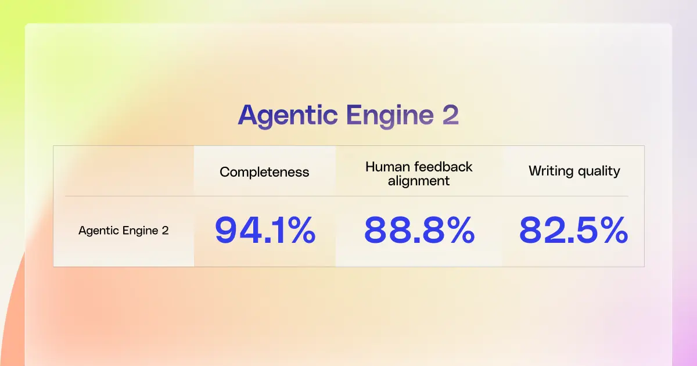
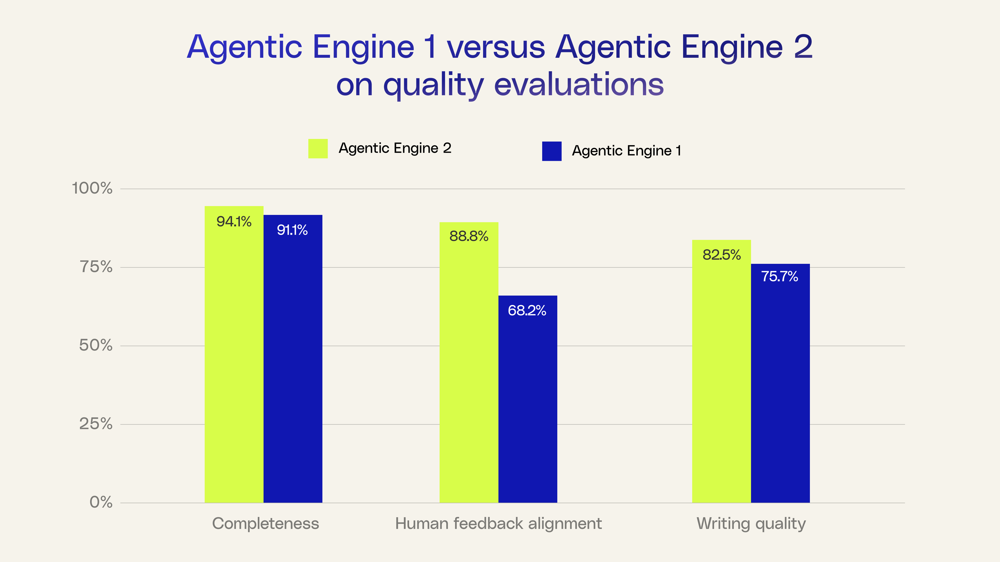
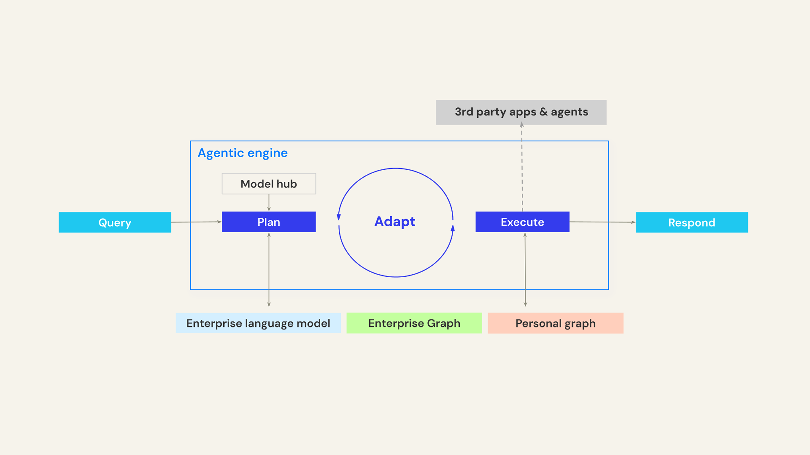
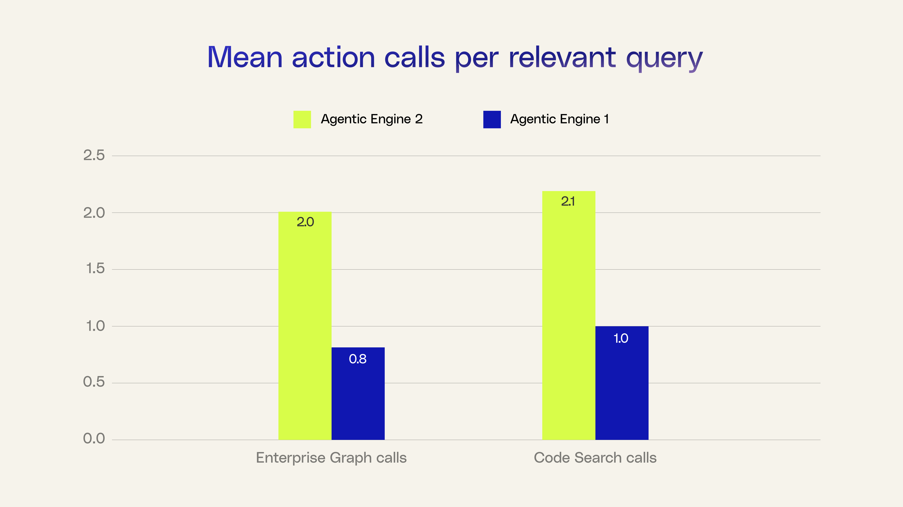
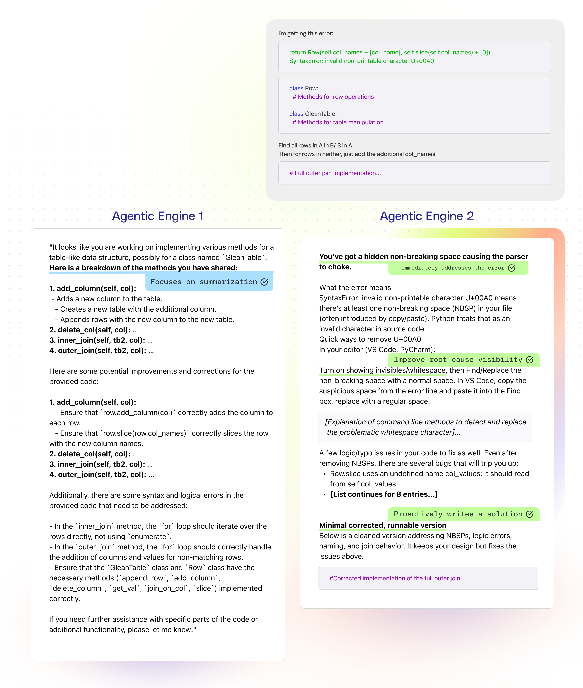
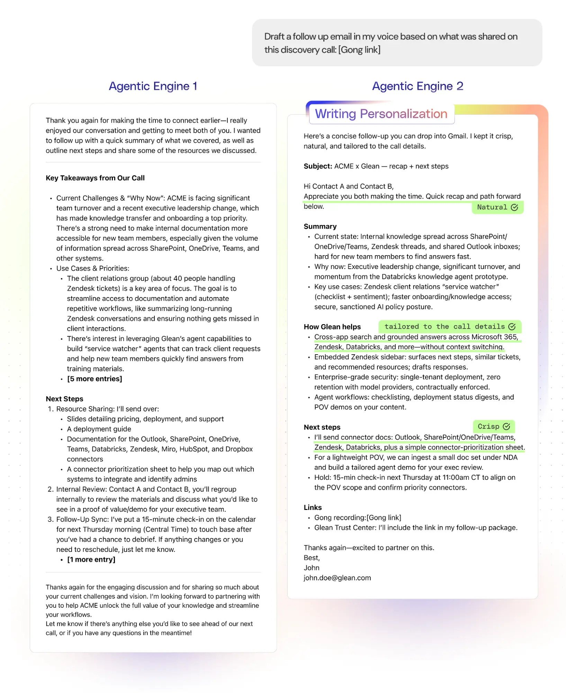
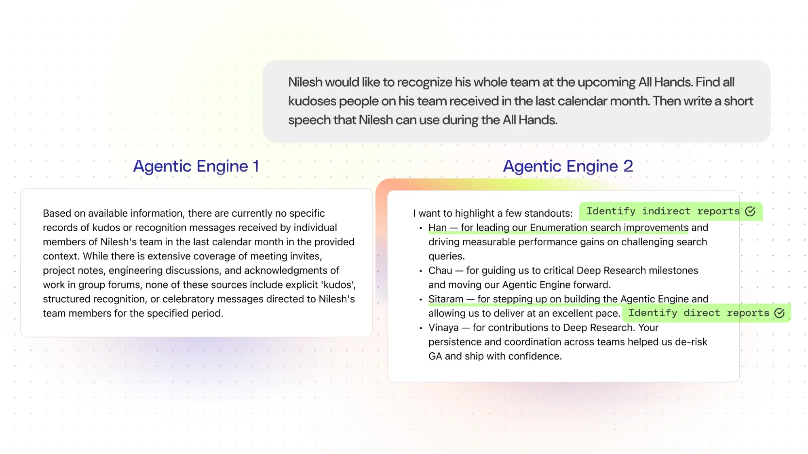
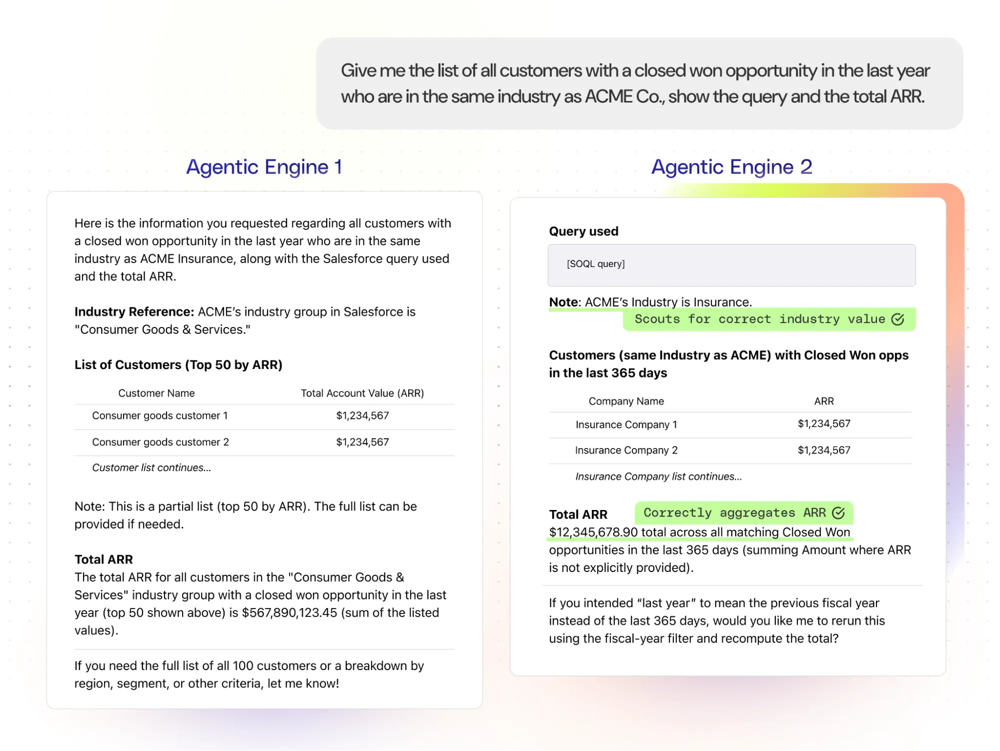

## Key Takeaways / 核心洞察

> 阅读笔记（凡哥）：以下 1 点为归档时补充的解读与引申，非原文内容；原文全文与逐段中英对照见下文。

### 1. Inside Agentic Engine 2 / 深入 Agentic Engine 2 的内部机制

**原文明确写出**：你给的这一点几乎是文章结论段的直译 —— `This blog has looked under the hood of the Agentic Engine 2—adaptive planning, execution across purpose‑built enterprise tools, and long‑term memory grounded in the Enterprise Graph— and we've shown how that machinery directly benefits the debugging, writing, and enumeration tasks people run every day.`

文章确实按「三条机制 × 三类任务」的矩阵展开：**自适应规划**（每次提问都做意图解读、计划提案与 Enterprise Graph 上下文锚定，且可在执行中改道，区别于 v1 的单步规划）、**跨专用企业工具的执行**（`explore → narrow → retrieve` 流程，工具暴露显式 operator、可低延迟链式组合，第三方智能体也被当作可调用工具）、**长期记忆**（反思「什么有效、为什么」并沉淀；Enterprise Graph 相比此前纳入 3 倍信号，且端到端嵌进引擎）。三类任务各有可核对的收益证据：调试用 goal-first planning 取代 v1 的「描述偏好」并直接改代码；写作在开源 WritingBench 上从 75.7% 提升到 82.5%；枚举质量相对 Agentic Engine 1 提升 19.4%，并用 Sales Cloud 的 SOQL 查询、Enterprise Graph 层级展开与子智能体分工来做到穷尽。整体指标是 94% 端到端任务完成度、对曾被点踩的最难问题多覆盖约 20%、测试期 Assistant 查询量增长 21%。

**事实校准（关于「基于 Enterprise Graph 的长期记忆」）**：原文措辞是 `long‑term memory grounded in the Enterprise Graph`，但同一节明确写了 `Durable learnings are written to the Personal Graph as private user preferences and to the Enterprise Graph as organization‑wide patterns` —— 长期记忆**同时落在两张图上**：Personal Graph 存私人偏好与写作风格，Enterprise Graph 存组织级模式（例如「canonical roadmap docs 常在 Confluence」）。Enterprise Graph 是记忆 grounding 的底座与组织级信号来源，不是唯一存储位置。此外三个任务小节还反复用到 short-term memory：调试时维护假设、diff 与测试结果的内部记录，枚举时携带中间结果集供分组聚合。把「长期记忆」完全等同于 Enterprise Graph，会漏掉 Personal Graph 这一半，也会漏掉短期记忆这一层。

**笔记作者推断**：文章把「机制 → 任务收益」作为自己的论证结构，但没有拆分三条机制各自对 94% 完成度的贡献度；因此「哪条机制最关键的」无法从本文得出，只能确认三者被并列论证。

> 作者: Megha Jhunjhunwala、John Pentakalos、Han Li、Yash Shah、Ayushi Mrigen、Eddie Zhou、Seema Jethani、Matthew Ding | 页面日期: Sep 25, 2025（Last updated） | 阅读时长: 7 分钟

> 原文链接: https://www.glean.com/blog/live-fall-25-agentic-engine2-performance

Glean is excited to introduce the Agentic Engine 2—an adaptive engine that plans, reasons, and leverages full enterprise context to tackle complex work. It represents the next step in our agentic architecture, evolving from simple retrieval-augmented generation, to multi-step planning, and now to adaptive planning orchestrated across enterprise tools.

Glean 很高兴推出 Agentic Engine 2 —— 一个会规划、会推理、并能调动完整企业上下文来处理复杂工作的自适应引擎。它代表我们智能体架构的下一步演进：从简单的检索增强生成，到多步规划，再到如今跨企业工具编排的自适应规划。

With a significantly stronger orchestrator, the new engine continuously plans and re-plans to assemble the right context—whether that means understanding your calendar, insights from warehouses and databases, what’s been written in the code base, and more.

借助显著增强的编排器，新引擎会持续规划、重新规划，以拼装出正确的上下文 —— 无论是理解你的日程、来自数仓与数据库的洞察、代码库里写过的内容，还是其他来源。

It also leans heavily on the Enterprise Graph—a live, permission‑aware map of people, teams, processes, and activity—enabling the Assistant to formulate responses from a deeper organizational model. The Enterprise Graph now incorporates 3x more signals and it’s embedded end-to-end in the engine.

它也高度依赖 Enterprise Graph —— 一张覆盖人员、团队、流程与活动的实时、权限感知地图 —— 让 Assistant 能从更深的组织模型出发组织回答。Enterprise Graph 如今纳入了 3 倍于此前的信号，并端到端嵌入引擎。

The result is an agentic Assistant that takes on harder tasks like debugging complex software issues, conducting exhaustive deep dives, and writing personalized content, going far beyond basic information-seeking tasks.

结果是一个能承担更难任务的智能体 Assistant：调试复杂软件问题、做穷尽式的深度调研、撰写个性化内容，远远超出基础的信息查找类任务。

In this blog, we show Agentic Engine 2 reaching 94% completeness—proof it can drive work end‑to‑end—while expanding into difficult, complex tasks it couldn’t handle before.

在本文中，我们将展示 Agentic Engine 2 达到 94% 的任务完成度 —— 证明它能端到端把工作做完 —— 同时拓展到过去无法处理的困难、复杂任务。

## The Agentic Engine 2 unlocks previously unattainable tasks and boosts Assistant usage by 21% / Agentic Engine 2 解锁此前无法完成的任务，Assistant 使用量提升 21%

Our new architecture achieved completeness scores of 94%, meaning that the engine accomplishes the full task you asked for, end-to-end. So, if your goal was to file a Jira ticket, completeness means the ticket actually got filed.

新架构取得了 94% 的完成度得分，含义是引擎把你要求的整件事从头到尾做完。所以，如果你的目标是提交一张 Jira 工单，「完成」意味着工单真的被提交了。

What excited us most was seeing the largest improvement in addressing direct end-user feedback. For example, when judged using human feedback from previously downvoted queries, Agentic Engine 2 was able to tackle 20% more of the most challenging query types that users ask Assistant, representing a class of tasks that had previously been unreachable. This performance difference translated directly into increased usage- with a jump of 21% more queries run in Assistant during testing.

最让我们兴奋的，是在回应终端用户直接反馈上看到了最大幅度的改善。例如，用此前被点踩查询的人类反馈来评判时，Agentic Engine 2 能多处理 20% 的用户向 Assistant 提出的最具挑战性的查询类型，这代表了一类过去根本够不着的任务。这一性能差异也直接转化为使用量增长 —— 测试期间在 Assistant 中运行的查询增加了 21%。

## Agents that build plans and execute by learning from your organization / 会制定计划、并从组织中学习来执行任务的智能体

Agentic Engine 2 combines adaptive planning and reasoning with full enterprise context to tackle complex work.

Agentic Engine 2 把自适应规划与推理、以及完整的企业上下文结合起来，以处理复杂工作。

**Adaptive planning:** Every Assistant prompt triggers intent interpretation, plan proposal, and context grounding in the Enterprise Graph—the live representation of your teams, projects, and processes. In contrast to v1’s single planning step, Agentic Engine 2 can adapt and change course as the system learns.

**自适应规划：** 每一次 Assistant 提问都会触发意图解读、计划提案，以及在 Enterprise Graph（团队、项目与流程的实时表示）中的上下文锚定。与 v1 的单步规划不同，Agentic Engine 2 能随着系统获得新信息而调整、改变路线。

**Execution with enterprise tools:** Execution is designed to follow an explore → narrow → retrieve flow, and to support exploration we see that more tools get called on average than v1. Tools expose explicit operators so the agent can compose precise calls and they're also re-designed to be easily chained together for low latency. The engine treats third‑party agents as callable tools as well, enabling multi‑agent systems in one abstraction.

**跨企业工具的执行：** 执行被设计成 `explore → narrow → retrieve`（探索 → 收窄 → 检索）的流程；为支撑探索，平均调用的工具数比 v1 更多。工具暴露出显式的 operator，让智能体能组合出精确调用，并且被重新设计成易于链式串联以获得低延迟。引擎也把第三方智能体当作可调用工具，从而在同一层抽象里实现多智能体系统。

**Memory:** Responses are joined with a reflection on what worked and why—stored in long-term memory. Durable learnings are written to the Personal Graph as private user preferences and to the Enterprise Graph as organization‑wide patterns. Agentic Engine 2 learns more patterns—for example, that canonical roadmap docs often live in Confluence—help the engine search the right corpus first and conserve budget. In parallel, popular agents (the ones teams save and reuse) provide a live pulse on how the organization operates. Together, these memories encode optimal plans for each organization and surface common failure modes.

**记忆：** 回答会连同「什么有效、为什么」的反思一起写入长期记忆。可长期保留的经验分别写入 Personal Graph（作为用户的私人偏好）和 Enterprise Graph（作为组织级模式）。Agentic Engine 2 学到更多模式 —— 例如「权威的路线图文档常放在 Confluence」—— 帮助引擎优先检索正确的语料、节省预算。与此同时，热门智能体（团队保存并反复使用的那些）提供了组织如何运转的实时脉搏。这些记忆共同为每个组织编码出最优计划，并暴露常见的失败模式。

To illustrate the performance difference in Agentic Engine 2, we’re highlighting three classes of tasks—debugging, writing, and enumeration—that showcase both adaptive planning and enterprise context at work.

为说明 Agentic Engine 2 的性能差异，我们重点展示三类任务 —— 调试、写作与枚举 —— 它们同时体现了自适应规划与企业上下文在真实工作中的作用。

## Agentic Engine 2 at work on debugging, writing, and enumeration tasks / Agentic Engine 2 在调试、写作与枚举任务中的表现

### Debugging performance / 调试表现

Debugging is one task type where Agentic Engine 2 has improved performance. When asked to debug an interview candidate’s code, our previous architecture focuses on summarizing the details, producing an explanation of the class methods instead of solving the issue. On the other hand, Agentic Engine 2 is able to identify and address the user request, fixing the bug, and correcting the implementation.

调试是 Agentic Engine 2 性能有所提升的一类任务。当被要求调试一位面试候选人的代码时，我们此前的架构专注于总结细节，给出类方法的说明，而不是解决问题。相反，Agentic Engine 2 能识别并回应用户的真实请求，修掉 bug、纠正实现。

**Adaptive planning:** The v1 engine’s description bias nudged it toward summarizing code because that was the safest response. In Agentic Engine 2, we replaced that behavior with goal-first planning. In this example, Glean reflects on the user’s request, takes cycles to read code, and infers that the user wants to implement a full outer join, producing a stepwise plan with a clear goal. The Assistant assesses its progress at each step and, if evidence contradicts the hypothesis or debugging points elsewhere, it alters course.

**自适应规划：** v1 引擎的「描述偏好」把它推向总结代码，因为那是最安全的回答。在 Agentic Engine 2 中，我们用目标优先的规划取代了这一行为。这个例子里，Glean 会反思用户请求、分轮阅读代码，推断出用户想实现 full outer join（全外连接），进而生成目标清晰的分步计划。Assistant 在每一步评估进展；一旦证据与假设矛盾、或调试线索指向别处，它就改变路线。

**Execution with enterprise tools:** Many debugging queries revolve around understanding and finding code, Glean’s code search tool indexes language-aware artifacts—classes, methods, functions, constants, and types—along with their locations and/or signatures. Instead of scanning entire files, it goes directly to the right artifact, disambiguates overloaded or similarly named modules, and surfaces definitions and references across the codebase.

**跨企业工具的执行：** 许多调试查询都围绕理解与定位代码，Glean 的代码搜索工具索引的是语言感知的构件 —— 类、方法、函数、常量与类型 —— 以及它们的位置和／或签名。它不扫描整个文件，而是直接定位到正确的构件，区分重载或命名相近的模块，并给出整个代码库中的定义与引用。

**Memory:** Agentic Engine 2 achieves reliability with short-term memory, keeping a structured internal record as it debugs. The agent continuously updates the record with hypotheses, diffs, and test outcomes versus previous iterations that summarize progress each step and guide it towards its main goal.

**记忆：** Agentic Engine 2 靠短期记忆获得可靠性：调试时维护一份结构化的内部记录，持续用假设、diff 和测试结果更新它；相较之下，此前的迭代是每一步总结一次进展，再据此引导它朝主目标前进。

### Writing performance / 写作表现

Writing is another function where Agentic Engine 2 excels, improving upon the open source [WritingBench evaluation](https://github.com/X-PLUG/WritingBench/tree/main) from 75.7% to 82.5%, a benchmark that measures writing performance across six general-purpose domains — sales, finance, engineering, marketing, creative/literary, and policy — each with 100+ sample queries. These performance gains show that Agentic Engine 2 is better able to follow detailed writing instructions and generate more information-rich responses that stick to the style, format, and length of the content.

写作是 Agentic Engine 2 表现出色的另一项能力：在开源 [WritingBench 评测](https://github.com/X-PLUG/WritingBench/tree/main) 上从 75.7% 提升到 82.5%。该基准覆盖销售、金融、工程、市场、创意／文学与政策六个通用领域，每个领域有 100 多个样本查询，用于衡量写作表现。这些提升说明 Agentic Engine 2 更能遵循细致的写作指令，生成信息量更丰富、且贴合内容风格、格式与长度的回复。

In addition to improving writing performance overall, Agentic Engine 2 adds writing personalization. In this sales email example, it mirrors the account executive’s style—crisp, tailored, and anchored to call details—producing a denser, more specific follow‑up in concise bullets.

除了整体写作能力提升，Agentic Engine 2 还加入了写作个性化。在这个销售邮件例子里，它复刻了客户主管的风格 —— 利落、量身定制、紧扣通话细节 —— 用简洁的要点产出更密集、更具体的跟进邮件。

**Adaptive planning:** Agentic Engine 2 understands writing intent, inferring that a “follow-up email” for a sales call entails understanding the customer conversation, as well as tailoring style and formatting for the sales reps customer-facing writing style. The planning step pulls details of all these requirements from your Personal Graph (voice, formatting, and workstyle preferences), so outlining and drafting start in your voice—not a generic one.

**自适应规划：** Agentic Engine 2 理解写作意图，能推断出一次销售通话的「跟进邮件」意味着要理解客户对话，还要按销售面向客户的写作风格调整语气与格式。规划步骤从你的 Personal Graph（语气、格式与工作风格偏好）中取出这些要求的细节，让列提纲与起草从你的口吻开始，而不是通用口吻。

**Execution with enterprise tools:** Agentic Engine 2 handles multiple dimensions of a message—audience, purpose, medium, tone, structure, evidence, constraints, and style. Execution emphasizes exploration and synthesis: generating and revising outlines, deciding section order, and negotiating trade‑offs (brevity vs. completeness). In this example, Agentic Engine 2 integrates recent, relevant examples of the sales reps past customer call follow up emails to better capture their style and their preferred formatting.

**跨企业工具的执行：** Agentic Engine 2 处理一条信息的多个维度 —— 受众、目的、媒介、语气、结构、证据、约束与风格。执行强调探索与综合：生成并修订提纲、决定章节顺序、权衡取舍（简洁 vs 完整）。这个例子里，Agentic Engine 2 会整合该销售近期相关的客户通话跟进邮件样例，以更好地捕捉其风格与偏好的格式。

**Memory:** What makes writing unique is that memory goes beyond the chat session, it takes into account what you actually wrote at work in different apps. As a result, it's less slanted to one, generic style and brings in more of the diversity of your written work. It also juggles both explicit preferences you often include in prompts with implicit preferences inferred from your own written work. How you write becomes part of your canonical style that Glean stores in the Personal Graph to help you communicate effectively.

**记忆：** 写作的独特之处在于，记忆不止于当前会话，还会考虑你在不同应用里实际写过的东西。因此它不会偏向某一种通用风格，而是带入你书面作品里更多的多样性。它同时兼顾两类偏好：你常在提示词里明说的要求，以及从你自己文字里推断出的隐含偏好。你的写作方式会成为规范风格的一部分，由 Glean 存进 Personal Graph，帮助你更有效地沟通。

### Enumeration and data analysis performance / 枚举与数据分析表现

Enumeration and analysis queries — where a user requests comprehensive data and insights — are a third query class that benefit from Agentic Engine 2. Enumeration is traditionally challenging for LLMs because of the emphasis on next‑token prediction during training, rather than on full coverage and deduplication.

枚举与分析类查询 —— 用户要求给出全面数据与洞察 —— 是受益于 Agentic Engine 2 的第三类查询。枚举对大语言模型历来很难，因为训练强调的是下一个 token 的预测，而不是完整覆盖与去重。

Agentic Engine 2 leads to a **19.4%** performance gain in enumeration quality compared to Agentic Engine 1. In this example from Glean, one user requests all kudos given to every member of Nilesh’s engineering team, and another user wants to know how much of our revenue comes from companies like ACME Co, one of our customers in the insurance sector.

相较 Agentic Engine 1，Agentic Engine 2 在枚举质量上带来 **19.4%** 的性能提升。在 Glean 的这个例子里，一位用户要列出 Nilesh 工程团队每位成员收到的全部表扬（kudos），另一位用户则想知道我们的收入中有多少来自像 ACME Co 这样保险行业的客户。

**Adaptive planning:** Glean’s adaptive planning approach interprets user instructions such as “list all customers” or “list all kudos messages” by constructing a plan to identify authoritative sources, set the inclusion criteria (time windows like “last year”, attributes like “Nilesh reports”, etc.), and stop conditions (ie: discovery rate plateau, source exhaustion, etc.). Given the action space in enumeration is large and the goal is exhaustion, scouting is key to efficiency. Agentic Engine 2 creates a survey of where the data likely resides and issues preliminary searches to validate the key assumptions underlying the search strategy (such as correctly verifying ACME’s industry) to inform how and where to dig deep.

**自适应规划：** Glean 的自适应规划在理解「列出所有客户」「列出所有表扬消息」这类指令时，会构造一份计划：确定权威数据源、设定纳入标准（如「去年」这样的时间窗、「Nilesh 的下属」这样的属性），以及停止条件（例如发现速率进入平台期、数据源穷尽）。枚举的动作空间很大而目标是穷尽，因此「先侦察」是效率的关键。Agentic Engine 2 会先摸清数据可能分布在哪里，发出试探性搜索来验证检索策略背后的关键假设（例如正确核实 ACME 所属行业），再决定往哪里深挖、怎么深挖。

**Execution with enterprise tools:** For the ACME closed won opportunities, Glean identifies that the most authoritative data resides in Sales Cloud and generates a SOQL query to retrieve the full customer list. In contrast, for a request like listing all kudos messages, Glean recognizes that relevant information must be found by looking at Nilesh’s reports in the Enterprise Graph.

**跨企业工具的执行：** 针对 ACME 这类已赢单商机，Glean 判断最权威的数据在 Sales Cloud，于是生成 SOQL 查询取回完整客户名单。相反，面对「列出所有表扬消息」这样的请求，Glean 意识到相关信息必须先在 Enterprise Graph 中找到 Nilesh 的下属才能定位。

Because Nilesh manages managers, Glean uses the Enterprise Graph to find the direct reports of all his direct reports, flatten the hierarchy, then perform a complete retrieval of each member’s Slack mentions. Once Agentic Engine 2 realizes it must traverse the Enterprise Graph to resolve higher order relationships, it delegates the comprehensive search of each of Nilesh’s direct reports to sub-agents. Sub-agents independently conduct targeted searches for member-specific kudos messages, which the main agent reconciles into a complete list of results.

由于 Nilesh 管的是管理者，Glean 用 Enterprise Graph 找出他所有直接下属的直接下属，把层级摊平，再对每位成员的 Slack 提及做完整检索。一旦 Agentic Engine 2 意识到必须遍历 Enterprise Graph 才能解出更高阶的关系，它就把对 Nilesh 每位下属的全面检索分派给子智能体。子智能体各自独立做定向搜索，查找针对特定成员的表扬消息，主智能体再把结果归并成一份完整清单。

**Memory:** Short-term memory carries forward intermediate result sets for downstream analysis, such as grouping and aggregation operations. Short-term memory management yields more stable, iterative refinements that result in reliable outputs. At the same time, learnings from enumeration queries— authoritative sources and optimal execution routes— become stored in long-term memory, increasing the efficiency of the Agentic Engine 2.

**记忆：** 短期记忆把中间结果集带给下游分析，用于分组与聚合等操作；对短期记忆的管理带来更稳定、可迭代的精化，从而产出可靠结果。与此同时，枚举查询中学到的东西 —— 哪些是权威数据源、哪条是最佳执行路径 —— 会沉淀进长期记忆，持续提升 Agentic Engine 2 的效率。

### What can you do with Agentic Engine 2? / 你能用 Agentic Engine 2 做什么？

The Agentic Engine 2 reaches 94% completeness on end‑to‑end tasks—while taking on a class of hard queries that were previously out of reach, tackling roughly 20% more of the toughest downvoted questions based on human feedback. The impact is visible in usage, with a 21% increase as more people adopt the Assistant as a companion for personalized, agentic work.

Agentic Engine 2 在端到端任务上达到 94% 的完成度，同时接手了一类过去够不着的困难查询 —— 按人类反馈计算，最难、曾被点踩的问题多解决了约 20%。影响也体现在使用量上：随着越来越多的人把 Assistant 当作个性化智能体工作伙伴，查询量增长了 21%。

This blog has looked under the hood of the Agentic Engine 2—adaptive planning, execution across purpose‑built enterprise tools, and long‑term memory grounded in the Enterprise Graph— and we’ve shown how that machinery directly benefits the debugging, writing, and enumeration tasks people run every day. What this means for you is that AI can:

本文拆解了 Agentic Engine 2 的内部机制 —— 自适应规划、跨专用企业工具的执行，以及以 Enterprise Graph 为底座的长期记忆 —— 并展示了这套机制如何直接惠及人们每天要做的调试、写作与枚举任务。对你来说，这意味着 AI 可以：

- Tackle more complex tasks: With Agentic Engine 2 planning and reasoning across your full enterprise context and via multi-hop tools, it handles complex work like debugging, personalized writing, and enumeration. / 处理更复杂的任务：Agentic Engine 2 在你的完整企业上下文中规划与推理，并通过多跳工具调用，胜任调试、个性化写作、枚举这类复杂工作。
- Reflect your personal preferences: Agentic Engine 2 uses your personal preferences—writing style, communication style, memory, and work style—so it works the way you do, not like a generic chatbot. / 体现你的个人偏好：Agentic Engine 2 使用你的写作风格、沟通风格、记忆与工作风格等偏好，按你的方式工作，而不是像一个通用聊天机器人。
- Solve context engineering: In other systems, you must configure connectors, specify the tool calls, and create and update indexes to assemble context; Glean’s enterprise tools handle the context engineering for you. / 解决上下文工程：在其他系统里，你得自己配置连接器、指定工具调用、创建并更新索引来拼装上下文；Glean 的企业工具替你把上下文工程做完了。
- Execute tasks the way your organization actually works: Instead of one‑size‑fits‑all agents, Glean agents use the Enterprise Graph to represent your actual teams, projects, and processes, creating agents that can actually pick up the work. / 按组织真实的运作方式执行任务：Glean 智能体不做「一刀切」，而是用 Enterprise Graph 表示你真实的团队、项目与流程，让智能体能真正接手工作。

You can learn more about the Agentic Engine 2 along with everything we announced at Glean:LIVE Fall'25 here. If you’re not a Glean user and want to see the third-generation Assistant at work, sign up for a free [demo](https://www.glean.com/get-a-demo) today.

你可以在这里进一步了解 Agentic Engine 2，以及我们在 Glean:LIVE Fall'25 上发布的所有内容。如果你还不是 Glean 用户，想看看第三代 Assistant 的实际表现，今天就注册一个免费 [演示](https://www.glean.com/get-a-demo)。

**Authors:** [Megha Jhunjhunwala](https://www.linkedin.com/in/megha-jhunjhunwala/), [John Pentakalos](https://www.linkedin.com/in/johnpentakalos/), [Han Li](https://www.linkedin.com/in/iamhanli/), [Yash Shah](https://www.linkedin.com/in/ys1998/), [Ayushi Mrigen](https://www.linkedin.com/in/ayushimrigen/), [Eddie Zhou](https://www.linkedin.com/in/eddie-zhou-70364b54/), [Seema Jethani](https://www.linkedin.com/in/seemajethani/), [Matthew Ding](https://www.linkedin.com/in/mattding/)

作者（共 8 人）：Megha Jhunjhunwala、John Pentakalos、Han Li、Yash Shah、Ayushi Mrigen、Eddie Zhou、Seema Jethani、Matthew Ding
