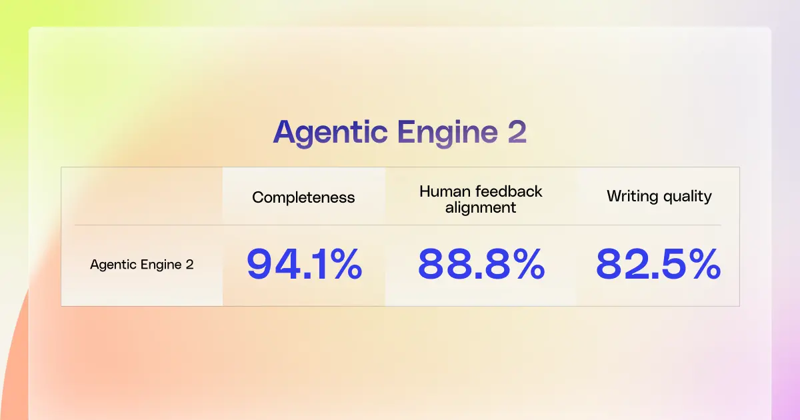
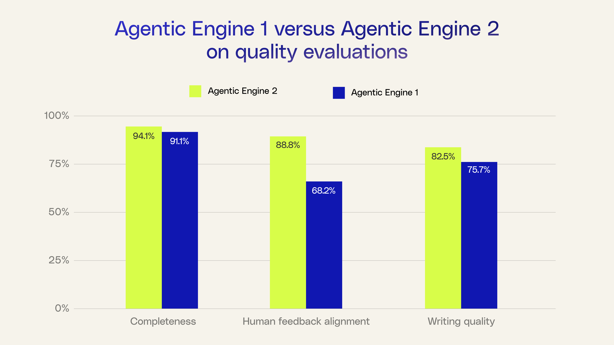
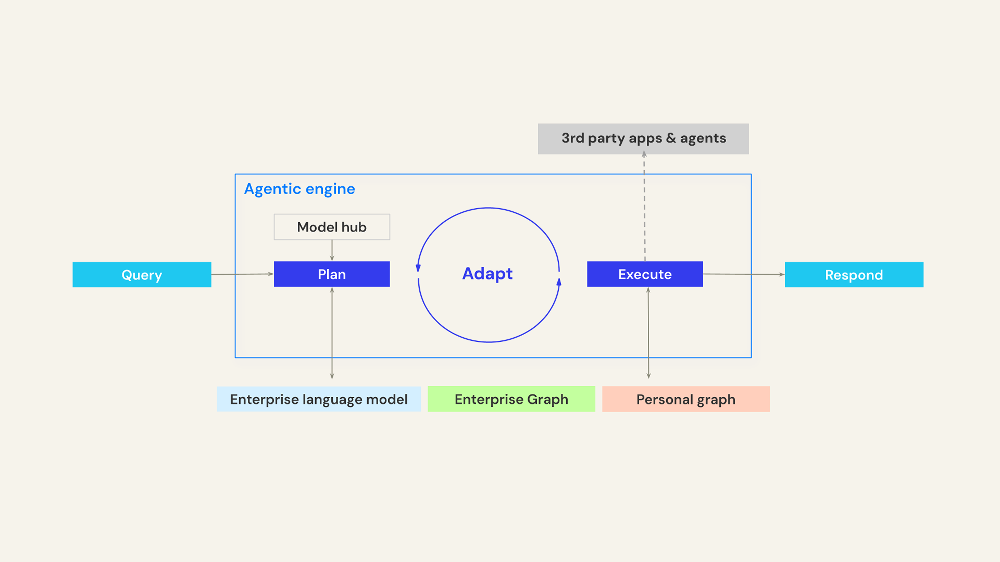
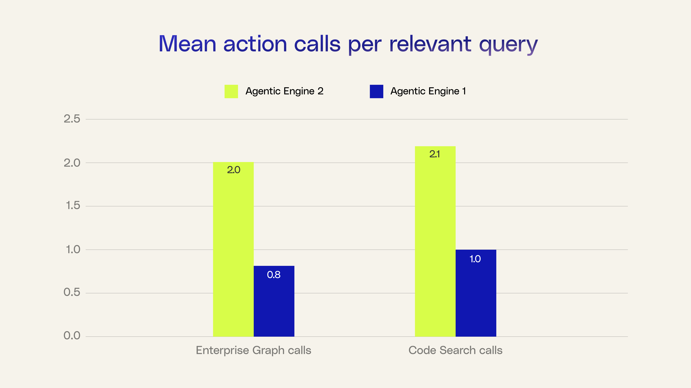
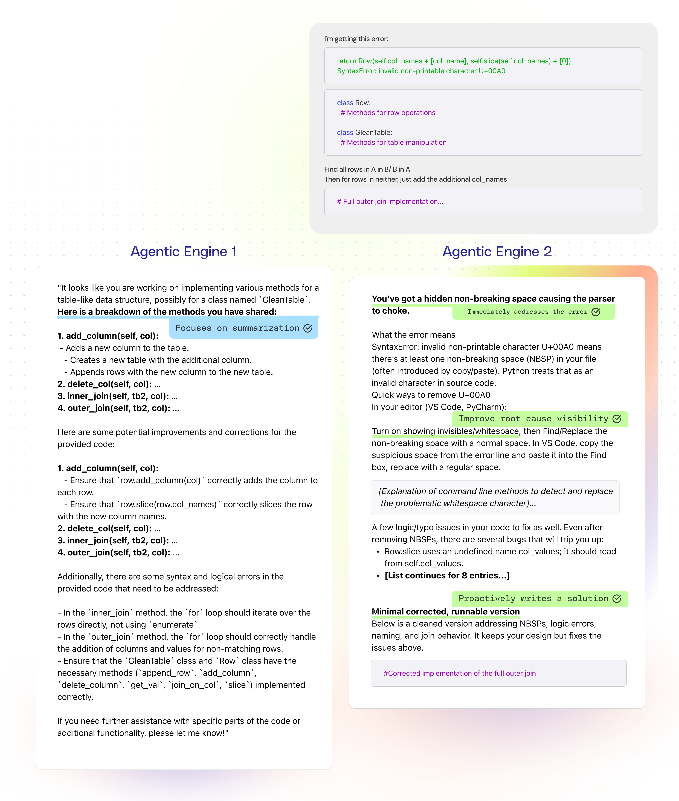
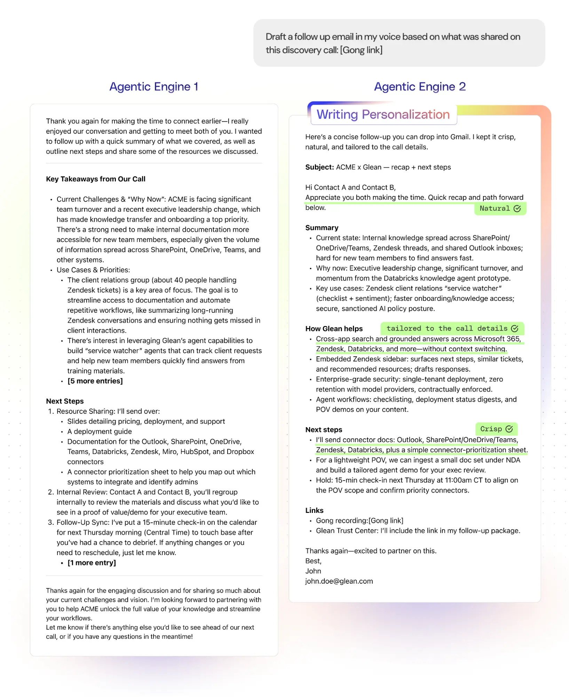
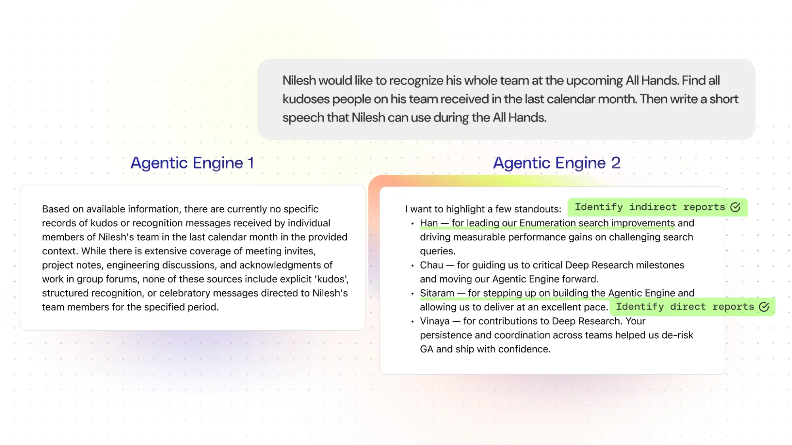
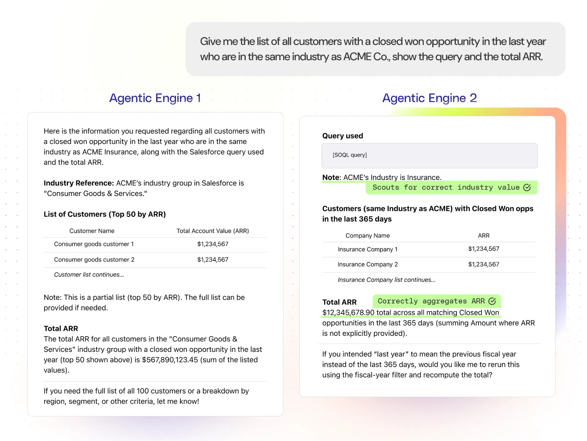

# Glean’s Agentic Engine 2 achieves 94% completeness, excelling at challenging enterprise debugging, writing, and enumeration tasks

Glean is excited to introduce the Agentic Engine 2—an adaptive engine that plans, reasons, and leverages full enterprise context to tackle complex work. It represents the next step in our agentic architecture, evolving from simple retrieval-augmented generation, to multi-step planning, and now to adaptive planning orchestrated across enterprise tools.

With a significantly stronger orchestrator, the new engine continuously plans and re-plans to assemble the right context—whether that means understanding your calendar, insights from warehouses and databases, what’s been written in the code base, and more.

It also leans heavily on the Enterprise Graph—a live, permission‑aware map of people, teams, processes, and activity—enabling the Assistant to formulate responses from a deeper organizational model. The Enterprise Graph now incorporates 3x more signals and it’s embedded end-to-end in the engine.

The result is an agentic Assistant that takes on harder tasks like debugging complex software issues, conducting exhaustive deep dives, and writing personalized content, going far beyond basic information-seeking tasks.

In this blog, we show Agentic Engine 2 reaching 94% completeness—proof it can drive work end‑to‑end—while expanding into difficult, complex tasks it couldn’t handle before.

## The Agentic Engine 2 unlocks previously unattainable tasks and boosts Assistant usage by 21%

Our new architecture achieved completeness scores of 94%, meaning that the engine accomplishes the full task you asked for, end-to-end. So, if your goal was to file a Jira ticket, completeness means the ticket actually got filed.

What excited us most was seeing the largest improvement in addressing direct end-user feedback. For example, when judged using human feedback from previously downvoted queries, Agentic Engine 2 was able to tackle 20% more of the most challenging query types that users ask Assistant, representing a class of tasks that had previously been unreachable. This performance difference translated directly into increased usage- with a jump of 21% more queries run in Assistant during testing.

## Agents that build plans and execute by learning from your organization

Agentic Engine 2 combines adaptive planning and reasoning with full enterprise context to tackle complex work.

**Adaptive planning:** Every Assistant prompt triggers intent interpretation, plan proposal, and context grounding in the Enterprise Graph—the live representation of your teams, projects, and processes. In contrast to v1’s single planning step, Agentic Engine 2 can adapt and change course as the system learns.

**Execution with enterprise tools:** Execution is designed to follow an explore → narrow → retrieve flow, and to support exploration we see that more tools get called on average than v1. Tools expose explicit operators so the agent can compose precise calls and they're also re-designed to be easily chained together for low latency. The engine treats third‑party agents as callable tools as well, enabling multi‑agent systems in one abstraction.

**Memory:** Responses are joined with a reflection on what worked and why—stored in long-term memory. Durable learnings are written to the Personal Graph as private user preferences and to the Enterprise Graph as organization‑wide patterns. Agentic Engine 2 learns more patterns—for example, that canonical roadmap docs often live in Confluence—help the engine search the right corpus first and conserve budget. In parallel, popular agents (the ones teams save and reuse) provide a live pulse on how the organization operates. Together, these memories encode optimal plans for each organization and surface common failure modes.

To illustrate the performance difference in Agentic Engine 2, we’re highlighting three classes of tasks—debugging, writing, and enumeration—that showcase both adaptive planning and enterprise context at work.

## Agentic Engine 2 at work on debugging, writing, and enumeration tasks

### Debugging performance

Debugging is one task type where Agentic Engine 2 has improved performance. When asked to debug an interview candidate’s code, our previous architecture focuses on summarizing the details, producing an explanation of the class methods instead of solving the issue. On the other hand, Agentic Engine 2 is able to identify and address the user request, fixing the bug, and correcting the implementation.

**Adaptive planning:** The v1 engine’s description bias nudged it toward summarizing code because that was the safest response. In Agentic Engine 2, we replaced that behavior with goal-first planning. In this example, Glean reflects on the user’s request, takes cycles to read code, and infers that the user wants to implement a full outer join, producing a stepwise plan with a clear goal. The Assistant assesses its progress at each step and, if evidence contradicts the hypothesis or debugging points elsewhere, it alters course.

**Execution with enterprise tools:** Many debugging queries revolve around understanding and finding code, Glean’s code search tool indexes language-aware artifacts—classes, methods, functions, constants, and types—along with their locations and/or signatures. Instead of scanning entire files, it goes directly to the right artifact, disambiguates overloaded or similarly named modules, and surfaces definitions and references across the codebase.

**Memory:** Agentic Engine 2 achieves reliability with short-term memory, keeping a structured internal record as it debugs. The agent continuously updates the record with hypotheses, diffs, and test outcomes versus previous iterations that summarize progress each step and guide it towards its main goal.

### Writing performance

Writing is another function where Agentic Engine 2 excels, improving upon the open source [WritingBench evaluation](https://github.com/X-PLUG/WritingBench/tree/main) from 75.7% to 82.5%, a benchmark that measures writing performance across six general-purpose domains — sales, finance, engineering, marketing, creative/literary, and policy — each with 100+ sample queries. These performance gains show that Agentic Engine 2 is better able to follow detailed writing instructions and generate more information-rich responses that stick to the style, format, and length of the content.

In addition to improving writing performance overall, Agentic Engine 2 adds writing personalization. In this sales email example, it mirrors the account executive’s style—crisp, tailored, and anchored to call details—producing a denser, more specific follow‑up in concise bullets.

**Adaptive planning:** Agentic Engine 2 understands writing intent, inferring that a “follow-up email” for a sales call entails understanding the customer conversation, as well as tailoring style and formatting for the sales reps customer-facing writing style. The planning step pulls details of all these requirements from your Personal Graph (voice, formatting, and workstyle preferences), so outlining and drafting start in your voice—not a generic one.

**Execution with enterprise tools:** Agentic Engine 2 handles multiple dimensions of a message—audience, purpose, medium, tone, structure, evidence, constraints, and style. Execution emphasizes exploration and synthesis: generating and revising outlines, deciding section order, and negotiating trade‑offs (brevity vs. completeness). In this example, Agentic Engine 2 integrates recent, relevant examples of the sales reps past customer call follow up emails to better capture their style and their preferred formatting.

**Memory:** What makes writing unique is that memory goes beyond the chat session, it takes into account what you actually wrote at work in different apps. As a result, it's less slanted to one, generic style and brings in more of the diversity of your written work. It also juggles both explicit preferences you often include in prompts with implicit preferences inferred from your own written work. How you write becomes part of your canonical style that Glean stores in the Personal Graph to help you communicate effectively.

### Enumeration and data analysis performance

Enumeration and analysis queries — where a user requests comprehensive data and insights — are a third query class that benefit from Agentic Engine 2. Enumeration is traditionally challenging for LLMs because of the emphasis on next‑token prediction during training, rather than on full coverage and deduplication.

Agentic Engine 2 leads to a **19.4%** performance gain in enumeration quality compared to Agentic Engine 1. In this example from Glean, one user requests all kudos given to every member of Nilesh’s engineering team, and another user wants to know how much of our revenue comes from companies like ACME Co, one of our customers in the insurance sector.

**Adaptive planning:** Glean’s adaptive planning approach interprets user instructions such as “list all customers” or “list all kudos messages” by constructing a plan to identify authoritative sources, set the inclusion criteria (time windows like “last year”, attributes like “Nilesh reports”, etc.), and stop conditions (ie: discovery rate plateau, source exhaustion, etc.). Given the action space in enumeration is large and the goal is exhaustion, scouting is key to efficiency. Agentic Engine 2 creates a survey of where the data likely resides and issues preliminary searches to validate the key assumptions underlying the search strategy (such as correctly verifying ACME’s industry) to inform how and where to dig deep.

**Execution with enterprise tools:** For the ACME closed won opportunities, Glean identifies that the most authoritative data resides in Sales Cloud and generates a SOQL query to retrieve the full customer list. In contrast, for a request like listing all kudos messages, Glean recognizes that relevant information must be found by looking at Nilesh’s reports in the Enterprise Graph.

Because Nilesh manages managers, Glean uses the Enterprise Graph to find the direct reports of all his direct reports, flatten the hierarchy, then perform a complete retrieval of each member’s Slack mentions. Once Agentic Engine 2 realizes it must traverse the Enterprise Graph to resolve higher order relationships, it delegates the comprehensive search of each of Nilesh’s direct reports to sub-agents. Sub-agents independently conduct targeted searches for member-specific kudos messages, which the main agent reconciles into a complete list of results.

**Memory:** Short-term memory carries forward intermediate result sets for downstream analysis, such as grouping and aggregation operations. Short-term memory management yields more stable, iterative refinements that result in reliable outputs. At the same time, learnings from enumeration queries— authoritative sources and optimal execution routes— become stored in long-term memory, increasing the efficiency of the Agentic Engine 2.

### What can you do with Agentic Engine 2?

The Agentic Engine 2 reaches 94% completeness on end‑to‑end tasks—while taking on a class of hard queries that were previously out of reach, tackling roughly 20% more of the toughest downvoted questions based on human feedback. The impact is visible in usage, with a 21% increase as more people adopt the Assistant as a companion for personalized, agentic work.

This blog has looked under the hood of the Agentic Engine 2—adaptive planning, execution across purpose‑built enterprise tools, and long‑term memory grounded in the Enterprise Graph— and we’ve shown how that machinery directly benefits the debugging, writing, and enumeration tasks people run every day. What this means for you is that AI can:

- Tackle more complex tasks: With Agentic Engine 2 planning and reasoning across your full enterprise context and via multi-hop tools, it handles complex work like debugging, personalized writing, and enumeration.
- Reflect your personal preferences: Agentic Engine 2 uses your personal preferences—writing style, communication style, memory, and work style—so it works the way you do, not like a generic chatbot.
- Solve context engineering: In other systems, you must configure connectors, specify the tool calls, and create and update indexes to assemble context; Glean’s enterprise tools handle the context engineering for you.
- Execute tasks the way your organization actually works: Instead of one‑size‑fits‑all agents, Glean agents use the Enterprise Graph to represent your actual teams, projects, and processes, creating agents that can actually pick up the work.

You can learn more about the Agentic Engine 2 along with everything we announced at Glean:LIVE Fall'25 here. If you’re not a Glean user and want to see the third-generation Assistant at work, sign up for a free [demo](https://www.glean.com/get-a-demo) today.

**Authors:** [Megha Jhunjhunwala](https://www.linkedin.com/in/megha-jhunjhunwala/), [John Pentakalos](https://www.linkedin.com/in/johnpentakalos/), [Han Li](https://www.linkedin.com/in/iamhanli/), [Yash Shah](https://www.linkedin.com/in/ys1998/), [Ayushi Mrigen](https://www.linkedin.com/in/ayushimrigen/), [Eddie Zhou](https://www.linkedin.com/in/eddie-zhou-70364b54/), [Seema Jethani](https://www.linkedin.com/in/seemajethani/), [Matthew Ding](https://www.linkedin.com/in/mattding/)
