Ray Dalio / 瑞·达利欧

Founder of Bridgewater Associates / 桥水基金创始人

January 4, 2022 / 2022年1月4日

> 原文链接: https://www.linkedin.com/pulse/changing-world-order-new-paradigm-ray-dalio/

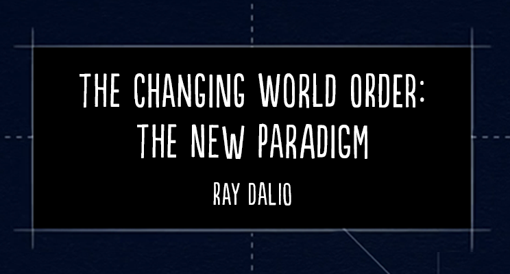

At the risk of boring you by repeating myself, now at this beginning of the new year and with the publication of my book Principles for Dealing with the Changing World Order, I want to concisely convey the most important thoughts I have about the paradigm we are now in, which is a result of how the world order appears to be changing. To be clear, while I express concerns and risks, I believe that we collectively have the power to manage our challenges well if we are smart and considerate with each other. Also, please know that I am not sure that any expectations I have are right. I’m just passing along my thinking for you to take or leave as you like.

冒着因重复自己而让你厌烦的风险，在这新年之初，也在我的书《应对变化中的世界秩序的原则》出版之际，我想简要传达我对我们现在所处范式最重要的想法。这个范式，是世界秩序看来正在如何变化的结果。说清楚：虽然我表达了担忧和风险，我相信只要我们明智、并彼此体谅，我们集体有能力把挑战处理好。另外请知道，我并不能确定我的任何预期是对的。我只是把我的思考传递给你，采纳或放下，随你喜欢。

MY CONCLUSIONS UP-FRONT / 先说我的结论

The world order is changing in important ways that have happened many times before in history, though not in our lifetimes. How the world order is changing has created the paradigm that we are in. By “paradigm,” I mean the environment that we are in. Paradigms typically last about 10 years, with occasional big corrections within them. They are driven by a persistent set of conditions that takes those conditions in a swing from one extreme to an opposite extreme. Because of this, each paradigm is more likely to be opposite than similar to the one before it. For example, the Roaring ’20s were followed by the depressionary 1930s, and the inflationary 1970s were followed by the disinflationary 1980s. The assets and liabilities that you would most like to have, and those that you would most like to avoid, change with the paradigm that exists at the time. For example, in the Roaring ’20s you’d want to own stocks and avoid bonds, while in the depressionary 1930s it would be the opposite; in the inflationary 1970s you’d want to own hard assets like gold and avoid bonds, while in the disinflationary 1980s you’d want to own financial assets and avoid hard assets.

世界秩序正在以历史上多次发生过、但在我们有生之年没有发生过的重要方式发生变化。世界秩序如何变化，造就了我们所处的范式。我说的“范式”，是指我们所处的环境。范式通常持续约10年，其间偶尔有大的修正。它们由一组持续的条件驱动，把这些条件从一端摆到相反的一端。因此，每一个范式更可能与前一个相反，而不是相似。例如，喧嚣的20年代之后是萧条的30年代，通胀的70年代之后是去通胀的80年代。你最想持有的资产和负债，以及你最想避开的那些，会随当时存在的范式而改变。例如，在喧嚣的20年代你想持有股票、避开债券，而在萧条的30年代则相反；在通胀的70年代你想持有黄金这类硬资产、避开债券，而在去通胀的80年代你想持有金融资产、避开硬资产。

For reasons explained in this report, I believe the current paradigm is a classic one that is characterized by the leading empire (the US) 1) spending a lot more money than it is earning and printing and taxing a lot, 2) having large wealth, values, and political gaps that are leading to significant internal conflict, and 3) being in decline relative to an emerging great power (China). The last time we saw this confluence of events was in the 1930-45 period, though the 1970-80 period was also analogous financially. In this piece, I will explain my reasoning and show charts that display these things happening. (For a much more comprehensive description, read Principles for Dealing with the Changing World Order.)

基于本报告所解释的理由，我相信当前范式是一个经典范式，其特征是：主导帝国（美国）1）支出远多于收入，并大量印钞和征税；2）存在巨大的财富、价值观和政治鸿沟，正导向显著的内部冲突；3）相对于一个新兴大国（中国）处于衰落。我们上一次看到这些事件汇合，是在1930–1945年这一时期，尽管1970–1980年在金融上也类似。在这篇文章里，我会解释我的推理，并展示显示这些事情正在发生的图表。（若要全面得多的描述，请读《应对变化中的世界秩序的原则》。）

What should one do in this new paradigm? This paradigm is leading to a big shift in wealth and power. Naturally, as a global macroeconomic investor, the economic and market behaviors in this paradigm are top of mind. I think one should consider minimizing one’s ownership of cash and bonds in dollars, euros, and yen (and/or borrow in these) and putting funds into a highly diversified portfolio of assets, including stocks and inflation-hedge assets, especially in countries with healthy finances and well-educated and civil populations that have internal order. These things are especially important in this paradigm. In brief, I think one’s assets and liabilities should be well-balanced with minimum exposures to dollar, euro, and yen currency and debt assets. During this time, I also think it will pay to be short cash (i.e., borrow cash). Of course there will be corrections during the several years in the paradigm—for example, in central bank tightenings. But I don’t see any sustained period in which the government will likely allow cash returns to be better than the returns of a well-diversified, non-cash portfolio (e.g., All Weather) geared to the level of risk you’re comfortable with because that would cause terrible problems. These circumstances also have big geopolitical implications, which I will touch on here.

在这个新范式里，一个人该做什么？这个范式正导向财富和权力的大转移。作为一个全球宏观投资者，这个范式里的经济和市场行为自然是我最先想到的。我认为应当考虑尽量减少持有美元、欧元和日元的现金与债券（并且／或者以这些货币借款），把资金放入高度分散的资产组合，包括股票和通胀对冲资产，尤其是在财政健康、人口受过良好教育且文明、内部有秩序的国家。在这个范式里，这些事情尤其重要。简言之，我认为一个人的资产和负债应当良好平衡，对美元、欧元和日元货币及债务资产的敞口降到最低。在这段时间，我也认为做空现金（也就是借入现金）会有回报。当然，在这个范式的若干年里会有修正——例如央行收紧。但我看不到任何持续的时期，政府会允许现金回报好于一个充分分散的、非现金组合（例如全天候）在你能接受的风险水平上的回报，因为那会造成可怕的问题。这些情况也有重大的地缘政治含义，我会在这里略加触及。

Now I will show you the reasoning behind my conclusions. Please do not just believe my conclusions because I don’t want you to blindly follow me. I urge you to challenge my reasoning and see how it goes. I hope the picture comes through clearly in the charts and text that follow.

现在我将展示结论背后的推理。请不要仅仅因为是我说的就相信我的结论，我不希望你盲目跟随我。我敦促你质疑我的推理，看看它如何展开。我希望接下来的图表和文字能把这幅图景清楚地呈现出来。

THE FOLLOWING ARE THE THREE BIGGEST ISSUES THAT I WANT TO FOCUS ON / 以下是我想聚焦的三个最大问题

1) Big Debt and Debt Monetizations, Particularly in the World’s Leading Reserve Currency / 1）巨额债务与债务货币化，尤其是在世界领先的储备货币中

2) Internal Conflicts over Wealth and Values Gaps / 2）围绕财富和价值观鸿沟的内部冲突

3) External Conflicts, Most Importantly the Rise of a Great Power (China) to Challenge the Existing Great Power (the US) / 3）外部冲突，最重要的是一个大国（中国）崛起，挑战现有大国（美国）

The confluence of these three issues is shaping the type of paradigm we are in. While I can’t cover them in depth in this brief report, I can hit the most important aspects of them, particularly of the debt/money/investment issue because that’s an area I have devoted my life to. All three issues transpire in cycles driven by cause/effect relationships that are logical and can be understood. It is important to understand how these cycles work and where we are in them.

这三个问题的汇合，正在塑造我们所处的范式类型。我无法在这篇简短报告里深入覆盖它们，但我可以点出最重要的方面，尤其是债务／货币／投资问题，因为那是我奉献了一生的领域。这三个问题都在由合乎逻辑、可以被理解的因果关系驱动的周期中展开。理解这些周期如何运作、以及我们处在其中的什么位置，是重要的。

1) BIG DEBT AND DEBT MONETIZATIONS / 1）巨额债务与债务货币化

The three major reserve currency empires—the United States, Europe, and to a lesser extent Japan—are in poor financial shape. The top chart shows for the US how debt levels (black line) are high today and were high in the 1929-33 and 2008 periods. In both cases, interest rates hit 0% (blue line), and the printing of money and buying of financial assets began in a big way (red line). More recently, the COVID-triggered downturn and the political move to the left has led to a massive increase in debt creation and debt monetization in the US (and other countries). There is no doubt that this will continue even after COVID disappears, as large deficits that have to be monetized will exist. This makes everyone financially rich (i.e., they have a lot of money) and devalues money, which takes away much of this newfound wealth.

三大储备货币帝国——美国、欧洲，以及程度较轻的日本——财务状况不佳。上图显示，对美国而言，债务水平（黑线）今天很高，在1929–1933年和2008年也很高。在这两种情形下，利率都降到了0%（蓝线），印钞并购买金融资产以大规模方式开始（红线）。更近一些，新冠引发的下行以及政治上向左的移动，导致美国（以及其他国家）的债务创造和债务货币化大幅增加。毫无疑问，即便新冠消失之后这仍会继续，因为必须被货币化的巨额赤字将会存在。这使每个人在财务上变富（也就是他们有很多钱），并使货币贬值，从而拿走这种新得财富的很大一部分。

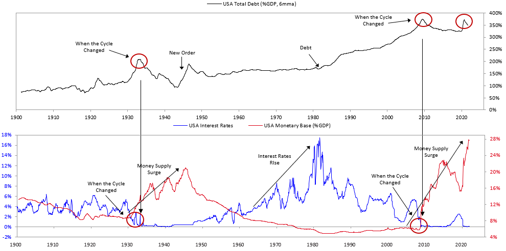

THIS PRINTING OF MONEY AND BUYING OF DEBT ASSETS HAS DRIVEN INTEREST RATES SO LOW THAT CASH AND BONDS ARE STUPID TO OWN / 这种印钞并购买债务资产，已经把利率压到如此之低，以至于持有现金和债券是愚蠢的

You aren’t getting an interest rate—why would you keep your money there? You are guaranteed to get lousy rates, particularly on cash. The charts below show that you are basically going to get the worst interest rates ever in both inflation-adjusted and nominal terms.

你没有得到利率——为什么还把钱放在那里？你被保证会得到糟糕的利率，尤其是现金。下面的图显示，无论是经通胀调整后还是以名义计，你基本上将得到有史以来最差的利率。

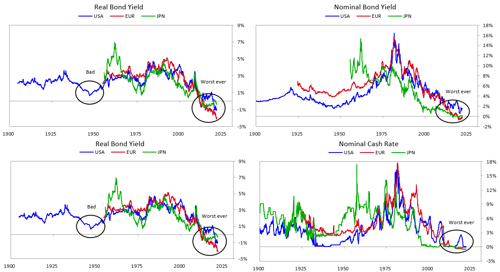

Think about the deal. The charts below [1] show the number of years it takes for the money one invests in bonds and cash to be returned before one starts making a profit. The one on the top left is in dollars and the one on the top right is in inflation-adjusted dollars. As shown, the amounts of time are between 50 years and never. This creates more incentive to sell and borrow this debt than to buy more. At the same time, a lot more debt will be produced and will have to be sold. There won’t be enough demand to buy it, especially since global investors are already overweight in it. The way this is dealt with is that the Fed prints a lot more money and buys a lot of debt.

想一想这笔交易。下面的图[1]显示，一个人投资于债券和现金的钱，要多少年才能在开始盈利之前被还回来。左上是以美元计，右上是以经通胀调整后的美元计。如图所示，这段时间在50年到永远之间。这造成了更多卖掉并借入这种债务、而不是买入更多的激励。与此同时，还将产生多得多的债务，并且必须被卖掉。不会有足够的需求去买它，尤其是因为全球投资者已经超配了它。处理方式是美联储印更多的钱并购买大量债务。

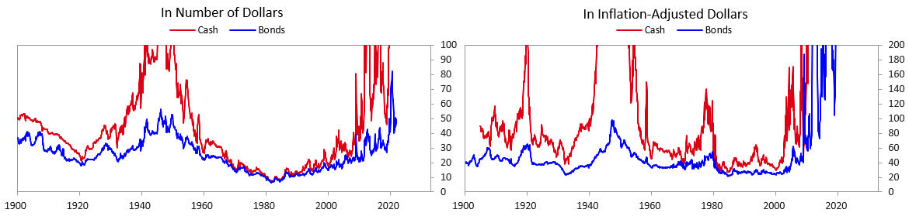

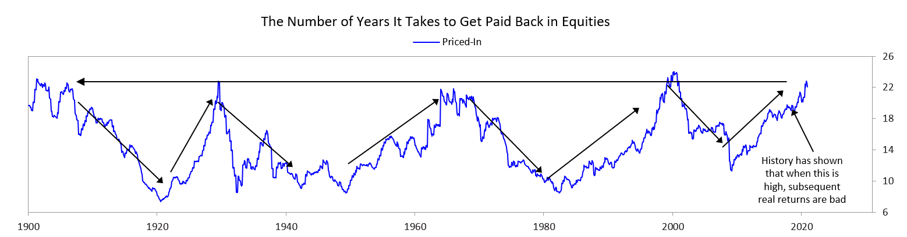

REMEMBER THAT ONE PERSON’S DEBTS ARE ANOTHER PERSON’S ASSETS, AND IMAGINE WHAT WOULD HAPPEN IF THE ASSET HOLDERS SOLD BECAUSE THE DEBT ASSETS WERE UNATTRACTIVE (WHICH THEY ARE) / 记住，一个人的债务是另一个人的资产；并想象一下，如果资产持有者因为债务资产缺乏吸引力（而它们确实缺乏吸引力）而出售，会发生什么

That would lead to either a big increase in interest rates or a huge increase in the printing of money to buy the debt to artificially hold interest rates down. The chart below [2] shows the amount of debt assets relative to GDP, which means that a lot can be sold if the holders lose their taste for it.

那将导致要么利率大幅上升，要么大规模印钞来购买债务、从而人为地把利率压住。下图[2]显示债务资产相对于GDP的数量，这意味着如果持有者失去对它的兴趣，可以卖掉很多。

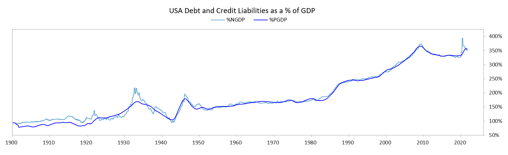

THE AMOUNT OF FINANCIAL ASSETS RELATIVE TO REAL ASSETS IS DANGEROUSLY HIGH, WHICH COULD LEAD TO A “BANK RUN”-TYPE MOVE FROM FINANCIAL ASSETS TO REAL ASSETS / 金融资产相对于真实资产的数量高到危险的程度，这可能导致从金融资产转向真实资产的“银行挤兑”式变动

I am not saying this will happen, but I am saying that there is a much higher probability of this happening than is reflected in market pricing. Think about it. There is only one purpose of investment assets, and that is to sell them to get cash to buy the real goods and services that one wants. Throughout history, whenever there were far more claims on real assets than there were real assets, a crisis eventually occurred when many holders of these financial assets went to sell them and discovered that there were far too many of them. That led to a “run on the bank”-type dynamic. Right now, there are vastly more financial assets than there are real assets, so if there was a move to convert them into real assets, that would lead to a “run on the bank”-type dynamic, which central banks would certainly respond to by printing a lot of money to allow people to get the money, but it would be of much less value.

我不是说这将会发生，我是说这件事发生的概率远高于市场价格所反映的。想一想。投资资产只有一个目的，那就是卖掉它们换成现金，去买一个人想要的真实商品和服务。贯穿历史，每当对真实资产的索取权远多于真实资产时，最终就会发生危机：许多这些金融资产的持有者去卖它们，却发现它们实在太多了。那导向一种“挤兑银行”式的动态。眼下，金融资产远远多于真实资产，所以如果出现把它们转换成真实资产的移动，就会导向“挤兑银行”式的动态。中央银行肯定会以印大量的钱来回应，让人们拿到钱，但那些钱的价值会小得多。

Making financial asset prices go up by creating a lot of money and debt makes people financially richer, but it doesn’t make them actually richer. It also leads to periods of bad real returns. This is shown in the following charts [3]. The top chart shows financial asset values as a percentage of all assets, the second chart shows financial net worth relative to GDP, and the third chart shows rolling returns of the 60/40 stock/bond portfolio since 1910.

通过创造大量货币和债务来推高金融资产价格，使人们在财务上更富，但并没有使他们真正更富。它也会导向实际回报很差的时期。下面的图[3]显示了这一点。上图是金融资产价值占全部资产的百分比，第二张图是金融净值相对于GDP，第三张图是自1910年以来60/40股债组合的滚动回报。

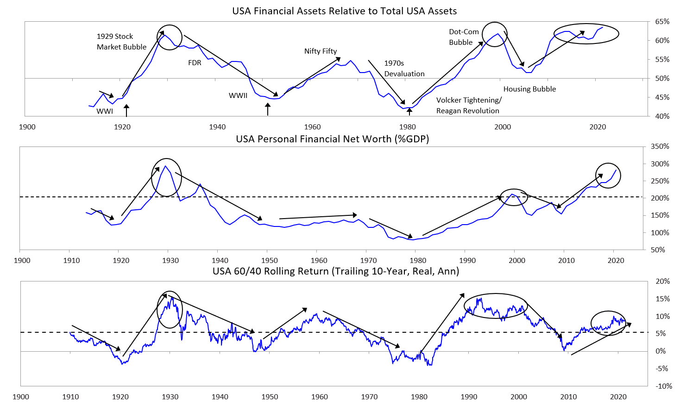

PERIODS LIKE THESE PRODUCE TERRIBLE RETURNS FOR HOLDING CASH / 像这样的时期，持有现金会产生糟糕的回报

In my opinion, the four periods circled in the chart below [4] are the analogous periods to today, each of which produced analogous paradigms to what we’re experiencing.

在我看来，下图[4]中圈出的四个时期是与今天可类比的时期，每一个都产生了与我们正在经历的相类似的范式。

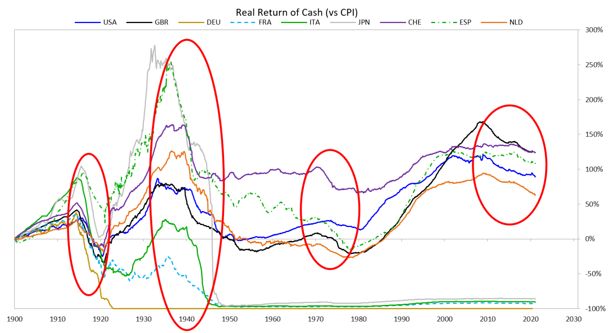

PERIODS LIKE THESE EVENTUALLY PRODUCE BAD REAL RETURNS FOR STOCKS AND BONDS [5] / 像这样的时期，最终会给股票和债券带来糟糕的实际回报[5]

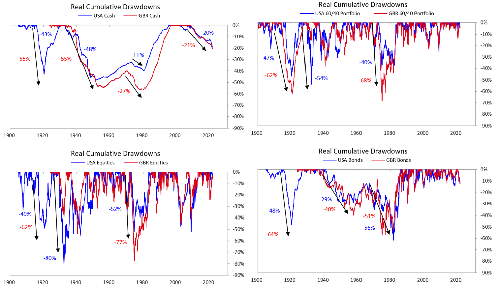

2) INTERNAL CONFLICTS OVER WEALTH AND VALUES GAPS / 2）围绕财富和价值观鸿沟的内部冲突

In the US (and a number of other countries), wealth and income gaps are the largest since the 1930s.

在美国（以及若干其他国家），财富和收入鸿沟是1930年代以来最大的。

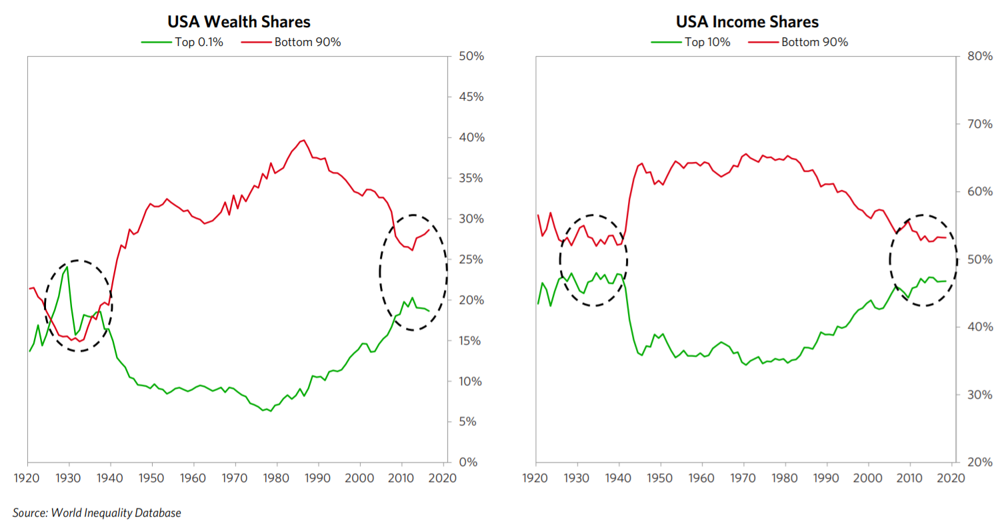

AND THE POLITICAL GAPS ARE THE GREATEST EVER / 而且政治鸿沟是有史以来最大的

This chart [6] shows that the US Republican Party (red lines) is more right-leaning and the US Democratic Party (blue lines) is more left-leaning than at any time since 1900, so the gap between them is enormous. There is great internal conflict going on in the United States now, which makes it a risky place. For example, it is entirely possible that neither side will accept losing the 2024 election. Such political clashes hurt productivity and create an inhospitable environment, which hurts capital flows.

这张图[6]显示，美国共和党（红线）比1900年以来任何时候都更右，美国民主党（蓝线）比1900年以来任何时候都更左，因此它们之间的鸿沟巨大。美国现在正在发生巨大的内部冲突，这使它成为一个有风险的地方。例如，完全有可能任何一方都不接受在2024年选举中落败。这种政治冲突伤害生产力，并造成不宜人的环境，从而伤害资本流动。

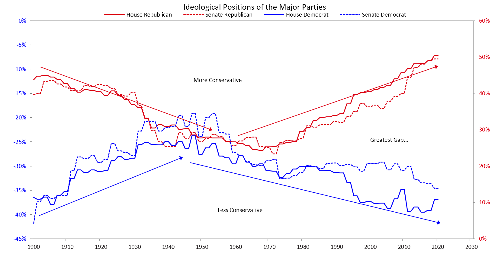

GOVERNMENT SPENDING WILL INCREASE A LOT. TAX RATES WILL RISE A LOT, BUT NOT ENOUGH TO COVER THE SPENDING. SO WEALTH WILL BE REDISTRIBUTED THROUGH BOTH TAXES AND DEBT MONETIZATIONS.

政府支出将大幅增加。税率将大幅上升，但不足以覆盖支出。因此财富将通过税收和债务货币化两者被再分配。

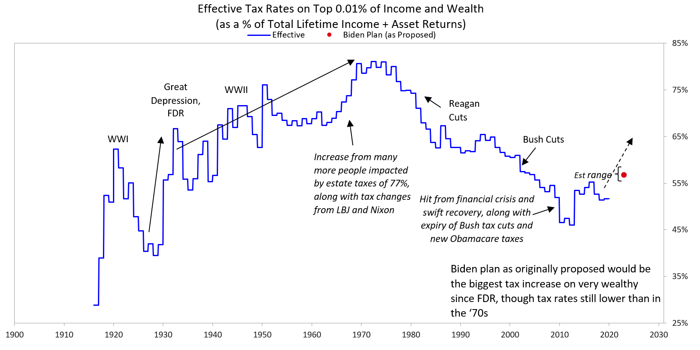

3) EXTERNAL CONFLICTS DUE TO THE RISES AND DECLINES OF GREAT POWERS / 3）由于大国兴衰而产生的外部冲突

The chart below shows indices of the strengths and weaknesses of the leading world powers since 1500. Note the Dutch, British, American, and Chinese cycles. The Dutch guilder was the world’s reserve currency when the Dutch Empire was on top, the British pound was the world’s reserve currency when the British Empire was on top, and the US dollar is the dominant reserve currency now that the US is on top. Note how things are changing. These cycles are transpiring for archetypical reasons.

下图显示1500年以来主要世界强国强弱的指数。请注意荷兰、英国、美国和中国的周期。荷兰帝国处于顶峰时，荷兰盾是世界储备货币；大英帝国处于顶峰时，英镑是世界储备货币；现在美国处于顶峰，美元是主导储备货币。请注意事情正在如何变化。这些周期因典型的原因而展开。

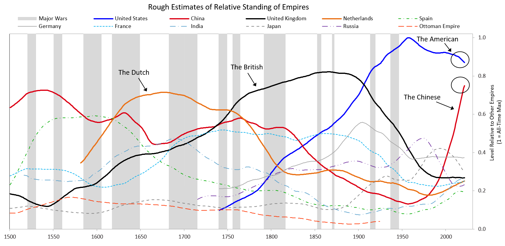

This chart is a simplified version of what you just saw for these four empires. The gray shaded areas are the periods of great internal and external conflicts and restructurings via depression, revolution, and war (typically lasting 10-25 years). They are followed by more extended periods of peace and prosperity in which order is brought about by the existence of a dominant power that no country wants to fight because it’s too strong, leading people to work harmoniously together.

这张图是你刚才看到的这四个帝国的简化版本。灰色阴影区域是经由萧条、革命和战争发生的巨大内部与外部冲突及重组时期（通常持续10–25年）。它们之后是更长的和平与繁荣时期：秩序由一个主导强权的存在带来，没有国家想与之开战，因为它太强，于是人们和谐地一起工作。

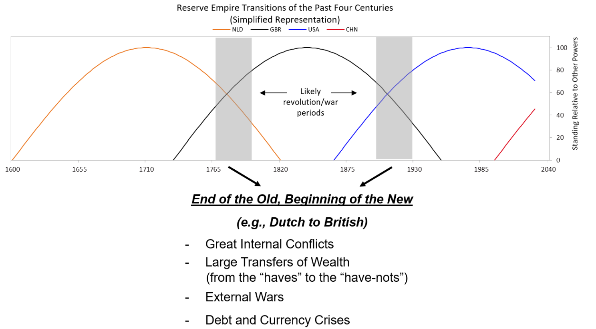

THE ARCHETYPICAL BIG CYCLE / 典型的大周期

I will begin taking you through the typical cycle at the point that the new order is created. After revolutions and wars a new order—i.e., a new system run by new leaders—is created. For example, the last world order to be created came after WWII, in 1945. At that point in the cycle there is a dominant power, and nobody wants to fight the dominant power, so this part of the cycle is typically peaceful and, if managed well, prosperous. It is economically rewarding, which leads people to borrow and bet on it continuing, leading to over-indebtedness. Because economic opportunities are naturally distributed unevenly, large wealth gaps develop. Also, with time, competitors emerge and grow in power. Over-indebtedness and declining competitiveness eventually lead to financial problems at the same time as there are large wealth and political gaps. This produces more internal conflict and people demanding more money, which leads governments to create more debt and print a lot more money, which weakens the currency and raises inflation. As the dominant power weakens and other powers get strong enough to challenge it, there are greater internal and external conflicts that lead to revolutionary changes in who has what wealth and power. That ends the old order and leads to the next new order. That is now happening.

我将从新秩序被创造的那个点开始，带你走过典型周期。革命和战争之后，一种新秩序——也就是由新领导者运行的新体系——被创造出来。例如，上一个被创造的世界秩序出现在第二次世界大战之后，1945年。在周期的那个点上有一个主导强权，没有人想与主导强权开战，所以周期的这一部分通常是和平的，而且如果管理得好，是繁荣的。它在经济上有回报，这使人们借款并押注它会继续，从而导向过度负债。因为经济机会天然分布不均，巨大的财富鸿沟发展起来。同时，随着时间推移，竞争者出现并在力量上增长。过度负债和竞争力下降最终在存在巨大财富和政治鸿沟的同时导向财务问题。这产生更多内部冲突，以及人们要求更多的钱，这使政府创造更多债务并大量印钞，从而削弱货币并抬高通胀。随着主导强权变弱、其他强权强大到足以挑战它，就出现更大的内部和外部冲突，导向谁拥有什么财富和权力的革命性变化。那结束旧秩序，并导向下一个新秩序。这正在发生。

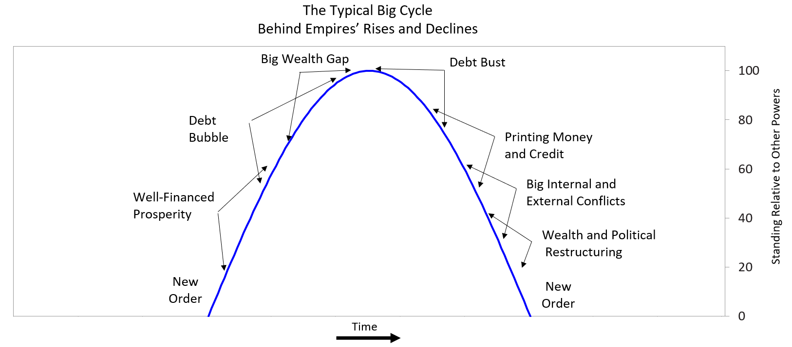

As explained in my conclusions up-front, I believe that important wealth and power shifts are underway, creating a new paradigm in which 1) it is undesirable to hold dollar-, euro-, and yen-denominated credit assets, especially short-term debt assets, because they will have significantly negative real returns, and 2) it is desirable to hold a well-diversified portfolio of currencies, countries, and asset classes.

正如我在前面的结论中所解释的，我相信重要的财富和权力转移正在进行，正在创造一种新范式：1）持有以美元、欧元和日元计价的信贷资产是不可取的，尤其是短期债务资产，因为它们将有显著为负的实际回报；2）持有一个在货币、国家和资产类别上充分分散的组合是可取的。

What I’ve given you above is an inadequately brief overview of that which is covered comprehensively in my book Principles for Dealing with the Changing World Order. If you are interested in this subject, I urge you to read it.

我上面给你的，是对我的书《应对变化中的世界秩序的原则》所全面覆盖内容的一个不够充分的简要概述。如果你对这个题目感兴趣，我敦促你去读它。

In the coming days, I’ll be sharing another update on what I’ll be watching for in 2022.

在未来几天，我会再分享一份更新，关于我在2022年会关注什么。

[1] Data shown in the 'In Inflation-Adjusted Dollars' chart is the latest available as of December 2020 / [1] 「经通胀调整后的美元」图中所示数据，为截至2020年12月的最新可得数据

[2] Estimated based on Bridgewater analysis. Please review the "Important Disclosers and Other Information" located at the end of this presentation.

[2] 估计基于桥水的分析。请查阅本演示文末的“Important Disclosers and Other Information”。

[3] Financial asset measures sourced from the World Inequality Database. Personal Financial Net Worth represents gross personal financial assets minus private debts. USA 60/40 refers to a portfolio with a 60% allocation to US equities and a 40% allocation to US government bonds. Please review the "Important Disclosures and Other Information" located at the end of this presentation.

[3] 金融资产度量来自世界不平等数据库。个人金融净值指个人金融资产总额减去私人债务。美国60/40指把60%配置于美国股票、40%配置于美国政府债券的组合。请查阅本演示文末的《重要披露及其他信息》。

[4] Estimates are based on Bridgewater analysis. Please review the “Important Disclosures and Other Information” located at the end of this presentation.

[4] 估计基于桥水的分析。请查阅本演示文末的《重要披露及其他信息》。

[5] 60/40 portfolio refers to a portfolio with a 60% allocation to the respective country’s equities and a 40% allocation to their bonds. Please review the “Important Disclosures and Other Information” located at the end of this presentation.

[5] 60/40组合指把60%配置于相应国家的股票、40%配置于其债券的组合。请查阅本演示文末的《重要披露及其他信息》。

[6] Based on data from voteview.com. Please review the "Important Disclosures and Other Information" located at the end of this presentation.

[6] 基于 voteview.com 的数据。请查阅本演示文末的《重要披露及其他信息》。

Important Disclosures and Other Information / 重要披露及其他信息

IMPORTANT DISCLOSURES / 重要披露

Please read carefully the following important disclosures and other information as they provide additional information relevant to understanding the assumptions, research and performance information presented herein. Additional information is available upon request except where the proprietary nature of the information precludes its dissemination.

请仔细阅读以下重要披露及其他信息，因为它们提供了与理解本文所呈现的假设、研究和业绩信息相关的额外信息。除信息的专有性质排除传播的情形外，更多信息可应要求提供。

This presentation contains proprietary information regarding Bridgewater Associates, LP (“Bridgewater”) and the strategies Bridgewater manages and is being furnished on a confidential basis to a sophisticated prospective investor for the purpose of evaluating an investment with Bridgewater. By accepting this presentation, the prospective investor agrees that it (and each employee, representative or other agent of such prospective investor) will use the information only to evaluate its potential interest in a fund or strategy described herein and for no other purpose and will not divulge any such information to any other party. No part of this presentation may be (i) copied, photocopied or duplicated in any form by any means or (ii) redistributed without the prior written consent of Bridgewater. Notwithstanding anything to the contrary, a prospective investor, and each employee, representative or other agent of such prospective investor, may disclose to any and all persons, without limitation of any kind, the U.S. federal and state income tax treatment and tax structure of a fund described herein (and any of the transactions contemplated hereby) and all materials of any kind (including opinions or other tax analyses) that are provided to a prospective investor relating to such U.S. federal and state income tax treatment and tax structure.

本演示包含关于 Bridgewater Associates, LP（“桥水”）以及桥水所管理策略的专有信息，并以保密方式提供给一位成熟的潜在投资者，用于评估对桥水的投资。接受本演示，即表示该潜在投资者同意：其（以及该潜在投资者的每位雇员、代表或其他代理人）将只把这些信息用于评估其对本文所述基金或策略的潜在兴趣，不作其他用途，并且不会向任何其他方泄露任何此类信息。本演示的任何部分不得（i）以任何方式、任何形式复制、影印或复印，或（ii）未经桥水事先书面同意而再分发。尽管有任何相反约定，潜在投资者及其每位雇员、代表或其他代理人，可以向任何及所有人披露、不受任何种类的限制：本文所述基金的美国联邦和州所得税待遇及税务结构（以及由此拟进行的任何交易），以及提供给潜在投资者的、与该等美国联邦和州所得税待遇及税务结构有关的任何种类的全部材料（包括意见或其他税务分析）。

This presentation has been prepared solely for informational purposes and is not an offer to buy or sell or a solicitation of an offer to buy or sell any security or to participate in any trading strategy. Any such offering, will be made pursuant to a definitive offering memorandum (the “OM”) which will contain the terms and risks of making an investment with Bridgewater in the relevant fund and other material information not contained herein and which will supersede this information in its entirety. In the event of any discrepancy between the information shown in this presentation and the OM, the OM will prevail. Investors should not construe the contents of this presentation as legal, tax, accounting, investment or other advice. Any decision to invest in a Bridgewater fund or strategy described herein should be made after carefully reviewing the OM (including the risks described therein) and all other related documents, conducting such investigations as the prospective investor deems necessary and consulting such investor’s own investment, legal, accounting and tax advisors in order to make an independent determination of the suitability and consequences of an investment in such fund or strategy.

本演示仅为信息目的而编制，不是买入或卖出任何证券的要约或要约邀请，也不是参与任何交易策略的要约邀请。任何此类发行将依据一份最终发行备忘录（“OM”）进行，其中将包含在相关基金中向桥水投资的条款和风险，以及本文未包含的其他重大信息，并将完整地取代本信息。若本演示所示信息与 OM 有任何不符，以 OM 为准。投资者不应把本演示的内容解释为法律、税务、会计、投资或其他建议。任何投资于本文所述桥水基金或策略的决定，都应在仔细审阅 OM（包括其中描述的风险）及所有其他相关文件、进行潜在投资者认为必要的调查，并咨询该投资者自己的投资、法律、会计和税务顾问之后作出，以便独立确定投资于该基金或策略的适当性及后果。

An investment in any Bridgewater fund or strategy involves significant risks and there can be no assurance that any fund or strategy will achieve its investment objective or any targets or that investors will receive any return of their capital. An investment in any Bridgewater fund or strategy is suitable only for sophisticated investors and requires the financial ability and willingness to accept the high risks inherent in such an investment (including the risk of loss of their entire investment) for an indefinite period of time. Past performance is not indicative of future results. 

投资于任何桥水基金或策略都涉及重大风险，不能保证任何基金或策略将实现其投资目标或任何目标，也不能保证投资者将收回其任何资本。投资于任何桥水基金或策略只适合成熟投资者，并要求具备财务能力，且愿意在不确定的期间内接受此类投资固有的高风险（包括损失全部投资的风险）。过往业绩并不预示未来结果。

This presentation and the OM will only be made available to persons or entities who are “accredited investors” under the Securities Act of 1933, as amended, and “qualified purchasers” under the Investment Company Act of 1940, as amended. The distribution of this presentation and the OM may be restricted by law in certain jurisdictions, and it is the responsibility of persons into whose possession this presentation or the OM comes to inform themselves about, and observe, any such restrictions.

本演示和 OM 只会提供给经修订的《1933年证券法》下的“合格投资者”，以及经修订的《1940年投资公司法》下的“合格购买者”。本演示和 OM 的分发在某些司法辖区可能受法律限制，本演示或 OM 落入其持有的人有责任自行了解并遵守任何此类限制。

The shares in the fund may not be offered or sold to the public in Brazil. Accordingly, the shares in the fund have not been nor will be registered with the Brazilian Securities Commission - CVM nor have they been submitted to the foregoing agency for approval. Documents relating to the shares in the fund, as well as the information contained therein, may not be supplied to the public in Brazil, as the offering of shares in the fund is not a public offering of securities in Brazil, nor used in connection with any offer for subscription or sale of securities to the public in Brazil.

该基金的份额不得在巴西向公众发售或出售。因此，该基金的份额未曾也不会在巴西证券委员会 CVM 注册，也未曾提交前述机构批准。与该基金份额有关的文件以及其中所含信息，不得向巴西公众提供，因为该基金份额的发行不是巴西的证券公开发售，也不得用于与在巴西向公众认购或出售证券的任何要约相联系。

Certain information contained herein constitutes forward-looking statements (including projections, targets, hypotheticals, ratios, estimates, returns, performance, opinions, activity and other events contained or referenced herein), which can be identified by the use of terms such as “may,” “will,” “should,” “expect,” “anticipate,” “project,” “estimate,” “intend,” “continue” or “believe” or other variations (or the negatives thereof) thereof. Due to various risks, assumptions, uncertainties and actual events, including those discussed herein and in the OM, actual results, returns or performance may differ materially from those reflected or contemplated in such forward-looking statements. As a result, prospective investors should not rely on such forward-looking statements in making their investment decisions. Any forward-looking statements contained herein reflect Bridgewater’s current judgment and assumptions which may change in the future, and Bridgewater has no obligation to update or amend such forward-looking statements.

本文所含的某些信息构成前瞻性陈述（包括本文包含或提及的预测、目标、假设情形、比率、估计、回报、业绩、意见、活动和其他事件），可通过使用“可能”“将”“应当”“预期”“预计”“项目”“估计”“打算”“继续”或“相信”等词语或其他变体（或其否定）来识别。由于各种风险、假设、不确定性和实际事件，包括本文及 OM 中讨论的那些，实际结果、回报或业绩可能与此类前瞻性陈述所反映或设想的有重大差异。因此，潜在投资者在做投资决定时不应依赖此类前瞻性陈述。本文所含的任何前瞻性陈述反映桥水当前的判断和假设，这些判断和假设将来可能改变，桥水没有义务更新或修改此类前瞻性陈述。

Bridgewater’s investment process seeks to understand the cause and effect linkages that drive markets over time. To assess and refine its understanding of these linkages, Bridgewater performs historical stress tests across a wide range of timeframes and market environments. From these stress tests, Bridgewater is able to simulate how its strategies would have performed prior to their inception. For strategies that include active decision making, Bridgewater often “humbles” its simulated alpha returns (by systematically adjusting downward the simulated results that Bridgewater’s current alpha investment logic produces) to account for the possibility that it could be wrong. Because this stress testing is a core component of Bridgewater’s investment process, it shares these simulations with current and prospective investors to demonstrate its thinking. However, because they do not demonstrate actual results, these simulations are inherently limited and should not be relied upon to make an investment decision.

桥水的投资过程寻求理解随时间驱动市场的因果联系。为评估并提炼对这些联系的理解，桥水在广泛的时间框架和市场环境中进行历史压力测试。从这些压力测试中，桥水能够模拟其策略在创立之前会如何表现。对于包含主动决策的策略，桥水常常对其模拟的阿尔法回报进行“谦抑”处理（系统性地下调桥水当前阿尔法投资逻辑所产生的模拟结果），以计入它可能是错的这种可能性。因为这种压力测试是桥水投资过程的核心组成部分，它与现有和潜在投资者分享这些模拟，以展示其思考。然而，因为它们并不展示实际结果，这些模拟天生有限，不应被依赖来做投资决定。

HYPOTHETICAL PERFORMANCE RESULTS HAVE MANY INHERENT LIMITATIONS, SOME OF WHICH ARE DESCRIBED BELOW. NO REPRESENTATION IS BEING MADE THAT ANY ACCOUNT WILL OR IS LIKELY TO ACHIEVE PROFITS OR LOSSES SIMILAR TO THOSE SHOWN. IN FACT, THERE ARE FREQUENTLY SHARP DIFFERENCES BETWEEN HYPOTHETICAL PERFORMANCE RESULTS AND THE ACTUAL RESULTS SUBSEQUENTLY ACHIEVED BY ANY PARTICULAR TRADING PROGRAM.

假设业绩结果有许多固有局限，其中一些在下面描述。此处并未作出任何陈述，称任何账户将会或很可能取得与所示相似的盈利或亏损。事实上，假设业绩结果与任何特定交易程序随后取得的实际结果之间，经常存在尖锐差异。

ONE OF THE LIMITATIONS OF HYPOTHETICAL PERFORMANCE RESULTS IS THAT THEY ARE GENERALLY PREPARED WITH THE BENEFIT OF HINDSIGHT. IN ADDITION, HYPOTHETICAL TRADING DOES NOT INVOLVE FINANCIAL RISK, AND NO HYPOTHETICAL TRADING RECORD CAN COMPLETELY ACCOUNT FOR THE IMPACT OF FINANCIAL RISK IN ACTUAL TRADING. FOR EXAMPLE, THE ABILITY TO WITHSTAND LOSSES OR TO ADHERE TO A PARTICULAR TRADING PROGRAM IN SPITE OF TRADING LOSSES ARE MATERIAL POINTS WHICH CAN ALSO ADVERSELY AFFECT ACTUAL TRADING RESULTS. THERE ARE NUMEROUS OTHER FACTORS RELATED TO THE MARKETS IN GENERAL OR TO THE IMPLEMENTATION OF ANY SPECIFIC TRADING PROGRAM WHICH CANNOT BE FULLY ACCOUNTED FOR IN THE PREPARATION OF HYPOTHETICAL PERFORMANCE RESULTS AND ALL OF WHICH CAN ADVERSELY AFFECT ACTUAL TRADING RESULTS.

假设业绩结果的局限之一是，它们通常是在事后之明的帮助下编制的。此外，假设交易不涉及财务风险，没有任何假设交易记录能完全计入实际交易中财务风险的影响。例如，承受亏损的能力，或尽管有交易亏损仍坚持某一特定交易程序的能力，是也会对实际交易结果产生不利影响的重大要点。还有许多与市场总体或与实施任何特定交易程序相关的其他因素，无法在编制假设业绩结果时被充分计入，而所有这些因素都可能对实际交易结果产生不利影响。

Bridgewater believes that a particular return stream should be evaluated against its expected performance or its benchmark. To that end, Bridgewater demonstrates whether its strategies are operating as expected via a cone chart, which shows the performance of a particular strategy over time relative to the strategy’s benchmark and also within bands of standard deviation from that benchmark. Separately, to demonstrate the impact of market conditions on the strategies it manages, Bridgewater explains the macro-economic pressures and market conditions that effected performance in the context of client letters, account reviews, or other publications that Bridgewater provides to each current and prospective investor on a regular basis. Additional information about how Bridgewater thinks about setting expectations for its strategies via a benchmark is available upon request.

桥水认为，某一特定回报流应当对照其预期表现或其基准来评估。为此，桥水通过锥形图来展示其策略是否按预期运行。该图显示某一策略随时间相对于该策略基准的表现，以及处于该基准若干标准差区间之内的情况。另外，为展示市场条件对其所管理策略的影响，桥水在客户信、账户回顾或其定期向每位现有和潜在投资者提供的其他出版物中，解释影响业绩的宏观经济压力和市场条件。关于桥水如何通过基准为其策略设定预期的更多信息，可应要求提供。

Any tables, graphs or charts relating to past performance, whether hypothetical, simulated or actual, included in this presentation are intended only to illustrate the performance of indices, strategies, or specific accounts for the historical periods shown. When creating such tables, graphs and charts, Bridgewater may incorporate assumptions on trading, positions, transactions costs, market impact estimations and the benefit of hindsight. For example, transaction cost estimates used in simulations are based on historical measured costs and/or modeled costs, and attribution is derived from a process of attributing positions held at a point in time to specific market views and is inherently imprecise. Such tables, graphs and charts are not intended to predict future performance and should not be used as a basis for making any investment decision. Bridgewater has no obligation to update or amend such tables, graphs or charts.

本演示中与过往业绩有关的任何表格、图或图表，无论是假设的、模拟的还是实际的，都只意图说明所示历史期间内指数、策略或特定账户的表现。在制作此类表格、图和图表时，桥水可能纳入关于交易、头寸、交易成本、市场冲击估计以及事后之明好处的假设。例如，模拟中使用的交易成本估计基于历史上测得的成本和／或模型化成本；归因来自把某一时点持有的头寸归于特定市场观点的过程，天生是不精确的。此类表格、图和图表并不意图预测未来业绩，不应被用作任何投资决定的基础。桥水没有义务更新或修改此类表格、图或图表。

Statements regarding target performance or target ratios related to assumed risk budgets, liabilities, volatility, target volatility, tracking error or other targets should not be considered a guarantee that such results can or will be achieved. For example, Bridgewater may adjust returns to match, for instance, the annualized standard deviation of two or more return series but this adjustment does not suggest that the returns or assets are similar with respect to other aspects of the risk such as liquidity risk. Any statements with respect to the ability to risk match or risk adjust in the future are not a guarantee that the realized risks will be similar and material divergences could occur. All performance and risk targets contained herein are subject to revision by Bridgewater and are provided solely as a guide to current targets.

关于假定风险预算、负债、波动率、目标波动率、跟踪误差或其他目标的目标业绩或目标比率的陈述，不应被视为此类结果能够或将会实现的保证。例如，桥水可能调整回报，以便例如使两个或更多回报序列的年化标准差相匹配，但这一调整并不表示这些回报或资产在流动性风险等风险的其他方面是相似的。任何关于未来能够进行风险匹配或风险调整的陈述，都不是已实现风险将会相似的保证，重大偏离可能发生。本文所含的全部业绩和风险目标都可由桥水修订，并仅作为当前目标的指引而提供。

Discussions related to the risk controlling capabilities of low risk portfolios, diversification, passive investing, risk management, risk adjusting, and any other risk control theories, statements, measures, calculations and policies contained herein should not be construed as a statement that Bridgewater has the ability to control all risk or that the investments or instruments discussed are low risk. Active trading comes with a monetary cost and high risk and there is no guarantee the cost of trading will not have a materially adverse impact on any account, fund, portfolio or other structure. Bridgewater manages accounts, funds and strategies not referred to herein. Additionally, even where accounts, funds or strategies are traded similarly, performance may materially diverge based on, among other factors, timing, the approved instruments, markets, and target risk for each strategy or market. The price and value of the investments referred to in this presentation and the income, if any, derived from there may fluctuate.

与低风险组合的风险控制能力、分散化、被动投资、风险管理、风险调整，以及本文所含的任何其他风险控制理论、陈述、度量、计算和政策有关的讨论，不应被解释为桥水有能力控制全部风险，或所讨论的投资或工具是低风险的。主动交易有金钱成本和高风险，不能保证交易成本不会对任何账户、基金、组合或其他结构产生重大不利影响。桥水还管理本文未提及的账户、基金和策略。此外，即使账户、基金或策略以相似方式交易，业绩仍可能基于时机、获准工具、市场，以及每个策略或市场的目标风险等因素而重大偏离。本演示所提及投资的价格和价值，以及从中获得的任何收入，可能波动。

Statistical and mathematical measures of performance and risk measures based on past performance, market assumptions or any other input should not be relied upon as indicators of future results. While Bridgewater believes the assumptions and possible adjustments it may make in making the underlying calculations are reasonable, other assumptions, methodologies and adjustments could have been made that are reasonable and would result in materially different results, including materially lower results. Where shown, targeted performance and the abilities and capabilities of the active and passive management approaches discussed herein are based on Bridgewater’s analysis of market data, quantitative research of the underlying forces that influence asset classes as well as management policies and objectives, all of which are subject to change. The material contained herein may exhibit the potential for attractive returns, however it also involves a corresponding high degree of risk. Targeted performance, whether mathematically based or theoretical, is considered hypothetical and is subject to inherent limitations such as the impact of concurrent economic or geo-political elements, forces of nature, war and other factors not addressed in the analysis, such as lack of liquidity. There is no guarantee that the targeted performance for any fund or strategy shown herein can or will be achieved. A broad range of risk factors, individually or collectively, could cause a fund or strategy to fail to meet its investment objectives and/or targeted returns, volatilities or correlations.

基于过往业绩、市场假设或任何其他输入的业绩与风险的统计和数学度量，不应被依赖为未来结果的指标。虽然桥水认为它在做底层计算时可能作出的假设和可能调整是合理的，也可以作出其他合理的假设、方法和调整，并会产生重大不同的结果，包括重大更低的结果。在有展示的地方，本文讨论的目标业绩以及主动与被动管理方法的能力和本领，基于桥水对市场数据的分析、对影响资产类别的底层力量的定量研究，以及管理政策和目标，所有这些都可能改变。本文所含材料可能展现有吸引力回报的潜力，然而它也涉及相应的高度风险。目标业绩，无论是基于数学的还是理论的，都被视为假设，并受固有局限的约束，例如并存的经济或地缘政治因素、自然力量、战争，以及分析中未处理的其他因素（如缺乏流动性）的影响。不能保证本文所示任何基金或策略的目标业绩能够或将会实现。广泛的风险因素，单独或共同地，可能导致基金或策略未能达到其投资目标和／或目标回报、波动率或相关性。

Where shown, information related to markets traded may not necessarily indicate the actual historical or current strategies of Bridgewater. Markets listed may or may not be currently traded and are subject to change without notice. Markets used for illustrative purposes may not represent the universe of markets traded or results available and may not include actual trading results of Bridgewater. Other markets or trading, not shown herein, may have had materially different results. Attribution of performance or designation of markets and the analysis of performance or other performance with respect to scenario analysis or the determination of biases is based on Bridgewater’s analysis. Statements made with respect to the ability of Bridgewater, a fund, a strategy, a market or instrument to perform in relation to any other market, instrument or manager in absolute terms or in any specific manner in the future or any specified time period are not a guarantee of the desired or targeted result.

在有展示的地方，与所交易市场有关的信息未必表示桥水实际的历史或当前策略。所列市场可能目前在交易，也可能没有，并可能不经通知而改变。用于说明的市场可能并不代表所交易市场或可得结果的全集，也可能不包括桥水的实际交易结果。本文未展示的其他市场或交易，可能有过重大不同的结果。业绩归因或市场指定，以及关于情景分析的业绩分析或其他业绩分析，或对偏向的判定，基于桥水的分析。关于桥水、某只基金、某个策略、某个市场或工具相对于任何其他市场、工具或管理人，在绝对意义上、或以任何特定方式、在未来或任何指定时期表现能力的陈述，都不是所希望或所瞄准结果的保证。

Bridgewater research utilizes data and information from public, private and internal sources, including data from actual Bridgewater trades. Sources include the Australian Bureau of Statistics, Bloomberg Finance L.P., Capital Economics, CBRE, Inc., CEIC Data Company Ltd., Consensus Economics Inc., Corelogic, Inc., CoStar Realty Information, Inc., CreditSights, Inc., Dealogic LLC, DTCC Data Repository (U.S.), LLC, Ecoanalitica, EPFR Global, Eurasia Group Ltd., European Money Markets Institute – EMMI, Evercore ISI, Factset Research Systems, Inc., The Financial Times Limited, GaveKal Research Ltd., Global Financial Data, Inc., Haver Analytics, Inc., ICE Data Derivatives, IHSMarkit, The Investment Funds Institute of Canada, International Energy Agency, Lombard Street Research, Mergent, Inc., Metals Focus Ltd, Moody’s Analytics, Inc., MSCI, Inc., National Bureau of Economic Research, Organisation for Economic Cooperation and Development, Pensions & Investments Research Center, Refinitiv, Renwood Realtytrac, LLC, Rystad Energy, Inc., S&P Global Market Intelligence Inc., Sentix Gmbh, Spears & Associates, Inc., State Street Bank and Trust Company, Sun Hung Kai Financial (UK), Totem Macro, United Nations, US Department of Commerce, Wind Information (Shanghai) Co Ltd, Wood Mackenzie Limited, World Bureau of Metal Statistics, and World Economic Forum. While we consider information from external sources to be reliable, we do not assume responsibility for its accuracy.

桥水的研究使用来自公共、私人及内部来源的数据和信息，包括来自桥水实际交易的数据。来源包括澳大利亚统计局、Bloomberg Finance L.P.、Capital Economics、CBRE, Inc.、CEIC Data Company Ltd.、Consensus Economics Inc.、Corelogic, Inc.、CoStar Realty Information, Inc.、CreditSights, Inc.、Dealogic LLC、DTCC Data Repository (U.S.), LLC、Ecoanalitica、EPFR Global、Eurasia Group Ltd.、European Money Markets Institute – EMMI、Evercore ISI、Factset Research Systems, Inc.、The Financial Times Limited、GaveKal Research Ltd.、Global Financial Data, Inc.、Haver Analytics, Inc.、ICE Data Derivatives、IHSMarkit、加拿大投资基金协会、国际能源署、Lombard Street Research、Mergent, Inc.、Metals Focus Ltd、Moody’s Analytics, Inc.、MSCI, Inc.、美国国家经济研究局、经济合作与发展组织、Pensions & Investments Research Center、Refinitiv、Renwood Realtytrac, LLC、Rystad Energy, Inc.、S&P Global Market Intelligence Inc.、Sentix Gmbh、Spears & Associates, Inc.、State Street Bank and Trust Company、Sun Hung Kai Financial (UK)、Totem Macro、联合国、美国商务部、Wind Information (Shanghai) Co Ltd、Wood Mackenzie Limited、World Bureau of Metal Statistics，以及世界经济论坛。虽然我们认为外部来源的信息是可靠的，但我们不对其准确性承担责任。

None of the information related to a fund or strategy that Bridgewater may provide is intended to form the basis for any investment decision with respect to any retirement plan’s assets. Any information Bridgewater provides should be independently and critically evaluated based on whatever other sources deemed appropriate, including legal and tax advice; it is also not intended to be impartial investment information or advice as Bridgewater may recommend one or more Bridgewater products in connection with such information, which would result in additional fees being paid to Bridgewater. Bridgewater’s status as an ERISA fiduciary with respect to the management of any existing or future Bridgewater product(s) in which you invest would be (or continue to be) set forth in that product’s applicable governing instruments. You are responsible for ensuring that your decision to invest in any Bridgewater product does not violate the fiduciary or prohibited transaction rules of ERISA, the U.S. Internal Revenue Code or any applicable laws or regulations that are similar. On and after June 9, 2017, the information provided herein is being made available only to “independent fiduciaries with financial expertise” (within the meaning of the Definition of the Term “Fiduciary”; Conflict of Interest Rule – Retirement Investment Advice, 81 Fed. Reg. 20,946 (Apr. 8, 2017), available at

https://www.gpo.gov/fdsys/pkg/FR-2016-04-08/pdf/2016-07924.pdf
), and this presentation should not be accepted by any person who does not meet such requirements.

桥水可能提供的、与某只基金或某个策略有关的任何信息，都不意图构成就任何退休计划资产作出任何投资决定的基础。桥水提供的任何信息，都应根据认为适当的任何其他来源（包括法律和税务建议）独立而批判地评估；它也不意图成为公正的投资信息或建议，因为桥水可能结合此类信息推荐一个或多个桥水产品，那会导致向桥水支付额外费用。桥水就你所投资的任何现有或未来桥水产品的管理而言作为 ERISA 受托人的地位，将（或继续）在该产品适用的治理文件中载明。你有责任确保你投资任何桥水产品的决定不违反 ERISA、《美国国内税收法》或任何类似适用法律或法规的受托人或禁止交易规则。在2017年6月9日及之后，本文所提供的信息仅向“具备财务专长的独立受托人”提供（该用语见《“受托人”一词的定义；利益冲突规则——退休投资建议》，81 Fed. Reg. 20,946（2017年4月8日），可于

https://www.gpo.gov/fdsys/pkg/FR-2016-04-08/pdf/2016-07924.pdf
 查阅），不符合此类要求的任何人不应接受本演示。

This presentation was written in connection with the promotion or marketing of a Bridgewater fund or strategy, and it was not intended or written to be used and cannot be used by any person for the purpose of avoiding penalties that may be asserted under the U.S. Internal Revenue Code.

本演示是在推广或营销一只桥水基金或策略的过程中撰写的，它并不意图、也不是为了被任何人用来规避可能根据《美国国内税收法》被主张的罚则，并且不能被如此使用。

In certain instances amounts and percentages in this presentation are approximate and have been rounded for presentation purposes. Statements in this presentation are made as of the date appearing on this presentation unless otherwise indicated. Neither the delivery of this presentation or the OM shall at any time under any circumstances create an implication that the information contained herein is correct as of any time subsequent to such date. Bridgewater has no obligation to inform potential or existing investors when information herein becomes stale, deleted, modified or changed. ©2021 Bridgewater Associates, LP. All rights reserved.

在某些情况下，本演示中的金额和百分比是近似的，并已为演示目的四舍五入。除非另有说明，本演示中的陈述以本演示上出现的日期作出。无论是交付本演示还是 OM，在任何时候、任何情况下都不应造成一种暗示，即其中所含信息在该日期之后的任何时间仍然正确。当本文信息变得过时、被删除、被修改或被改变时，桥水没有义务通知潜在或现有投资者。©2021 Bridgewater Associates, LP。保留所有权利。
