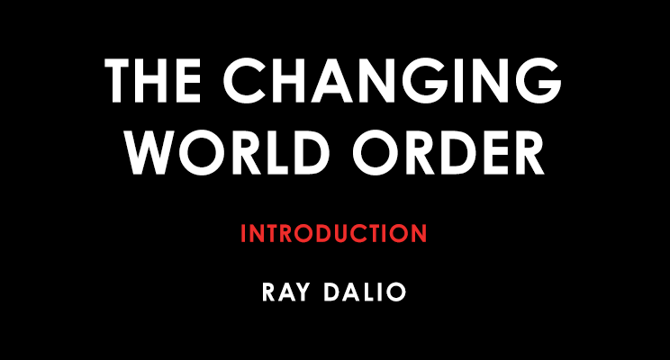

Ray Dalio / 瑞·达利欧

Founder of Bridgewater Associates / 桥水基金创始人

March 26, 2020 / 2020年3月26日

> 原文链接: https://www.linkedin.com/pulse/changing-world-order-ray-dalio-1f/

The times ahead will be radically different from those we’ve experienced in our lifetimes, though similar to many times in history. How do I know that? Because they always have been.

未来的时代将与我们此生所经历的截然不同，却与历史上的许多时期相似。我何以得知？因为历来如此。

Over the last 50 or so years, in order to handle my responsibilities well, I have needed to understand the most important factors that go into making countries and their markets succeed and fail. I learned that to anticipate and handle situations that I had never faced before I needed to study as many analogous historical cases as possible to understand the mechanics of how they transpired. That gave me principles for dealing with them well.

过去大约 50 年里，为了妥善履行我的职责，我必须弄清那些决定国家及其市场成败的最重要因素。我认识到，要预判并应对我从未面对过的局面，就得尽可能多地研究类似的历史案例，搞清楚它们是如何展开的。这给了我一套能把它们处理好的原则。

A few years ago, I observed the emergence of a number of big developments that hadn’t happened before in my lifetime but had occurred numerous times in history. Most importantly, I was seeing the confluence of huge debts and zero or near-zero interest rates that led to massive printing of money in the world’s three major reserve currencies; big political and social conflicts within countries, especially the US, due to the largest wealth, political, and values gaps in roughly a century; and the rising of a new world power (China) to challenge the existing world power (the US) and the existing world order. The most recent analogous time was the period from 1930 to 1945. This was very concerning to me. I knew that I couldn’t really understand what was happening and deal with what would be coming at me unless I studied past analogous periods, which led to this study of the rises and declines of empires, their reserve currencies, and their markets. In other words, to develop an understanding of what is happening now and might happen over the next few years, I needed to study the mechanics behind similar cases in history—e.g., the 1930–45 period, the rise and fall of the Dutch and British empires, the rise and fall of Chinese dynasties, and others. [1] I was in the midst of doing those studies when the COVID-19 pandemic struck, which was another one of those big events that never happened in my lifetime but had happened many times before. Past pandemics became a part of this study and showed me that surprising acts of nature—e.g., diseases, famines, and floods— need to be considered as possibilities because those surprising big acts of nature that rarely come along were by any measure even more impactful than the biggest depressions and wars.

几年前，我观察到一批重大事态正在出现：它们在我有生之年从未发生过，却在历史上反复出现过。最重要的是，我看到几股力量汇合到一起：巨额债务，以及为零或接近于零的利率，由此导致世界三大储备货币大规模印钞；国家内部激烈的政治与社会冲突，尤其是在美国，源于大约一个世纪以来最大的财富、政治和价值观鸿沟；以及一个新的世界大国（中国）崛起，挑战现有的世界大国（美国）和现有的世界秩序。距今最近的可类比时期是 1930 年到 1945 年。这让我非常忧虑。我知道，除非去研究过去那些可类比的时期，否则我无法真正理解正在发生的事，也无法应对即将扑面而来的局面。于是有了这项关于帝国、其储备货币及其市场兴衰的研究。换句话说，要理解现在正在发生什么、未来几年可能发生什么，我需要研究历史上相似案例背后的机制，例如 1930–1945 年、荷兰与大英帝国的兴衰、中国各个王朝的兴衰，以及其他案例。我正做着这些研究时，新冠疫情爆发了。这又是一件我有生之年从未发生、历史上却多次发生的大事。历史上的大流行病由此成为这项研究的一部分，并让我看到：出人意料的自然行为——例如疾病、饥荒和洪水——必须被当作可能发生的事来考虑，因为这些罕见而惊人的大自然重大行为，无论以何种标准衡量，其冲击都甚至大于最严重的萧条和战争。

As I studied history, I saw that it typically transpires via relatively well-defined life cycles, like those of organisms, that evolve as each generation transitions to the next. In fact, the history and the future of humanity can be seen as just the aggregate of all the individual life stories evolving through time. I saw these stories flow together as one all-encompassing story from the beginning of recorded history up to this moment, with the same things happening over and over again for basically the same reasons, while still evolving. By seeing many interlinking cases evolve together, I could see the patterns and cause/effect relationships that govern them and could imagine the future based on what I learned. These events happened many times throughout history and were parts of a cycle of rises and declines of empires and most aspects of empires—e.g., of their education levels, their levels of productivity, their levels of trade with other countries, their militaries, their currencies and other markets, etc.

我研究历史时看到，历史通常经由相对清晰的生命周期展开，就像生物体那样，随一代人向一代人过渡而演化。事实上，人类的历史与未来，可以被看成所有个体生命故事随时间演化的总和。我看到这些故事汇成一个无所不包的故事，从有文字记载的历史之初一直流到此刻：同样的事情因基本相同的原因一再发生，同时又在不断演化。通过观察许多相互关联的案例一起演化，我能看见支配它们的模式和因果关系，并依据所学去想象未来。这些事件在历史上发生过许多次，是帝国及其大多数方面兴衰周期的组成部分——例如教育水平、生产力水平、与其他国家的贸易水平、军队、货币和其他市场，等等。

Each of these aspects or powers transpired in cycles, and they were all interrelated. For example, nations’ levels of education affected their levels of productivity, which affected their levels of trade with other countries, which affected the levels of military strength required to protect trade routes, which together affected their currencies and other markets, which affected many other things. Their movements together made up the economic and political cycles that occurred over many years—e.g., a very successful empire or dynasty could have its cycle last 200 or 300 years. All the empires and dynasties I studied rose and declined in a classic Big Cycle that has clear markers that allow us to see where we are in it.

这些方面或力量各自以周期的方式展开，并且彼此关联。例如，一国的教育水平影响其生产力水平，生产力影响它与其他国家的贸易水平，贸易又影响保护贸易路线所需的军力水平，这些合在一起影响其货币和其他市场，进而影响许多其他事情。它们的共同运动构成了跨越许多年的经济与政治周期——例如，一个非常成功的帝国或王朝，其周期可以长达 200 或 300 年。我所研究的所有帝国和王朝，都在一个经典的大周期中兴起又衰落，而这个大周期有清晰的标志，让我们能看出自己处在其中的哪个位置。

This Big Cycle produces swings between 1) peaceful and prosperous periods of great creativity and productivity that raise living standards a lot and 2) depression, revolution, and war periods when there is a lot of fighting over wealth and power and a lot of destruction of wealth, life, and other things we cherish. I saw that the peaceful/creative periods lasted much longer than the depression/ revolution/war periods, typically by a ratio of about 5:1, so one could say that the depression/revolution/war periods were transition periods between the normally peaceful/creative periods.

这个大周期在两类时期之间摆动：1）和平而繁荣的时期，创造力和生产力极高，生活水平大幅提高；2）萧条、革命和战争时期，人们为财富和权力激烈争斗，我们所珍惜的财富、生命和其他事物遭到大量毁灭。我看到，和平／创造时期比萧条／革命／战争时期长得多，通常大约是 5 比 1。因此可以说，萧条／革命／战争时期是通常那些和平／创造时期之间的过渡阶段。

While the peaceful/creative periods are certainly more enjoyable for most people, all these realities have their purposes for advancing evolution, so in the broader sense they are neither good nor bad. The depression/revolution/war periods produce a lot of destruction, but like cleansing storms, they also get rid of weaknesses and excesses (such as too much debt) and produce a new beginning in the form of a return to fundamentals on a sounder footing (albeit painfully). After the conflict is resolved, it is clear who has what power, and because most people desperately want peace, there is a resolution that produces new monetary, economic, and political systems—together, a new world order—and fosters the next peaceful/creative period. Within this Big Cycle are other cycles. For example, there are long-term debt cycles that last about 100 years and short-term debt cycles that last about eight years. This short-term cycle also has within it longer, prosperous expansion periods that are interrupted by shorter recession periods, and within these cycles are shorter cycles, and so on. Before I get your head spinning with all this cycle stuff, the main thing I want to convey is that when the cycles align, the tectonic plates of history shift, and the lives of all people change in big ways. These shifts will sometimes be terrible and sometimes terrific. They certainly will happen in the future, and most people will fail to anticipate them. In other words, the swinging of conditions from one extreme to another in a cycle is the norm, not the exception. It was a very rare country in a very rare century that didn’t have at least one boom/harmonious/prosperous period and one depression/ civil war/revolution period, so we should expect both. Yet, most people throughout history have thought (and still think today) that the future will look like a slightly modified version of the recent past. That is because the really big boom periods and the really big bust periods, like many things, come along about once in a lifetime and so they are surprising unless one has studied the patterns of history over many generations. Because the swings between great and terrible times tend to be far apart the future we encounter is likely to be very different from what most people expect.

对大多数人来说，和平／创造时期当然更令人愉快，但所有这些现实都有其推动演化的作用，所以从更宽的意义上说，它们无所谓好坏。萧条／革命／战争时期造成大量毁灭，但就像净化一切的风暴，它们也清除弱点和过度（例如过多的债务），并以回到更稳固根基上的基本面的形式带来新的开端（尽管这个过程很痛苦）。冲突解决之后，谁拥有什么权力就清楚了；而且因为大多数人极度渴望和平，于是会达成一种解决，产生新的货币、经济和政治体系——合在一起，就是一种新的世界秩序——并孕育下一个和平／创造时期。在这个大周期之内还有其他周期。例如，有持续约 100 年的长期债务周期，也有持续约 8 年的短期债务周期。这个短期周期内部又有较长的繁荣扩张期，被较短的衰退期打断；这些周期之内还有更短的周期，如此等等。在我用这么多周期把你绕晕之前，我想传达的要点是：当这些周期对齐时，历史的构造板块就会移动，所有人的生活都会发生重大改变。这些移动有时可怕，有时极好。它们将来一定会发生，而大多数人无法预见到。换句话说，状况在一个周期里从一端摆到另一端是常态，不是例外。在一个非常罕见的世纪里，一个非常罕见的国家才会一次都不经历繁荣／和谐／昌盛时期，也一次都不经历萧条／内战／革命时期，所以两者我们都应该预期。然而，历史上的大多数人（今天仍然如此）都认为，未来看起来会像最近的过去稍作修改的版本。那是因为，真正巨大的繁荣期和真正巨大的崩溃期，像许多事情一样，大约一生只来一次，所以除非有人研究过许多代人的历史模式，否则它们会令人吃惊。因为极好与极坏时期之间的摆动往往相距很远，我们遇到的未来很可能与大多数人的预期非常不同。

For example, my dad and most of his peers who went through the Great Depression and World War II never imagined the post-war economic boom because it was more different from than similar to what they had experienced. I understand why, given those experiences, they wouldn’t think of borrowing and putting their hard-earned savings into the stock market, so it’s understandable that they missed out on profiting from the boom. Similarly, I understand why, decades later, those who only experienced debt-financed booms and never experienced depression and war would borrow a lot in order to speculate and would consider depression and war implausible. The same is true with money: money used to be “hard” (i.e., linked to gold) after World War II until governments made money “soft” (i.e., fiat) to accommodate borrowing and prevent entities from going broke in the 1970s. As a result, most people at the moment of my writing this book believe that they should borrow more, even though borrowing and debt-financed booms have historically led to depressions and internal and external conflicts.

例如，我的父亲和他那一代经历过大萧条与第二次世界大战的大多数同龄人，从未想象过战后的经济繁荣，因为它与他们的经历不同之处远多于相似之处。我理解，鉴于那些经历，他们不会想到去借钱、把辛苦攒下的积蓄投入股市，所以他们错过这场繁荣带来的收益是可以理解的。同样，我理解为什么几十年后，那些只经历过债务融资式繁荣、从未经历过萧条和战争的人，会大量借钱去投机，并认为萧条和战争不可思议。货币也是如此：第二次世界大战之后，货币曾经是“硬”的（也就是与黄金挂钩），直到各国政府在 1970 年代把货币变成“软”的（也就是法币），以便迁就借贷、防止各类主体破产。结果是，在我写这本书的此刻，大多数人相信自己应该借更多钱，尽管从历史上看，借贷和债务融资式繁荣曾经通向萧条以及内部和外部冲突。

Understanding history in this way also raises questions whose answers provide us with valuable clues on what the future will be like. For example, throughout my life, the dollar has been the world’s reserve currency, monetary policy has been an effective tool for stimulating economies, and democracy and capitalism have been widely regarded as the superior political and economic systems. Anyone who studies history can see that no system of government, no economic system, no currency, and no empire lasts forever, yet almost everyone is surprised and ruined when they fail. Naturally I asked myself how would I and the people I care about know when we are entering one of these depression/revolution/war periods and how would we know how to navigate them well. Because my professional responsibility is to preserve wealth regardless of the environment, I needed to develop an understanding and strategy that would have worked throughout history, including through these sorts of devastating times.

以这种方式理解历史，还会引出一些问题，而这些问题的答案为我们提供了关于未来会是什么样子的宝贵线索。例如，在我的一生中，美元一直是世界的储备货币，货币政策一直是刺激经济的有效工具，民主和资本主义被广泛视为更优越的政治和经济制度。任何研究历史的人都能看到：没有任何政府制度、经济制度、货币和帝国可以永远存续，但当它们失败时，几乎每个人都感到惊讶并因此毁灭。我自然会问自己：我和我所关心的人，如何知道我们正进入这样的萧条／革命／战争时期，又如何知道怎样妥善地穿过去。因为我的职业责任是在任何环境下保全财富，我需要发展出一套在整个历史上都管用的理解和方法，包括穿过这类毁灭性的时期。

The purpose of this book is to pass along what I learned that has helped me and that I believe might help you. I present it for your consideration.

这本书的目的，是把我学到的、曾经帮助过我、并且我相信也可能帮助你的东西传递下去。我把它呈上，供你斟酌。

### HOW I LEARNED TO ANTICIPATE THE FUTURE BY STUDYING THE PAST / 我如何通过研究过去来预判未来

While it might seem odd that an investment manager who is required to make investment decisions on short time frames would pay so much attention to long-term history, through my experiences I have learned that I need this perspective. My approach isn’t an academic one created for scholarly purposes; it is a very practical one that I follow in order to do my job well. The game I play requires me to understand what is likely to happen to economies better than the competition does, so I have spent roughly 50 years closely observing most major economies and their markets—as well as their political conditions, since those affect both—trying to understand what is happening well enough to bet on it. From my years of wrestling with the markets and trying to come up with principles for doing it well, I’ve learned that one’s ability to anticipate and deal well with the future depends on one’s understanding  of  the  cause/effect  relationships  that  make  things change, and one’s ability to understand these cause/effect relationships comes from studying how they have changed in the past.

一个必须在短时间框架内做投资决策的投资经理，却如此关注长期历史，这看起来也许奇怪；但经验告诉我，我需要这种视角。我的方法不是为了学术目的而造出来的学院式方法，而是我为了把工作做好而遵循的非常实用的方法。我所参与的这场博弈，要求我比竞争对手更了解经济体可能发生什么，因此我花了大约 50 年时间密切观察大多数主要经济体及其市场——以及它们的政治状况，因为政治状况两者都会影响——努力把正在发生的事情理解到足以据此下注的程度。多年来与市场搏斗、并试图总结出把这件事做好的原则之后，我认识到：一个人预判并妥善应对未来的能力，取决于他是否理解那些推动事物变化的因果关系；而理解这些因果关系的能力，来自研究它们在过去是如何变化的。

I arrived at this approach after the painful learning that the biggest mistakes in my career came from missing big market moves that hadn’t happened in my lifetime but had happened many times before. The first of these big surprises for me came in 1971 when I was 22 years old and clerking on the floor of the New York Stock Exchange as a summer job. I loved it because it was a fast-pasted game of making and losing money played on a trading floor with people who liked to have a blast with each other—so much so that traders used to have water pistol fights right on the trading floor. I was engrossed in this game of watching the big developments in the world and betting on how they would drive the markets. Sometimes it could be dramatic.

我是在痛苦的教训之后才走到这种方法的：我职业生涯中最大的错误，来自错过了那些我有生之年没有发生过、历史上却多次发生过的大市场变动。这些大意外中的第一件，发生在 1971 年，当时我 22 岁，暑假在纽约证券交易所的交易大厅当办事员。我喜欢这份工作，因为它是一场在交易大厅上进行的、和一群喜欢互相取乐的人一起赚钱又亏钱的快节奏游戏——快到交易员们过去常常就在交易大厅里打水枪。我沉浸在这场游戏里：观察世界上的重大事态，并下注它们将如何驱动市场。有时场面会很戏剧化。

On a Sunday night—August 15, 1971—President Richard Nixon announced that the US would renege on its promise to allow paper dollars to be turned in for gold. As I listened to Nixon speak, I realized that the US government had defaulted on a promise and that money as we knew it had ceased to exist. That couldn’t be good, I thought. So on Monday morning I walked onto the floor of the exchange expecting pandemonium as stocks took a dive. There was pandemonium all right, but not the sort I expected. Instead of falling, the stock market jumped about 4 percent as the dollar plummeted. I was shocked. That’s because I hadn’t experienced a currency devaluation before. In the days that followed, I dug into history and saw that there were many cases of currency devaluations that had had similar effects on stock markets. By studying further, I figured out why, and I learned something valuable that would help me many times in my future. It took a few more of those painful surprises to beat the realization into my head that I needed to understand all the big economic and market moves that had happened in the last 100-plus years and in all major countries.

1971 年 8 月 15 日，一个星期日的晚上，理查德·尼克松总统宣布，美国将背弃允许把纸美元兑换成黄金的承诺。我听着尼克松讲话，意识到美国政府违约了，我们所认识的货币不复存在。我想，这不可能是好事。于是星期一早上我走进交易所大厅，预期股市大跌、一片混乱。混乱确实有，但不是我预期的那种。股市没有下跌，而是在美元暴跌的同时跳涨了大约 4%。我震惊了。因为我以前没有经历过货币贬值。随后几天，我钻进历史，看到许多货币贬值案例对股市产生了类似影响。进一步研究之后，我弄清了原因，并学到了后来多次帮助我的宝贵东西。又经历了几次这样的痛苦意外，我才把这个认识砸进脑子里：我需要理解过去 100 多年里、所有主要国家发生过的全部重大经济和市场变动。

In other words, if some big and important event had happened in the past (like the Great Depression), I couldn’t say for sure that it wouldn’t happen to me, so I had to figure out how it worked and be prepared to deal with it. Through my research I saw that there were many cases of the same types of things happening (e.g., depressions) and that by studying them just like a doctor studies many cases of a particular type of disease, I could gain a deeper understanding of how they work. I studied these qualitatively and quantitatively through my experiences, by speaking with preeminent experts, reading great books, and digging into statistics and archives with my great research team.

换句话说，如果某件重大而重要的事曾经在过去发生过（比如大萧条），我不能肯定它不会发生在我身上，所以我必须弄清它如何运作，并准备好应对。通过研究我看到，同一类事情有许多案例（例如萧条）；像医生研究某种疾病的许多病例那样去研究它们，我就能更深入地理解它们如何运作。我借助自己的经验、与杰出专家交谈、阅读伟大的著作，并和我出色的研究团队一起挖掘统计数据和档案，对这些案例做了定性和定量的研究。

From that learning came a visualization of an archetypical sequence of how rises and declines in wealth and power typically happen. The archetype helps me see the cause/effect relationships that drive how these cases typically progress. With that archetypical template specified, I can study deviations from it to try to explain them. Then I put these mental models into algorithms both to monitor conditions relative to my archetypes and to help me make decisions based on them. This process helps me refine my understanding of the cause/ effect relationships to the point where I can create decision-making rules—i.e., principles for dealing with my realities—in the form of “if/then” statements—i.e., if X happens, then make Y bet. Then I watch actual events transpire relative to that template and what we are expecting. I do these things in a very systematic way with my partners at Bridgewater Associates. If events are on track, we continue to bet on what typically comes next; if events start to deviate from our template, we try to understand why and course correct. This process has helped me both understand the big cause/effect sequences that typically drive their progressions and gain a lot of humility. I do this continuously and will continue to do it until I die, so what you are reading is a work in progress. [2]

从这些学习中，我形成了一幅典型序列的图像：财富和权力的兴衰通常如何发生。这个典型模型帮助我看见驱动这些案例通常如何推进的因果关系。把这个典型模板确定下来之后，我可以研究偏离它的情形，并试图解释这些偏离。然后我把这些心智模型放进算法里，既用来对照我的典型模型监测状况，也用来帮助我据此做决策。这个过程帮助我把对因果关系的理解提炼到可以形成决策规则的程度——也就是应对我所处现实的原则——其形式是“如果／那么”陈述：如果 X 发生，就下 Y 这个注。然后我观察实际事件相对于该模板、以及相对于我们的预期如何展开。我和桥水基金的合伙人一起，以非常系统的方式做这些事。如果事件在轨道上，我们就继续押注通常接下来会发生的事；如果事件开始偏离我们的模板，我们就试图理解原因并修正航向。这个过程既帮助我理解通常驱动其进程的那些重大因果序列，也让我获得了大量谦逊。我持续这样做，并且会一直做到死去为止，所以你正在读的是一件进行中的作品。

### THIS APPROACH AFFECTS HOW I SEE EVERYTHING / 这种方法如何影响我看待一切

Seeing events in this way helped shift my perspective from being caught in the blizzard of things coming at me to stepping above them to see their patterns through time.[3] The more related things I could understand in this way, the more I could see how they influence each other—e.g., how the economic cycle works with the political one— and how they interact over longer periods of time.

以这种方式看待事件，帮助我把视角从被扑面而来的事物暴风雪困住，转变为站到它们上方、看见它们随时间呈现的模式。我能以这种方式理解的相关事物越多，就越能看见它们如何相互影响——例如经济周期如何与政治周期一起运作——以及它们如何在更长的时间里相互作用。

I believe that the reason people typically miss the big moments of evolution coming at them in life is because they experience only tiny pieces of what’s happening. We are like ants preoccupied with our jobs of carrying crumbs in our very brief lifetimes instead of having a broader perspective of the big-picture patterns and cycles, the important interrelated things driving them, where we are within the cycles, and what’s likely to transpire. From gaining this perspective, I’ve come to believe that throughout history there are only a limited number of personality types[4] going down a limited number of paths, which lead them to encounter a limited number of situations to produce a limited number of stories that repeat over time. The only things that change are the clothes the characters are wearing, the languages they are speaking, and the technologies they’re using.

我相信，人们之所以通常会错过生命中即将到来的那些重大演化时刻，是因为他们只经历了正在发生之事的微小碎片。我们像蚂蚁，在非常短暂的一生里忙着搬面包屑，而没有更宽广的视角去看大局中的模式和周期、驱动它们的那些重要且相互关联的事物、我们处在周期中的哪个位置，以及很可能将要发生什么。获得这种视角之后，我开始相信：贯穿历史，只有有限的几种人格类型走在有限的几条路径上，使他们遭遇有限的几种处境，从而产生有限的几种故事，并随时间一再重复。唯一改变的，是人物穿着的衣服、他们说的语言，以及他们使用的技术。

### THIS STUDY AND HOW I CAME TO DO IT / 这项研究，以及我为何着手去做

One study led to another, which led me to do this study. More specifically: / 一项研究引出另一项，最终把我引到这项研究。更具体地说：

- Studying money and credit cycles throughout history made me aware of the long-term debt and capital markets cycle (which typically lasts about 50 to 100 years), which has led me to view what is happening now in a very different way than if I hadn’t gained that perspective. For example, interest rates hit 0 percent and central banks printed money and bought financial assets in response to the 2008 financial crisis. I had studied that happening in the 1930s, which helped me see how and why central bank actions of creating a lot of money and credit/debt 90 years ago pushed financial asset prices up, which widened the wealth gap and led to an era of populism and conflict. We are now seeing the same forces at play in the post-2008 period. / 研究贯穿历史的货币与信贷周期，让我意识到长期债务和资本市场周期（通常持续约 50 到 100 年），并使我以一种若没有这种视角就不会有的、非常不同的方式看待现在正在发生的事。例如，利率降到 0，中央银行印钞并购买金融资产，以应对 2008 年金融危机。我研究过 1930 年代发生的同样事情，这帮助我看见，大约 90 年前中央银行创造大量货币和信贷／债务的行动如何推高了金融资产价格、扩大了财富差距，并导向一个民粹主义和冲突的时代。我们现在在 2008 年之后的时期看到同样的力量在起作用。

- In 2014, I wanted to forecast economic growth rates in a number of countries because they were relevant to our investment decisions. I used the same approach of studying many cases to find the drivers of growth and come up with timeless and universal indicators for anticipating countries’ growth rates over 10-year periods. Through this process, I developed a deeper understanding of why some countries did well and others did poorly. I combined these indicators into gauges and equations that we used (and continue to use) to produce 10-year growth estimates across the 20 largest economies. Besides being helpful to us, I saw that this study could help economic policy makers because, by seeing these timeless and universal cause/effect relationships, they could know that if they changed X, it would have Y effect in the future. I also saw how these 10-year leading economic indicators (such as the quality of education and the level of indebtedness) were worsening for the US relative to big emerging countries such as China and India. This study is called “Productivity and Structural Reform: Why Countries Succeed and Fail, and What Should Be Done So Failing Countries Succeed.” (This study, and every other study mentioned here, is available for free at economicprinciples.org.) / 2014 年，我想预测若干国家的经济增长率，因为它们与我们的投资决策相关。我用同样的方法研究许多案例，找出增长的驱动因素，并得出可用来预判各国 10 年期增长率的、无时间性且普遍的指标。通过这个过程，我更深入地理解了为什么有些国家做得好、有些国家做得差。我把这些指标组合成仪表和方程，我们曾用（并且继续用）它们对 20 个最大经济体做出 10 年增长估计。除了对我们有帮助，我看到这项研究也能帮助经济政策制定者，因为看见这些无时间性、普遍的因果关系之后，他们可以知道：如果改变 X，未来就会有 Y 这种效应。我也看到，这些 10 年期领先经济指标（例如教育质量和负债水平）相对中国和印度这样的大型新兴国家而言，美国正在变差。这项研究名为《生产力与结构性改革：国家为何成功与失败，以及应做什么才能让失败的国家成功》。（这项研究，以及这里提到的每一项其他研究，都可在 economicprinciples.org 免费获得。）

- Soon after the Trump election in 2016 and with increases in populism in developed countries becoming more apparent, I began a study called “Populism: The Phenomenon.” That highlighted for me how gaps in wealth and values led to deep social and political conflicts in the 1930s that are similar to those that exist now. It also showed me how and why populists of the left and populists of the right are more nationalistic, militaristic, protectionist, and confrontational—and what such approaches led to. I saw how powerful the conflict between the economic/political left and right could become and the significant impact this conflict has on economies, markets, wealth, and power, which gave me a better understanding of events that were and still are transpiring. / 2016 年特朗普当选后不久，发达国民粹主义的上升也变得更加明显，我开始了一项名为《民粹主义：这一现象》的研究。它向我突出了一点：财富和价值观的鸿沟如何在 1930 年代导致深刻的社会和政治冲突，与现在存在的那些冲突相似。它也向我展示了左翼民粹主义者和右翼民粹主义者如何以及为何更民族主义、更军国主义、更保护主义、更对抗性——以及这类路径曾经通向什么。我看到经济／政治上的左与右之间的冲突可以变得多么有力，以及这种冲突对经济、市场、财富和权力的重大影响，这使我更好地理解了当时以及现在仍在展开的事件。

- From doing these studies, and from observing numerous things that were happening around me, I saw that America was experiencing very large gaps in people’s economic conditions, which were obscured by looking only at economic averages. So I divided the economy into quintiles, looking at the top 20 percent of income earners, the next 20 percent, and so on down to the bottom 20 percent, and examined the conditions of these populations individually. This resulted in two studies. In “Our Biggest Economic, Social, and Political Issue: The Two Economies—The Top 40% and the Bottom 60%,” I saw the dramatic differences in conditions between the “haves” and the “have-nots,” which helped me understand the greater polarity and populism I saw emerging. Those findings, as well as the close contact my wife and I were having through her philanthropic work with the reality of wealth and opportunity gaps in Connecticut communities and their schools, led to the research that became my study called “Why and How Capitalism Needs to Be Reformed.” / 做完这些研究，并观察到身边正在发生的许多事情之后，我看到美国正在经历人们经济状况上的巨大鸿沟，而只看经济平均会把这些鸿沟掩盖掉。于是我把经济分成五等分，看收入最高的 20%、接下来的 20%，一直到最低的 20%，并分别考察这些人的状况。这产生了两项研究。在《我们最大的经济、社会和政治问题：两种经济——顶部 40% 与底部 60%》中，我看到“有产者”和“无产者”之间状况的剧烈差异，这帮助我理解我所看到的正在浮现的更大极化和民粹主义。这些发现，以及我和妻子通过她的慈善工作与康涅狄格社区及其学校中财富和机会鸿沟的现实所保持的密切接触，引出了后来成为我的研究《资本主义为何以及如何需要被改革》的那些研究。

- At the same time, through my many years of international dealings in and research on other countries, I saw huge global economic and geopolitical shifts taking place, especially in China. I have been going to China for 37 years and am lucky enough to have become well-acquainted with the thinking of top economic policy makers and a broad range of others. Having this direct contact has helped me see up close the reasoning behind their actions, which have produced remarkable advances. It is a fact that these people have led China to become an effective competitor with the US in production, trade, technology, geopolitics, and world capital markets, so how they’ve done this must be examined and understood without bias. / 与此同时，通过我多年在其他国家的国际交往和对它们的研究，我看到巨大的全球经济和地缘政治转变正在发生，尤其是在中国。我去中国已经 37 年，并且有幸变得熟悉顶级经济政策制定者以及广泛的其他人的想法。拥有这种直接接触，帮助我近距离看见他们行动背后的推理，而这些行动产生了显著的进展。事实是，这些人已经带领中国在生产、贸易、技术、地缘政治和世界资本市场上成为美国的有效竞争者，因此他们是如何做到的，必须不带偏见地加以考察和理解。

My most recent study, on which this book is based, came about because of my need to understand three big forces that hadn’t happened before in my lifetime and the questions they prompt: / 我最近的这项研究——本书即基于它——之所以开始，是因为我需要理解三股在我有生之年从未发生过的巨大力量，以及它们引出的问题：

1) The Long-Term Debt and Capital Markets Cycle: At no point in our lifetimes have interest rates been so low or negative on so much debt as they are as of this writing. The value of money and debt assets is being called into question by the supply-and-demand picture for them. In 2021, more than $16 trillion of debt was at negative interest rates and an unusually large amount of additional new debt will soon need to be sold to finance deficits. This is happening at the same time as huge pension and healthcare obligations loom large on the horizon. These circumstances raised some interesting questions for me. Naturally I wondered why anyone would want to hold debt yielding a negative interest rate and how much lower interest rates could be pushed. I also wondered what will happen to economies and markets when they can’t be pushed lower and how central banks could be stimulative when the next downturn inevitably comes. Would central banks print a lot more currency, causing its value to go down? What would happen if the currency that the debt is denominated in goes down while interest rates are so low? These questions in turn led me to ask what central banks would do if investors flee debt denominated in the world’s major reserve currencies (i.e., the dollar, the euro, and the yen), which would be expected if the money that they are being paid back in is both depreciating in value and paying interest rates that are so low.

（1）长期债务与资本市场周期：在我们的一生中，从来没有哪个时刻像我写这些文字时这样，如此多的债务利率如此之低甚至为负。货币和债务资产的价值，正在被它们的供求图景所质疑。2021 年，超过 16 万亿美元的债务处于负利率，而且很快还需要出售异常大量的新增债务来为赤字融资。与此同时，巨大的养老金和医疗义务正在地平线上逼近。这些情况向我提出了一些有意思的问题。我自然会想：为什么会有人愿意持有收益率为负的债务，利率还能被压到多低。我也会想：当利率无法再被压低时，经济和市场会发生什么；当下一次下行不可避免地到来时，中央银行还能如何刺激。中央银行会不会印制多得多的货币，使其价值下降？如果债务计价的那种货币在利率已经如此之低时贬值，会发生什么？这些问题又让我进一步问：如果投资者逃离以世界主要储备货币（即美元、欧元和日元）计价的债务——当他们被偿还的货币既在贬值、支付的利率又如此之低时，这是可以预期的——中央银行会怎么做。

A reserve currency is a currency that is accepted around the world for transactions and savings. The country that gets to print the world’s primary currency (now the US, but as we’ll see this has changed through history) is in a very powerful position, and debt that is denominated in the world’s reserve currency (i.e., US dollar-denominated debt now) is the most fundamental building block for the world’s capital markets and the world’s economies. It is also the case that all reserve currencies in the past have ceased to be reserve currencies, often coming to traumatic ends for the countries that enjoyed this special power. So I also began to wonder whether, when, and why the dollar will decline as the world’s leading reserve currency, what might replace it, and how that would change the world as we know it.

储备货币是一种在全世界被接受用于交易和储蓄的货币。能够印刷世界主要货币的国家（现在是美国，但我们会看到这一点在历史上曾经改变）处于非常有力的位置，而以世界储备货币计价的债务（也就是现在的美元计价债务）是世界资本市场和世界经济最根本的基石。同样真实的是，过去所有的储备货币都不再是储备货币，对曾经享有这种特殊权力的国家来说，结局往往是创伤性的。于是我也开始想：美元会否、何时以及为何不再是世界领先的储备货币，什么可能取代它，那将如何改变我们所认识的世界。

2) The Internal Order and Disorder Cycle: Wealth, values, and political gaps are now larger than at any other point during my lifetime. By studying the 1930s and other prior eras when polarization was also high, I learned that which side wins out (i.e., left or right) will have very big impacts on economies and markets. So naturally I wondered what today’s gaps will lead to. My examinations of history have taught me that when wealth and values gaps are large and there is an economic downturn, it is likely that there will be a lot of conflict about how to divide the pie. How will people and policy makers interact with each other when the next economic downturn arrives? I was especially concerned because of the limitations on central banks’ abilities to cut interest rates adequately to stimulate the economy. In addition to these traditional tools being ineffective, printing money and buying financial assets (now called “quantitative easing”) also widens the wealth gap because buying financial assets pushes up their prices, which benefits the wealthy who hold more financial assets than the poor do. How would that play out in the future?

（2）内部秩序与失序周期：财富、价值观和政治鸿沟现在比我一生中的任何其他时刻都大。通过研究 1930 年代以及其他极化同样严重的先前时代，我了解到哪一方胜出（也就是左翼或右翼）将对经济和市场产生非常大的影响。所以我自然会想，今天的这些鸿沟将通向什么。我对历史的考察告诉我：当财富和价值观鸿沟很大、并且出现经济下行时，很可能围绕如何分饼发生大量冲突。下一次经济下行到来时，人们和政策制定者将如何互动？我尤其担心，因为中央银行把利率降到足以刺激经济的能力是有限的。除了这些传统工具失效之外，印钞并购买金融资产（现在称为“量化宽松”）还会扩大财富差距，因为购买金融资产推高其价格，这使持有更多金融资产的富人比穷人受益更多。这件事在未来会如何展开？

3) The External Order and Disorder Cycle: For the first time in my life, the United States is encountering a true rival power. (The Soviet Union was only a military rival, never a significant economic one.) China has become a rival power to the United States in most ways and is becoming strong in most ways at a faster rate. If trends continue, China will be stronger than the United States in the most important ways that an empire becomes dominant. Or at the very least, it will be a worthy competitor. I have seen both countries up close for most of my life, and I now see how conflict is increasing fast, especially in the areas of trade, technology, geopolitics, capital, and economic/political/social ideologies. I can’t help but wonder how these conflicts, and the changes in the world order that will result from them, will transpire in the years ahead and what effects that will have on us all.

（3）外部秩序与失序周期：我一生中第一次，美国遇到了一个真正的对手强国。（苏联只是军事上的对手，从来不是重要的经济对手。）中国已经在大多数方面成为美国的对手强国，并且在大多数方面以更快的速度变强。如果趋势持续，中国将在一个帝国变得主导的那些最重要的方面强于美国。或者至少，它将是一个够分量的竞争者。我一生中的大部分时间都近距离看过这两个国家，我现在看到冲突正在迅速加剧，尤其是在贸易、技术、地缘政治、资本，以及经济／政治／社会意识形态这些领域。我忍不住想知道，这些冲突以及它们将造成的世界秩序变化，在未来岁月里将如何展开，又会对我们所有人产生什么影响。

To gain the perspective I needed about these factors and what their confluence might mean, I looked at the rises and declines of all the major empires and their currencies over the last 500 years, focusing most closely on the three biggest ones: the US Empire and the US dollar, which are most important now; the British Empire and the British pound, which were most important before that; and the Dutch Empire and the Dutch guilder before that. I also focused less closely on the six other significant, though less financially dominant, empires of Germany, France, Russia, Japan, China, and India. Of those six, I gave China the most attention and looked at its history back to the year 600 because 1) China was so important throughout history, 2) it’s so important now and will likely be even more important in the future, and 3) it provides many cases to look at of dynasties rising and declining, which helped me better understand the patterns and the forces behind them. In these cases, a clearer picture emerged of how other influences, most importantly technology and acts of nature, played significant roles.

为了获得我所需的、关于这些因素及其汇合可能意味着什么的视角，我考察了过去 500 年里所有主要帝国及其货币的兴衰，最密切地聚焦于三个最大的：现在最重要的美帝国和美元；在那之前最重要的大英帝国和英镑；以及更早的荷兰帝国和荷兰盾。我也以较低的密切程度关注了另外六个重要、但金融上不那么主导的帝国：德国、法国、俄罗斯、日本、中国和印度。这六个之中，我给中国的关注最多，并把它的历史看到公元 600 年，因为：1）中国在整个历史上都如此重要；2）它现在如此重要，未来很可能更加重要；3）它提供了许多王朝兴起又衰落的案例，帮助我更好地理解这些模式及其背后的力量。在这些案例中，一幅更清晰的图景浮现出来：其他影响，最重要的是技术和自然行为，扮演了重大角色。

From examining all these cases across empires and across time, I saw that the great empires typically lasted roughly 250 years, give or take 150 years, with big economic, debt, and political cycles within them lasting about 50 to 100 years. By studying how these rises and declines worked individually, I could see how they worked on average in an archetypical way, and then I could examine how they worked differently and why. Doing that taught me a lot. My challenge now is trying to convey it to you.

考察跨越帝国、跨越时间的所有这些案例之后，我看到伟大的帝国通常大约持续 250 年，上下大约 150 年，其内部的重大经济、债务和政治周期持续约 50 到 100 年。通过分别研究这些兴衰如何运作，我能看到它们平均而言如何以一种典型的方式运作，然后我可以考察它们如何不同以及为什么不同。这样做教会了我很多。我现在的挑战是设法把它传达给你。

You can miss seeing these cycles if you watch events too close up or if you are looking at the averages rather than the individual cases. Almost everyone talks about what is happening now and nobody talks about these big cycles, even though they are the biggest drivers of what is happening now. When looking at the whole or at averages, you don’t see the individual cases of rises and declines, which are far greater. For example, looking at a stock market average (e.g., the S&P 500) and not looking at individual companies will lead you to miss the important fact that almost all the individual cases that make up the average have periods of birth, growth, and death. If you experienced any one of these, you would have had a hell of a ride up followed by a hell of a ride down into ruin unless you diversified and rebalanced your bets (e.g., the way it is done by S&P to create the index) or were able to discern the rising periods from the declining periods ahead of the crowd so as to be able to move well. By “move” I don’t just mean move your position in markets—in the case of rising and falling empires, I mean “move” in nearly everything, including where you live.

如果你把事件看得太近，或者你看的是平均而非个别案例，就会错过这些周期。几乎每个人都在谈论现在正在发生什么，没有人谈论这些大周期，尽管它们是现在正在发生之事的最大驱动因素。看整体或看平均时，你看不见个别的兴衰案例，而那些案例的幅度要大得多。例如，只看股市平均（比如标普 500）而不看个别公司，会让你错过一个重要事实：构成这个平均的几乎所有个别案例，都有诞生、成长和死亡的时期。如果你经历其中任何一个，你都会先经历一段惊心动魄的上升，再经历一段跌入毁灭的惊心动魄的下降，除非你分散并再平衡你的赌注（例如标普编制指数的方式），或者能够先于人群辨别上升期与下降期，从而妥善地“移动”。我说的“移动”不只是移动你在市场中的头寸——就兴起和衰落的帝国而言，我指的是几乎一切事情上的“移动”，包括你住在哪里。

This leads me to my next point: to see the big picture, you can’t focus on the details. While I will attempt to paint this big, sweeping picture accurately, I can’t paint it in a precise way. Also, in order for you to see it and understand it, you can’t try to do so in a precise way. That is because we are looking at mega-macro cycles and evolution over very long time frames. To see them, you will have to let go of the details. Of course, when the details are important, which they often are, we will need to go from the very big imprecise picture to a more detailed one.

这就把我带到下一点：要看见大局，你就不能盯着细节。我会试图准确画出这幅宏大而概括的图，但我无法以精确的方式来画。同样，为了让你看见并理解它，你也不能试图以精确的方式去做。那是因为我们看的是超宏观的周期，以及非常长时间框架上的演化。要看见它们，你必须放开细节。当然，当细节重要时——它们常常重要——我们就需要从非常大而不精确的图景走到更细致的图景。

Looking at what happened in the past from this mega-macro perspective will radically alter how you see things. For example, because the span of time covered is so large, many of the most fundamental things that we take for granted and many of the terms we use to describe them do not exist over the full period of time. As a result, I will be imprecise in my wording so that I can convey the big picture without getting tripped up on what might seem to be big things but, in the scope of what we are looking at, are relative details.

从这种超宏观视角看过去发生的事，会根本地改变你看待事物的方式。例如，因为所覆盖的时间跨度如此之大，许多我们视为理所当然的最基本事物，以及我们用来描述它们的许多术语，在整段时间里并不存在。因此，我会在用词上不求精确，以便传达大局，而不被那些看起来也许很大、但在我们所看的范围内只是相对细节的东西绊住。

For example, I wrestled with how much I should worry about the differences between countries, kingdoms, nations, states, tribes, empires, and dynasties. Nowadays we think mostly in terms of countries. However, countries as we know them didn’t come into existence until the 17th century, after the Thirty Years’ War in Europe. In other words, before then there were no countries—generally speaking, though not always, there were states and kingdoms instead. In some places, kingdoms still exist and can be confused with being countries, and in some places they are both. Generally speaking, though not always, kingdoms are small, countries are bigger, and empires are biggest (spreading beyond the kingdom or the country). The relationships between them are often not all that clear. The British Empire was mostly a kingdom that gradually evolved into a country and then into an empire that extended way beyond England’s borders, so that its leaders controlled broad areas and many non-English peoples.

例如，我曾反复斟酌，该在多大程度上担心国家、王国、民族、邦国、部落、帝国和王朝之间的差别。如今我们大多以国家来思考。然而，我们所认识的国家直到 17 世纪、欧洲三十年战争之后才出现。换句话说，在那之前没有国家——一般而言（尽管不总是如此）存在的是邦国和王国。有些地方王国仍然存在，并可能被混淆成国家；有些地方两者兼是。一般而言（尽管不总是如此），王国较小，国家较大，帝国最大（扩展到王国或国家之外）。它们之间的关系往往并不那么清楚。大英帝国主要是一个王国，逐渐演化成一个国家，然后再成为一个帝国，延伸到英格兰边界之外很远，以至于它的领导者控制着广阔地区和许多非英格兰人民。

It’s also the case that each of these types of singularly controlled entities—states, countries, kingdoms, tribes, empires, etc.—controls its population in different ways, which further confuses things for those who seek precision. For example, in some cases empires are areas that are occupied by a dominant power, while in other cases empires are areas influenced by a dominant power through threats and rewards. The British Empire generally occupied the countries in its empire while the American Empire has controlled more via rewards and threats—though that is not entirely true, as at the time of this writing the US has military bases in at least 70 countries. Though it is clear that there is an American Empire, it is less clear exactly what is in it. Anyway, you get my point—that trying to be precise can stand in the way of conveying the biggest, most important things. So you are going to have to bear with my sweeping imprecisions. You will also understand why I will henceforth imprecisely call these entities countries, even though not all of them were countries, technically speaking.

同样真实的是，这些被单一控制的实体——邦国、国家、王国、部落、帝国等等——以不同方式控制其人口，这进一步困扰那些追求精确的人。例如，在某些情况下，帝国是被一个主导强权占领的地区；在另一些情况下，帝国是通过威胁和奖赏被一个主导强权影响的地区。大英帝国大体上占领了其帝国内的国家，而美帝国更多地通过奖赏和威胁来控制——尽管这并不完全正确，因为在我写这些文字时，美国在至少 70 个国家有军事基地。虽然存在一个美帝国是清楚的，它里面究竟有什么却不那么清楚。总之，你明白我的意思：试图精确，可能妨碍传达那些最大、最重要的事情。所以你得忍受我这些概括性的不精确。你也会理解，为什么我此后会不精确地把这些实体都叫作国家，尽管从技术上说它们并不都是国家。

Along these lines, some will argue that my comparing different countries with different systems in different times is impossible. While I can understand that perspective, I want to assure you that I will seek to explain whatever major differences exist and that the timeless and universal similarities are much greater than the differences. It would be tragic to let the differences stand in the way of seeing the similarities that provide us with the lessons of history we need.

顺着这个思路，有人会说，把不同时代、不同制度的不同国家拿来比较是不可能的。我能理解这种看法，但我想向你保证：我会力求解释存在的任何重大差异，而无时间性、普遍性的相似之处远大于差异。若让差异挡住我们看见相似之处的路，从而得不到我们需要的历史教训，那将是可悲的。

### REMEMBER THAT WHAT I DON’T KNOW IS MUCH GREATER THAN WHAT I KNOW / 请记住：我所不知道的，远多于我所知道的

In asking these questions, from the outset I felt like an ant trying to understand the universe. I had many more questions than answers, and I knew that I was delving into numerous areas that others have devoted their lives to studying. One of the benefits of my circumstances is that I can speak with the world’s best scholars who have studied history in depth as well as with the people who are in, or have been in, the positions of making history. This allowed me to triangulate with the best of them. While each had in-depth perspectives on some pieces of the puzzle, none had the holistic understanding that I needed to adequately answer all my questions. But by speaking with all of them and triangulating what I learned with the research I did myself, the pieces started to fall into place.

提出这些问题时，我从一开始就觉得自己像一只试图理解宇宙的蚂蚁。我的问题远多于答案，而且我知道自己正深入许多别人奉献了一生来研究的领域。我的处境带来的一个好处是，我可以同世界上最优秀的、深入研究过历史的学者交谈，也可以同正在或曾经处于创造历史位置上的人交谈。这使我能够与他们当中最出色的人相互印证。每个人都对拼图的某些部分有深入视角，但没有人拥有我为充分回答所有问题所需的整体理解。不过，通过与他们所有人交谈，并把我学到的与我自己做的研究相互印证，碎片开始各归其位。

The people and tools at Bridgewater were also invaluable to this research. Because the world is a complicated place, playing the highly competitive  game  of  making  sense  of  the  past,  processing  what’s going on in the present, and using that information to bet on the future requires hundreds of people and great computer power. For example, we actively consume about a hundred million data series that are run through our logic frameworks that systematically convert this information into trades in every market we can trade within every major country in the world. I believe that our ability to see and process information about all major countries and all major markets is unparalleled. It was through this machine that I could see and attempt to understand how the world I’m living in works and I relied on it in doing this study.

桥水的人和工具对这项研究同样无比宝贵。因为世界是一个复杂的地方，要玩这场高度竞争的游戏——弄清过去、处理现在正在发生的事，并用这些信息为未来下注——需要数百人和强大的计算能力。例如，我们主动消化大约一亿个数据序列，把它们放进我们的逻辑框架，这些框架系统地把这些信息转换成我们在世界上每个主要国家、每一个能交易的市场中的交易。我相信，我们看见并处理关于所有主要国家和所有主要市场的信息的能力是无与伦比的。正是通过这台机器，我能够看见并试图理解我所生活的世界如何运作，我也依靠它来做这项研究。

Still, I can’t be sure that I’m right about anything.

尽管如此，我仍然不能确定自己对任何事情都是对的。

While I have learned an enormous amount that I will put to good use, I know that what I know is still only a tiny portion of what I need to know to be confident in my outlook for the future. I also know from experience that if I wait to learn enough to be satisfied with what I know before acting or sharing, I’d never be able to use or convey what I have learned. So please understand that while this study will provide you with my very top-down, big-picture perspective on what I’ve learned and my very low-confidence outlook for the future, you should approach my conclusions as theories rather than facts. Keep in mind that even with all of this, I have been wrong more times than I can remember, which is why I value diversification of my bets above all else. So please realize that I’m just doing the best I can to openly convey my thinking to you.

虽然我已经学到了大量我将善加利用的东西，我知道我所知道的仍然只是我要对未来展望有信心所需知道的微小一部分。经验也告诉我，如果我等到学到足以让自己满意再行动或分享，我就永远无法使用或传达我已经学到的东西。所以请理解：这项研究会给你我非常自上而下的大局视角，关于我所学到的，以及我对未来非常低信心的展望；你应该把我的结论当作理论而不是事实。请记住，即便有这一切，我犯错的次数多到我记不清，这就是为什么我把赌注的分散置于一切之上。所以请明白，我只是在尽我所能，把我的思考公开地传达给你。

You might be wondering why I wrote this book. In the past, I would have been silent about what I’ve learned. However, I am now in the phase of my life that silently achieving more isn’t as important to me as passing along what I have learned in the hope that it can be of use to others. My main objectives are to convey to you my model for how the world works—to share with you a single digestible story of the last 500 years that shows how and why history “rhymes” with what is happening today—and to help you and others make better decisions so we all might have a better future.

你也许会想，我为什么写这本书。过去，我会对自己学到的东西保持沉默。然而我现在处于生命中的这样一个阶段：默默地取得更多，对我而言已经不如把我学到的传递下去重要，希望它能对别人有用。我的主要目标是把我关于世界如何运作的模型传达给你——与你分享一个可消化的、关于过去 500 年的单一故事，说明历史为何以及如何与今天正在发生的事“押韵”——并帮助你和其他人做出更好的决策，这样我们大家或许会有一个更好的未来。

### HOW THIS STUDY IS ORGANIZED / 这项研究是如何组织的

As with all my studies, I will attempt to convey what I learned in both shorter, simpler ways (such as videos you can find online), longer, more comprehensive ways (like this book), and even more comprehensive ways for those who want additional charts and historical examples (available along with everything else not printed in the book at economicprinciples.org). In order to make the most important concepts easy to understand, this book is written in the vernacular, favoring clarity over precision. As a result, some of my wording will be by and large accurate but not always precisely so.

和我所有的研究一样，我会试图以更短、更简单的方式（例如你可以在网上找到的视频）、更长、更全面的方式（像这本书），以及为那些想要更多图表和历史例证的人准备的更加全面的方式（连同书里没有印出的其他一切，可在 economicprinciples.org 获得）来传达我学到的东西。为了让最重要的概念易于理解，这本书用白话写成，宁取清晰、不取精确。因此，我的一些措辞大体准确，但并不总是严格精确。

In Part I, I will summarize all that I learned in a simplified archetype of the rises and declines of empires, drawing from all my research of specific cases. I will first distill my findings into an index of the total power of empires, which provides an overview of the ebbs and flows of different powers and which is constituted from eight indices of different types of power. I will then go into more detail on a list of 18 determinants that I believe to be the key forces behind the rises and falls of empires and then I will cover in more detail the three big cycles mentioned previously. In Part II, I will show the individual cases in greater depth, walking through the story of the major reserve currency empires over the last 500 years, including a chapter focused on the present day conflicts between the US and China. Finally, in the concluding Part III, I will discuss what all of this means for the future.

在第一部分，我将把从所有具体案例研究中学到的东西，总结为一个关于帝国兴衰的简化典型模型。我会先把发现提炼成一个帝国总权力指数，用以概览不同强权的盛衰，它由八种不同类型权力的指数构成。然后我会更详细地说明一份我认为驱动帝国兴衰的18 项关键力量决定因素清单，接着更详细地讨论前面提到的三大周期。在第二部分，我会更深入地展示个别案例，走过过去 500 年主要储备货币帝国的故事，其中包括专门讨论当今美国与中国冲突的一章。最后，在作为结论的第三部分，我会讨论这一切对未来意味着什么。

[1] To be clear, while I am describing these cycles of the past, I’m not one of those people who believes that what happened in the past will necessarily continue into the future without understanding the cause/effect mechanics that drive changes. My objective above all else is to have you join with me in looking at the cause/effect relationships and then to use that understanding to explore what might be coming at us and agree on principles to handle it in the best possible way.

[1] 说清楚：我描述过去这些周期时，并不是那种认为过去发生的事不必理解驱动变化的因果机制就必然会延续到未来的人。我高于一切的目标，是让你和我一起查看这些因果关系，然后用这种理解去探索可能扑向我们的东西，并就以最好方式应对它的原则达成一致。

[2] For example, I have followed this approach for debt cycles because I’ve had to navigate many of them over the last 50 years and they are the most important force driving big shifts in economies and markets. If you are interested in my template for understanding big debt crises and seeing all the cases that make it up, you can get Principles for Navigating Big Debt Crises in free digital form at economicprinciples.org or in print form for sale in bookstores or online. I’ve studied many big, important things (e.g., depressions, hyperinflation, wars, balance of payments crises, etc.) by following this approach, usually because I was compelled to understand unusual things that appeared to be germinating around me. It was that perspective that allowed Bridgewater to navigate the 2008 financial crisis well when others struggled.

[2] 例如，我用这种方法处理债务周期，因为过去 50 年里我不得不穿越其中许多次，而它们是驱动经济和市场重大转变的最重要力量。如果你对我理解大债务危机的模板、以及构成它的全部案例感兴趣，可以在 economicprinciples.org 免费获得《债务危机》的数字版，也可以在书店或网上购买印刷版。我用这种方法研究过许多重大而重要的事情（例如萧条、恶性通胀、战争、国际收支危机等），通常是因为我被迫去理解那些看来正在我周围萌发的不寻常事物。正是那种视角，使桥水在别人挣扎时较好地穿越了 2008 年金融危机。

[3] I approach just about everything this way. For example, in building and running my business, I had to understand the realities of how people think and learn principles for dealing with these realities well, which I did using this same approach. If you are interested in what I learned about such non-economic and non-market things, I conveyed it in my book Principles: Life and Work, which is free in an iOS/Android app called Principles in Action or is for sale in the usual bookstores.

[3] 我几乎以这种方式对待一切。例如，在建立和经营我的企业时，我必须理解人们如何思考的现实，并学会妥善应对这些现实的原则，我用的就是这同一套方法。如果你对我在这些非经济、非市场的事情上所学到的感兴趣，我把它写在了《原则：生活和工作》里。这本书在名为 Principles in Action 的 iOS／Android 应用中免费提供，也可在通常的书店购买。

[4] In my book Principles: Life and Work, I share my perspective on these different ways of thinking. I won’t describe them here but will direct you there should you be interested.

[4] 在《原则：生活和工作》中，我分享了自己对这些不同思维方式的看法。我在这里不作描述，如果你感兴趣，我会把你引向那里。
