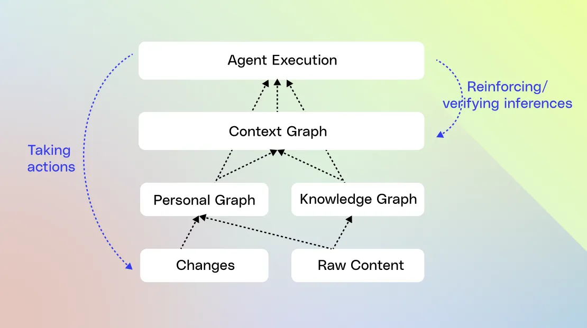
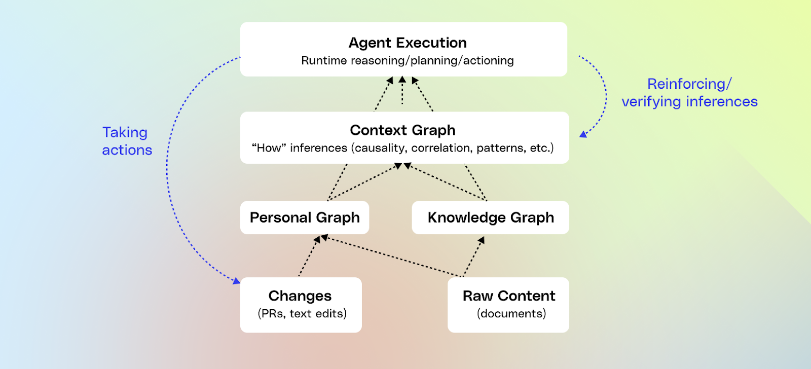
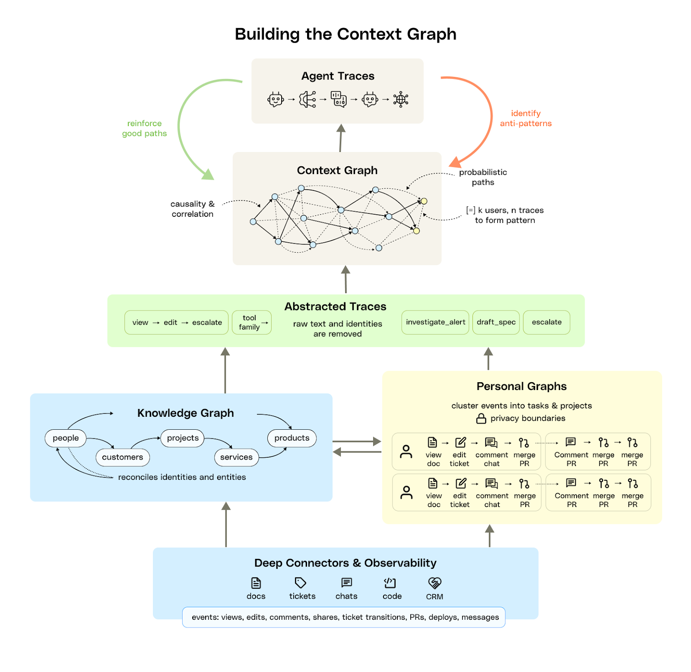

> 作者: David Huynh（Software Engineer）、Pradeep Vaghela（Software Engineer）、Julie Mills（PMM） | 页面日期: Feb 05, 2026（Last updated） | 阅读时长: 8 分钟

> 原文链接: https://www.glean.com/blog/how-do-you-build-a-context-graph

Context graphs are getting a lot of attention right now, with investors calling them a “trillion-dollar opportunity.”

上下文图谱现在备受关注，投资人称其为「万亿美元级的机会」。

That’s because while AI models can now use tools, they still lack the process knowledge needed to actually automate work. Systems of record capture decisions, but the real work happens in meetings, chats, emails, and docs. Without a structured view of how work actually gets done, AI cannot automate it reliably.

这是因为，虽然 AI 模型如今已经能用工具，但它们仍然缺少真正把工作自动化所需的流程知识。记录系统（systems of record）留存的是决策，而真正的工作发生在会议、聊天、邮件和文档里。没有对「工作究竟如何完成」的结构化视图，AI 就无法可靠地把它自动化。

With all the hype, social posts keep circling the same two questions: what exactly is a context graph, and how do you build one? In this blog, we’ll lay out Glean’s approach to building context graphs and explain why we took the path we did.

在这样一片热议中，社交平台上反复出现同样两个问题：上下文图谱到底是什么，以及怎么把它建起来？本文会讲清 Glean 构建上下文图谱的方法，以及我们为什么选择这条路径。

## What are context graphs? / 什么是上下文图谱？

A context graph is a model that connects your enterprise entities (people, documents, tickets, systems) with the temporal traces of actions and events between them. It then surfaces actionable insights from those traces so AI understands how work actually gets done.

上下文图谱是一种模型，它把企业实体（人、文档、工单、系统）与它们之间动作和事件的时间轨迹连接起来，再从这些轨迹中提炼出可执行的洞察，让 AI 理解工作实际上是如何完成的。

Context graphs help AI answer questions like:

上下文图谱帮助 AI 回答这类问题：

- “How do P1 incidents usually get resolved here?” / 「这里的 P1 故障通常是怎么解决的？」
- “What are the most common escalations about product X?” / 「关于产品 X 最常见的升级诉求是什么？」
- “What typically happens between ‘pilot created’ and ‘deal closed’?” / 「从『试点创建』到『成交』之间通常会发生什么？」
- “What does ‘onboarding complete’ actually mean for this team?” / 「对这支团队来说，『完成入职』到底意味着什么？」
- “How long does typical deployment take and why?” / 「典型部署需要多久，为什么？」

Current agents have difficulty with end-to-end processes or long-term tasks (those spanning weeks or months) that require synthesizing knowledge from multiple, disparate systems.

当前的智能体很难处理端到端流程或长期任务（跨越数周乃至数月），这类任务需要综合来自多个彼此割裂的系统的知识。

When you connect multiple tasks that span different events, you need to bring together information from various sources and from many people who each execute the work a bit differently, with local exceptions and one-off edge cases baked into their process. But systems of record typically only show the current state and rarely capture this execution variability or the full historical context, so relying on that incomplete view can lead to blind spots and suboptimal outcomes.

当你把跨越不同事件的多个任务串起来时，需要汇集来自各种来源、以及许多执行方式各不相同的人的信息 —— 他们的流程里还嵌着本地例外和一次性边界情况。但记录系统通常只呈现当前状态，很少捕捉这种执行上的差异或完整的历史上下文，因此依赖这份不完整的视图会导致盲区和次优结果。

Instead, having an internal model of your organization’s real processes—a context graph built from actual traces of actions—becomes the best proxy for learning both the structure to follow and the intent behind the work.

相反，对组织真实流程建立一个内部模型 —— 一个由真实动作轨迹构建的上下文图谱 —— 会成为学习「该遵循什么结构」以及「工作背后意图」的最佳代理。

## From “what” to “how” / 从「是什么」到「怎么做」

A context graph describes the flow of work by shifting from describing “what” exists to describing “how” change happens:

上下文图谱描述工作的流动，做法是从描述「有什么」转向描述「变化如何发生」：

- “What”: Traditional data and knowledge systems model things: customers, tickets, docs, people, systems. / 「是什么」：传统数据与知识系统对「物」建模：客户、工单、文档、人员、系统。
- “How”: A context graph models behavior: who did what, in which apps, in what order, and with what effect. / 「怎么做」：上下文图谱对「行为」建模：谁做了什么、在哪个应用里、按什么顺序、产生了什么效果。

The “how” is described by transforming actions into a first-class entity in the graph:

「怎么做」是通过把动作提升为图中的一等实体来描述的：

- Nodes: (aka User and Agent Actions with rich data traces) “created,” “viewed,” “approved,” “escalated,” “commented on,” “resolved,” each with timestamps and rich metadata about the changes. / 节点：（即携带丰富数据轨迹的用户与智能体动作）「创建」「查看」「批准」「升级」「评论」「解决」，每个都带有时间戳和关于变更的丰富元数据。
- Edges: The edges are causality and correlation. “Message A” triggered “Update B” at probability P. / 边：边表示因果与相关性。「消息 A」以概率 P 触发了「更新 B」。

We chose to have Glean model this way in order to attach predictive power to a sequence of activities, so we can suggest what step is likely to happen next without hard-coding a flow. What we end up with is a distribution of likely paths, giving the agent the autonomy to pick the most probable one for the scenario.

我们让 Glean 采用这种建模方式，是为了给一连串活动赋予预测能力，从而能在不硬编码流程的前提下，建议下一步最可能发生什么。最终我们得到的是可能路径的分布，让智能体有权自主选择对该场景最可能的那一条。

Now, layered on top of these process paths are derived insights—a reasoning behind why “Path A” differed from “Path B.” This enables us to encode not just the “how” but also a probable “why,” which can be fed into the agent at runtime.

在这些流程路径之上，还叠加了派生洞察 —— 即「路径 A」为何不同于「路径 B」的推理依据。这让我们不只编码「怎么做」，还能编码一个概率性的「为什么」，并在运行时喂给智能体。

After the agent runs, its actions become new traces for the context graph. Reinforcement learning over these traces then evaluates whether the chosen path was optimal and identifies alternative paths the agent can take in the future.

智能体运行之后，它的动作又成为上下文图谱的新轨迹。对这些轨迹做强化学习，可以评估所选路径是否最优，并找出智能体未来可走的替代路径。

## How do we build a context graph? / 我们如何构建上下文图谱？

### Investing in deep connectors and observability / 投入深度连接器与可观测性

Context graphs require a foundation of deep connectors and observability. If we can’t see how work happens, we can’t model it. That means integrating at a document level with the apps where work actually takes place, as well as structured data: CRM and ticketing systems, chat, docs, email, calendars, code, dashboards, and internal apps.

上下文图谱需要深度连接器和可观测性作为地基。如果看不见工作如何发生，就无法为它建模。这意味着要在文档级别与实际承载工作的应用集成，也要接入结构化数据：CRM 与工单系统、聊天、文档、邮件、日历、代码、仪表盘和内部应用。

We understand how each app is really used—for example, Jira comments decay quickly, while the links in a Jira description are usually canonical (ie: docs, designs, etc.). We capture those patterns in a centralized data model, which we then place in our search index.

我们理解每个应用真实的使用方式 —— 例如，Jira 的评论衰减很快，而 Jira 描述里的链接通常是权威指向（比如文档、设计稿）。我们把这些模式沉淀到集中式数据模型中，再放进搜索索引。

From there, the hard part is keeping that model healthy over time: chasing down inconsistent APIs, reconciling identities that differ across tools, and continually enforcing content permissions so that every result is both relevant and properly secured.

接下来困难的部分是长期维持这个模型的健康：追查不一致的 API、核对在不同工具间不一致的身份，并持续执行内容权限，让每个结果既相关又被正确保护。

A couple of years ago, we moved towards capturing not just document data, but all of the change events in an app. We then normalize and expose them as traces, with the aim of building a context graph.

几年前，我们开始不只采集文档数据，还采集应用中的全部变更事件。随后把它们归一化并以轨迹的形式暴露出来，目标就是构建上下文图谱。

### Building a unified knowledge graph / 构建统一的知识图谱

After we crawl and index data, we build a knowledge graph by running a machine learning pipeline to infer higher-level entities like projects, customers, products, teams, and people. We also identify the relationships between them—determining which docs, tickets, calls, and dashboards belong to a given product or account.

抓取并索引数据之后，我们通过运行机器学习流水线来构建知识图谱，推断出项目、客户、产品、团队、人员这类更高层的实体。我们也会识别它们之间的关系 —— 判断哪些文档、工单、通话和仪表盘属于某个产品或账户。

We continuously feed in activity signals (views, edits, comments, etc,) to understand how information is actually used and how people collaborate. This is how Glean understands that “ACME Inc” in CRM and “ACME” in support tickets are the same customer.

我们持续输入活动信号（浏览、编辑、评论等），以理解信息实际如何被使用、人们如何协作。Glean 正是靠这个认出 CRM 里的「ACME Inc」和工单里的「ACME」是同一个客户。

This allows us to roll up activities into the same canonical project or customer, giving a high degree of confidence as to what is actually happening.

这让我们能把活动归并到同一个权威项目或客户上，从而对「实际发生了什么」有很高的置信度。

This is why knowledge graphs are a key foundation to context graphs, because activity signals on their own are noisy, you need knowledge graphs underneath to make that activity meaningful.

这也是知识图谱成为上下文图谱关键地基的原因：单独看，活动信号是嘈杂的，你需要底层的知识图谱才能让这些活动有意义。

### Creating a personal graph / 构建个人图谱

In parallel with the knowledge graph, we build a personal graph that understands your tasks and projects to offer proactive, personalized help. To build the personal graph, we collect and synthesize activity streams and traces,  stitch those raw signals into timelines, and enrich them with entities from the knowledge graph:

与知识图谱并行，我们构建个人图谱，理解你的任务和项目，从而提供主动、个性化的帮助。构建个人图谱时，我们收集并综合活动流与轨迹，把这些原始信号拼接成时间线，并用知识图谱中的实体加以丰富：

- For each person, a chronological sequence of actions across tools, along with richer metadata. / 对每个人，形成跨工具的动作时间序列，并附带更丰富的元数据。
- From there, we start grouping low-level events into semantic tasks. / 在此基础上，我们开始把低层事件归组为语义任务。

That’s where it gets tricky. Real work is messy: people context switch constantly, reuse the same doc across efforts, and abandon threads and pick them back up days later. A single “edit doc” event might belong to multiple parallel streams of work.

难点就在这里。真实工作是混乱的：人会不停切换上下文、把同一份文档复用到多个事项上、搁置一条线索又在几天后重新捡起。单个「编辑文档」事件可能同属多条并行的工作流。

To make sense of this, we combine:

为了理清这些，我们结合两类信号：

- Simple signals like shared titles, links between tickets and docs, meeting invites, channel names, and time windows. / 简单信号：共享标题、工单与文档之间的链接、会议邀请、频道名称、时间窗口。
- LLMs that look at sequences of events and infer, “this cluster looks like investigating an alert,” or “these actions together look like drafting and socializing a spec.” / 大模型：观察事件序列并推断「这一簇看起来像是在排查告警」，或「这些动作合起来像是在起草并散发规格文档」。

The goal is to carve the flow into coherent units of work—tasks and higher-level projects—that the system can reason about.

目标是把流动的工作切分成连贯的工作单元 —— 任务和更高层的项目 —— 让系统可以对它进行推理。

Now, at this point, we’ve only looked at a single individual at work. And, because we maintain user privacy, this data is only visible to them. But when we start to analyze it in aggregate, we can see themes.

注意，到这里我们只看了单个个体的工作。而且出于对用户隐私的保护，这些数据只有本人可见。但当我们开始做聚合分析时，就能看见主题。

### Creating a context graph / 构建上下文图谱

When we analyze processes in aggregate, we take each personal graph and normalize it into a sequence of anonymized “steps” with coarse labels:

当我们聚合分析流程时，会把每份个人图谱归一化成一系列匿名化的「步骤」，并打上粗粒度标签：

- action type (view, edit, comment, escalate) / 动作类型（浏览、编辑、评论、升级）
- tool family (docs, chat, tickets, code) / 工具族（文档、聊天、工单、代码）
- knowledge graph entities involved (incident type, product, service, customer segment) / 涉及的知识图谱实体（故障类型、产品、服务、客户分层）
- derived process tags from LLms or heuristics (e “investigate_alert”, “draft_spec”, “negotiate_contract”, “onboard_customer”) / 由大模型或启发式规则派生的流程标签（「investigate_alert」「draft_spec」「negotiate_contract」「onboard_customer」）
- lightweight timing features and outcomes (e.g. “resolved P1, MTTR < 30 minutes” or “deal closed-won”) / 轻量的时序特征与结果（例如「已解决 P1，MTTR < 30 分钟」或「成交赢单」）

What we do not carry into abstracted traces is raw text (doc bodies, message text), user identifiers, or customer‑specific secrets. We then compute similarity between abstracted traces to figure out which ones are likely to involve the same process.

我们不会带进抽象轨迹的是：原始文本（文档正文、消息内容）、用户标识符，或客户专属的机密信息。然后我们计算抽象轨迹之间的相似度，判断哪些可能属于同一个流程。

On top of that, we only treat a pattern as viable if it appears across at least k distinct users and n independent traces, with anything too rare dropped to preserve anonymity.

此外，只有当某个模式出现在至少 k 个不同用户和 n 条独立轨迹中，我们才认为它成立；过于罕见的一律丢弃，以保证匿名性。

When we do this, we’re building a probabilistic view of “what tends to happen”, and “in what order,” and “why does this path deviate from other similar paths.” We then use timing to determine the value of the process. If it's taking similar groups of users a lot of time to do a process, it’s most likely a high-value process. That becomes the system’s context graph—the playbooks agents can lean on when they see a similar situation.

这样做，我们构建的是对「通常会发生什么」「以什么顺序发生」「这条路径为何偏离其他相似路径」的概率性视图。随后用时间来判定流程的价值：如果同类用户群在一道流程上耗费大量时间，它很可能就是高价值流程。这就成为系统的上下文图谱 —— 智能体遇到相似情形时可以依赖的剧本。

As we’ve built this graph,  we’ve weighed different ways to store event data for traversal. Pure graph structures are rigid; raw text is flexible but hard to navigate. So we use a hybrid model: take free-form text, break it into smaller chunks, and embed entity IDs.

在构建这张图的过程中，我们权衡了多种存储事件数据以支持遍历的方式。纯图结构很僵硬；原始文本灵活但难以导航。所以我们采用混合模型：取自由文本，切成更小的块，并嵌入实体 ID。

An incident, for example, becomes short segments that mark transitions—“investigating” to “mitigating”— by tagging them with IDs like incident_id=INC-123, channel_id=#p1-incidents, or action_type=escalated. This lets the agent walk the process step by step with clear guideposts, with the tradeoff that it’s not optimized for reasoning across thousands of incidents at once.

举例来说，一次故障会被切成标记状态转换（从「排查中」到「缓解中」）的短片段，并打上 incident_id=INC-123、channel_id=#p1-incidents 或 action_type=escalated 这类 ID。这让智能体能一步步走完流程、沿途有清晰的路标；代价是它并不是为同时跨数千起故障做推理而优化的。

### Learning from agentic traces / 从智能体轨迹中学习

The last major step is to close the loop with agent execution. If agents run outside this system, the graph never learns from them. If they run inside it, every agent run becomes one more trace:

最后一个关键步骤是让智能体执行闭环。如果智能体跑在这套系统之外，图谱就永远学不到东西；如果跑在里面，每次运行都成为一条新轨迹：

- Which tools it called, in what order, with what inputs and outputs. / 它调用了哪些工具、按什么顺序、输入输出是什么。
- Whether the run completed successfully, how efficiently it ran, and whether the user downvoted or upvoted the response / 这次运行是否成功完成、效率如何，以及用户对回答是点了赞还是踩。

All of these learnings are scoped per enterprise and focus on how the agent uses the tools, rather than storing the underlying content.

所有这些学习都以企业为范围，关注的是智能体如何使用工具，而不是存储底层内容。

Offline, we then replay and try out alternative routes. We score the alternatives on correctness, completeness, instruction following, and efficiency. We treat these agent traces the same way we treat human ones:

在离线状态下，我们会重放并尝试替代路线，从正确性、完整性、指令遵循和效率几方面给替代方案打分。我们对待智能体轨迹的方式，与对待人类轨迹完全一样：

- Successful runs reinforce the patterns you want the system to prefer, becoming natural language playbooks. / 成功的运行会强化你希望系统偏好的模式，最终沉淀为自然语言的剧本。
- Runs that need intervention highlight anti-patterns where more context or better tool use is needed / 需要人工介入的运行则暴露出反模式，指出哪里需要更多上下文或更好的工具调用。

Over time, the context graph becomes a joint model of human and agent behavior. It doesn’t just describe how work used to happen; it reflects how work is unfolding now as humans and agents share more of it.

假以时日，上下文图谱会成为人类与智能体行为的联合模型。它不只描述工作过去如何发生，而是反映在人与智能体共同分担更多工作的当下，工作正在如何展开。

That’s why the context graph must be owned jointly by the data layer and the orchestration layer. For high-value flows—incident response, sales deals, product development—you need both: a context layer that captures a structured, process-aware model of the enterprise, and an execution layer that can plan, iterate, and generate traces. Separating them creates drift: the graph evolves one way, agent execution evolves another, and you end up with two divergent versions of reality.

这就是为什么上下文图谱必须由数据层与编排层共同拥有。对于高价值流程 —— 故障响应、销售成单、产品研发 —— 你两者都需要：一个捕捉企业结构化、流程感知模型的上下文层，以及一个能够规划、迭代并产生轨迹的执行层。把它们分开会导致漂移：图谱朝一个方向演进，智能体执行朝另一个方向演进，最终你得到两个彼此背离的现实版本。

Keeping the graph and orchestration in one system ensures agents stay grounded in a live, evolving model of how your enterprise actually works.

把图谱与编排放在同一个系统里，能确保智能体始终扎根于一个实时演进的企业运作模型。

## Building context graphs at Glean / Glean 如何构建上下文图谱

Building context graphs is a big investment, and we actually tested the concept internally before building it. We manually created a context graph for Glean by relying on technology we had already built: the personal graph.

构建上下文图谱是一笔大投入，我们在真正动手之前先在内部验证了这个概念。我们依靠已经建好的技术 —— 个人图谱 —— 手工为 Glean 构建了一个上下文图谱。

We asked employees at Glean to opt in to sharing their personal graph data, which captured what projects they worked on, the sequence of steps that they followed, and the time they spent. With the element of time, we were able to distinguish low-value from high-value processes. We then looked at which teams have the same, repeated processes that are high value, like “AE mid‑market deal cycle,” “SE proof‑of‑concept,” “on‑call incident response,” “PM feature launch,” etc.

我们邀请 Glean 员工自愿共享他们的个人图谱数据，其中记录了他们在做哪些项目、遵循的步骤序列，以及花费的时间。有了时间这个维度，我们就能区分低价值与高价值流程。接着我们观察哪些团队存在相同且重复的高价值流程，例如「AE 中型市场成单周期」「SE 概念验证」「值班故障响应」「PM 功能发布」等。

We took the sequences of events for this work, and we validated with subject-matter experts the A-path versus the D-path to get the work done, when there are deviations, and why. We also looked at where we had blinders, or steps that we’re missing because we hadn’t crawled the right data or lacked the actions to support a given step. Then, we put resources behind making these high-value processes (vetted for both Glean and customer demand), into agents that actually work in Glean.

我们取出这些工作的完整事件序列，与领域专家一起校验：完成工作最快的 A 路径与最慢的 D 路径分别是什么、何时出现偏离、原因是什么。我们也检视自己的盲区 —— 因为没抓到正确的数据、或缺少支撑某一步的动作而缺失的环节。然后我们投入资源，把这些高价值流程（同时经过 Glean 自身与客户需求双重验证）做成真正在 Glean 里工作的智能体。

While these agents become a static representation of the current state, that wasn’t the end game for us. We wanted context graphs. That’s because optimal paths evolve, ownership changes, new tools show up, and more. Our goal with the context graph isn’t just to mint a static set of agents, but to keep feeding agents with fresh process insights from the graph and push more of the logic into that learned layer instead of constantly relying on manual instructions. That’s how we believe you get long-running agents that operate autonomously. And here at Glean, we’re close to making that a reality.

这些智能体会成为当前状态的静态呈现，但那不是我们的终局。我们要的是上下文图谱。因为最优路径会变、负责人会变、新工具会出现，等等。我们做上下文图谱的目标不是铸造一批静态智能体，而是持续用图谱中的新鲜流程洞察喂养智能体，把更多逻辑推进那个「已学习」的层，而不是长期依赖人工指令。我们相信，这才是获得可自主运转的长时运行智能体的方式。在 Glean，我们离把它变成现实已经很近了。

Looking to learn more about context graphs? Check out our previous blog [here](https://www.glean.com/blog/context-data-platform)—or sign up for a free [demo](https://www.glean.com/get-a-demo) of Glean today.

想进一步了解上下文图谱？可以看我们之前这篇博客 [here](https://www.glean.com/blog/context-data-platform)，或注册 Glean 的免费 [demo](https://www.glean.com/get-a-demo)。
