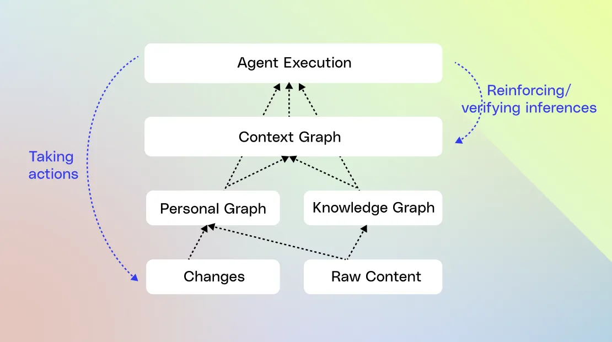
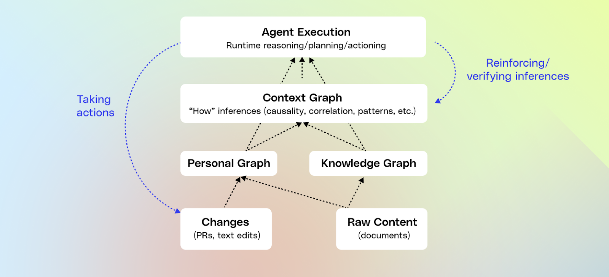
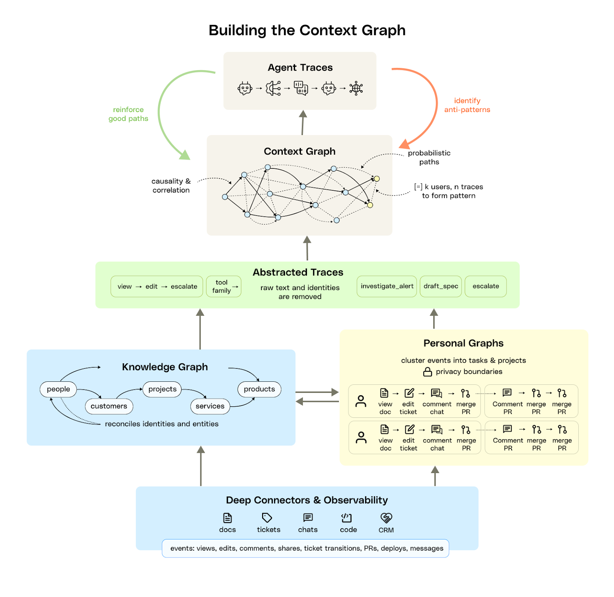

[___](#)  在新窗口中打开 打开外部网站 在新窗口中打开外部网站        本网站利用 Cookie 等技术来启用基本网站功能以及 分析、个性化定制 和 有针对性的广告。 您可随时更改设置或接受默认设置。 您可以关闭此横幅以仅继续使用必要的 cookie。     [隐私政策](https://www.glean.com/privacy-policy)  [存储偏好](#0af52645-63c0-4fb0-aa23-30146d9b0996)

    - 有针对性的广告
- 个性化定制
- 分析

                          存储偏好

          

Product

[Platform overviewSee how Glean works.](/platform)Built for enterprise AI.[Glean Enterprise Context Ground AI in company context](/platform/enterprise-context)[Connectors & actionsGlean offers more than 275+ connectors](/platform/connectors)[APIsBuild generative AI experiences](/platform/api)[API lookbookExplore what you can build](/platform/api/lookbook)[Glean ProtectSafely scale AI at work](/platform/security)[Glean IntelligenceGet more from every AI request](/platform/intelligence)[Auto routingRoute work to the right model](/platform/auto-routing)[Model hubGet access to the latest models](/platform/model-hub)[Usage controlsControl AI usage and spend](/platform/cost-controls)[AI gatewayGovern every AI interaction](/platform/ai-gateway)[Glean AssistantYour enterprise AI coworker](/ai-assistant)[Proactive AIStay ahead of what matters](/ai-assistant/proactive-ai)[Content creationCreate grounded, on-brand content](/ai-assistant/content-creation)[MultiplayerCreate and refine work together](/ai-assistant/multiplayer)[Work executionTurn insight into action](/ai-assistant/work-execution)[Data analysis and researchTurn context into insights](/ai-assistant/research-and-analysis)[Enterprise searchFind answers across your company](/enterprise-search)[Glean AgentsBuild and manage agents](/ai-agents)[Agent builderBuild agents your way](/ai-agents/agent-builder)[Agent orchestrationAutomate work across systems](/ai-agents/agent-orchestration)[Agent governanceScale agents with control](/ai-agents/agent-governance)[Agent libraryDiscover trusted, reusable agents](/ai-agents/agent-library)[Coming soonGlean TransformSee where AI can make the biggest impact](/transform)Customers

FEATURED STORIES[Booking.com](/resources/customer-stories/booking-com)[Zillow](/resources/customer-stories/zillow)[TIME](/resources/customer-stories/time)[Ericsson](/resources/customer-stories/ericsson)[See all customer stories](/resources/customer-stories)Solutions

DEPARTMENTS[All Teams](/solutions/all-teams)[Engineering](/solutions/departments/engineering)[Customer Service](/solutions/departments/customer-service)[Sales](/solutions/departments/sales)[IT](/solutions/departments/it-service-management)[Marketing](/solutions/departments/marketing)[B2B Marketing](/solutions/departments/marketing/b2b)[B2C Marketing](/solutions/departments/marketing/b2c)[People](/solutions/departments/people)[Finance](/solutions/departments/finance)[Legal](/solutions/departments/legal)INDUSTRIES[Retail](/solutions/industries/retail)[Consumer Goods](/solutions/industries/industrials/consumer-goods)[Industrials](/solutions/industries/industrials)[Energy & Utilities](/solutions/industries/industrials/energy-utilities)[Manufacturing](/solutions/industries/industrials/manufacturing)[Supply Chain](/solutions/industries/industrials/supply-chain)[Professional Services](/solutions/industries/professional-services)[Consulting](/solutions/industries/professional-services/consulting)[Construction](/solutions/industries/professional-services/construction)[IT Services](/solutions/industries/professional-services/it-services)[Financial Services](/solutions/industries/financial-services)[Banking](/solutions/industries/financial-services/banking)[PE/VC](/solutions/industries/financial-services/private-equity-venture-capital)[Asset management](/solutions/industries/financial-services/asset-management)[Insurance](/solutions/industries/financial-services/insurance)[Government](/solutions/industries/government)[Healthcare](/solutions/industries/healthcare)[Life Sciences](/solutions/industries/life-sciences)[Higher Education](/solutions/industries/higher-education)[What’s the state of your AI stack for software engineering?Take the quiz
  
See how your engineering AI stack performs across delivery speed, incident response, and context access. Get your AI Stack Score and next-step recommendations.Take the quiz](/resources/quiz/eng-ai-stack-performance-benchmark)Resources

EXPLORE

[Guides](/resources/guides)[Product Videos](/resources/product-videos)[Blog](/blog)[Webinars](/webinars)ENGAGE[Glean:GO 2026](/events/glean-go-2026)[Gleaniverse Community](https://community.glean.com/)SUPPORT & SERVICES[Help Center](https://help.glean.com/en/)[Developers](https://developers.glean.com/)[Partners](/partners)[Work AI Institute

  .nav_resource-center_link.is-nav26 {
    position: relative;
    overflow: hidden;
    z-index: 1;
  }

  /* Sweep layer — your gradient, parked off-screen left and invisible until triggered */
  .nav_resource-center_link.is-nav26::after {
    content: '';
    position: absolute;
    inset: 0;
    background:
      linear-gradient(88.36deg, rgba(239, 96, 27, 0) 37.54%, rgba(239, 96, 27, 0.36) 47.48%, rgba(225, 107, 255, 0.36) 54.99%, rgba(225, 107, 255, 0) 60.43%);
    transform: translateX(-100%);
    z-index: -1;
    pointer-events: none;
  }

  /* One pass, left → right; "forwards" leaves it parked off-screen right = invisible */
  .nav_resource-center_link.is-nav26.is-sweeping::after {
    animation: nav26-sweep 1.3s ease-in-out forwards;
  }
  @keyframes nav26-sweep {
    from { transform: translateX(-100%); }
    to   { transform: translateX(100%); }
  }

  @media (prefers-reduced-motion: reduce) {
    .nav_resource-center_link.is-nav26.is-sweeping::after { animation: none; }
  }

(function () {
  var SWEEP_DELAY = 200; // ms after the dropdown opens before the sweep runs

  function init() {
    var links = document.querySelectorAll('.nav_resource-center_link.is-nav26');

    links.forEach(function (link) {
      var item = link.closest('.nav-25_list_item'); // the Resources nav item
      if (!item) return;

      var timer = null;

      function runSweep() {
        link.classList.remove('is-sweeping');
        void link.offsetWidth;          // reflow so the animation replays
        link.classList.add('is-sweeping');
      }

      var wasOpen = false;
      new MutationObserver(function () {
        var open = item.classList.contains('trigger-enter-active');
        if (open && !wasOpen) {
          clearTimeout(timer);
          timer = setTimeout(runSweep, SWEEP_DELAY);
        } else if (!open) {
          clearTimeout(timer);          // cancel if they leave before it fires
        }
        wasOpen = open;
      }).observe(item, { attributes: true, attributeFilter: ['class'] });
    });
  }

  if (document.readyState === 'loading') document.addEventListener('DOMContentLoaded', init);
  else init();
})();](/work-ai-institute)[The AI Token Savings StoryExplore how context and model routing affect token costs, output quality, and savings at scale.Explore the story](/ai-token-economics)Company

[About us](/about)[Glean on Glean](/about/ai-at-glean)[Story](/about/glean-story)[Culture](/about/culture-and-values)[Careers](/careers)Thank you! Your submission has been received!Oops! Something went wrong while submitting the form.[Sign in](https://app.glean.com/login?redirect=%2F)[Get a demo](/get-a-demo)[Get a demo](/get-a-demo)

[Sign in](https://app.glean.com/login?redirect=%2F)[Get a demo](/get-a-demo)[Get a demo](/get-a-demo)

Product

Customers

Solutions

Resources

Company

[Sign in](https://app.glean.com/login?redirect=%2F)

[Sign in](https://app.glean.com/login?redirect=%2F)[Get a demo](/get-a-demo)[Get a demo](/get-a-demo)

PRODUCT[Platform overviewSee how Glean works.](/platform)Built for enterprise AI.[Glean Enterprise Context Ground AI in company context](/platform/enterprise-context)[Connectors & actionsGlean offers more than 275+ connectors](/platform/connectors)[APIsBuild generative AI experiences](/platform/api)[API lookbookExplore what you can build](/platform/api/lookbook)[Glean ProtectSafely scale AI at work](/platform/security)[Glean IntelligenceGet more from every AI request](/platform/intelligence)[Auto routingRoute work to the right model](/platform/auto-routing)[Model hubGet access to the latest models](/platform/model-hub)[Usage controlsControl AI usage and spend](/platform/cost-controls)[AI gatewayGovern every AI interaction](/platform/ai-gateway)[Glean AssistantYour enterprise AI coworker](/ai-assistant)[Proactive AIStay ahead of what matters](/ai-assistant/proactive-ai)[Content creationCreate grounded, on-brand content](/ai-assistant/content-creation)[MultiplayerCreate and refine work together](/ai-assistant/multiplayer)[Work executionTurn insight into action](/ai-assistant/work-execution)[Data analysis and researchTurn context into insights](/ai-assistant/research-and-analysis)[Enterprise searchFind answers across your company](/enterprise-search)[Glean AgentsBuild and manage agents](/ai-agents)[Agent builderBuild agents your way](/ai-agents/agent-builder)[Agent orchestrationAutomate work across systems](/ai-agents/agent-orchestration)[Agent governanceScale agents with control](/ai-agents/agent-governance)[Agent libraryDiscover trusted, reusable agents](/ai-agents/agent-library)[Coming soonGlean TransformSee where AI can make the biggest impact](/transform)

[Sign in](https://app.glean.com/login?redirect=%2F)[Get a demo](/get-a-demo)[Get a demo](/get-a-demo)

CUSTOMERSFEATURED STORIES[Booking.com](/resources/customer-stories/booking-com)[Zillow](/resources/customer-stories/zillow)[TIME](/resources/customer-stories/time)[Ericsson](/resources/customer-stories/ericsson)[See all customer stories](/resources/customer-stories)

[Sign in](https://app.glean.com/login?redirect=%2F)[Get a demo](/get-a-demo)[Get a demo](/get-a-demo)

SOLUTIONSDEPARTMENTS[All Teams](/solutions/all-teams)[Engineering](/solutions/departments/engineering)[Customer Service](/solutions/departments/customer-service)[Sales](/solutions/departments/sales)[IT](/solutions/departments/it-service-management)[Marketing](/solutions/departments/marketing)[B2B Marketing](/solutions/departments/marketing/b2b)[B2C Marketing](/solutions/departments/marketing/b2c)[People](/solutions/departments/people)[Finance](/solutions/departments/finance)[Legal](/solutions/departments/legal)INDUSTRIES[Retail](/solutions/industries/retail)[Consumer Goods](/solutions/industries/industrials/consumer-goods)[Industrials](/solutions/industries/industrials)[Energy & Utilities](/solutions/industries/industrials/energy-utilities)[Manufacturing](/solutions/industries/industrials/manufacturing)[Supply Chain](/solutions/industries/industrials/supply-chain)[Professional Services](/solutions/industries/professional-services)[Consulting](/solutions/industries/professional-services/consulting)[Construction](/solutions/industries/professional-services/construction)[IT Services](/solutions/industries/professional-services/it-services)[Financial Services](/solutions/industries/financial-services)[Banking](/solutions/industries/financial-services/banking)[PE/VC](/solutions/industries/financial-services/private-equity-venture-capital)[Asset management](/solutions/industries/financial-services/asset-management)[Insurance](/solutions/industries/financial-services/insurance)[Government](/solutions/industries/government)[Healthcare](/solutions/industries/healthcare)[Life Sciences](/solutions/industries/life-sciences)[Higher Education](/solutions/industries/higher-education)[What’s the state of your AI stack for software engineering?Take the quiz
  
See how your engineering AI stack performs across delivery speed, incident response, and context access. Get your AI Stack Score and next-step recommendations.Take the quiz](/resources/quiz/eng-ai-stack-performance-benchmark)

[Sign in](https://app.glean.com/login?redirect=%2F)[Get a demo](/get-a-demo)[Get a demo](/get-a-demo)

RESOURCESEXPLORE

[Guides](/resources/guides)[Product Videos](/resources/product-videos)[Blog](/blog)[Webinars](/webinars)ENGAGE[Glean:GO 2026](/events/glean-go-2026)[Gleaniverse Community](https://community.glean.com/)SUPPORT & SERVICES[Help Center](https://help.glean.com/en/)[Developers](https://developers.glean.com/)[Partners](/partners)[Work AI Institute

  .nav_resource-center_link.is-nav26 {
    position: relative;
    overflow: hidden;
    z-index: 1;
  }

  /* Sweep layer — your gradient, parked off-screen left and invisible until triggered */
  .nav_resource-center_link.is-nav26::after {
    content: '';
    position: absolute;
    inset: 0;
    background:
      linear-gradient(88.36deg, rgba(239, 96, 27, 0) 37.54%, rgba(239, 96, 27, 0.36) 47.48%, rgba(225, 107, 255, 0.36) 54.99%, rgba(225, 107, 255, 0) 60.43%);
    transform: translateX(-100%);
    z-index: -1;
    pointer-events: none;
  }

  /* One pass, left → right; "forwards" leaves it parked off-screen right = invisible */
  .nav_resource-center_link.is-nav26.is-sweeping::after {
    animation: nav26-sweep 1.3s ease-in-out forwards;
  }
  @keyframes nav26-sweep {
    from { transform: translateX(-100%); }
    to   { transform: translateX(100%); }
  }

  @media (prefers-reduced-motion: reduce) {
    .nav_resource-center_link.is-nav26.is-sweeping::after { animation: none; }
  }

(function () {
  var SWEEP_DELAY = 200; // ms after the dropdown opens before the sweep runs

  function init() {
    var links = document.querySelectorAll('.nav_resource-center_link.is-nav26');

    links.forEach(function (link) {
      var item = link.closest('.nav-25_list_item'); // the Resources nav item
      if (!item) return;

      var timer = null;

      function runSweep() {
        link.classList.remove('is-sweeping');
        void link.offsetWidth;          // reflow so the animation replays
        link.classList.add('is-sweeping');
      }

      var wasOpen = false;
      new MutationObserver(function () {
        var open = item.classList.contains('trigger-enter-active');
        if (open && !wasOpen) {
          clearTimeout(timer);
          timer = setTimeout(runSweep, SWEEP_DELAY);
        } else if (!open) {
          clearTimeout(timer);          // cancel if they leave before it fires
        }
        wasOpen = open;
      }).observe(item, { attributes: true, attributeFilter: ['class'] });
    });
  }

  if (document.readyState === 'loading') document.addEventListener('DOMContentLoaded', init);
  else init();
})();](/work-ai-institute)[The AI Token Savings StoryExplore how context and model routing affect token costs, output quality, and savings at scale.Explore the story](/ai-token-economics)

[Sign in](https://app.glean.com/login?redirect=%2F)[Get a demo](/get-a-demo)[Get a demo](/get-a-demo)

COMPANY[About us](/about)[Glean on Glean](/about/ai-at-glean)[Story](/about/glean-story)[Culture](/about/culture-and-values)[Careers](/careers)8minutes readAuthors

[David Huynh

Software Engineer](/authors/david-huynh)[Pradeep Vaghela

Software Engineer](/authors/pradeep-vaghela)[Julie Mills

PMM](/authors/julie-mills)

### Table of contents

[What are context graphs?](#what-are-context-graphs)[From “what” to “how”](#from-what-to-how)[How do we build a context graph?](#how-do-we-build-a-context-graph)[Investing in deep connectors and observability](#investing-in-deep-connectors-and-observability)[Building a unified knowledge graph](#building-a-unified-knowledge-graph)[Creating a personal graph](#creating-a-personal-graph)[Creating a context graph](#creating-a-context-graph)[Learning from agentic traces](#learning-from-agentic-traces)[Building context graphs at Glean](#building-context-graphs-at-glean)[Contextless AI wastes tokensLearn how context, model routing, and execution design shape the cost and performance of enterprise AI.Get the whitepaper](/resources/guides/token-economy-enterprise-ai)Share this article:

Context graphs are getting a lot of attention right now, with investors calling them a “trillion-dollar opportunity.”

That’s because while AI models can now use tools, they still lack the process knowledge needed to actually automate work. Systems of record capture decisions, but the real work happens in meetings, chats, emails, and docs. Without a structured view of how work actually gets done, AI cannot automate it reliably.

With all the hype, social posts keep circling the same two questions: what exactly is a context graph, and how do you build one? In this blog, we’ll lay out Glean’s approach to building context graphs and explain why we took the path we did.

## What are context graphs?

A **context graph** is a model that connects your enterprise entities (people, documents, tickets, systems) with the temporal traces of actions and events between them. It then surfaces actionable insights from those traces so AI understands how work actually gets done.

Context graphs help AI answer questions like:

- “How do P1 incidents usually get resolved here?”
- “What are the most common escalations about product X?”
- “What typically happens between ‘pilot created’ and ‘deal closed’?”
- “What does ‘onboarding complete’ actually mean for this team?”
- “How long does typical deployment take and why?”

Current agents have difficulty with end-to-end processes or long-term tasks (those spanning weeks or months) that require synthesizing knowledge from multiple, disparate systems.

When you connect multiple tasks that span different events, you need to bring together information from various sources and from many people who each execute the work a bit differently, with local exceptions and one-off edge cases baked into their process. But systems of record typically only show the current state and rarely capture this execution variability or the full historical context, so relying on that incomplete view can lead to blind spots and suboptimal outcomes.

Instead, having an internal model of your organization’s real processes—a context graph built from actual traces of actions—becomes the best proxy for learning both the structure to follow and the intent behind the work.

## From “what” to “how”

A context graph describes the flow of work by shifting from describing “what” exists to describing “how” change happens:

- “What”: Traditional data and knowledge systems model things: customers, tickets, docs, people, systems.
- “How”: A context graph models behavior: who did what, in which apps, in what order, and with what effect.

The “how” is described by transforming actions into a first-class entity in the graph:

- Nodes: (aka User and Agent Actions with rich data traces) “created,” “viewed,” “approved,” “escalated,” “commented on,” “resolved,” each with timestamps and rich metadata about the changes.
- Edges: The edges are causality and correlation. “Message A” triggered “Update B” at probability P.

We chose to have Glean model this way in order to attach predictive power to a sequence of activities, so we can suggest what step is likely to happen next without hard-coding a flow. What we end up with is a distribution of likely paths, giving the agent the autonomy to pick the most probable one for the scenario.

Now, layered on top of these process paths are derived insights—a reasoning behind why “Path A” differed from “Path B.” This enables us to encode not just the “how” but also a probable “why,” which can be fed into the agent at runtime.

After the agent runs, its actions become new traces for the context graph. Reinforcement learning over these traces then evaluates whether the chosen path was optimal and identifies alternative paths the agent can take in the future.

## How do we build a context graph?

### Investing in deep connectors and observability

Context graphs require a foundation of deep connectors and observability. If we can’t see how work happens, we can’t model it. That means integrating at a document level with the apps where work actually takes place, as well as structured data: CRM and ticketing systems, chat, docs, email, calendars, code, dashboards, and internal apps.

We understand how each app is really used—for example, Jira comments decay quickly, while the links in a Jira description are usually canonical (ie: docs, designs, etc.). We capture those patterns in a centralized data model, which we then place in our search index.

From there, the hard part is keeping that model healthy over time: chasing down inconsistent APIs, reconciling identities that differ across tools, and continually enforcing content permissions so that every result is both relevant and properly secured.

A couple of years ago, we moved towards capturing not just document data, but all of the change events in an app. We then normalize and expose them as traces, with the aim of building a context graph.

### Building a unified knowledge graph

After we crawl and index data, we build a knowledge graph by running a machine learning pipeline to infer higher-level entities like projects, customers, products, teams, and people. We also identify the relationships between them—determining which docs, tickets, calls, and dashboards belong to a given product or account.

We continuously feed in activity signals (views, edits, comments, etc,) to understand how information is actually used and how people collaborate. This is how Glean understands that “ACME Inc” in CRM and “ACME” in support tickets are the same customer.

This allows us to roll up activities into the same canonical project or customer, giving a high degree of confidence as to what is actually happening.

This is why knowledge graphs are a key foundation to context graphs, because activity signals on their own are noisy, you need knowledge graphs underneath to make that activity meaningful.

### Creating a personal graph

In parallel with the knowledge graph, we build a personal graph that understands your tasks and projects to offer proactive, personalized help. To build the personal graph, we collect and synthesize activity streams and traces,  stitch those raw signals into timelines, and enrich them with entities from the knowledge graph:

- For each person, a chronological sequence of actions across tools, along with richer metadata.
- From there, we start grouping low-level events into semantic tasks.

That’s where it gets tricky. Real work is messy: people context switch constantly, reuse the same doc across efforts, and abandon threads and pick them back up days later. A single “edit doc” event might belong to multiple parallel streams of work.

To make sense of this, we combine:

- Simple signals like shared titles, links between tickets and docs, meeting invites, channel names, and time windows.
- LLMs that look at sequences of events and infer, “this cluster looks like investigating an alert,” or “these actions together look like drafting and socializing a spec.”

The goal is to carve the flow into coherent units of work—tasks and higher-level projects—that the system can reason about.

Now, at this point, we’ve only looked at a single individual at work. And, because we maintain user privacy, this data is only visible to them. But when we start to analyze it in aggregate, we can see themes.

### Creating a context graph

When we analyze processes in aggregate, we take each personal graph and normalize it into a sequence of anonymized “steps” with coarse labels:

- action type (view, edit, comment, escalate)
- tool family (docs, chat, tickets, code)
- knowledge graph entities involved (incident type, product, service, customer segment)
- derived process tags from LLms or heuristics (e “investigate_alert”, “draft_spec”, “negotiate_contract”, “onboard_customer”)
- lightweight timing features and outcomes (e.g. “resolved P1, MTTR < 30 minutes” or “deal closed‑won”)

What we *do not* carry into abstracted traces is raw text (doc bodies, message text), user identifiers, or customer‑specific secrets. We then compute similarity between abstracted traces to figure out which ones are likely to involve the same process.

On top of that, we only treat a pattern as viable if it appears across at least *k* distinct users and *n* independent traces, with anything too rare dropped to preserve anonymity.

When we do this, we’re building a probabilistic view of “what tends to happen”, and “in what order,” and “why does this path deviate from other similar paths.” We then use timing to determine the value of the process. If it's taking similar groups of users a lot of time to do a process, it’s most likely a high-value process. That becomes the system’s context graph—the playbooks agents can lean on when they see a similar situation.

As we’ve built this graph,  we’ve weighed different ways to store event data for traversal. Pure graph structures are rigid; raw text is flexible but hard to navigate. So we use a hybrid model: take free-form text, break it into smaller chunks, and embed entity IDs.

An incident, for example, becomes short segments that mark transitions—“investigating” to “mitigating”— by tagging them with IDs like *incident_id=INC-123, channel_id=#p1-incidents*, or *action_type=escalated*. This lets the agent walk the process step by step with clear guideposts, with the tradeoff that it’s not optimized for reasoning across thousands of incidents at once.

### Learning from agentic traces

The last major step is to close the loop with agent execution. If agents run outside this system, the graph never learns from them. If they run inside it, every agent run becomes one more trace:

- Which tools it called, in what order, with what inputs and outputs.
- Whether the run completed successfully, how efficiently it ran, and whether the user downvoted or upvoted the response

All of these learnings are scoped per enterprise and focus on how the agent uses the tools, rather than storing the underlying content.

Offline, we then replay and try out alternative routes. We score the alternatives on correctness, completeness, instruction following, and efficiency. We treat these agent traces the same way we treat human ones:

- Successful runs reinforce the patterns you want the system to prefer, becoming natural language playbooks.
- Runs that need intervention highlight anti-patterns where more context or better tool use is needed

Over time, the context graph becomes a joint model of human and agent behavior. It doesn’t just describe how work *used* to happen; it reflects how work is unfolding now as humans and agents share more of it.

That’s why the context graph must be owned jointly by the data layer and the orchestration layer. For high-value flows—incident response, sales deals, product development—you need both: a context layer that captures a structured, process-aware model of the enterprise, and an execution layer that can plan, iterate, and generate traces. Separating them creates drift: the graph evolves one way, agent execution evolves another, and you end up with two divergent versions of reality.

Keeping the graph and orchestration in one system ensures agents stay grounded in a live, evolving model of how your enterprise actually works.

## Building context graphs at Glean

Building context graphs is a big investment, and we actually tested the concept internally before building it. We manually created a context graph for Glean by relying on technology we had already built: the personal graph.

We asked employees at Glean to opt in to sharing their personal graph data, which captured what projects they worked on, the sequence of steps that they followed, and the time they spent. With the element of time, we were able to distinguish low-value from high-value processes. We then looked at which teams have the same, repeated processes that are high value, like “AE mid‑market deal cycle,” “SE proof‑of‑concept,” “on‑call incident response,” “PM feature launch,” etc.

We took the sequences of events for this work, and we validated with subject-matter experts the A-path versus the D-path to get the work done, when there are deviations, and why. We also looked at where we had blinders, or steps that we’re missing because we hadn’t crawled the right data or lacked the actions to support a given step. Then, we put resources behind making these high-value processes (vetted for both Glean and customer demand), into agents that actually work in Glean.

While these agents become a static representation of the current state, that wasn’t the end game for us. We wanted context graphs. That’s because optimal paths evolve, ownership changes, new tools show up, and more. Our goal with the context graph isn’t just to mint a static set of agents, but to keep feeding agents with fresh process insights from the graph and push more of the logic into that learned layer instead of constantly relying on manual instructions. That’s how we believe you get long-running agents that operate autonomously. And here at Glean, we’re close to making that a reality.
‍

Looking to learn more about context graphs? Check out our previous blog [here](https://www.glean.com/blog/context-data-platform)—or sign up for a free [demo](https://www.glean.com/get-a-demo) of Glean today.

[Back to all stories](/blog)

## 

[Get The Resource](#)

## 

[Get The Resource](#)Work AI for all.[Get a Demo](/get-a-demo)

  

