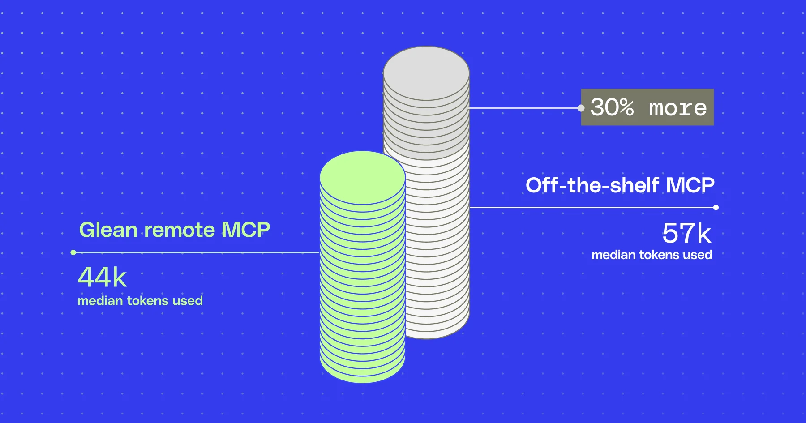
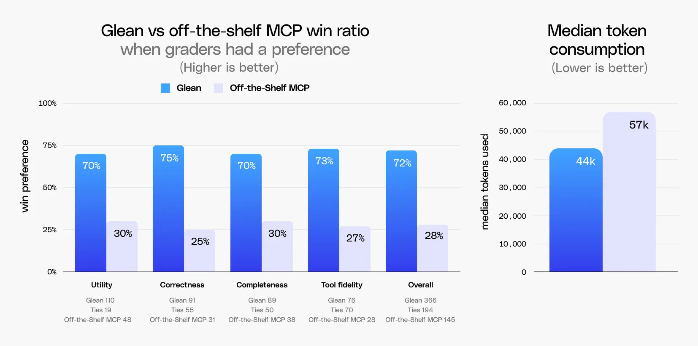
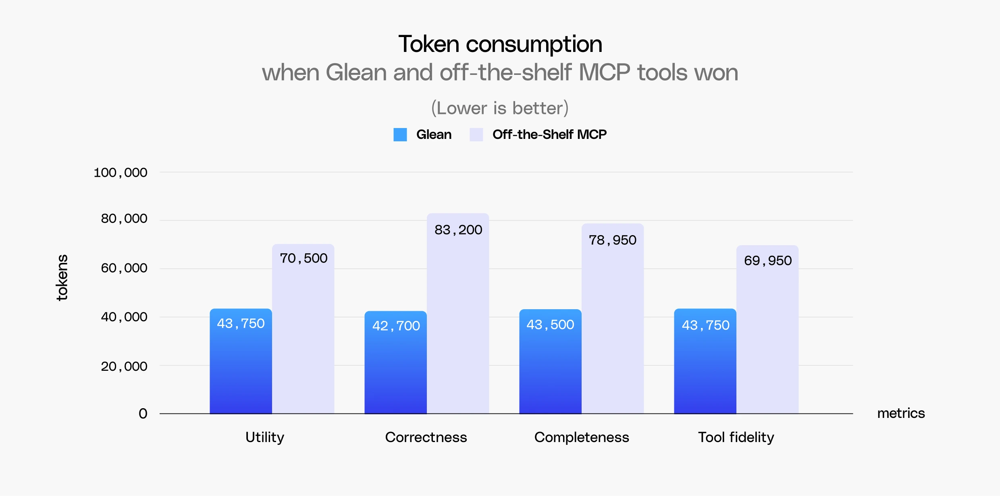
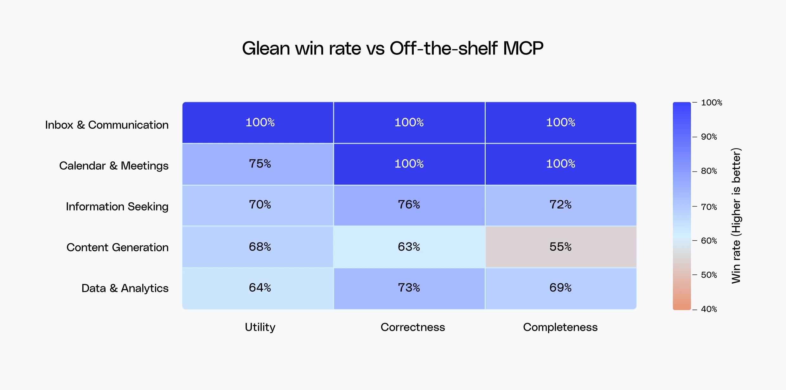
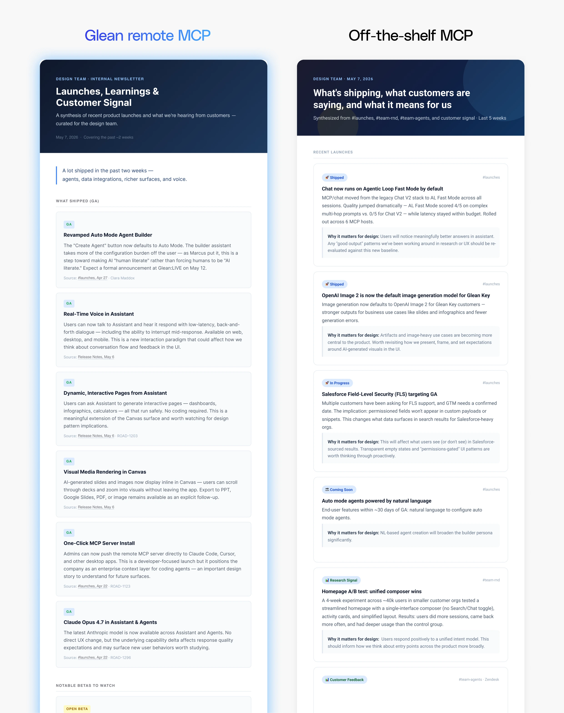
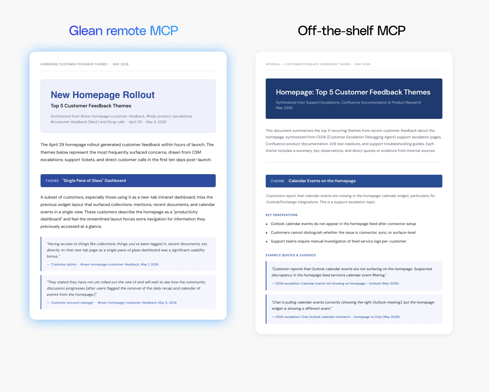

## Key Takeaways / 核心洞见

> 阅读笔记（凡哥）：以下 3 点为归档时补充的解读与引申，非原文内容；原文全文与逐段中英对照见下文。

### 1. Measured win: better retrieval at a lower token cost / 实测胜出：检索更准，token 更省

**原文明确写出**：这是文章的核心实验结论，不是引申。在 ≈175 个 Cowork 风格查询上，固定 Claude Cowork + Claude Sonnet 4.6 作为 harness、只替换上下文层，Glean 远程 MCP 被评分者偏好的频率是 Atlassian Rovo、Gmail、Google Drive、Slack 等开箱即用 MCP 工具组合的 ≈2.5 倍，同时开箱即用工具多消耗约 30% 的 token。更有说服力的是 token 消耗的分布形状：Glean 无论输赢都稳定在 ≈42k–44k，而开箱即用工具「赢」的那些样本反而烧掉更多 token —— 当它产出更正确的答案时消耗约 83k，是 Glean（43k）的近两倍。也就是说，源端工具靠近乎暴力式的多轮搜索与工具调用才赢下的结果，Glean 用更少的上下文获取成本就拿到了。原文还给出了胜率随复杂度上升的数字：简单任务 66%，复杂任务升到 73%。

### 2. Evaluation design: four metrics, one variable / 评测设计：四个维度，只动一个变量

**原文明确写出**：评测方法本身是这篇文章的方法论价值所在。设计上把「上下文层」孤立成唯一变量 —— harness 固定为 Claude Cowork（默认模型 Claude Sonnet 4.6），只切换 MCP 服务器，从而避免模型能力差异污染结论。评分维度四个，均用 5 分制偏好量表打分：Utility（实用性，衡量回答还要改多少才算可交付）、Correctness（正确性，衡量论断是否有经核实、有引用、最新的来源支撑）、Completeness（完整性，衡量是否端到端完成任务、子问题是否都被回答）、Tool fidelity（工具保真度，衡量是否调用了正确的工具、是否成功执行，以及超时、OAuth 反复授权等中断是否需要人工介入或重试）。**归档者补充**：Tool fidelity 这一维度值得单独注意 —— 它衡量的其实不是「答得好不好」，而是「执行链路有没有断」，这正是多连接器联邦检索最容易出问题的地方，也是第三个案例里开箱即用工具翻车的直接原因。

### 3. Three end-to-end cases: where the gap shows up / 三个端到端案例：差距具体出现在哪里

**原文明确写出**：三个案例都给出了 Glean 与开箱即用 MCP 的并排结果。案例一（生成可分享给设计团队的 HTML 简报）：Glean 梳理出 6 个已发布功能并以客户原话支撑主题，开箱即用只给出 2 个且缺少客户信号，设计团队要用还得大量返工。案例二（首页客户反馈 Top 5 主题）：Glean 跨来源定位到真实诉求（统一视图、搜索入口难找），开箱即用给出的却是与新首页无关的连接器问题（日历事件不显示、索引控制），且执行中工具报错导致相关工具没调成，覆盖度受限。案例三（上周哪些部署触发了 SSAT 告警）：Glean 直接给出完整受影响清单（Maxium Corp、Ironbridge Health、Provo Systems）；开箱即用工具能对单个客户深挖，但没能先做全局扫描，CSV 附件读取失败，还自己标注「5 月 1 日那份 CSV 更大、可能还有别的部署但名字没出现在讨论里」。**归档者推断**：案例三最能说明「先广后深」的价值 —— 这类穷尽型查询首要目标是找全集合，只对单一对象钻深的回答即使细节再丰富也算误判了任务。

> 作者: Neil Dhruva（Engineering）、Karthik Rajkumar（Applied Scientist）、Chenhao Yang（Software Engineer）、Julie Mills（PMM） | 页面日期: May 13, 2026（Last updated） | 阅读时长: 9 分钟

> 原文链接: https://www.glean.com/blog/cowork-mcp-eval

The promise of AI coworkers is that employees can get more done when AI is connected to their external data sources, including Google Docs, Gmail, Google Calendar, Salesforce, and Atlassian. That connection enables large-scale data analysis, smarter inbox and calendar management, faster content creation, and better information retrieval. However, realizing that promise requires AI whose output an employee can take and use almost as-is at a token cost commensurate with the task.

AI 同事的承诺是：当 AI 接入员工的外部数据源 —— 包括 Google Docs、Gmail、Google Calendar、Salesforce 与 Atlassian —— 员工就能完成更多工作。这种连接支撑起大规模数据分析、更聪明的收件箱与日历管理、更快的内容创作，以及更好的信息检索。但要兑现这个承诺，AI 的输出必须是员工几乎可以原样拿去用的，且 token 成本要与任务本身相称。

At Glean, we wanted to understand how the context layer shapes the effectiveness and efficiency of AI coworkers to generate these ‘take and use’ results. It is well established that the quality of the underlying context, the indexes and knowledge graphs, drives response accuracy. What is less understood is the economic tradeoff of indexes with better relevance and ranking: indexes trade a small upfront data storage cost for reduced dependence on compute costs, which are climbing fast in the enterprise as frontier model token consumption grows.

在 Glean，我们想弄清楚上下文层如何影响 AI 同事的有效性与效率，从而产出这种「拿来即用」的结果。底层上下文（索引与知识图谱）的质量决定回答准确度，这一点已有共识；但较少被理解的是相关性、排序更好的索引在经济上的权衡：索引以少量前置存储成本，换取对算力成本更低的依赖 —— 而在前沿模型 token 消耗不断增长的当下，企业里的算力成本正快速攀升。

To prove the value of the context layer, we benchmarked Glean against off-the-shelf MCP tools, isolating for context by standardizing the harness on Claude Cowork. With Claude Cowork as the constant, we compared Glean's remote MCP server, which includes access to search and write tools, against the off-the-shelf MCP servers available in Cowork across ≈175 queries. We found that:

为了验证上下文层的价值，我们把 Glean 与开箱即用的 MCP 工具做基准对比，方法上以 Claude Cowork 作为统一测试框架，从而把变量隔离在上下文上。Claude Cowork 保持不变，我们让 Glean 的远程 MCP 服务器（包含搜索与写入工具）与 Cowork 中可用的开箱即用 MCP 服务器在 ≈175 个查询上对比。结果发现：

- Glean was preferred ≈2.5x as often as off-the-shelf MCP tools / Glean 被偏好的频率约为开箱即用 MCP 工具的 2.5 倍
- Off-the-shelf MCP tools consumed ≈30% more tokens than Glean / 开箱即用 MCP 工具消耗的 token 比 Glean 多约 30%

## The federated search token tax / 联邦式搜索的「token 税」

The Model Context Protocol (MCP) is an open standard that lets AI models connect to external tools to access data and take action through a consistent interface. MCP standardizes tool connectivity, giving models a consistent way to call external systems. However, MCP does not standardize the quality of the underlying tools themselves. The design of a tool shapes the quality of the response it enables and the number of tool calls and reasoning loops required to get there.

模型上下文协议（Model Context Protocol，MCP）是一个开放标准，让 AI 模型能通过统一接口连接外部工具、访问数据并执行操作。MCP 标准化了工具的连接方式，为模型提供了调用外部系统的一致方式。然而，MCP 并没有标准化底层工具本身的质量。工具的设计决定了它能带来什么样的回答质量，以及需要多少次工具调用与推理循环才能得到结果。

There have traditionally been two approaches to solving for enterprise context: federation and indexing. Federation relies on the search provided out-of-the-box by each individual connector, querying each system independently using its own retrieval strategy. Centralized indexing takes a different approach: data from across all sources is ingested and normalized into a single layer, enabling cross-application signals and consistent ranking regardless of where the data originated.

传统上有两种解决企业上下文的思路：联邦（federation）与索引（indexing）。联邦依赖每个连接器自带的搜索能力，各系统用自己的检索策略被独立查询。集中式索引则是另一种做法：把所有来源的数据摄取并归一化到单一层，从而获得跨应用的信号，并让排序与数据来自何处无关。

There are several well-understood challenges with adopting a federated-only approach:

仅采用联邦式做法，有几个公认的挑战：

- The quality of the underlying search varies significantly, with some tools supporting only lexical or semantic retrieval but not both. / 底层搜索质量差异很大，有些工具只支持词法检索或语义检索，而非两者兼备。
- The number of tool calls required to gather the data increases, as each tool has to be called individually and then rely on the model to normalize and aggregate that data. / 收集数据所需的工具调用次数会增加：每个工具都得单独调用，再依赖模型去归一化和聚合这些数据。
- Access to data is limited to user-specific signals, which means you lose visibility into how that data is used across the wider enterprise: the authority of the author, document linkages, and other cross-application ranking inputs. This impacts the accuracy of results. / 对数据的访问被限制在用户自身的信号范围内，这意味着你看不到这些数据在整个企业中被如何使用：作者的权威度、文档之间的关联，以及其他跨应用的排序输入。这会影响结果的准确度。
- Latency compounds quickly when you are dealing with multiple API calls to different tools. Each tool has its own latency and so you're bound by the slowest tool call. / 涉及对多个不同工具的多次 API 调用时，延迟会迅速叠加。每个工具都有自己的延迟，因此你被最慢的那次工具调用拖住。

Federated search often compensates by having AI over-fetch data across multiple tool calls and rely on multiple reasoning loops to synthesize the results. Both are costly workarounds in terms of latency and token usage, and they still tend to produce inaccurate responses. Models have a fixed context window and a finite capacity for attention. Over-fetching data risks diluting that window and even aggregating contradictory or out-of-date information, making it harder for the model to reason about what information is relevant.

联邦式搜索常常这样补偿：让 AI 跨多次工具调用超额抓取数据，并依赖多轮推理循环去综合结果。两者在延迟与 token 消耗上都是昂贵的补丁，而且往往仍会产出不准确的回答。模型的上下文窗口是固定的，注意力容量也有限。超额抓取数据存在稀释这个窗口的风险，甚至会聚合进相互矛盾或过时的信息，让模型更难判断哪些信息才相关。

As AI takes on longer-running, multi-step work, these limitations become increasingly costly. Each missed or incorrect retrieval can compound across steps until the final artifact or write action reflects incorrect data. Meanwhile, token costs are rising as frontier model pricing increases and consumption accelerates, with engineering teams at companies like [Uber](https://www.theinformation.com/newsletters/applied-ai/uber-cto-shows-claude-code-can-blow-ai-budgets) and [ServiceNow](https://x.com/laurabratton5/status/2054558503436755350?s=46) reportedly burning through their annual AI coding tool budgets within the first few months of the year. This is what makes the right context layer increasingly important in the Cowork era.

随着 AI 承担运行时间更长、多步骤的工作，这些局限的代价越来越高。每一次漏检或错误的检索都会在多个步骤间复利累积，直到最终产物或写入动作反映出错误的数据。与此同时，随着前沿模型定价上涨、消耗加速，token 成本也在上升 —— 据报道，Uber 和 ServiceNow 等公司的工程团队在年初几个月内就烧掉了一整年的 AI 编码工具预算。这正是「正确的上下文层」在 Cowork 时代越来越重要的原因。

## Evaluation design / 评测设计

Our benchmark was designed to isolate for context, keeping Claude Cowork as the harness with Claude Sonnet 4.6 as the default model, and swapping only the context layer: off-the-shelf MCP servers against Glean's remote MCP server, which uses centralized indexes and knowledge graph technology. We evaluated common off-the-shelf MCP servers like Atlassian Rovo, GCP (for logs), GitHub (local MCP), Gmail, Google Calendar, Google Drive, Salesforce (local MCP), and Slack.

我们的基准测试旨在隔离上下文这一变量：保持 Claude Cowork 作为统一的测试框架，默认模型为 Claude Sonnet 4.6，只替换上下文层 —— 即开箱即用的 MCP 服务器与 Glean 的远程 MCP 服务器（采用集中式索引与知识图谱技术）之间的对比。我们评测了常见的开箱即用 MCP 服务器，如 Atlassian Rovo、GCP（用于日志）、GitHub（本地 MCP）、Gmail、Google Calendar、Google Drive、Salesforce（本地 MCP）和 Slack。

To measure efficiency, we held the models constant and examined token usage differences between Glean's remote MCP server and off-the-shelf MCP tools. Graders ran the same ≈175 Cowork-style queries against both configurations and scored responses on a 5-point preference scale across four metrics:

为了衡量效率，我们固定模型不变，考察 Glean 远程 MCP 服务器与开箱即用 MCP 工具在 token 消耗上的差异。评分者用同样的 ≈175 个 Cowork 风格查询分别跑两套配置，并在四个指标上以 5 分制偏好量表打分：

- Utility: Which response would you actually use in your job? Captures how much editing is needed before a response is work ready. / 实用性：哪个回答你真的会用在工作里？衡量一个回答要经过多少修改才算「可以交付」。
- Correctness: Which response is more factually or logically accurate? Captures whether claims are backed by verified, cited, and up-to-date sources. / 正确性：哪个回答在事实或逻辑上更准确？衡量其中的论断是否有经过核实、有引用、且是最新的来源支撑。
- Completeness: Which output finished the task end-to-end? Captures whether all sub-queries were addressed, analysis was exhaustive, and responses were actionable. / 完整性：哪个输出端到端地完成了任务？衡量所有子问题是否都被回答、分析是否穷尽、回答是否可执行。
- Tool fidelity: Did the system use the right tool calls when responding? This metric captures execution integrity: whether the correct tools were invoked, whether they completed successfully, and whether issues like timeouts, OAuth re-prompts, or other interruptions required manual user intervention or retries to produce a response. / 工具保真度：系统在回答时是否调用了正确的工具？这个指标衡量执行完整性：是否调用了正确的工具、是否成功完成，以及超时、OAuth 反复授权或其他中断是否需要人工介入或重试才能产出回答。

## How context quality impacts token consumption / 上下文质量如何影响 token 消耗

Off-the-shelf MCP tools used 30% more tokens than Glean, but the more revealing finding came from examining how token consumption shifted based on outcome quality. Regardless of the result, Glean's token usage remained stable within a range of ≈42k to ≈44k tokens, while off-the-shelf MCP consumption climbed in order to win.

开箱即用 MCP 工具比 Glean 多用了 30% 的 token，但更有启发性的发现来自观察 token 消耗如何随产出的质量而变化。无论结果如何，Glean 的 token 用量都稳定在 ≈42k 到 ≈44k 之间，而开箱即用 MCP 的消耗则会为了「赢」而攀升。

When Cowork produced a more correct response with off-the-shelf tools, it consumed roughly 83k tokens compared to Glean's 43k, nearly double the tokens used by Glean to win. Getting to a win with off-the-shelf tools was a function of brute-force search, more tool calls, and more reasoning loops, rather than more efficient context retrieval. This is a pattern consistent with the known drawbacks of federated approaches.

当 Cowork 用开箱即用工具产出更正确的回答时，它消耗了约 83k token，而 Glean 只用了 43k —— 几乎是 Glean 取胜所需的两倍。用开箱即用工具取得胜利，靠的是暴力搜索、更多工具调用和更多推理循环，而不是更高效的上下文检索。这一模式与联邦式方法的已知缺陷一致。

## The role of context in on-the-job readiness / 上下文在「上手即用」中的作用

Token efficiency only tells part of the story. What determines whether an AI coworker can take on the job is how close the output is to being work-ready: how much a human needs to tweak it and how many follow-up prompts are required. To determine this, we evaluated Glean across a wide range of Cowork-style tasks that reflect the diversity of work in the enterprise:

token 效率只说明了故事的一部分。决定 AI 同事能否真正接手工作的，是输出离「工作就绪」有多近：人还需要改多少、还需要多少轮追问。为了判断这一点，我们在大量反映企业工作多样性的 Cowork 风格任务上评测了 Glean：

- Content generation: Creating files including documents, HTML, and slides that are accurate enough to use or share with minimal editing. / 内容生成：创建文档、HTML 和幻灯片等文件，准确度足够高，只需极少修改即可使用或分享。
- Calendar and meeting prep: Managing calendars, preparing for meetings, and ensuring the right stakeholders and context are included. / 日历与会议准备：管理日历、为会议做准备，并确保包含正确的相关方与上下文。
- Inbox and communications management: Drafting emails and Slack messages that reflect the right tone and audience, while synthesizing to-do lists from recent communications and strategic priorities to surface what needs to get done. / 收件箱与沟通管理：起草语气、受众都恰当的邮件与 Slack 消息，同时把近期沟通与战略优先级综合成待办清单，指出真正需要完成的事。
- Large-scale data analysis: Analyzing data at scale to surface business trends, predict outcomes, and support decision-making across functions. / 大规模数据分析：在规模化数据上分析以发现业务趋势、预测结果，并支撑各职能的决策。
- Finding information: Summarizing information, mapping out processes, identifying who owns a piece of work, and surfacing the canonical document or metric definition, a query class that remains highly relevant in the age of AI coworkers. / 查找信息：总结信息、梳理流程、确认某项工作由谁负责，并把权威文档或指标定义找出来 —— 这类查询在 AI 同事时代依然高度相关。

Glean outperformed off-the-shelf MCP servers across every category, demonstrating the power of context in enabling AI to accurately handle the range of personal and business productivity needs in the enterprise.

Glean 在每个类别上都优于开箱即用 MCP 服务器，这体现了上下文的力量：它让 AI 能准确处理企业中各类个人与业务生产力需求。

Slicing by query category was one lens on the results, but we also wanted to understand how the importance of context shifted as task complexity increased. Characteristics like response token count, number of reasoning loops, and the number of read or write tool calls served as proxies for complexity, giving us a way to segment tasks beyond category alone. On simpler tasks, Glean won 66% of the time, but as complexity increased, that figure rose to 73%. This illustrated how well-designed context becomes increasingly important as the work requires more steps and more sources to complete.

按查询类别切分只是观察结果的一个视角，我们还想理解随着任务复杂度上升，上下文的重要性如何变化。回答的 token 数、推理循环次数、读写工具调用次数等特征可作为复杂度的代理指标，让我们能在类别之外对任务做分层。在较简单的任务上，Glean 的胜率为 66%；随着复杂度上升，这一数字提高到 73%。这说明当工作需要的步骤和来源更多时，设计良好的上下文会变得愈发重要。

## 3 queries showcasing the power of context / 三个查询，展示上下文的力量

#### Look up recent launch posts and customer comms, summarize the top observations and learnings, and give me an HTML newsletter I can share with the design team. / 查一下最近的产品发布帖和客户沟通，总结出最重要的观察与经验，再给我一份可以分享给设计团队的 HTML 简报。

*This response was slightly altered and pseudonyms were used to protect the names of customers and sensitive data.*

*该回答经过轻微改动，并使用了化名，以保护客户与敏感数据的名称。*

When it comes to creating interactive HTML artifacts, the quality of the underlying context directly shapes the richness of the output. In a task requiring a summary of recent launch posts and customer communications, Glean surfaced six released features compared to two from off-the-shelf MCP servers, and grounded its analysis in direct customer quotes that surfaced meaningful themes about the product experience. Off-the-shelf MCP lacked the customer signal, producing a shallower output that required significantly more editing to be usable by a product design team, a gap that traces directly to Glean's ability to synthesize signals across sources.

在创建可交互的 HTML 产物时，底层上下文的质量直接决定输出的丰富程度。在一项要求总结近期发布帖与客户沟通的任务中，Glean 梳理出六个已发布功能，而开箱即用 MCP 服务器只给出两个；Glean 还把分析建立在直接引用的客户原话上，从中提炼出关于产品体验的有意义的主题。开箱即用 MCP 缺少客户信号，产出的东西更浅，产品设计团队要用起来还得大量修改 —— 这一差距直接源于 Glean 跨来源综合信号的能力。

#### Find the most recent customer feedback themes on the homepage and create a doc summarizing the top 5 themes with example quotes. / 找出首页最新的客户反馈主题，创建一份文档，总结前 5 个主题并附示例引用。

*This response was slightly altered and pseudonyms were used to protect the names of customers and sensitive data.*

*该回答经过轻微改动，并使用了化名，以保护客户与敏感数据的名称。*

When asked to surface the most recent customer feedback themes, Glean synthesized data across sources to identify the top customer asks, including requests for a single pane of glass and to make the search feature easier to find. Off-the-shelf MCP tools, by contrast, surfaced product requests that were unrelated to the new homepage rollout but rather connectors issues, like calendar events not displaying and data indexing controls. Off-the-shelf tools also fell short on completeness, not providing specific examples from customers but rather snippets from support tickets. One of the challenges was tool quality as the off-the-shelf servers encountered errors during execution that prevented all the relevant tools from being called successfully, limiting coverage and quality.

当被要求梳理最新的客户反馈主题时，Glean 跨来源综合数据，识别出最靠前的客户诉求，包括希望有一个统一视图，以及让搜索功能更容易被发现。相比之下，开箱即用 MCP 工具给出的是与新版首页发布无关的产品诉求，而是连接器问题，比如日历事件不显示、数据索引控制。开箱即用工具在完整性上也不达标，没有提供来自客户的具体例子，只给了支持工单的片段。其中一个挑战是工具质量：开箱即用的服务器在执行过程中报错，导致无法成功调用所有相关工具，从而限制了覆盖范围与质量。

#### What deployments had SSAT alerts last week? / 上周哪些部署触发了 SSAT 告警？

**Glean 的回答**

Based on the search results, here's what I found for last week's SSAT alerts (week of 4/28–5/4, covered by Alex Chen):

根据搜索结果，上周（4/28–5/4，由 Alex Chen 值班覆盖）的 SSAT 告警情况如下：

- Maxium Corp — Google Drive indexed docs spiked steeply, with a corresponding spike in incidence in top 10 results. Root cause follow-up was linked in the ssat-alerts thread. / Maxium Corp —— Google Drive 索引文档量陡增，前 10 条结果中的命中率也相应飙升。根因跟进记录已链接在 ssat-alerts 讨论串里。
- Ironbridge Health and Provo Systems — Both dropped for a day but recovered on their own. The note says they'll look into it further if it persists. / Ironbridge Health 与 Provo Systems —— 两者都下降了一天，但自行恢复。笔记里说如果持续出现，会进一步排查。

This is from a running on-call/search quality doc on Drive. Want me to pull up more detail on any of these, like the linked Slack threads?

这段内容来自 Drive 上一篇值班/搜索质量的记录文档。需要我展开其中任何一项的更多细节吗，比如相关的 Slack 讨论串？

**Off-the-shelf MCP 的回答**

The #ssat-alerts channel had alerts most days last week. The April 29th post had 13 replies — let me dig into that thread and the others to find which specific deployments were flagged. Each alert has a CSV file with the deployment list. Let me try to download those to get the actual names. The CSV content isn't loading directly. Let me try to fetch the files and also search for any direct mentions of deployment names in the channel. The CSV content isn't accessible directly. Let me look at the Maxium Corp thread that was referenced, and also try to find other customer/deployment mentions. Based on the threads I've read, here's what I found for last week (Apr 28–May 2):

#ssat-alerts 频道上周大多数天都有告警。4 月 29 日那条帖子有 13 条回复 —— 让我翻一下那个讨论串和其他讨论串，找出具体标记了哪些部署。每个告警都附带一个包含部署列表的 CSV 文件。让我试着下载这些文件拿到真实名称。CSV 内容没直接加载出来。让我试着抓取文件，同时搜索频道里任何直接提到部署名称的地方。CSV 内容无法直接访问。让我看看被引用的 Maxium Corp 讨论串，并尝试找到其他客户/部署的提及。根据我读过的讨论串，上周（4 月 28 日–5 月 2 日）的情况如下：

- Maxium Corp prod was the deployment flagged on SSAT alerts, appearing across all 5 daily alert CSVs from the Acme bot in #ssat-alerts. The alert ran for multiple consecutive days, which is what prompted the escalation. / Maxium Corp prod 是 SSAT 告警标记的部署，出现在 #ssat-alerts 中 Acme 机器人发出的全部 5 份每日告警 CSV 里。该告警连续多日持续，这正是升级处理的原因。
- The discussion in the thread zeroed in on the cause: a spike in indexed Google Drive documents causing Google Drive results to over-represent, hurting search quality. Jordan Park investigated and cross-posted to #internal-maxium-corp, where Marcus Reyes confirmed that additional Google Drive support had been recently enabled for the Maxium Corp deployment — this expanded what was being crawled and shifted the results mix. / 讨论串把焦点锁定在原因上：Google Drive 索引文档量激增，使 Google Drive 结果过度呈现，损害了搜索质量。Jordan Park 做了排查，并交叉发布到 #internal-maxium-corp；Marcus Reyes 在那里确认，Maxium Corp 这个部署最近启用了额外的 Google Drive 支持 —— 这扩大了抓取范围，也改变了结果构成。

One note: the May 1 CSV was noticeably larger (≈446 bytes vs ≈208 bytes for the other days), so there may have been additional deployments flagged that day specifically, but those names aren't surfaced in the Slack discussion — they'd be in the CSV attached to this message.

补充一点：5 月 1 日的 CSV 明显更大（≈446 字节，其他几天 ≈208 字节），所以那天可能还标记了额外的部署，但那些名称没有出现在 Slack 讨论里 —— 它们应该在这条消息附带的 CSV 里。

*This response was slightly altered and pseudonyms were used to protect the names of customers and sensitive data.*

*该回答经过轻微改动，并使用了化名，以保护客户与敏感数据的名称。*

While off-the-shelf MCP was able to dig deep into a specific alert for one customer, it failed to first go broad and identify the full set of customers affected by the alert before beginning troubleshooting. Since the primary purpose of the query was exhaustive data analysis across all affected customers, Glean's ability to surface the complete picture before drilling down made it the more accurate and complete response.

虽然开箱即用 MCP 能针对某个客户的某个告警深挖下去，但它没有先做全局梳理、在开始排查前找出受影响的完整客户集合。由于这个查询的首要目的是对所有受影响客户做穷尽式数据分析，Glean 能先呈现完整画面再下钻，这使它成为更准确、更完整的回答。

## Context in the Cowork Era / Cowork 时代的上下文

Glean's centralized indexes and knowledge graph outperformed off-the-shelf MCP servers on both quality and efficiency. On utility, correctness, completeness, and execution quality, Glean was preferred ≈2.5x as often, with the gap widening as task complexity increased. On token consumption, off-the-shelf MCP servers required 30% more tokens on average, with Glean maintaining consistent token usage regardless of outcome quality. Off-the-shelf MCP consumed nearly double the tokens the harder they had to work to produce a correct response.

Glean 的集中式索引与知识图谱在质量与效率两方面都优于开箱即用 MCP 服务器。在实用性、正确性、完整性与执行质量上，Glean 被偏好的频率 ≈2.5 倍，且差距随任务复杂度上升而扩大。在 token 消耗上，开箱即用 MCP 服务器平均多需要 30%，而 Glean 无论产出质量如何都能保持稳定的 token 用量。开箱即用 MCP 越是需要努力才能产出正确答案，消耗的 token 就越接近 Glean 的两倍。

As enterprises scale AI across longer-running, more complex work during a period of rapidly rising frontier model costs, the design of the context layer becomes a direct input to both the quality and the economics of AI at work. With Glean, enterprises index their data and build knowledge graphs once, then use MCP to connect that context across every surface where work happens, from Claude Cowork for personal productivity to AI-IDEs for engineering, compounding the return on that investment across the enterprise.

当企业把 AI 扩展到运行时间更长、更复杂的工作，而前沿模型成本正快速上涨时，上下文层的设计会直接成为「AI 在工作中的质量与经济性」的输入项。借助 Glean，企业只需把数据索引一次、把知识图谱建一次，然后用 MCP 把这份上下文连接到工作发生的每一个界面 —— 从用于个人生产力的 Claude Cowork，到用于工程的 AI IDE —— 从而在整个企业范围内复利这份投资的回报。
