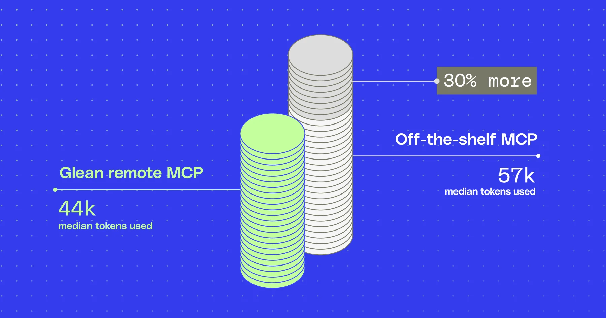
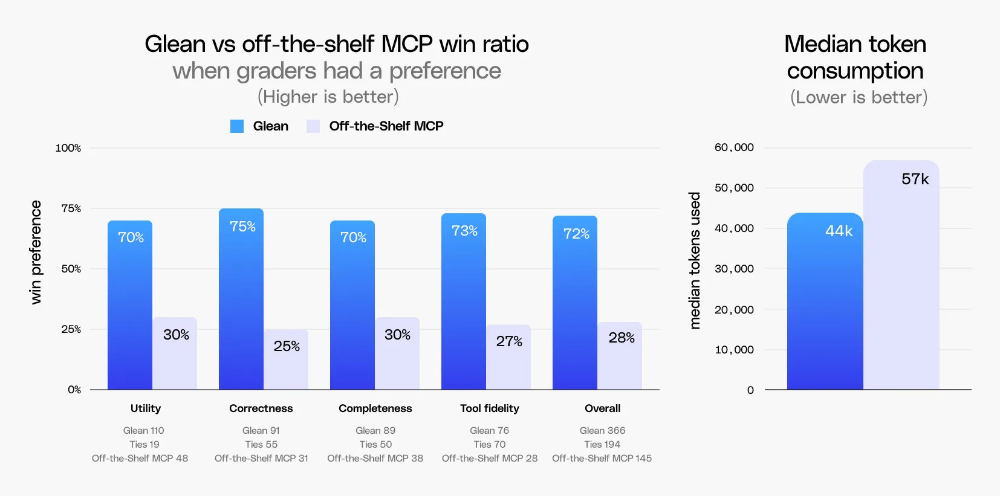
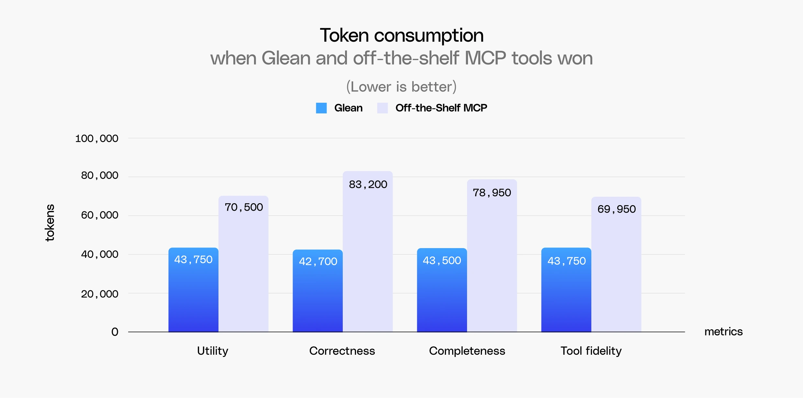
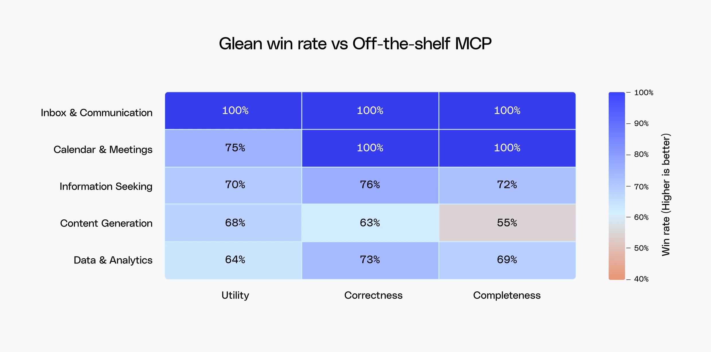
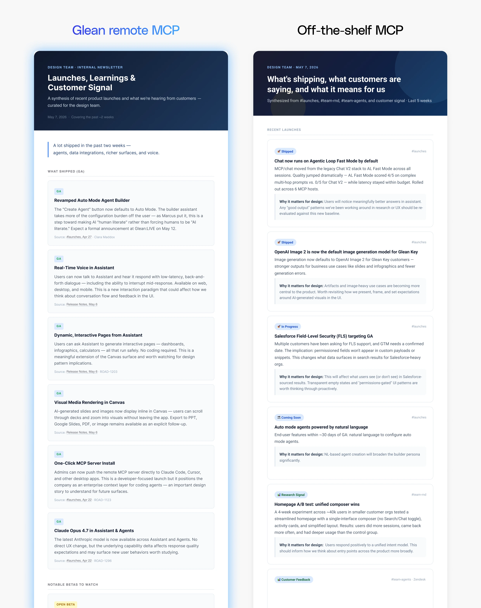
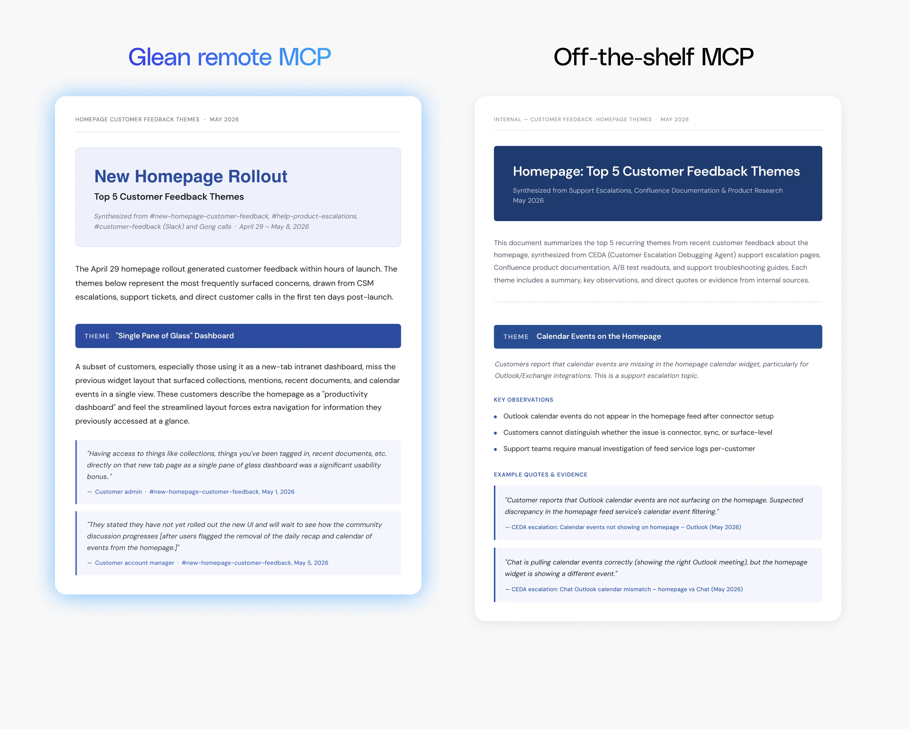

[___](#)  在新窗口中打开 打开外部网站 在新窗口中打开外部网站        本网站利用 Cookie 等技术来启用基本网站功能以及 分析、个性化定制 和 有针对性的广告。 您可随时更改设置或接受默认设置。 您可以关闭此横幅以仅继续使用必要的 cookie。     [隐私政策](https://www.glean.com/privacy-policy)  [存储偏好](#e53e4b23-8113-4716-9a67-b17f3961c968)

    - 有针对性的广告
- 个性化定制
- 分析

                          存储偏好

          

Product

[Platform overviewSee how Glean works.](/platform)Built for enterprise AI.[Glean Enterprise Context Ground AI in company context](/platform/enterprise-context)[Connectors & actionsGlean offers more than 275+ connectors](/platform/connectors)[APIsBuild generative AI experiences](/platform/api)[API lookbookExplore what you can build](/platform/api/lookbook)[Glean ProtectSafely scale AI at work](/platform/security)[Glean IntelligenceGet more from every AI request](/platform/intelligence)[Auto routingRoute work to the right model](/platform/auto-routing)[Model hubGet access to the latest models](/platform/model-hub)[Usage controlsControl AI usage and spend](/platform/cost-controls)[AI gatewayGovern every AI interaction](/platform/ai-gateway)[Glean AssistantYour enterprise AI coworker](/ai-assistant)[Proactive AIStay ahead of what matters](/ai-assistant/proactive-ai)[Content creationCreate grounded, on-brand content](/ai-assistant/content-creation)[MultiplayerCreate and refine work together](/ai-assistant/multiplayer)[Work executionTurn insight into action](/ai-assistant/work-execution)[Data analysis and researchTurn context into insights](/ai-assistant/research-and-analysis)[Enterprise searchFind answers across your company](/enterprise-search)[Glean AgentsBuild and manage agents](/ai-agents)[Agent builderBuild agents your way](/ai-agents/agent-builder)[Agent orchestrationAutomate work across systems](/ai-agents/agent-orchestration)[Agent governanceScale agents with control](/ai-agents/agent-governance)[Agent libraryDiscover trusted, reusable agents](/ai-agents/agent-library)[Coming soonGlean TransformSee where AI can make the biggest impact](/transform)Customers

FEATURED STORIES[Booking.com](/resources/customer-stories/booking-com)[Zillow](/resources/customer-stories/zillow)[TIME](/resources/customer-stories/time)[Ericsson](/resources/customer-stories/ericsson)[See all customer stories](/resources/customer-stories)Solutions

DEPARTMENTS[All Teams](/solutions/all-teams)[Engineering](/solutions/departments/engineering)[Customer Service](/solutions/departments/customer-service)[Sales](/solutions/departments/sales)[IT](/solutions/departments/it-service-management)[Marketing](/solutions/departments/marketing)[B2B Marketing](/solutions/departments/marketing/b2b)[B2C Marketing](/solutions/departments/marketing/b2c)[People](/solutions/departments/people)[Finance](/solutions/departments/finance)[Legal](/solutions/departments/legal)INDUSTRIES[Retail](/solutions/industries/retail)[Consumer Goods](/solutions/industries/industrials/consumer-goods)[Industrials](/solutions/industries/industrials)[Energy & Utilities](/solutions/industries/industrials/energy-utilities)[Manufacturing](/solutions/industries/industrials/manufacturing)[Supply Chain](/solutions/industries/industrials/supply-chain)[Professional Services](/solutions/industries/professional-services)[Consulting](/solutions/industries/professional-services/consulting)[Construction](/solutions/industries/professional-services/construction)[IT Services](/solutions/industries/professional-services/it-services)[Financial Services](/solutions/industries/financial-services)[Banking](/solutions/industries/financial-services/banking)[PE/VC](/solutions/industries/financial-services/private-equity-venture-capital)[Asset management](/solutions/industries/financial-services/asset-management)[Insurance](/solutions/industries/financial-services/insurance)[Government](/solutions/industries/government)[Healthcare](/solutions/industries/healthcare)[Life Sciences](/solutions/industries/life-sciences)[Higher Education](/solutions/industries/higher-education)[What’s the state of your AI stack for software engineering?Take the quiz
  
See how your engineering AI stack performs across delivery speed, incident response, and context access. Get your AI Stack Score and next-step recommendations.Take the quiz](/resources/quiz/eng-ai-stack-performance-benchmark)Resources

EXPLORE

[Guides](/resources/guides)[Product Videos](/resources/product-videos)[Blog](/blog)[Webinars](/webinars)ENGAGE[Glean:GO 2026](/events/glean-go-2026)[Gleaniverse Community](https://community.glean.com/)SUPPORT & SERVICES[Help Center](https://help.glean.com/en/)[Developers](https://developers.glean.com/)[Partners](/partners)[Work AI Institute

  .nav_resource-center_link.is-nav26 {
    position: relative;
    overflow: hidden;
    z-index: 1;
  }

  /* Sweep layer — your gradient, parked off-screen left and invisible until triggered */
  .nav_resource-center_link.is-nav26::after {
    content: '';
    position: absolute;
    inset: 0;
    background:
      linear-gradient(88.36deg, rgba(239, 96, 27, 0) 37.54%, rgba(239, 96, 27, 0.36) 47.48%, rgba(225, 107, 255, 0.36) 54.99%, rgba(225, 107, 255, 0) 60.43%);
    transform: translateX(-100%);
    z-index: -1;
    pointer-events: none;
  }

  /* One pass, left → right; "forwards" leaves it parked off-screen right = invisible */
  .nav_resource-center_link.is-nav26.is-sweeping::after {
    animation: nav26-sweep 1.3s ease-in-out forwards;
  }
  @keyframes nav26-sweep {
    from { transform: translateX(-100%); }
    to   { transform: translateX(100%); }
  }

  @media (prefers-reduced-motion: reduce) {
    .nav_resource-center_link.is-nav26.is-sweeping::after { animation: none; }
  }

(function () {
  var SWEEP_DELAY = 200; // ms after the dropdown opens before the sweep runs

  function init() {
    var links = document.querySelectorAll('.nav_resource-center_link.is-nav26');

    links.forEach(function (link) {
      var item = link.closest('.nav-25_list_item'); // the Resources nav item
      if (!item) return;

      var timer = null;

      function runSweep() {
        link.classList.remove('is-sweeping');
        void link.offsetWidth;          // reflow so the animation replays
        link.classList.add('is-sweeping');
      }

      var wasOpen = false;
      new MutationObserver(function () {
        var open = item.classList.contains('trigger-enter-active');
        if (open && !wasOpen) {
          clearTimeout(timer);
          timer = setTimeout(runSweep, SWEEP_DELAY);
        } else if (!open) {
          clearTimeout(timer);          // cancel if they leave before it fires
        }
        wasOpen = open;
      }).observe(item, { attributes: true, attributeFilter: ['class'] });
    });
  }

  if (document.readyState === 'loading') document.addEventListener('DOMContentLoaded', init);
  else init();
})();](/work-ai-institute)[The AI Token Savings StoryExplore how context and model routing affect token costs, output quality, and savings at scale.Explore the story](/ai-token-economics)Company

[About us](/about)[Glean on Glean](/about/ai-at-glean)[Story](/about/glean-story)[Culture](/about/culture-and-values)[Careers](/careers)Thank you! Your submission has been received!Oops! Something went wrong while submitting the form.[Sign in](https://app.glean.com/login?redirect=%2F)[Get a demo](/get-a-demo)[Get a demo](/get-a-demo)

[Sign in](https://app.glean.com/login?redirect=%2F)[Get a demo](/get-a-demo)[Get a demo](/get-a-demo)

Product

Customers

Solutions

Resources

Company

[Sign in](https://app.glean.com/login?redirect=%2F)

[Sign in](https://app.glean.com/login?redirect=%2F)[Get a demo](/get-a-demo)[Get a demo](/get-a-demo)

PRODUCT[Platform overviewSee how Glean works.](/platform)Built for enterprise AI.[Glean Enterprise Context Ground AI in company context](/platform/enterprise-context)[Connectors & actionsGlean offers more than 275+ connectors](/platform/connectors)[APIsBuild generative AI experiences](/platform/api)[API lookbookExplore what you can build](/platform/api/lookbook)[Glean ProtectSafely scale AI at work](/platform/security)[Glean IntelligenceGet more from every AI request](/platform/intelligence)[Auto routingRoute work to the right model](/platform/auto-routing)[Model hubGet access to the latest models](/platform/model-hub)[Usage controlsControl AI usage and spend](/platform/cost-controls)[AI gatewayGovern every AI interaction](/platform/ai-gateway)[Glean AssistantYour enterprise AI coworker](/ai-assistant)[Proactive AIStay ahead of what matters](/ai-assistant/proactive-ai)[Content creationCreate grounded, on-brand content](/ai-assistant/content-creation)[MultiplayerCreate and refine work together](/ai-assistant/multiplayer)[Work executionTurn insight into action](/ai-assistant/work-execution)[Data analysis and researchTurn context into insights](/ai-assistant/research-and-analysis)[Enterprise searchFind answers across your company](/enterprise-search)[Glean AgentsBuild and manage agents](/ai-agents)[Agent builderBuild agents your way](/ai-agents/agent-builder)[Agent orchestrationAutomate work across systems](/ai-agents/agent-orchestration)[Agent governanceScale agents with control](/ai-agents/agent-governance)[Agent libraryDiscover trusted, reusable agents](/ai-agents/agent-library)[Coming soonGlean TransformSee where AI can make the biggest impact](/transform)

[Sign in](https://app.glean.com/login?redirect=%2F)[Get a demo](/get-a-demo)[Get a demo](/get-a-demo)

CUSTOMERSFEATURED STORIES[Booking.com](/resources/customer-stories/booking-com)[Zillow](/resources/customer-stories/zillow)[TIME](/resources/customer-stories/time)[Ericsson](/resources/customer-stories/ericsson)[See all customer stories](/resources/customer-stories)

[Sign in](https://app.glean.com/login?redirect=%2F)[Get a demo](/get-a-demo)[Get a demo](/get-a-demo)

SOLUTIONSDEPARTMENTS[All Teams](/solutions/all-teams)[Engineering](/solutions/departments/engineering)[Customer Service](/solutions/departments/customer-service)[Sales](/solutions/departments/sales)[IT](/solutions/departments/it-service-management)[Marketing](/solutions/departments/marketing)[B2B Marketing](/solutions/departments/marketing/b2b)[B2C Marketing](/solutions/departments/marketing/b2c)[People](/solutions/departments/people)[Finance](/solutions/departments/finance)[Legal](/solutions/departments/legal)INDUSTRIES[Retail](/solutions/industries/retail)[Consumer Goods](/solutions/industries/industrials/consumer-goods)[Industrials](/solutions/industries/industrials)[Energy & Utilities](/solutions/industries/industrials/energy-utilities)[Manufacturing](/solutions/industries/industrials/manufacturing)[Supply Chain](/solutions/industries/industrials/supply-chain)[Professional Services](/solutions/industries/professional-services)[Consulting](/solutions/industries/professional-services/consulting)[Construction](/solutions/industries/professional-services/construction)[IT Services](/solutions/industries/professional-services/it-services)[Financial Services](/solutions/industries/financial-services)[Banking](/solutions/industries/financial-services/banking)[PE/VC](/solutions/industries/financial-services/private-equity-venture-capital)[Asset management](/solutions/industries/financial-services/asset-management)[Insurance](/solutions/industries/financial-services/insurance)[Government](/solutions/industries/government)[Healthcare](/solutions/industries/healthcare)[Life Sciences](/solutions/industries/life-sciences)[Higher Education](/solutions/industries/higher-education)[What’s the state of your AI stack for software engineering?Take the quiz
  
See how your engineering AI stack performs across delivery speed, incident response, and context access. Get your AI Stack Score and next-step recommendations.Take the quiz](/resources/quiz/eng-ai-stack-performance-benchmark)

[Sign in](https://app.glean.com/login?redirect=%2F)[Get a demo](/get-a-demo)[Get a demo](/get-a-demo)

RESOURCESEXPLORE

[Guides](/resources/guides)[Product Videos](/resources/product-videos)[Blog](/blog)[Webinars](/webinars)ENGAGE[Glean:GO 2026](/events/glean-go-2026)[Gleaniverse Community](https://community.glean.com/)SUPPORT & SERVICES[Help Center](https://help.glean.com/en/)[Developers](https://developers.glean.com/)[Partners](/partners)[Work AI Institute

  .nav_resource-center_link.is-nav26 {
    position: relative;
    overflow: hidden;
    z-index: 1;
  }

  /* Sweep layer — your gradient, parked off-screen left and invisible until triggered */
  .nav_resource-center_link.is-nav26::after {
    content: '';
    position: absolute;
    inset: 0;
    background:
      linear-gradient(88.36deg, rgba(239, 96, 27, 0) 37.54%, rgba(239, 96, 27, 0.36) 47.48%, rgba(225, 107, 255, 0.36) 54.99%, rgba(225, 107, 255, 0) 60.43%);
    transform: translateX(-100%);
    z-index: -1;
    pointer-events: none;
  }

  /* One pass, left → right; "forwards" leaves it parked off-screen right = invisible */
  .nav_resource-center_link.is-nav26.is-sweeping::after {
    animation: nav26-sweep 1.3s ease-in-out forwards;
  }
  @keyframes nav26-sweep {
    from { transform: translateX(-100%); }
    to   { transform: translateX(100%); }
  }

  @media (prefers-reduced-motion: reduce) {
    .nav_resource-center_link.is-nav26.is-sweeping::after { animation: none; }
  }

(function () {
  var SWEEP_DELAY = 200; // ms after the dropdown opens before the sweep runs

  function init() {
    var links = document.querySelectorAll('.nav_resource-center_link.is-nav26');

    links.forEach(function (link) {
      var item = link.closest('.nav-25_list_item'); // the Resources nav item
      if (!item) return;

      var timer = null;

      function runSweep() {
        link.classList.remove('is-sweeping');
        void link.offsetWidth;          // reflow so the animation replays
        link.classList.add('is-sweeping');
      }

      var wasOpen = false;
      new MutationObserver(function () {
        var open = item.classList.contains('trigger-enter-active');
        if (open && !wasOpen) {
          clearTimeout(timer);
          timer = setTimeout(runSweep, SWEEP_DELAY);
        } else if (!open) {
          clearTimeout(timer);          // cancel if they leave before it fires
        }
        wasOpen = open;
      }).observe(item, { attributes: true, attributeFilter: ['class'] });
    });
  }

  if (document.readyState === 'loading') document.addEventListener('DOMContentLoaded', init);
  else init();
})();](/work-ai-institute)[The AI Token Savings StoryExplore how context and model routing affect token costs, output quality, and savings at scale.Explore the story](/ai-token-economics)

[Sign in](https://app.glean.com/login?redirect=%2F)[Get a demo](/get-a-demo)[Get a demo](/get-a-demo)

COMPANY[About us](/about)[Glean on Glean](/about/ai-at-glean)[Story](/about/glean-story)[Culture](/about/culture-and-values)[Careers](/careers)9minutes readAuthors

[Neil Dhruva

Engineering](/authors/neil-dhruva)[Karthik Rajkumar

Applied Scientist](/authors/karthik-rajkumar)[Chenhao Yang

Software Engineer](/authors/chenhao-yang)[Julie Mills

PMM](/authors/julie-mills)

  

  
    Listen to article
    
  

  
  	
    
    
    
  

### Table of contents

[The federated search token tax](#the-federated-search-token-tax)[Evaluation design](#evaluation-design)[How context quality impacts token consumption](#how-context-quality-impacts-token-consumption)[The role of context in on-the-job readiness](#the-role-of-context-in-on-the-job-readiness)[3 queries showcasing the power of context](#3-queries-showcasing-the-power-of-context)[Look up recent launch posts and customer comms, summarize the top observations and learnings, and give me an HTML newsletter I can share with the design team.](#look-up-recent-launch-posts-and-customer-comms-summarize-the-top-observations-and-learnings-and-give-me-an-html-newsletter-i-can-share-with-the-design-team)[Find the most recent customer feedback themes on the homepage and create a doc summarizing the top 5 themes with example quotes.](#find-the-most-recent-customer-feedback-themes-on-the-homepage-and-create-a-doc-summarizing-the-top-5-themes-with-example-quotes)[Context in the Cowork Era](#context-in-the-cowork-era)[Have questions or want a demo?We’re here to help! Click the button below and we’ll be in touch.Get a Demo](/get-a-demo)Share this article:

  

  
    Listen to article
    
  

  
  	
    
    
    
  

The promise of AI coworkers is that employees can get more done when AI is connected to their external data sources, including Google Docs, Gmail, Google Calendar, Salesforce, and Atlassian. That connection enables large-scale data analysis, smarter inbox and calendar management, faster content creation, and better information retrieval. However, realizing that promise requires AI whose output an employee can take and use almost as-is at a token cost commensurate with the task.

At Glean, we wanted to understand how the context layer shapes the effectiveness and efficiency of AI coworkers to generate these ‘take and use’ results. It is well established that the quality of the underlying context, the indexes and knowledge graphs, drives response accuracy. What is less understood is the economic tradeoff of indexes with better relevance and ranking: indexes trade a small upfront data storage cost for reduced dependence on compute costs, which are climbing fast in the enterprise as frontier model token consumption grows.

To prove the value of the context layer, we benchmarked Glean against off-the-shelf MCP tools, isolating for context by standardizing the harness on Claude Cowork. With Claude Cowork as the constant, we compared Glean's remote MCP server, which includes access to search and write tools, against the off-the-shelf MCP servers available in Cowork across ~175 queries. We found that:

- Glean was preferred ~2.5x as often as off-the-shelf MCP tools
- Off-the-shelf MCP tools consumed ~30% more tokens than Glean

## The federated search token tax

The Model Context Protocol (MCP) is an open standard that lets AI models connect to external tools to access data and take action through a consistent interface. MCP standardizes tool connectivity, giving models a consistent way to call external systems. However, MCP does not standardize the quality of the underlying tools themselves. The design of a tool shapes the quality of the response it enables and the number of tool calls and reasoning loops required to get there.

There have traditionally been two approaches to solving for enterprise context: federation and indexing. Federation relies on the search provided out-of-the-box by each individual connector, querying each system independently using its own retrieval strategy. Centralized indexing takes a different approach: data from across all sources is ingested and normalized into a single layer, enabling cross-application signals and consistent ranking regardless of where the data originated.

There are several well-understood challenges with adopting a federated-only approach:

- The quality of the underlying search varies significantly, with some tools supporting only lexical or semantic retrieval but not both.
- The number of tool calls required to gather the data increases, as each tool has to be called individually and then rely on the model to normalize and aggregate that data.
- Access to data is limited to user-specific signals, which means you lose visibility into how that data is used across the wider enterprise: the authority of the author, document linkages, and other cross-application ranking inputs. This impacts the accuracy of results.
- Latency compounds quickly when you are dealing with multiple API calls to different tools. Each tool has its own latency and so you’re bound by the slowest tool call.

Federated search often compensates by having AI over-fetch data across multiple tool calls and rely on multiple reasoning loops to synthesize the results. Both are costly workarounds in terms of latency and token usage, and they still tend to produce inaccurate responses. Models have a fixed context window and a finite capacity for attention. Over-fetching data risks diluting that window and even aggregating contradictory or out-of-date information, making it harder for the model to reason about what information is relevant.

As AI takes on longer-running, multi-step work, these limitations become increasingly costly. Each missed or incorrect retrieval can compound across steps until the final artifact or write action reflects incorrect data. Meanwhile, token costs are rising as frontier model pricing increases and consumption accelerates, with engineering teams at companies like [Uber](https://www.theinformation.com/newsletters/applied-ai/uber-cto-shows-claude-code-can-blow-ai-budgets)and [ServiceNow](https://x.com/laurabratton5/status/2054558503436755350?s=46) reportedly burning through their annual AI coding tool budgets within the first few months of the year. This is what makes the right context layer increasingly important in the Cowork era.

## Evaluation design

Our benchmark was designed to isolate for context, keeping Claude Cowork as the harness with Claude Sonnet 4.6 as the default model, and swapping only the context layer: off-the-shelf MCP servers against Glean's remote MCP server, which uses centralized indexes and knowledge graph technology. We evaluated common off-the-shelf MCP servers like Atlassian Rovo, GCP (for logs), GitHub (local MCP), Gmail, Google Calendar, Google Drive, Salesforce (local MCP), and Slack.

To measure efficiency, we held the models constant and examined token usage differences between Glean's remote MCP server and off-the-shelf MCP tools. Graders ran the same ~175 Cowork-style queries against both configurations and scored responses on a 5-point preference scale across four metrics:

- Utility: Which response would you actually use in your job? Captures how much editing is needed before a response is work ready.
- Correctness: Which response is more factually or logically accurate? Captures whether claims are backed by verified, cited, and up-to-date sources.
- Completeness: Which output finished the task end-to-end? Captures whether all sub-queries were addressed, analysis was exhaustive, and responses were actionable.
- Tool fidelity: Did the system use the right tool calls when responding? This metric captures execution integrity: whether the correct tools were invoked, whether they completed successfully, and whether issues like timeouts, OAuth re-prompts, or other interruptions required manual user intervention or retries to produce a response.

## How context quality impacts token consumption

Off-the-shelf MCP tools used 30% more tokens than Glean, but the more revealing finding came from examining how token consumption shifted based on outcome quality. Regardless of the result, Glean's token usage remained stable within a range of ~42k to ~44k tokens, while off-the-shelf MCP consumption climbed in order to win.

When Cowork produced a more correct response with off-the-shelf tools, it consumed roughly 83k tokens compared to Glean's 43k, nearly double the tokens used by Glean to win. Getting to a win with off-the-shelf tools was a function of brute-force search, more tool calls, and more reasoning loops, rather than more efficient context retrieval. This is a pattern consistent with the known drawbacks of federated approaches.

## The role of context in on-the-job readiness

Token efficiency only tells part of the story. What determines whether an AI coworker can take on the job is how close the output is to being work-ready: how much a human needs to tweak it and how many follow-up prompts are required. To determine this, we evaluated Glean across a wide range of Cowork-style tasks that reflect the diversity of work in the enterprise:

- Content generation: Creating files including documents, HTML, and slides that are accurate enough to use or share with minimal editing.
- Calendar and meeting prep: Managing calendars, preparing for meetings, and ensuring the right stakeholders and context are included.
- Inbox and communications management: Drafting emails and Slack messages that reflect the right tone and audience, while synthesizing to-do lists from recent communications and strategic priorities to surface what needs to get done.
- Large-scale data analysis: Analyzing data at scale to surface business trends, predict outcomes, and support decision-making across functions.
- Finding information: Summarizing information, mapping out processes, identifying who owns a piece of work, and surfacing the canonical document or metric definition, a query class that remains highly relevant in the age of AI coworkers.

Glean outperformed off-the-shelf MCP servers across every category, demonstrating the power of context in enabling AI to accurately handle the range of personal and business productivity needs in the enterprise.

Slicing by query category was one lens on the results, but we also wanted to understand how the importance of context shifted as task complexity increased. Characteristics like response token count, number of reasoning loops, and the number of read or write tool calls served as proxies for complexity, giving us a way to segment tasks beyond category alone. On simpler tasks, Glean won 66% of the time, but as complexity increased, that figure rose to 73%. This illustrated how well-designed context becomes increasingly important as the work requires more steps and more sources to complete.

## 3 queries showcasing the power of context

#### Look up recent launch posts and customer comms, summarize the top observations and learnings, and give me an HTML newsletter I can share with the design team.

*This response was slightly altered and pseudonyms were used to protect the names of customers and sensitive data.*

When it comes to creating interactive HTML artifacts, the quality of the underlying context directly shapes the richness of the output. In a task requiring a summary of recent launch posts and customer communications, Glean surfaced six released features compared to two from off-the-shelf MCP servers, and grounded its analysis in direct customer quotes that surfaced meaningful themes about the product experience. Off-the-shelf MCP lacked the customer signal, producing a shallower output that required significantly more editing to be usable by a product design team, a gap that traces directly to Glean's ability to synthesize signals across sources.

#### Find the most recent customer feedback themes on the homepage and create a doc summarizing the top 5 themes with example quotes.

*This response was slightly altered and pseudonyms were used to protect the names of customers and sensitive data.*

When asked to surface the most recent customer feedback themes, Glean synthesized data across sources to identify the top customer asks, including requests for a single pane of glass and to make the search feature easier to find. Off-the-shelf MCP tools, by contrast, surfaced product requests that were unrelated to the new homepage rollout but rather connectors issues, like calendar events not displaying and data indexing controls. Off-the-shelf tools also fell short on completeness, not providing specific examples from customers but rather snippets from support tickets. One of the challenges was tool quality as the off-the-shelf servers encountered errors during execution that prevented all the relevant tools from being called successfully, limiting coverage and quality.
‍

  
    What deployments had SSAT alerts last week?
  

  
    
    
      
        
        Glean
      

      

      
        
          Based on the search results, here's what I found for last week's SSAT alerts (week of 4/28–5/4, covered by Alex Chen):

          - **Maxium Corp** — Google Drive indexed docs spiked steeply, with a corresponding spike in incidence in top 10 results. Root cause follow-up was linked in the ssat-alerts thread.
- **Ironbridge Health and Provo Systems** — Both dropped for a day but recovered on their own. The note says they'll look into it further if it persists.

          This is from a running on-call/search quality doc on Drive. Want me to pull up more detail on any of these, like the linked Slack threads?

        
      
    

    
    
      
        Off-the-shelf MCP
      

      

      
        
          The #ssat-alerts channel had alerts most days last week. The April 29th post had 13 replies — let me dig into that thread and the others to find which specific deployments were flagged. Each alert has a CSV file with the deployment list. Let me try to download those to get the actual names. The CSV content isn't loading directly. Let me try to fetch the files and also search for any direct mentions of deployment names in the channel. The CSV content isn't accessible directly. Let me look at the Maxium Corp thread that was referenced, and also try to find other customer/deployment mentions. Based on the threads I've read, here's what I found for last week (Apr 28–May 2):

          - **Maxium Corp prod** was the deployment flagged on SSAT alerts, appearing across all 5 daily alert CSVs from the Acme bot in #ssat-alerts. The alert ran for multiple consecutive days, which is what prompted the escalation.
- The discussion in the thread zeroed in on the cause: a spike in indexed Google Drive documents causing Google Drive results to over-represent, hurting search quality. Jordan Park investigated and cross-posted to #internal-maxium-corp, where Marcus Reyes confirmed that additional Google Drive support had been recently enabled for the Maxium Corp deployment — this expanded what was being crawled and shifted the results mix.

          One note: the May 1 CSV was noticeably larger (~446 bytes vs ~208 bytes for the other days), so there may have been additional deployments flagged that day specifically, but those names aren't surfaced in the Slack discussion — they'd be in the CSV attached to this message.

        
      
    
  
*This response was slightly altered and pseudonyms were used to protect the names of customers and sensitive data.*

While off-the-shelf MCP was able to dig deep into a specific alert for one customer, it failed to first go broad and identify the full set of customers affected by the alert before beginning troubleshooting. Since the primary purpose of the query was exhaustive data analysis across all affected customers, Glean's ability to surface the complete picture before drilling down made it the more accurate and complete response.

## Context in the Cowork Era

Glean's centralized indexes and knowledge graph outperformed off-the-shelf MCP servers on both quality and efficiency. On utility, correctness, completeness, and execution quality, Glean was preferred ~2.5x as often, with the gap widening as task complexity increased. On token consumption, off-the-shelf MCP servers required 30% more tokens on average, with Glean maintaining consistent token usage regardless of outcome quality. Off-the-shelf MCP consumed nearly double the tokens the harder they had to work to produce a correct response.

As enterprises scale AI across longer-running, more complex work during a period of rapidly rising frontier model costs, the design of the context layer becomes a direct input to both the quality and the economics of AI at work. With Glean, enterprises index their data and build knowledge graphs once, then use MCP to connect that context across every surface where work happens, from Claude Cowork for personal productivity to AI-IDEs for engineering, compounding the return on that investment across the enterprise.

[Back to all stories](/blog)

## 

[Get The Resource](#)

## 

[Get The Resource](#)Work AI for all.[Get a Demo](/get-a-demo)

  

