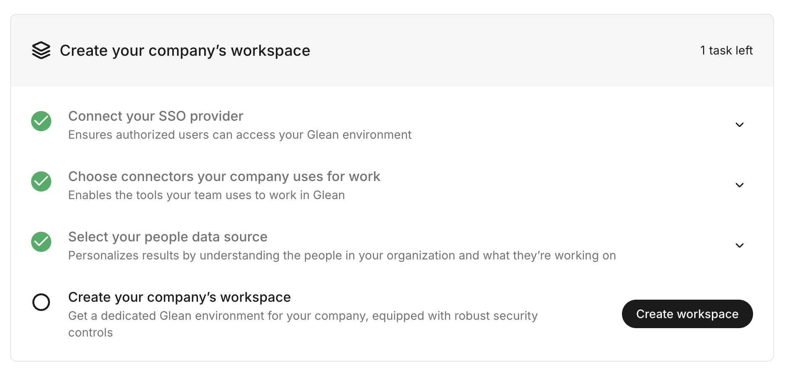
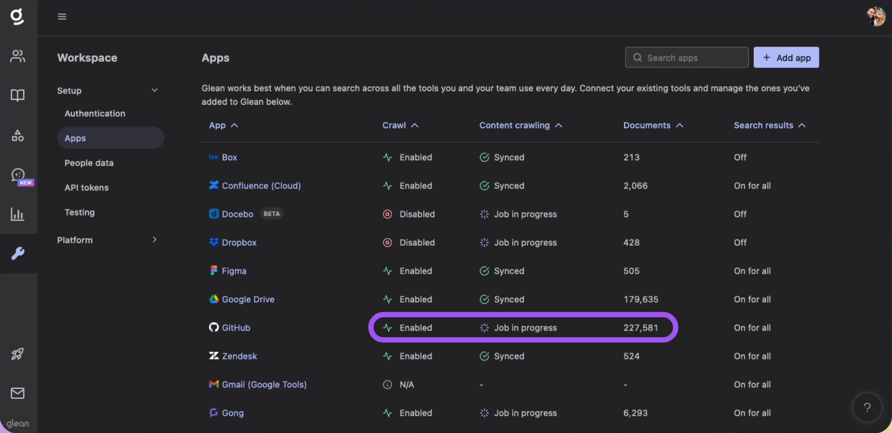

## Key Takeaways / 核心洞察

> 阅读笔记（凡哥）：以下 3 点为归档时补充的解读与引申，非原文内容；原文全文与逐段中英对照见下文。

### 1. Crawling → Indexing → Learning / 抓取、索引、学习三段式流程

文档把「数据抓取」和「后续的数据学习」拆成三个后台过程：**Crawling**（从已连接应用取回内容、权限与活动元数据）、**Indexing**（把抓来的内容映射成实时知识图谱，并入组织搜索索引）、**Learning**（在全部索引内容上运行机器学习工作流，生成贴合本组织数据与用户的搜索与排序算法）。三者有严格时序：抓取与索引可以并行，但 ML 必须等所有连接器抓取、索引完成后才启动，因为原文明确写了「ML workflows must be run on a complete dataset」。时间上，小型组织抓取+索引约 2–3 天，大型组织 10–14 天；ML 再额外 2–14 天，且受部署区域的 TPU/GPU 档位与待处理内容量影响（原文举例：若区域只支持 Nvidia T4 GPU 而非专用 TPU，全部 ML 工作流耗时会增加 4–6 倍）。也就是说，从建完工作区到可以正式放用户进来，典型是数天到接近一个月。

### 2. Delivery is heavy / 交付实施工作非常重

文档把上线写成「项目交付」而不是「开箱即用」：创建工作区要数小时并由 Glean 邮件通知；抓取、索引、学习全部完成后，由 Glean engineer（对接工程师）通知客户；ML 状态在 Glean 管理后台里看不到，只能由工程师同步进度。最关键的是原文明确注明：**ML 成功完成之前不支持使用 Glean，不应让用户访问**；而「What is the impact if the ML process is not completed?」这一条 FAQ 给出的答案是 —— 搜索结果质量将显著下降（原文 "Search results will be significantly degraded"）、Glean 不会正确响应、拼写检查出错、自动补全不工作、组织内的同义词或缩写出现在查询里也无法被理解。以上均为文档原文明确写出的约束，不是推断。（笔记作者的引申：Glean 的相关性优势来自「每个客户一份专属训练产物」，因此上线门槛天然绑定交付人力与算力排期，无法靠配置即时生效；这对评估同类企业级 AI 搜索产品的实施成本、首日体验和可复制性都是硬约束。）

### 3. What the ML process actually does / 机器学习负责的任务与重点解决的问题

原文列出 ML 的 5 项职责：优化搜索查询理解与拼写检查；理解组织内文档与员工之间使用的同义词、缩写和语义；提升搜索结果与人员推荐的相关性排序；支持查询建议、预测文本与自动补全；训练组织专属语言模型（文档称其为 Glean 运行所必需）。它重点解决的是「通用搜索与通用模型不懂这家企业的私有语汇与关系」：把抓取来的内容、人员、权限、语言、活动信号，转化成个性化的查询理解和排序能力。注意一个容易被忽略的设计约束：ML 不能与抓取/索引并行，也不能边抓边学，必须全量数据齐备后串行跑完 —— 这同时解释了交付周期为什么长，以及为什么 ML 未完成时搜索体验会直接塌方。

> 页面日期: 2026-11-04（页面标注）

> 原文链接: https://docs.glean.com/get-started/review/crawling-and-learning

After you connect your SSO provider, select your connectors, and choose your people data source, create your workspace. In the **Create your company's workspace** section, select **Create workspace**, then click **Confirm**.

在连接好 SSO 身份提供商、选好连接器并选定人员数据源之后，创建工作区。在「Create your company's workspace」区域选择「Create workspace」，然后点击「Confirm」。

Glean creates your dedicated workspace with the setup you completed, including the connectors you selected. Creating the workspace can take several hours. You don't need to do anything else during this time. Glean emails you when the workspace is ready. Then finish setting up your connectors. See [Finish setting up your connectors](https://docs.glean.com/get-started/setup/add-connectors#finish-setting-up-your-connectors).

Glean 会按你已完成的配置（含所选连接器）创建专属工作区。创建过程可能耗时数小时，这段时间你无需做任何操作；工作区就绪后 Glean 会发邮件通知你。随后完成连接器的收尾配置，参见[完成连接器设置](https://docs.glean.com/get-started/setup/add-connectors#finish-setting-up-your-connectors)。

In the previous section, you successfully linked all your company apps to Glean. Now, three essential background processes take place:

在上一节中，你已把公司的所有应用接入 Glean。接下来会发生三个关键的后台过程：

1. **Crawling** - Glean fetches data from your connected apps. / 抓取：Glean 从已连接的应用中获取数据。
2. **Indexing** - Glean creates a model of the data that was fetched and incorporates it into your organization's search index. / 索引：Glean 为抓取到的数据建立模型，并把它并入组织的搜索索引。
3. **Learning** - Glean processes the data that was fetched using Machine Learning (ML) to create a search and ranking algorithm tailored to your organization's data and users. / 学习：Glean 用机器学习（ML）处理抓取到的数据，生成贴合本组织数据与用户的搜索和排序算法。

## Timelines for completion / 完成时间预估

The time required to complete all three processes varies depending on the size of your organization and the volume of content that Glean needs to process. The combined crawling and indexing processes can take approximately:

完成这三个过程所需的时间，取决于组织规模和 Glean 需要处理的内容量。抓取与索引合计大约需要：

- Two to three days to complete for a typical small organization, or small volume of content. / 典型的小型组织、或内容量较小时，2 到 3 天。
- 10 to 14 days for a typical large organization, or large volume of content. / 典型的大型组织、或内容量很大时，10 到 14 天。

The machine learning (ML) process can take an additional two to 14 days, depending on:

机器学习（ML）过程还需要额外 2 到 14 天，具体取决于：

1. The GCP or AWS region that your Glean tenant was deployed to (and the tier of TPU/GPU hardware available in that region). / Glean 租户部署在哪个 GCP 或 AWS 区域（以及该区域可用的 TPU/GPU 硬件档位）。
2. The amount of content that needs to be processed as part of each ML workflow. / 每个 ML 工作流需要处理的内容量。

> [!note] Note / 注
> Use these times as an **estimate** only.
> 这些时间仅可作为估计值使用。

For a rough estimate of how long a single connector's initial crawl takes, see [Understand the initial crawl](https://docs.glean.com/connectors/crawling-types#understand-the-initial-crawl).

若想粗略估算单个连接器的初次抓取耗时，参见[了解初次抓取](https://docs.glean.com/connectors/crawling-types#understand-the-initial-crawl)。

Your Glean engineer will advise you once all crawling, indexing, and learning processes have been completed. The remainder of this topic covers these processes in more detail.

抓取、索引和学习全部完成后，你的 Glean 工程师会通知你。本文剩余部分会更详细地介绍这些过程。

For now, you can proceed to the next step: [Review people data import](https://docs.glean.com/get-started/review/review-people-data).

现在你可以继续下一步：[检查人员数据导入](https://docs.glean.com/get-started/review/review-people-data)。

## About crawling and indexing / 关于抓取与索引

When you initiate a crawl for a connector for the first time, the crawling and indexing processes initiate. During this time, Glean does the following:

首次对某个连接器发起抓取时，抓取与索引过程会同时启动。在此期间，Glean 会做两件事：

1. **Crawls** the content, associated permissions, and activity metadata for the selected connector. / 抓取该连接器的内容、关联权限与活动元数据。
2. Creates the **Glean Knowledge Graph** by **indexing** the crawled content, mapping it together, and creating a real-time model that Glean can refer to in response to a user's query. / 通过索引把抓取到的内容建立映射，创建 Glean 知识图谱这一实时模型，供 Glean 回答用户查询时引用。

> [!note] Note / 注
> **Crawling** is the process in which Glean fetches data from within your organization's sources of data for the purposes of creating the search index.
> 抓取，是 Glean 为构建搜索索引而从组织内部数据源取回数据的过程。
> The **Knowledge Graph** is a real-time model of your organization's indexed information. It is a map that links all content, people, permissions, language, and activity within your organization. It is designed to provide users with the most personalized and relevant results for their queries in a matter of milliseconds.
> 知识图谱是组织已索引信息的实时模型，是一张把组织内所有内容、人员、权限、语言与活动连接起来的地图，目的是在毫秒级为用户查询提供最个性化、最相关的结果。
> **Indexing** is the process in which Glean makes content ready for display in search results by creating (or updating) your organization's Knowledge Graph: the mapping between all content, people, permissions, language, and activity in the company.
> 索引，是 Glean 通过创建（或更新）组织知识图谱 —— 即公司内所有内容、人员、权限、语言与活动之间的映射 —— 让内容准备好在搜索结果中展示的过程。

### Check the crawling and indexing status / 查看抓取与索引状态

You can check the status of your in-progress crawls at any time by going to [Admin console → Platform → Connectors](https://app.glean.com/admin/setup/apps) and reviewing the table of configured apps.

你可以随时进入[管理后台 → Platform → Connectors](https://app.glean.com/admin/setup/apps)，查看已配置应用的表格，了解正在进行的抓取状态。

When a connector is undergoing its initial sync, it appears under the **Initial sync in progress** section, which is split into two phases:

某个连接器正在进行初始同步时，会出现在「Initial sync in progress」区域，该区域分为两个阶段：

1. **Crawling (Step 1/2)** - Glean is actively fetching content and metadata from the connector. / 抓取（第 1/2 步）：Glean 正在从该连接器取回内容与元数据。
2. **Indexing (Step 2/2)** - Glean is processing the crawled content and incorporating it into the Knowledge Graph. / 索引（第 2/2 步）：Glean 正在处理已抓取内容并把它并入知识图谱。

Once both crawling and indexing are complete for a connector, it moves from **Initial sync in progress** to the **All connectors** section, where it appears alongside other fully-synced sources.

某个连接器的抓取和索引都完成后，它会从「Initial sync in progress」移到「All connectors」区域，与其他已完成同步的数据源并列显示。

For each connector, you'll see:

对每个连接器，你会看到：

- **Items synced** - The total number of items, such as documents, messages, and files, that have been crawled and indexed. If a document has been crawled and indexed, it's visible in Glean. / 已同步条目数：已被抓取并索引的条目总数，例如文档、消息和文件。文档一旦被抓取并索引，就能在 Glean 中看到。
- **Crawl rate** (during initial sync) / **Change rate** (once steady state is reached) - The number of items synced or changes (edits, additions, deletions) processed in the past 24 hours, reflecting ongoing freshness. / 抓取速率（初始同步期间）／变更速率（进入稳定状态后）：过去 24 小时内同步的条目数或处理过的变更（编辑、新增、删除），反映数据的持续新鲜度。

> [!note] Note / 注
> Status and metrics refresh on an **hourly** cadence. If you don't see immediate updates after making changes, check back in about an hour.
> 状态与指标按小时刷新。如果改动后没有立刻看到更新，大约一小时后再回来查看。

### Crawling and indexing FAQ / 抓取与索引常见问题

#### How long does the initial crawl and index process take to complete? / 初次抓取与索引需要多久完成？

**Crawling (Step 1/2) / 抓取（第 1/2 步）**

The initial crawl for any connector always takes a while; the total time of which is dependent on two key factors:

任何连接器的初次抓取都要花不少时间，总耗时主要取决于两个关键因素：

The size of the connector (For example, the number of documents/messages, and the size of each).
The rate limit(s) of the connector vendor's API.

连接器的规模（例如文档／消息的数量，以及每条的大小）。
连接器厂商 API 的速率限制。

If a connector vendor's API has a low rate limit, this affects how quickly Glean can crawl it for items. Likewise, connectors containing a large number of documents, files, or messages also take longer to crawl.

如果连接器厂商的 API 速率限制较低，就会影响 Glean 抓取条目的速度。同样，包含大量文档、文件或消息的连接器，抓取耗时也会更长。

Some connectors share a rate limit across all integrated applications (like Glean). For these connectors, crawling time is typically slower, as Glean must be careful not to exhaust the entire rate limit threshold itself.

有些连接器在所有集成应用（包括 Glean）之间共享一份速率限制。对这类连接器，抓取通常更慢，因为 Glean 必须小心不要自己把整个限额耗尽。

You can monitor crawling progress by checking the **Initial sync in progress** section under **Crawling (Step 1/2)** and watching the **Items synced** metric increase.

你可以查看「Initial sync in progress」区域下「Crawling (Step 1/2)」的进度，观察「Items synced」指标的增长，来监控抓取进展。

**Indexing (Step 2/2) / 索引（第 2/2 步）**

The indexing process works in parallel with the crawling process. That is, content that has been crawled is processed by Glean's indexer while other content is still being crawled.

索引过程与抓取过程并行：当其他内容还在被抓取时，已抓取的内容就已交由 Glean 的索引器处理。

While the crawling speed is heavily dependent on the volume of data AND the API rate limit, the indexing speed is conversely heavily dependent on compute resources. The health of each deployment's index and compute resources dedicated to the indexing process is carefully monitored by Glean's SRE team.

抓取速度高度依赖数据量与 API 速率限制，而索引速度反过来高度依赖计算资源。每个部署的索引健康状况，以及专用于索引的计算资源，都由 Glean 的 SRE 团队仔细监控。

Once crawling begins to complete, you'll see the connector move to the **Indexing (Step 2/2)** phase in the **Initial sync in progress** section.

当抓取陆续完成时，你会看到该连接器在「Initial sync in progress」区域进入「Indexing (Step 2/2)」阶段。

**Total Time Required / 总耗时**

For a typical enterprise connector, expect the complete initial crawling and indexing processes to take anywhere from 3 days, up to 14 days for large connectors with moderate API rate limits. Once both phases complete, the connector moves to the **All connectors** section.

对典型的企业连接器，完整的初次抓取与索引过程预计需要 3 天起步；对于 API 速率限制中等的大型连接器，最长可达 14 天。两个阶段都完成后，连接器会移到「All connectors」区域。

For a rough estimate based on a specific connector and corpus size, see [Understand the initial crawl](https://docs.glean.com/connectors/crawling-types#understand-the-initial-crawl).

若想按具体连接器和语料规模做粗略估算，参见[了解初次抓取](https://docs.glean.com/connectors/crawling-types#understand-the-initial-crawl)。

#### Can multiple connectors be crawled at the same time without impact? / 多个连接器能同时抓取且互不影响吗？

Yes. Each connector configured has its own unique crawler that dynamically scales based on demand. This ensures that multiple connectors can be crawled in parallel without impact to the time required to complete each crawl.

可以。每个已配置的连接器都有自己独立的抓取器，会按需求动态扩缩容。这保证多个连接器可以并行抓取，且不影响各自完成抓取所需的时间。

#### What happens if a document is modified while a crawl is in progress? / 抓取过程中文档被修改会怎样？

When a full (initial) crawl of a connector is initiated, it captures the state of all documents and content up to the exact timestamp when the crawl started. If any documents are modified or created after this timestamp, they are processed and incorporated into the search index in one of two ways:

发起连接器的全量（初次）抓取时，它会记录抓取开始这一精确时间点之前所有文档与内容的状态。若在该时间点之后有文档被修改或新建，则会通过以下两种方式之一被处理并并入搜索索引：

- **Webhooks**: Most connectors support webhooks, which Glean leverages to be notified of any content changes. When a webhook is received, it is processed within 1–5 minutes, depending on the connector. / Webhooks：多数连接器支持 webhook，Glean 借它获知内容变更。收到 webhook 后，视连接器不同，会在 1–5 分钟内处理完成。
- **Incremental Crawls**: Glean performs an incremental crawl of each connector every 24 hours. These crawls focus on identifying and incorporating changes that have occurred since the last crawl that were not captured via webhooks. This ensures that all recent modifications are captured. / 增量抓取：Glean 每 24 小时对每个连接器做一次增量抓取，专门识别并并入自上次抓取以来、未被 webhook 捕获的变更，确保所有近期修改都被收录。

Both webhooks and incremental crawls operate independently and run concurrently with any active full crawls. This design ensures that document updates are processed efficiently and that the system remains up-to-date with the latest changes.

webhook 与增量抓取彼此独立运行，并可与任何正在进行的全量抓取并发。这一设计保证文档更新被高效处理，系统始终保持最新状态。

#### How to verify if a document is crawled and indexed? / 如何确认某篇文档已被抓取并索引？

The Access Verification page allows admins to resolve questions related to the visibility of specific documents within Glean. See [Verify if a document is visible in Glean](https://docs.glean.com/administration/search/access-verification) for more details.

管理员可以通过 Access Verification（访问验证）页面排查特定文档在 Glean 中的可见性问题。详见[验证文档在 Glean 中是否可见](https://docs.glean.com/administration/search/access-verification)。

#### How do I interpret slow or stalled progress during crawling and indexing? / 抓取或索引进度缓慢、卡住该怎么看？

If you are experiencing slow or stalled progress during crawling and indexing, refer to the [Use metrics for troubleshooting](https://docs.glean.com/connectors/connectors-monitoring#use-metrics-for-troubleshooting) section of the monitoring page to diagnose the issue.

如果抓取与索引过程中出现进度缓慢或停滞，请参考监控页面的[用指标排查问题](https://docs.glean.com/connectors/connectors-monitoring#use-metrics-for-troubleshooting)一节来诊断。

## About machine learning / 关于机器学习

Once the crawling and indexing processes have been completed, Glean initiates several Machine Learning (ML) workflows that run on all indexed content.

抓取与索引全部完成后，Glean 会启动若干机器学习（ML）工作流，在全部已索引内容上运行。

The ML process is critically important and is responsible for:

ML 过程至关重要，它负责：

- Optimizing search query understanding and spellcheck. / 优化搜索查询理解与拼写检查。
- Understanding synonyms, acronyms, and semantics used in documents and between employees within your organization. / 理解组织内文档中、以及员工之间使用的同义词、缩写和语义。
- Enhancing relevance rankings for search results and people suggestions. / 提升搜索结果与人员推荐的相关性排序。
- Enabling query suggestions, predictive text, and autocomplete. / 支持查询建议、预测文本与自动补全。
- Training the unique language model for your organization; which is essential for operation of Glean. / 训练组织专属的语言模型，这是 Glean 运行所必需的。

> [!note] Warning / 警告
> Usage of Glean is not supported until the ML process has completed successfully. You should not allow users access to Glean until all ML has completed.
> 在 ML 过程成功完成之前，不支持使用 Glean；所有 ML 完成之前，不应允许用户访问 Glean。

### Machine learning FAQ / 机器学习常见问题

#### How can I check the machine learning status? / 如何查看机器学习状态？

The ML workflows are background processes. It is not currently possible to check the status of these inside the Glean UI.

ML 工作流是后台过程，目前无法在 Glean 界面内查看其状态。

Your Glean engineer will notify you on the progress of these workflows and when they complete successfully.

你的 Glean 工程师会同步这些工作流的进度，并在它们成功完成时通知你。

#### How long does the ML process take to complete? / ML 过程需要多久完成？

Completing all required ML workflows can take two to 14 days in total, depending on:

跑完所有必需的 ML 工作流，总共可能需要 2 到 14 天，取决于：

- The amount of content that needs to be processed as part of each ML workflow. / 每个 ML 工作流需要处理的内容量。
- The GCP or AWS region that your Glean tenant was deployed to (and the tier of TPU/GPU hardware available in that region). / Glean 租户部署的 GCP 或 AWS 区域（以及该区域可用的 TPU/GPU 硬件档位）。
  - For example, using an Nvidia T4 GPU (if that is all that is supported in your elected deployment region) instead of a dedicated TPU typically increases the time required to run all ML workflows by a factor of four to six times. / 例如，若所选部署区域只支持 Nvidia T4 GPU 而没有专用 TPU，跑完全部 ML 工作流所需时间通常会增加 4 到 6 倍。

#### Does the ML process run in parallel with the crawl/index processes? / ML 能与抓取／索引并行运行吗？

No. The ML workflows must be run on a complete dataset. Hence, Glean cannot initiate the ML process until all of your connectors have been crawled and indexed.

不能。ML 工作流必须在完整数据集上运行，因此在所有连接器都完成抓取与索引之前，Glean 无法启动 ML 过程。

#### What is the impact if the ML process is not completed? / ML 未完成会有什么影响？

- Search results will be significantly degraded. / 搜索结果质量将显著下降。
- Glean will not respond correctly. / Glean 将无法正确响应。
- Spellcheck will be erroneous. / 拼写检查会出错。
- Autocomplete will not function. / 自动补全无法工作。
- Any synonyms or acronyms used within the organization will not be understood if included in a search query. / 组织内使用的同义词或缩写出现在搜索查询中时，将无法被理解。
