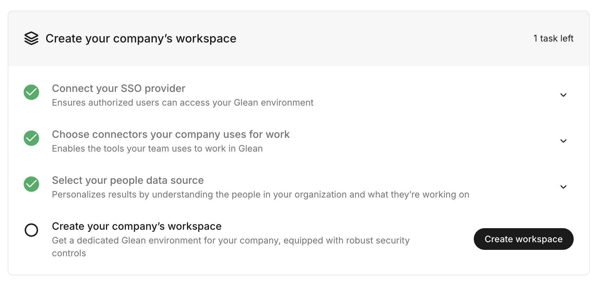
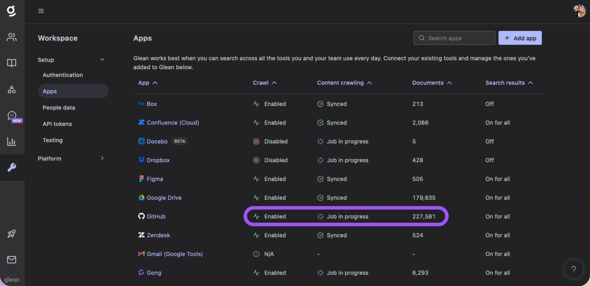

# Crawling and learning process

> 页面日期: 2026-11-04（页面标注）

> 原文链接: https://docs.glean.com/get-started/review/crawling-and-learning

After you connect your SSO provider, select your connectors, and choose your people data source, create your workspace. In the **Create your company's workspace** section, select **Create workspace**, then click **Confirm**.

Glean creates your dedicated workspace with the setup you completed, including the connectors you selected. Creating the workspace can take several hours. You don't need to do anything else during this time. Glean emails you when the workspace is ready. Then finish setting up your connectors. See [Finish setting up your connectors](https://docs.glean.com/get-started/setup/add-connectors#finish-setting-up-your-connectors).

In the previous section, you successfully linked all your company apps to Glean. Now, three essential background processes take place:

1. **Crawling** - Glean fetches data from your connected apps.
2. **Indexing** - Glean creates a model of the data that was fetched and incorporates it into your organization's search index.
3. **Learning** - Glean processes the data that was fetched using Machine Learning (ML) to create a search and ranking algorithm tailored to your organization's data and users.

## Timelines for completion

The time required to complete all three processes varies depending on the size of your organization and the volume of content that Glean needs to process. The combined crawling and indexing processes can take approximately:

- Two to three days to complete for a typical small organization, or small volume of content.
- 10 to 14 days for a typical large organization, or large volume of content.

The machine learning (ML) process can take an additional two to 14 days, depending on:

1. The GCP or AWS region that your Glean tenant was deployed to (and the tier of TPU/GPU hardware available in that region).
2. The amount of content that needs to be processed as part of each ML workflow.

> [!note] **Note**
> Use these times as an **estimate** only.

For a rough estimate of how long a single connector's initial crawl takes, see [Understand the initial crawl](https://docs.glean.com/connectors/crawling-types#understand-the-initial-crawl).

Your Glean engineer will advise you once all crawling, indexing, and learning processes have been completed. The remainder of this topic covers these processes in more detail.

For now, you can proceed to the next step: [Review people data import](https://docs.glean.com/get-started/review/review-people-data).

## About crawling and indexing

When you initiate a crawl for a connector for the first time, the crawling and indexing processes initiate. During this time, Glean does the following:

1. **Crawls** the content, associated permissions, and activity metadata for the selected connector.
2. Creates the **Glean Knowledge Graph** by **indexing** the crawled content, mapping it together, and creating a real-time model that Glean can refer to in response to a user's query.

> [!note] **Note**
> **Crawling** is the process in which Glean fetches data from within your organization's sources of data for the purposes of creating the search index.
> The **Knowledge Graph** is a real-time model of your organization's indexed information. It is a map that links all content, people, permissions, language, and activity within your organization. It is designed to provide users with the most personalized and relevant results for their queries in a matter of milliseconds.
> **Indexing** is the process in which Glean makes content ready for display in search results by creating (or updating) your organization's Knowledge Graph: the mapping between all content, people, permissions, language, and activity in the company.

### Check the crawling and indexing status

You can check the status of your in-progress crawls at any time by going to [Admin console → Platform → Connectors](https://app.glean.com/admin/setup/apps) and reviewing the table of configured apps.

When a connector is undergoing its initial sync, it appears under the **Initial sync in progress** section, which is split into two phases:

1. **Crawling (Step 1/2)** - Glean is actively fetching content and metadata from the connector.
2. **Indexing (Step 2/2)** - Glean is processing the crawled content and incorporating it into the Knowledge Graph.

Once both crawling and indexing are complete for a connector, it moves from **Initial sync in progress** to the **All connectors** section, where it appears alongside other fully-synced sources.

For each connector, you'll see:

- **Items synced** - The total number of items, such as documents, messages, and files, that have been crawled and indexed. If a document has been crawled and indexed, it's visible in Glean.
- **Crawl rate** (during initial sync) / **Change rate** (once steady state is reached) - The number of items synced or changes (edits, additions, deletions) processed in the past 24 hours, reflecting ongoing freshness.

> [!note] **Note**
> Status and metrics refresh on an **hourly** cadence. If you don't see immediate updates after making changes, check back in about an hour.

### Crawling and indexing FAQ

#### How long does the initial crawl and index process take to complete?

**Crawling (Step 1/2)**

The initial crawl for any connector always takes a while; the total time of which is dependent on two key factors:

The size of the connector (For example, the number of documents/messages, and the size of each).
The rate limit(s) of the connector vendor's API.

If a connector vendor's API has a low rate limit, this affects how quickly Glean can crawl it for items. Likewise, connectors containing a large number of documents, files, or messages also take longer to crawl.

Some connectors share a rate limit across all integrated applications (like Glean). For these connectors, crawling time is typically slower, as Glean must be careful not to exhaust the entire rate limit threshold itself.

You can monitor crawling progress by checking the **Initial sync in progress** section under **Crawling (Step 1/2)** and watching the **Items synced** metric increase.

**Indexing (Step 2/2)**

The indexing process works in parallel with the crawling process. That is, content that has been crawled is processed by Glean's indexer while other content is still being crawled.

While the crawling speed is heavily dependent on the volume of data AND the API rate limit, the indexing speed is conversely heavily dependent on compute resources. The health of each deployment's index and compute resources dedicated to the indexing process is carefully monitored by Glean's SRE team.

Once crawling begins to complete, you'll see the connector move to the **Indexing (Step 2/2)** phase in the **Initial sync in progress** section.

**Total Time Required**

For a typical enterprise connector, expect the complete initial crawling and indexing processes to take anywhere from 3 days, up to 14 days for large connectors with moderate API rate limits. Once both phases complete, the connector moves to the **All connectors** section.

For a rough estimate based on a specific connector and corpus size, see [Understand the initial crawl](https://docs.glean.com/connectors/crawling-types#understand-the-initial-crawl).

#### Can multiple connectors be crawled at the same time without impact?

Yes. Each connector configured has its own unique crawler that dynamically scales based on demand. This ensures that multiple connectors can be crawled in parallel without impact to the time required to complete each crawl.

#### What happens if a document is modified while a crawl is in progress?

When a full (initial) crawl of a connector is initiated, it captures the state of all documents and content up to the exact timestamp when the crawl started. If any documents are modified or created after this timestamp, they are processed and incorporated into the search index in one of two ways:

- **Webhooks**: Most connectors support webhooks, which Glean leverages to be notified of any content changes. When a webhook is received, it is processed within 1–5 minutes, depending on the connector.
- **Incremental Crawls**: Glean performs an incremental crawl of each connector every 24 hours. These crawls focus on identifying and incorporating changes that have occurred since the last crawl that were not captured via webhooks. This ensures that all recent modifications are captured.

Both webhooks and incremental crawls operate independently and run concurrently with any active full crawls. This design ensures that document updates are processed efficiently and that the system remains up-to-date with the latest changes.

#### How to verify if a document is crawled and indexed?

The Access Verification page allows admins to resolve questions related to the visibility of specific documents within Glean. See [Verify if a document is visible in Glean](https://docs.glean.com/administration/search/access-verification) for more details.

#### How do I interpret slow or stalled progress during crawling and indexing?

If you are experiencing slow or stalled progress during crawling and indexing, refer to the [Use metrics for troubleshooting](https://docs.glean.com/connectors/connectors-monitoring#use-metrics-for-troubleshooting) section of the monitoring page to diagnose the issue.

## About machine learning

Once the crawling and indexing processes have been completed, Glean initiates several Machine Learning (ML) workflows that run on all indexed content.

The ML process is critically important and is responsible for:

- Optimizing search query understanding and spellcheck.
- Understanding synonyms, acronyms, and semantics used in documents and between employees within your organization.
- Enhancing relevance rankings for search results and people suggestions.
- Enabling query suggestions, predictive text, and autocomplete.
- Training the unique language model for your organization; which is essential for operation of Glean.

> [!note] **Warning**
> Usage of Glean is not supported until the ML process has completed successfully. You should not allow users access to Glean until all ML has completed.

### Machine learning FAQ

#### How can I check the machine learning status?

The ML workflows are background processes. It is not currently possible to check the status of these inside the Glean UI.

Your Glean engineer will notify you on the progress of these workflows and when they complete successfully.

#### How long does the ML process take to complete?

Completing all required ML workflows can take two to 14 days in total, depending on:

- The amount of content that needs to be processed as part of each ML workflow.
- The GCP or AWS region that your Glean tenant was deployed to (and the tier of TPU/GPU hardware available in that region).
  - For example, using an Nvidia T4 GPU (if that is all that is supported in your elected deployment region) instead of a dedicated TPU typically increases the time required to run all ML workflows by a factor of four to six times.

#### Does the ML process run in parallel with the crawl/index processes?

No. The ML workflows must be run on a complete dataset. Hence, Glean cannot initiate the ML process until all of your connectors have been crawled and indexed.

#### What is the impact if the ML process is not completed?

- Search results will be significantly degraded.
- Glean will not respond correctly.
- Spellcheck will be erroneous.
- Autocomplete will not function.
- Any synonyms or acronyms used within the organization will not be understood if included in a search query.
