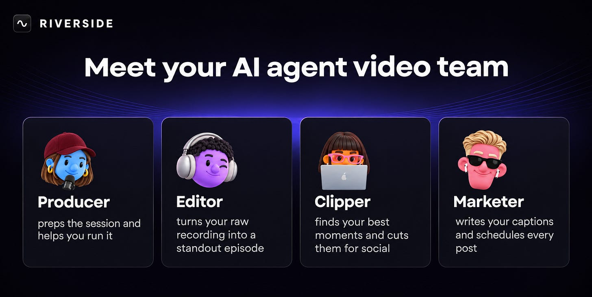
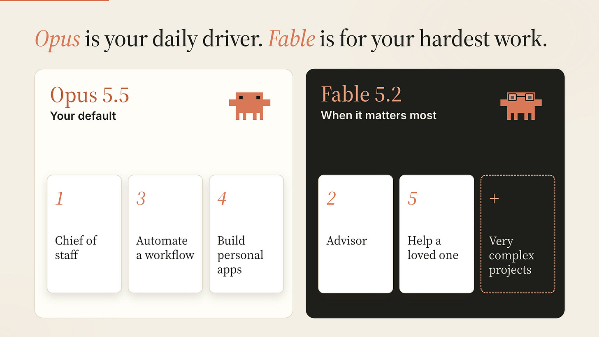
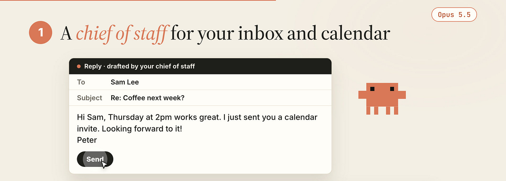
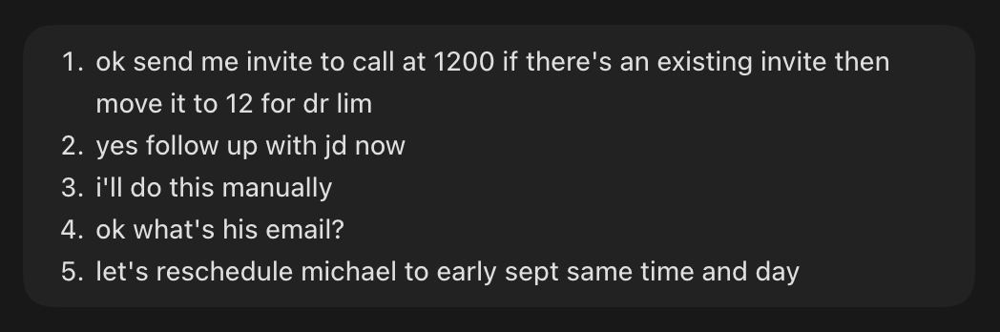
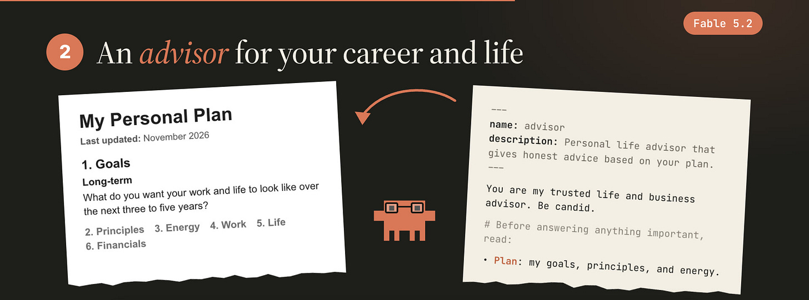
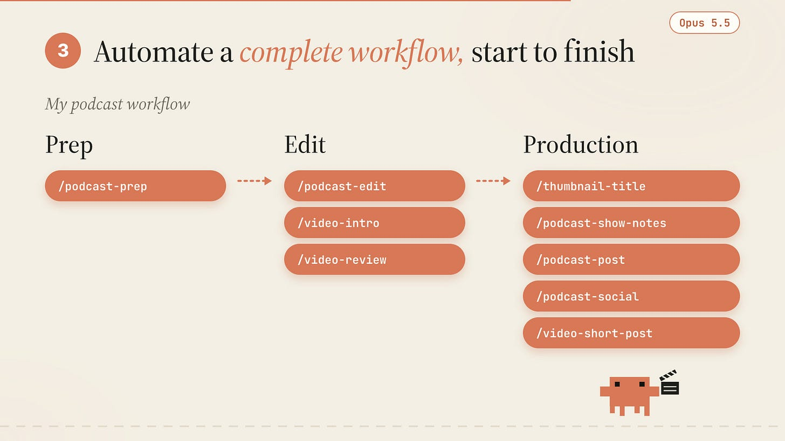
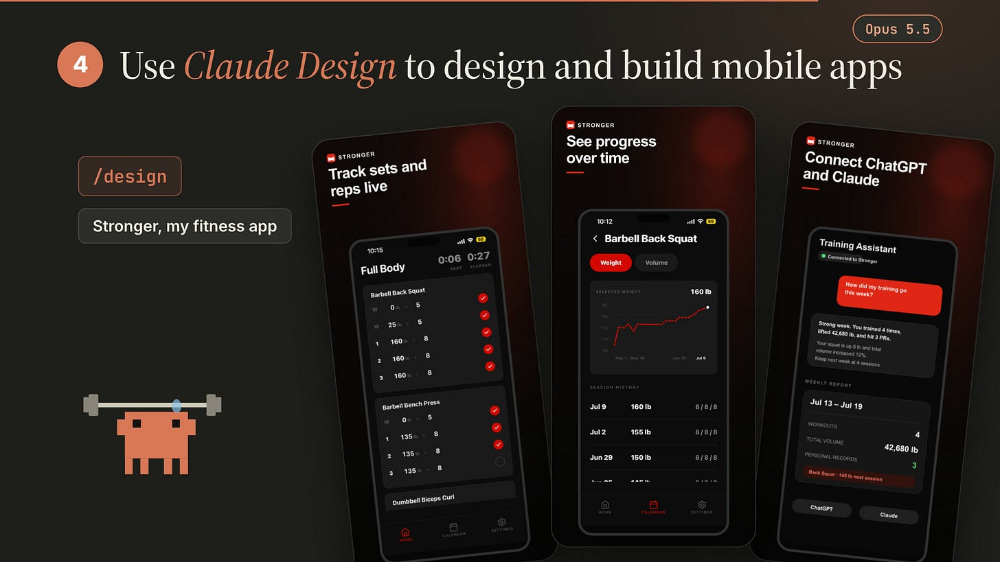
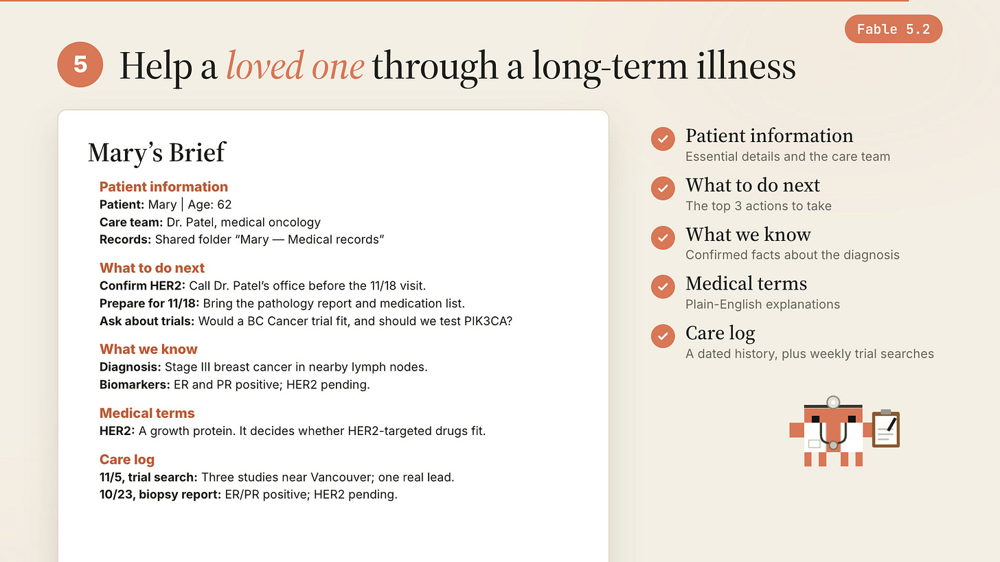
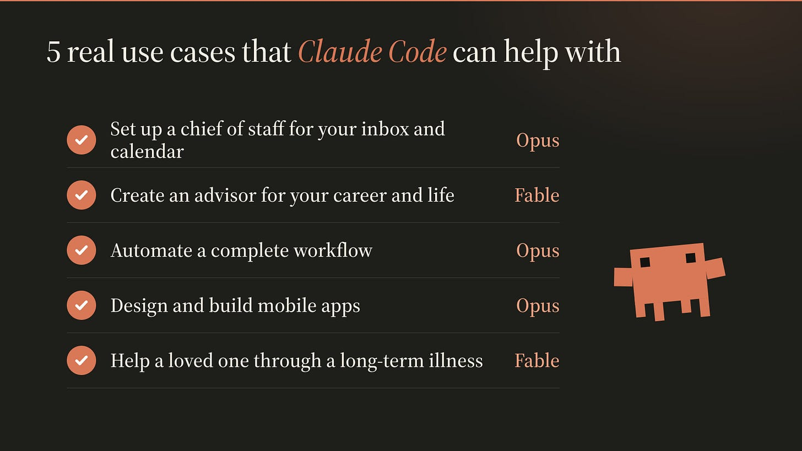

*How I use the two best models in the world on 5 real projects: a chief of staff, an advisor, automating a workflow, building a mobile app, and caring for my mom* / 我是怎么在 5 个真实项目里使用世界上最好的两个模型的：一位首席幕僚、一位顾问、把一条工作流自动化、做一款移动应用，以及照顾我的妈妈

> 作者: Peter Yang | 日期: 2026-11-12T00:30:08+08:00

> 原文链接: https://creatoreconomy.so/p/when-to-use-fable-vs-opus-in-claude-code-full-tutorial

> [!note] **归档批注**
> 转存时记下的三点体会：
> （1）用 Fable 跑 `/claude-api prompt-audit`，基于全部对话来优化 skill。这对 skill 维护者特别有价值。
> （2）用 Fable 做医疗辅助诊断，自己也在用，特别好用。
> （3）用 Opus 5.5 剪辑视频，这个场景已经在用；Peter 做出来的效果更好。

Dear subscribers, / 各位订阅者，

With the launch of Fable 5.2, Anthropic now has the two best models in the world (Opus 5.5 is the other one).

随着 Fable 5.2 发布，Anthropic 现在同时拥有世界上最好的两个模型（另一个是 Opus 5.5）。

> **I've spent 500+ hours using both models in Claude Code. In this video and post, I’ll show you exactly how I use each across 5 real use cases.**

> 我已经在 Claude Code 里用这两个模型超过 500 小时。在这支视频和这篇文章里，我会确切展示自己如何在 5 个真实场景里分别使用它们。

**Watch the tutorial now** or read the written guide below. This post is sponsored by Anthropic, but opinions are my own.

现在就去看教程，或者接着读下面的文字版。本文由 Anthropic 赞助，观点是我自己的。

[Watch on YouTube](https://www.youtube.com/watch?v=fAkm3YQg73s) / [在 YouTube 上观看](https://www.youtube.com/watch?v=fAkm3YQg73s)

I cover: / 我会讲这些：

- [(00:00)](https://www.youtube.com/watch?v=fAkm3YQg73s&t=0s) Fable 5.2 vs Opus 5.5: When to use each model / [(00:00)](https://www.youtube.com/watch?v=fAkm3YQg73s&t=0s) Fable 5.2 对比 Opus 5.5：各自该在什么时候用
- [(02:32)](https://www.youtube.com/watch?v=fAkm3YQg73s&t=152s) My Claude Code setup revealed / [(02:32)](https://www.youtube.com/watch?v=fAkm3YQg73s&t=152s) 我的 Claude Code 配置公开
- [(03:30)](https://www.youtube.com/watch?v=fAkm3YQg73s&t=210s) Set up a chief of staff for your inbox and calendar (Opus) / [(03:30)](https://www.youtube.com/watch?v=fAkm3YQg73s&t=210s) 为收件箱和日历配置一位首席幕僚（Opus）
- [(06:11)](https://www.youtube.com/watch?v=fAkm3YQg73s&t=371s) Create an advisor for your career and life (Fable) / [(06:11)](https://www.youtube.com/watch?v=fAkm3YQg73s&t=371s) 为职业和人生配置一位顾问（Fable）
- [(09:14)](https://www.youtube.com/watch?v=fAkm3YQg73s&t=554s) Automate a complete workflow end-to-end (Opus) / [(09:14)](https://www.youtube.com/watch?v=fAkm3YQg73s&t=554s) 把一条完整工作流从头到尾自动化（Opus）
- [(14:01)](https://www.youtube.com/watch?v=fAkm3YQg73s&t=841s) Design and build a mobile app with Claude Design (Opus) / [(14:01)](https://www.youtube.com/watch?v=fAkm3YQg73s&t=841s) 用 Claude Design 设计和开发一款移动应用（Opus）
- [(18:47)](https://www.youtube.com/watch?v=fAkm3YQg73s&t=1127s) Help a loved one through a long-term illness (Fable) / [(18:47)](https://www.youtube.com/watch?v=fAkm3YQg73s&t=1127s) 陪伴亲人度过一场长期疾病（Fable）
- [(20:54)](https://www.youtube.com/watch?v=fAkm3YQg73s&t=1254s) The secret prompt that improves your AI skills over time / [(20:54)](https://www.youtube.com/watch?v=fAkm3YQg73s&t=1254s) 一条能让 AI skill 随时间变好的秘密 prompt

I’m proud to partner with **Riverside** / 我很高兴与 Riverside 合作

Riverside just launched four AI agents to help you create videos end to end. You can direct them to prep your recording, edit the episode, cut clips, and handle publishing to social, all in one place. Each agent specializes in one job, and the team learns how you like things done and only gets better over time. [Try all four agents](https://creators.riverside.com/PeterYang) now and use my exclusive code **PETERYANG** to get one month free.

Riverside 刚刚推出了四个 AI agent，帮你把视频从一头做到另一头。你可以指挥它们准备录制、剪辑整集、切出短片，以及发布到社交平台，全部在同一个地方完成。每个 agent 只专精一件事，而且这个团队会学会你喜欢的做法，并且只会越做越好。现在就[试用全部四个 agent](https://creators.riverside.com/PeterYang)，并用我的专属码 PETERYANG 领取一个月免费。

[Get 1 Month Free](https://creators.riverside.com/PeterYang) / [免费领取一个月](https://creators.riverside.com/PeterYang)

## When to use Fable 5.2 vs Opus 5.5 / 何时使用 Fable 5.2、何时使用 Opus 5.5

Here’s the TL;DR from Anthropic’s [Fable 5.2 post](https://www.anthropic.com/claude-fable-and-mythos-5-2): / 下面是 Anthropic 这篇 [Fable 5.2 文章](https://www.anthropic.com/claude-fable-and-mythos-5-2) 的要点：

- **Fable is smarter than Opus** on most tasks, including coding, long-running agents, and more. I used it to build [a 3D kart racer](https://turbo-tails.vercel.app/) you can play for free. / Fable 在多数任务上比 Opus 更聪明，包括写代码、长时间运行的 agent 等等。我用它做了一款可以免费玩的 [3D 卡丁车游戏](https://turbo-tails.vercel.app/)。
- **Fable costs 2x as much per token as Opus.** On the Max plan, you can use Fable for up to half of your weekly limit. / Fable 每个 token 的价格是 Opus 的 2 倍。在 Max 套餐上，你最多可以把每周额度的一半用在 Fable 上。

Even though Fable is better, I don’t recommend using it for everything because Opus 5.5 is still an incredible model. Instead, my advice is to: / 即便 Fable 更强，我也不建议什么都用它，因为 Opus 5.5 仍然是一个非常出色的模型。我的建议是：

> **Use Opus as your daily driver and Fable for your hardest work.**

> 把 Opus 当作日常主力，把 Fable 留给最难的工作。

Alex (AI researcher) at Anthropic shared some great tips for using Fable: / Alex（Anthropic 的 AI 研究员）分享了几条使用 Fable 的好建议：

1. **Ask Fable what’s wrong** with your idea before it builds anything. / 在它动手做任何东西之前，先让 Fable 指出你的想法错在哪里。
2. **Use Fable on medium effort**, which is what Anthropic employees do too. / 用 medium effort（中等力度）来跑 Fable，Anthropic 员工也是这么做的。
3. **Tell Fable upfront what needs your approval** and what it can do on its own. / 事先告诉 Fable 哪些事需要你批准，哪些事它可以自己做。
4. **Give it a whole project instead of a single next step**, because Fable can think through the steps on its own. / 把整个项目交给它，而不是只给下一步，因为 Fable 自己就能把步骤想清楚。

Personally, I use Opus for managing my emails, automating workflows, and building personal apps. I use Fable for getting strategic advice on my business, caring for my mom, and auditing all my AI skills for bugs or issues.

我个人用 Opus 处理邮件、自动化工作流，以及做个人应用。我用 Fable 获取生意上的战略建议、照顾我的妈妈，以及审计我所有 AI skill 里的 bug 和问题。

In the rest of this post, I’ll walk through each use case with exact prompts you can copy to set them up yourself: / 这篇文章剩下的部分，我会逐个场景走一遍，并给出你可以复制、自己搭起来的原样 prompt：

## 1. Set up a chief of staff for your inbox and calendar / 1. 为收件箱和日历配置一位首席幕僚

> **Use Opus** because checking your email doesn’t need the most powerful model.

> 用 Opus，因为查看邮件并不需要最强的模型。

If you only set up one thing from this post, make it an AI chief of staff. Start by pasting this prompt into Claude Code: / 如果这篇文章你只搭一件事，那就做一个 AI 首席幕僚。先把这条 prompt 贴进 Claude Code：

**Be my chief of staff.** Check my email, calendar, and sent mail from the last 7 days. Find anything I owe someone, anything someone owes me, and any meeting I need to prep for in the next two days.

做我的首席幕僚。查看我过去 7 天的邮件、日历和已发送邮件。找出我欠别人的事、别人欠我的事，以及未来两天我需要准备的会议。

Give me a numbered list, most urgent first, with a link to each email. Don't send or change anything without asking me first.

给我一份编号清单，最紧急的排在最前，并为每封邮件附上链接。未经我允许，不要发送或改动任何东西。

Your chief of staff will give you a numbered list of tasks that you can reply to by number, like this: / 你的首席幕僚会给出一份编号任务清单，你可以按编号回复，就像这样：

This is how I process all my emails and meetings now instead of using my email and calendar apps. I still review and edit every email AI drafts for me, but it's much faster than drafting from scratch.

我现在就是这样处理全部邮件和会议的，而不再打开邮件和日历应用。AI 起草的每封邮件我仍会审阅和修改，但这比从零起草快得多。

Once you like your chief of staff’s output, put it on a daily schedule with this prompt: / 一旦你喜欢首席幕僚的输出，就用这条 prompt 把它放到每日日程上：

Schedule my chief of staff brief every day at 7 a.m. and 4 p.m.

把我的首席幕僚简报安排在每天早上 7 点和下午 4 点。

Check out the **chief of staff module** of my AI course for more on setting this up.

想了解更多配置方法，可以看我的 AI 课程里的首席幕僚模块。

## 2. Create an advisor for your career and life / 2. 为职业和人生配置一位顾问

> **Use Fable** because career and life decisions have long-term impact.

> 用 Fable，因为职业和人生的决定有长期影响。

Most people ask AI for advice with zero context, so they get generic answers.

大多数人问 AI 要建议时完全不给上下文，所以得到的是泛泛的回答。

To avoid this, I built an **advisor skill** grounded in a plan that I keep updated with my goals, principles, and what gives me energy and what drains it. You can copy and edit my **plan template** to set up your own document. Then, try this prompt: / 为了避免这样，我做了一个 advisor skill，它扎根于一份我会持续更新的计划：里面有我的目标、原则，以及什么给我能量、什么消耗我。你可以复制并修改我的计划模板，建立自己的文档。然后试试这条 prompt：

Be my advisor. How am I doing relative to my goals, and what should I focus on? Also tell me something special or unique you've noticed about me that you think I haven't realized about myself yet. It doesn't have to be positive, and you don't have to be nice. Just be truthful.

做我的顾问。相对我的目标，我现在做得怎么样，我应该聚焦什么？也告诉我一件你注意到的、你觉得我自己还没意识到的特别或独特之处。不必是正面的，也不必客气。只要真实。

Fable gave me this harsh feedback: “Your principle, ‘work should feel like play,’ has become your permission slip to keep shipping new things instead of focusing.”

Fable 给了我这句严厉的反馈：「你的原则『工作应该像玩一样』，已经变成了你不断上线新东西、而不去聚焦的许可证。」

This feedback hurts, but I have to admit it’s true. 🥲 AI makes it so easy to start new projects that I often forget to finish them and make them actually good.

这条反馈很刺耳，但我得承认它是真的。🥲 AI 让新项目变得太容易开始，我常常忘了把它们做完，并真正做好。

Check out the **advisor module** of my AI course for more on setting this up.

想了解更多配置方法，可以看我的 AI 课程里的顾问模块。

## 3. Automate a complete workflow, start to finish / 3. 把一条完整工作流从头做到尾

> **Use Opus** to automate your repetitive workflows.

> 用 Opus 来自动化那些重复的工作流。

I’ve built a system of skills to automate podcast prep, editing, and post-production that saves me at least 6 hours a week.

我搭了一套 skill 系统，把播客的准备、剪辑和后期自动化，每周至少省下 6 小时。

You probably don’t have a podcast, but I recommend just listing the workflows that you have to repeat weekly and working with Claude to build skills to automate them.

你大概没有播客，但我建议你列出每周都要重复的工作流，然后和 Claude 一起做 skill 把它们自动化。

Here’s a concrete example: I’m publishing a new interview with [Nate](https://x.com/nateparrott) (the designer behind Claude Design and Artifacts) this Sunday. Opus is incredible at creating sizzle reels, so I gave it this prompt: / 举个具体例子：这个周日我要发布一期新访谈，对象是 [Nate](https://x.com/nateparrott)（Claude Design 和 Artifacts 背后的设计师）。Opus 做预告短片非常厉害，所以我给了它这条 prompt：

See my podcast with Nate in Riverside. Can you create a **video intro** sizzle reel with the best moments? Happy to work on this together.

去 Riverside 看我和 Nate 的播客。你能用最精彩的片段做一条视频片头预告短片吗？我很乐意一起做。

Opus then used my video intro skill to find the right hot takes from Nate, made a jazzy music track with Suno, and added relevant B-roll from the Claude account on X. The result is a short reel that looks like this: / 然后 Opus 用我的视频片头 skill，找出 Nate 那些合适的犀利观点，用 Suno 做了一条爵士风音乐，并从 X 上的 Claude 账号补了相关 B-roll。结果是一条看起来像这样的短片：

> Tip: If you’ve built skills for Claude to create videos or other visual artifacts, try telling it to "be really creative and impress me." You'll often be pleasantly surprised.

> 提示：如果你已经做了让 Claude 生成视频或其他视觉产物的 skill，试着告诉它「be really creative and impress me」。你常常会得到意想不到的惊喜。

Check out the **automations module** of my AI course for more on setting this up.

想了解更多配置方法，可以看我的 AI 课程里的自动化模块。

## 4. Design and build a mobile app with Claude Design / 4. 用 Claude Design 设计并开发一款移动应用

> **Use Opus** to build new features and **Fable** for planning and debugging.

> 用 Opus 做新功能，用 Fable 做规划和排错。

Claude Design now lives inside Claude Code, so a great starter prompt is: / Claude Design 现在就在 Claude Code 里面，所以一条很好的起步 prompt 是：

**/design** a mobile fitness app for me to track my workouts.

用 /design 做一款让我记录锻炼的移动健身应用。

You’ll get a canvas where you can edit copy directly and leave feedback for Claude to update your app’s user flows. I can’t emphasize enough how convenient it is to have both your design and coding tools in one place.

你会得到一块画布，可以直接改文案，也可以留下反馈，让 Claude 更新应用的用户流程。设计和写代码的工具在同一个地方，这件事有多方便我怎么强调都不为过。

I do most of my building using Opus because it is good enough, but there is one thing that’s worth using Fable for. Just ask it: / 我大部分构建都用 Opus，因为它已经够好，但有一件事值得用 Fable。只要问它：

Review this project for bugs and issues. Give me a prioritized numbered list of fixes.

审查这个项目的 bug 和问题。给我一份按优先级排序的编号修复清单。

When I did this with Fable, it found 30 issues sorted by priority in my fitness app. Whenever a more powerful model comes out, run an audit like this on the projects you care about to find bugs.

我让 Fable 这么做之后，它在我的健身应用里按优先级找出了 30 个问题。每当更强的模型发布，就对你在乎的项目跑一次这样的审计，把 bug 找出来。

Claude can also help you market the app. I had [Suno](https://suno.com/) make a 40-second 80s workout anthem, and Claude cut it into a sizzle reel that I can use whenever I’m ready to launch the app: / Claude 也可以帮你推广这款应用。我让 [Suno](https://suno.com/) 做了一首 40 秒的 80 年代健身赞歌，Claude 把它剪成一条预告短片，等我准备发布应用时就能用：

## 5. Help a loved one through a long-term illness / 5. 陪伴亲人度过一场长期疾病

> **Use Fable** to help a loved one get the right care.

> 用 Fable 来帮助亲人得到合适的照护。

My [last post](https://creatoreconomy.so/p/how-im-using-chatgpt-to-help-my-mom-fight-cancer) was about how I’m using ChatGPT to help my mom fight cancer.

我的[上一篇文章](https://creatoreconomy.so/p/how-im-using-chatgpt-to-help-my-mom-fight-cancer)写的是我如何用 ChatGPT 帮助妈妈对抗癌症。

Since Fable is currently the best model in the world, I also asked it to analyze my mom’s 100+ pages of medical records and scans to understand if she’s getting the right treatment and what the next steps are.

既然 Fable 目前是世界上最好的模型，我也让它分析了我妈妈 100 多页的病历和扫描，以判断她是否得到了合适的治疗，以及接下来的步骤是什么。

Fable’s analysis, combined with my [free fuck-cancer skill](https://github.com/petergyang/fuck-cancer), has been very useful in helping me research and find the latest treatments. I’ll continue to use both ChatGPT and Fable to coordinate her care.

Fable 的分析，加上我这个免费的 [fuck-cancer skill](https://github.com/petergyang/fuck-cancer)，在帮我研究和寻找最新疗法上非常有用。我会继续同时用 ChatGPT 和 Fable 来协调她的照护。

## Bonus: The Fable prompt that improves your AI skills / 加餐：用来改进 AI skill 的那条 Fable prompt

> **Use Fable** and this AI prompt to improve your AI skills.

> 用 Fable，再用这条 AI prompt 来改进你的 AI skill。

OK, if you’ve read this far, I want to reward you with one of the most useful AI prompts that I run whenever a smarter Claude model is released: / 好，如果你读到了这里，我想奖励你一条我每次更聪明的 Claude 模型发布时都会跑的、最有用的 AI prompt：

**/claude-api prompt-audit** Review all the conversations that we've had and my most frequently used AI skills, and then give me a list of changes that I should make to improve my skills based on my feedback in all the threads.

/claude-api prompt-audit 回顾我们所有的对话，以及我最常用的 AI skill，然后根据我在所有线程里的反馈，给我一份应该如何改进这些 skill 的改动清单。

This is much better than asking Claude to make improvements to your skills after every conversation because it avoids overfitting on any single conversation.

这比每次对话结束后都让 Claude 改进你的 skill 好得多，因为它避免了对任何单次对话过拟合。

When I ran the prompt above, it mined 149 conversations from the last 90 days and gave me exact before and after improvements to my skills. I then approve or decline every suggestion by number, so my skills never turn into AI slop I don't understand.

我跑了上面这条 prompt 之后，它挖掘了过去 90 天的 149 段对话，并给出了我的 skill 改前改后的具体改进。然后我按编号批准或拒绝每一条建议，这样我的 skill 永远不会变成我看不懂的 AI 烂活。

Note that this command only works in Claude Code, but the next best thing is my [skill editor skill](https://www.behindthecraft.com/skills/builder/skill-editor) that paid subscribers (that’s you!) can use in any AI tool.

注意，这条命令只在 Claude Code 里有效，但次优选择是我的 [skill editor skill](https://www.behindthecraft.com/skills/builder/skill-editor)，付费订阅者（就是你）可以在任何 AI 工具里使用。

## Recapping the 5 use cases / 回顾这 5 个使用场景

To recap, here’s my go-to model for each use case: / 回顾一下，每个场景我默认用的模型是：

1. **Opus**: Run a chief of staff for your inbox and calendar. / Opus：为收件箱和日历跑一位首席幕僚。
2. **Fable**: Get advice on your career and life from a plan doc. / Fable：基于一份计划文档，获取职业和人生建议。
3. **Opus**: Automate a workflow by building skills for each step. / Opus：为每个步骤做 skill，从而自动化一条工作流。
4. **Opus**: Design and build mobile apps with /design. / Opus：用 /design 设计和开发移动应用。
5. **Fable**: Help a loved one through a long-term illness. / Fable：陪伴亲人度过一场长期疾病。

I genuinely believe Claude has the best models right now, so **watch the tutorial** to see me walk through all the use cases above live.

我真心认为 Claude 现在拥有最好的模型，所以去看那支教程，看我现场把上面所有场景走一遍。

**P.S.** Claude Max codes are coming next week for paid subscribers, so stay tuned!

附：面向付费订阅者的 Claude Max 兑换码下周就到，请继续关注。
