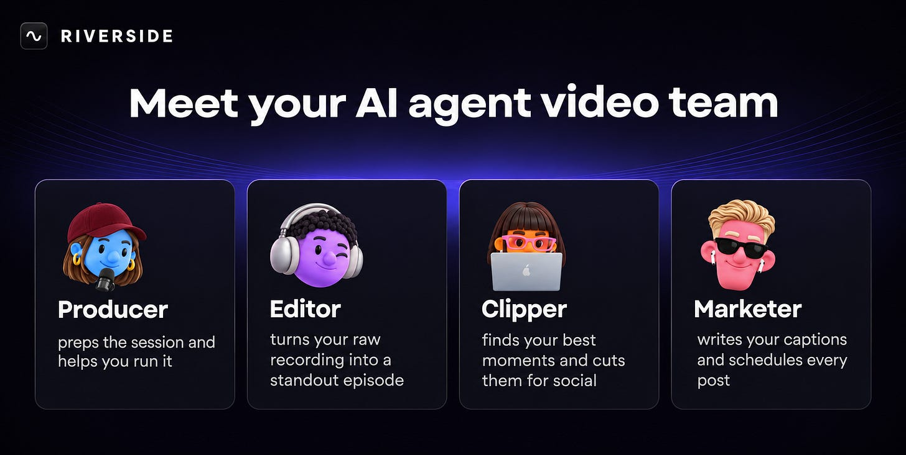
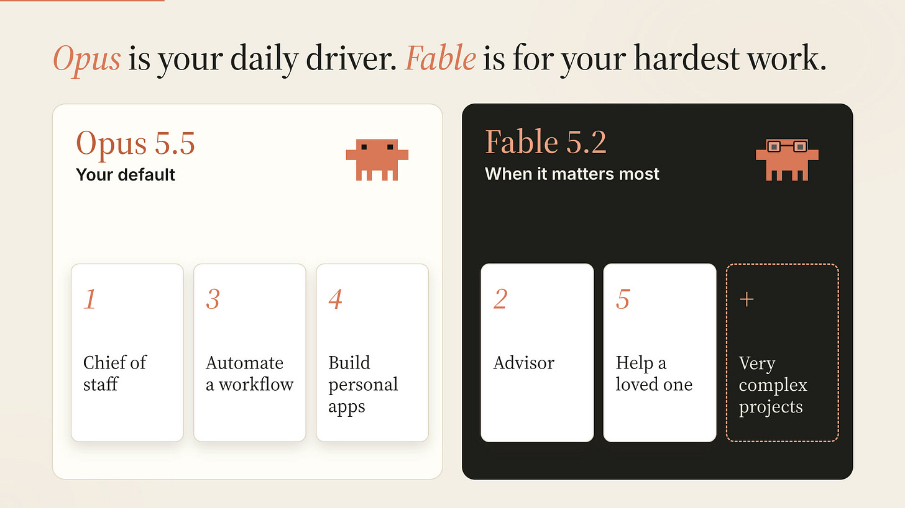
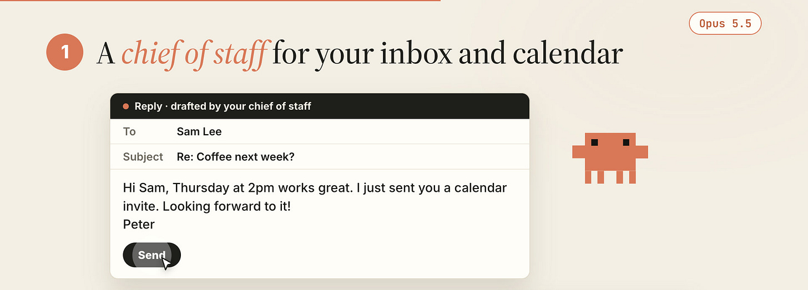
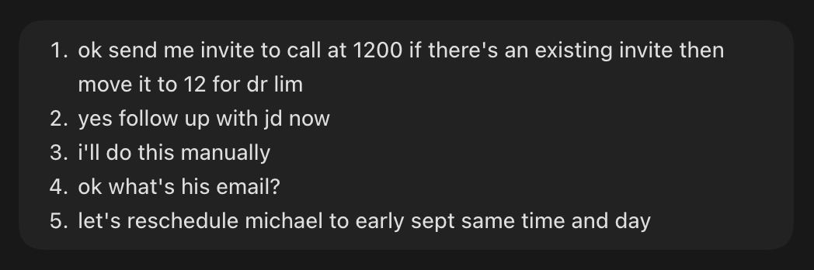
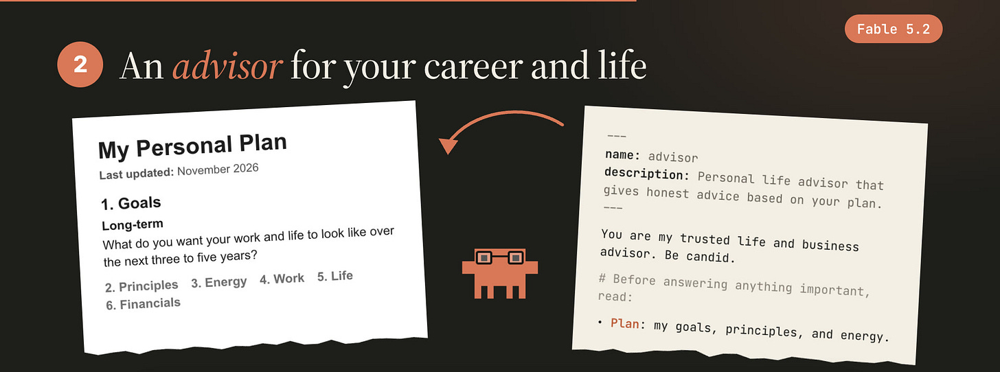
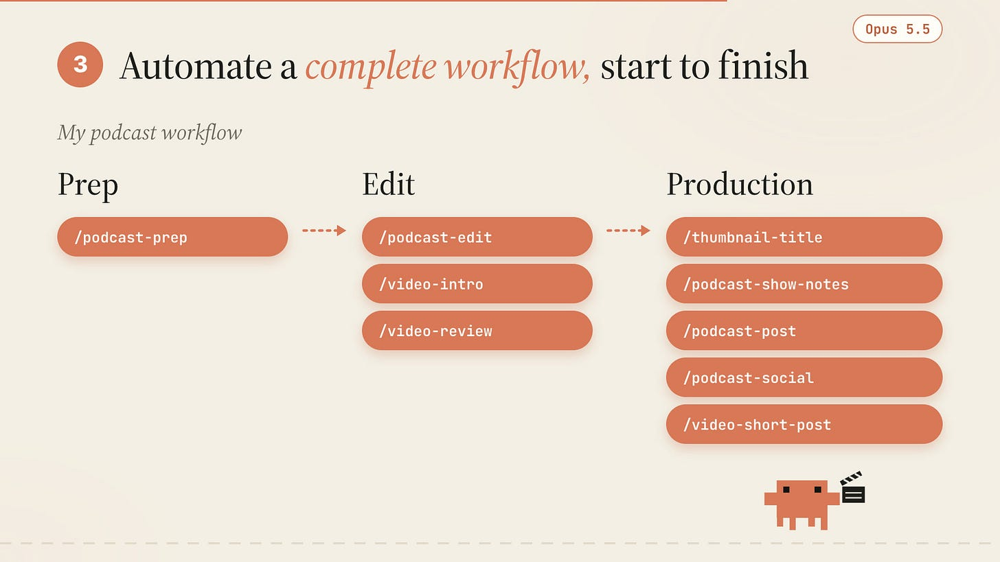
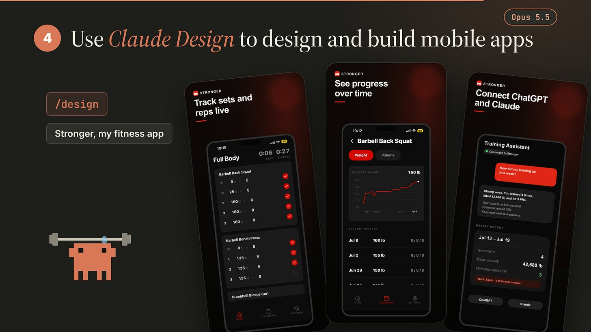
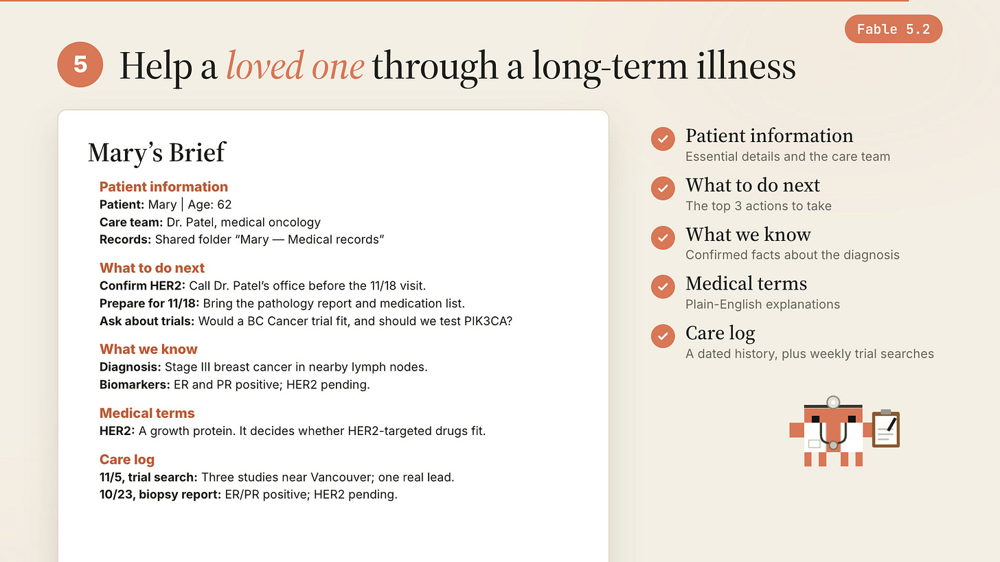
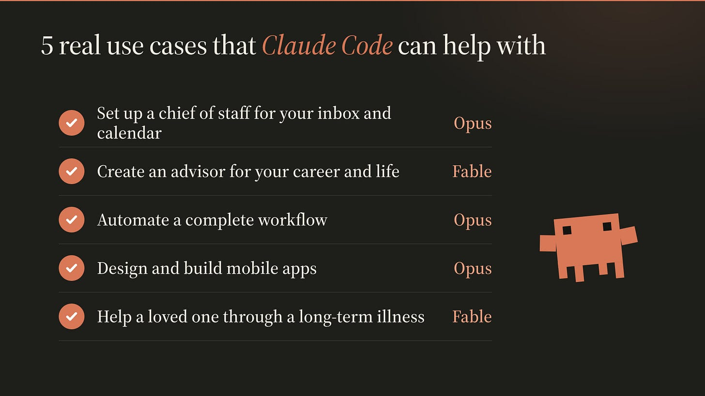

# When to Use Fable 5.2 vs Opus 5.5 in Claude Code (Full Tutorial)

*How I use the two best models in the world on 5 real projects: a chief of staff, an advisor, automating a workflow, building a mobile app, and caring for my mom*

> 作者: Peter Yang | 日期: 2026-11-12T00:30:08+08:00

> 原文链接: https://creatoreconomy.so/p/when-to-use-fable-vs-opus-in-claude-code-full-tutorial

---

Dear subscribers,

With the launch of Fable 5.2, Anthropic now has the two best models in the world (Opus 5.5 is the other one).

> **I've spent 500+ hours using both models in Claude Code. In this video and post, I’ll show you exactly how I use each across 5 real use cases.**

**Watch the tutorial now** or read the written guide below. This post is sponsored by Anthropic, but opinions are my own.

[Watch on YouTube](https://www.youtube.com/watch?v=fAkm3YQg73s)

I cover:

- [(00:00)](https://www.youtube.com/watch?v=fAkm3YQg73s&t=0s) Fable 5.2 vs Opus 5.5: When to use each model
- [(02:32)](https://www.youtube.com/watch?v=fAkm3YQg73s&t=152s) My Claude Code setup revealed
- [(03:30)](https://www.youtube.com/watch?v=fAkm3YQg73s&t=210s) Set up a chief of staff for your inbox and calendar (Opus)
- [(06:11)](https://www.youtube.com/watch?v=fAkm3YQg73s&t=371s) Create an advisor for your career and life (Fable)
- [(09:14)](https://www.youtube.com/watch?v=fAkm3YQg73s&t=554s) Automate a complete workflow end-to-end (Opus)
- [(14:01)](https://www.youtube.com/watch?v=fAkm3YQg73s&t=841s) Design and build a mobile app with Claude Design (Opus)
- [(18:47)](https://www.youtube.com/watch?v=fAkm3YQg73s&t=1127s) Help a loved one through a long-term illness (Fable)
- [(20:54)](https://www.youtube.com/watch?v=fAkm3YQg73s&t=1254s) The secret prompt that improves your AI skills over time

---

I’m proud to partner with **Riverside**

Riverside just launched four AI agents to help you create videos end to end. You can direct them to prep your recording, edit the episode, cut clips, and handle publishing to social, all in one place. Each agent specializes in one job, and the team learns how you like things done and only gets better over time. [Try all four agents](https://creators.riverside.com/PeterYang) now and use my exclusive code **PETERYANG** to get one month free.

[Get 1 Month Free](https://creators.riverside.com/PeterYang)

---

## When to use Fable 5.2 vs Opus 5.5

Here’s the TL;DR from Anthropic’s [Fable 5.2 post](https://www.anthropic.com/claude-fable-and-mythos-5-2):

- **Fable is smarter than Opus** on most tasks, including coding, long-running agents, and more. I used it to build [a 3D kart racer](https://turbo-tails.vercel.app/) you can play for free.
- **Fable costs 2x as much per token as Opus.** On the Max plan, you can use Fable for up to half of your weekly limit.

Even though Fable is better, I don’t recommend using it for everything because Opus 5.5 is still an incredible model. Instead, my advice is to:

> **Use Opus as your daily driver and Fable for your hardest work.**

Alex (AI researcher) at Anthropic shared some great tips for using Fable:

1. **Ask Fable what’s wrong** with your idea before it builds anything.
2. **Use Fable on medium effort**, which is what Anthropic employees do too.
3. **Tell Fable upfront what needs your approval** and what it can do on its own.
4. **Give it a whole project instead of a single next step**, because Fable can think through the steps on its own.

Personally, I use Opus for managing my emails, automating workflows, and building personal apps. I use Fable for getting strategic advice on my business, caring for my mom, and auditing all my AI skills for bugs or issues.

In the rest of this post, I’ll walk through each use case with exact prompts you can copy to set them up yourself:

---

## 1. Set up a chief of staff for your inbox and calendar

> **Use Opus** because checking your email doesn’t need the most powerful model.

If you only set up one thing from this post, make it an AI chief of staff. Start by pasting this prompt into Claude Code:

**Be my chief of staff.** Check my email, calendar, and sent mail from the last 7 days. Find anything I owe someone, anything someone owes me, and any meeting I need to prep for in the next two days.

Give me a numbered list, most urgent first, with a link to each email. Don't send or change anything without asking me first.

Your chief of staff will give you a numbered list of tasks that you can reply to by number, like this:

This is how I process all my emails and meetings now instead of using my email and calendar apps. I still review and edit every email AI drafts for me, but it's much faster than drafting from scratch.

Once you like your chief of staff’s output, put it on a daily schedule with this prompt:

Schedule my chief of staff brief every day at 7 a.m. and 4 p.m.

Check out the **chief of staff module** of my AI course for more on setting this up.

---

## 2. Create an advisor for your career and life

> **Use Fable** because career and life decisions have long-term impact.

Most people ask AI for advice with zero context, so they get generic answers.

To avoid this, I built an **advisor skill** grounded in a plan that I keep updated with my goals, principles, and what gives me energy and what drains it. You can copy and edit my **plan template** to set up your own document. Then, try this prompt:

Be my advisor. How am I doing relative to my goals, and what should I focus on? Also tell me something special or unique you've noticed about me that you think I haven't realized about myself yet. It doesn't have to be positive, and you don't have to be nice. Just be truthful.

Fable gave me this harsh feedback: “Your principle, ‘work should feel like play,’ has become your permission slip to keep shipping new things instead of focusing.”

This feedback hurts, but I have to admit it’s true. 🥲 AI makes it so easy to start new projects that I often forget to finish them and make them actually good.

Check out the **advisor module** of my AI course for more on setting this up.

---

## 3. Automate a complete workflow, start to finish

> **Use Opus** to automate your repetitive workflows.

I’ve built a system of skills to automate podcast prep, editing, and post-production that saves me at least 6 hours a week.

You probably don’t have a podcast, but I recommend just listing the workflows that you have to repeat weekly and working with Claude to build skills to automate them.

Here’s a concrete example: I’m publishing a new interview with [Nate](https://x.com/nateparrott) (the designer behind Claude Design and Artifacts) this Sunday. Opus is incredible at creating sizzle reels, so I gave it this prompt:

See my podcast with Nate in Riverside. Can you create a **video intro** sizzle reel with the best moments? Happy to work on this together.

Opus then used my video intro skill to find the right hot takes from Nate, made a jazzy music track with Suno, and added relevant B-roll from the Claude account on X. The result is a short reel that looks like this:

> Tip: If you’ve built skills for Claude to create videos or other visual artifacts, try telling it to "be really creative and impress me." You'll often be pleasantly surprised.

Check out the **automations module** of my AI course for more on setting this up.

---

## 4. Design and build a mobile app with Claude Design

> **Use Opus** to build new features and **Fable** for planning and debugging.

Claude Design now lives inside Claude Code, so a great starter prompt is:

**/design** a mobile fitness app for me to track my workouts.

You’ll get a canvas where you can edit copy directly and leave feedback for Claude to update your app’s user flows. I can’t emphasize enough how convenient it is to have both your design and coding tools in one place.

I do most of my building using Opus because it is good enough, but there is one thing that’s worth using Fable for. Just ask it:

Review this project for bugs and issues. Give me a prioritized numbered list of fixes.

When I did this with Fable, it found 30 issues sorted by priority in my fitness app. Whenever a more powerful model comes out, run an audit like this on the projects you care about to find bugs.

Claude can also help you market the app. I had [Suno](https://suno.com/) make a 40-second 80s workout anthem, and Claude cut it into a sizzle reel that I can use whenever I’m ready to launch the app:

---

## 5. Help a loved one through a long-term illness

> **Use Fable** to help a loved one get the right care.

My [last post](https://creatoreconomy.so/p/how-im-using-chatgpt-to-help-my-mom-fight-cancer) was about how I’m using ChatGPT to help my mom fight cancer.

Since Fable is currently the best model in the world, I also asked it to analyze my mom’s 100+ pages of medical records and scans to understand if she’s getting the right treatment and what the next steps are.

Fable’s analysis, combined with my [free fuck-cancer skill](https://github.com/petergyang/fuck-cancer), has been very useful in helping me research and find the latest treatments. I’ll continue to use both ChatGPT and Fable to coordinate her care.

---

## Bonus: The Fable prompt that improves your AI skills

> **Use Fable** and this AI prompt to improve your AI skills.

OK, if you’ve read this far, I want to reward you with one of the most useful AI prompts that I run whenever a smarter Claude model is released:

**/claude-api prompt-audit** Review all the conversations that we've had and my most frequently used AI skills, and then give me a list of changes that I should make to improve my skills based on my feedback in all the threads.

This is much better than asking Claude to make improvements to your skills after every conversation because it avoids overfitting on any single conversation.

When I ran the prompt above, it mined 149 conversations from the last 90 days and gave me exact before and after improvements to my skills. I then approve or decline every suggestion by number, so my skills never turn into AI slop I don't understand.

Note that this command only works in Claude Code, but the next best thing is my [skill editor skill](https://www.behindthecraft.com/skills/builder/skill-editor) that paid subscribers (that’s you!) can use in any AI tool.

---

## Recapping the 5 use cases

To recap, here’s my go-to model for each use case:

1. **Opus**: Run a chief of staff for your inbox and calendar.
2. **Fable**: Get advice on your career and life from a plan doc.
3. **Opus**: Automate a workflow by building skills for each step.
4. **Opus**: Design and build mobile apps with /design.
5. **Fable**: Help a loved one through a long-term illness.

I genuinely believe Claude has the best models right now, so **watch the tutorial** to see me walk through all the use cases above live.

---

**P.S.** Claude Max codes are coming next week for paid subscribers, so stay tuned!