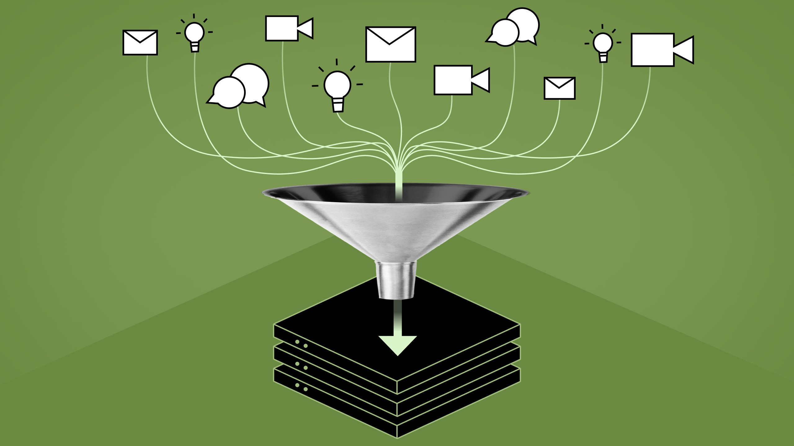

> 作者: Jaya Gupta, Ashu Garg | 页面日期: Dec 22, 2025 | 阅读时长: 12 MIN READ | 分类: AI · Enterprise | 来源: Foundation Capital

> 原文链接: https://foundationcapital.com/ideas/context-graphs-ais-trillion-dollar-opportunity

The last generation of enterprise software created a trillion-dollar ecosystem by becoming systems of record. Salesforce for customers. Workday for employees. SAP for operations. Own the canonical data, own the workflow, own the lock-in.

上一代企业软件通过成为「记录系统」（systems of record，即权威数据源），缔造了一个万亿美元级的生态：Salesforce 管客户，Workday 管员工，SAP 管运营。谁掌握了权威数据，谁就掌握了工作流，也就掌握了锁定用户的筹码。

The debate right now is whether those systems survive the shift to agents. Jamin Ball's recent post "[Long Live Systems of Record](https://cloudedjudgement.substack.com/p/clouded-judgement-121225-long-live)" hit a nerve. Pushing back on the "agents kill everything" narrative, he argues that agents don't replace systems of record, they raise the bar for what a good one looks like.

当下的争论是：向智能体迁移时，这些系统能否存活。Jamin Ball 近期的文章《Long Live Systems of Record》戳中了痛点。他反驳「智能体将消灭一切」的叙事，认为智能体并不会取代记录系统，而是抬高了「什么才算好的记录系统」的标准。

We agree. Agents are cross-system and action-oriented. The UX of work is separating from the underlying data plane. Agents become the interface, but something still has to be canonical underneath.

我们同意。智能体是跨系统、面向动作的。工作的交互层正在与底层数据平面分离。智能体成为界面，但界面之下仍必须有一个权威数据源。

Where we go further is this: Ball’s framing assumes the data agents need already lives somewhere, and agents just need better access to it plus better governance, semantic contracts, and explicit rules about which definition wins for which purpose.

我们要再往前推一步：Ball 的框架假设智能体所需的数据已经存在于某处，智能体只需要更好的访问方式，外加更好的治理、语义契约，以及明确规定「在哪种用途下以哪个定义为准」的显式规则。

That’s half the picture. The other half is the missing layer that actually runs enterprises: **the decision traces** - the exceptions, overrides, precedents, and cross-system context that currently live in Slack threads, deal desk conversations, escalation calls, and people’s heads.

这只是一半。另一半，是真正驱动企业运转却缺失的那一层：**决策轨迹** —— 那些如今还散落在 Slack 对话、交易台沟通、升级电话和人们脑子里的例外、覆写、先例与跨系统上下文。

This is the distinction that matters:

关键区别在这里：

**Rules** tell an agent *what should happen in general* (“use official ARR for reporting”)

**规则**告诉智能体*一般情况下应该发生什么*（「报表一律用官方 ARR 口径」）

**Decision traces** capture *what happened in this specific case* (“we used X definition, under policy v3.2, with a VP exception, based on precedent Z, and here’s what we changed”).

**决策轨迹**记录*在这个具体个案里实际发生了什么*（「我们用了 X 定义，依据 v3.2 版政策，经 VP 特批，参照先例 Z，以下是我们改动的部分」）。

Agents don’t just need rules. They need access to the decision traces that show how rules were applied in the past, where exceptions were granted, how conflicts were resolved, who approved what, and which precedents actually govern reality.

智能体不只需要规则。它们还需要能读到决策轨迹：过去规则是如何被套用的、例外在哪些环节被放行、冲突如何被裁决、谁批准了什么，以及哪些先例才真正约束着现实。

This is where systems of agents startups have a structural advantage. They sit **in the execution path**. They see the full context at decision time: what inputs were gathered across systems, what policy was evaluated, what exception route was invoked, who approved, and what state was written. If you persist those traces, you get something that doesn’t exist in most enterprises today: a queryable record of how decisions were made.

这正是智能体系统（systems of agents）创业公司的结构性优势所在。它们就**处在执行路径上**。它们在决策发生的那一刻看到完整上下文：跨系统收集了哪些输入、评估了哪条政策、触发了哪条例外通道、谁批的、最后写入了什么状态。只要把这些轨迹持久化，就能得到今天绝大多数企业并不具备的东西：一份关于「决策是怎么做出来的」的可查询记录。

We call the accumulated structure formed by those traces a **context graph**: not “the model’s chain-of-thought,” but a living record of decision traces stitched across entities and time so precedent becomes searchable. Over time, that context graph becomes the real source of truth for autonomy - because it explains not just *what* happened, but *why it was allowed* to happen.

我们把这些轨迹累积形成的结构称为**上下文图谱**：它不是「模型的思维链」，而是一份把决策轨迹按实体和时间缝合起来的活记录，让先例变得可检索。久而久之，这张上下文图谱会成为自主运行真正的事实来源 —— 因为它不只解释*发生了什么*，还解释*为什么它被允许发生*。

The core question isn’t whether existing systems of record survive. It’s whether entirely new ones emerge - systems of record for decisions, not just objects - and whether those become the next trillion-dollar platforms.

核心问题并不是现有的记录系统能否存续，而是会不会涌现出全新的记录系统 —— 记录的是决策，而不只是对象 —— 以及它们会不会成为下一个万亿美元级平台。

## What systems of record don’t capture / 记录系统没有捕捉到的东西

Agents are shipping into real workflows - contract review, quote-to-cash, support resolution - and teams are hitting a wall that governance alone can't solve.

智能体正在进入真实工作流 —— 合同审查、报价到回款（quote-to-cash）、客服问题闭环 —— 而团队撞上了一堵光靠治理解决不了的墙。

The wall isn't missing data. It's missing decision traces. Agents run into the same ambiguity humans resolve every day with judgment and organizational memory. But the inputs to those judgments aren't stored as durable artifacts. Specifically:

这堵墙不是缺数据，而是缺决策轨迹。智能体会撞上人类每天靠判断力和组织记忆化解的那些模糊地带，但支撑这些判断的输入从未被存成可持久复用的产物。具体来说：

- **Exception logic that lives in people's heads.** "We always give healthcare companies an extra 10% because their procurement cycles are brutal." That's not in the CRM. It's tribal knowledge passed down through onboarding and side conversations. / **只存在于人脑里的例外逻辑。**「医疗行业客户我们总会多给 10%，因为他们的采购流程太折磨人。」这条规则不在 CRM 里，而是靠入职传帮带和私下交流口耳相传的部落知识。
- **Precedent from past decisions.** "We structured a similar deal for Company X last quarter - we should be consistent." No system links those two deals or records why the structure was chosen. / **来自过往决策的先例。**「上季度我们给 X 公司做过一笔结构类似的单子，这次应该保持一致。」没有任何系统把这两笔交易关联起来，也没有记录当初为什么选了那种结构。
- **Cross-system synthesis.** The support lead checks the customer's ARR in Salesforce, sees two open escalations in Zendesk, reads a Slack thread flagging churn risk, and decides to escalate. That synthesis happens in their head. The ticket just says "escalated to Tier 3." / **跨系统的信息综合。** 客服负责人先在 Salesforce 查客户 ARR，再在 Zendesk 看到两个未关闭的升级工单，又读到 Slack 里提示流失风险的讨论，最后决定升级。这个综合判断发生在他的脑子里，工单上只留下一句「已升级至三级支持」。
- **Approval chains that happen outside systems.** A VP approves a discount on a Zoom call or in a Slack DM. The opportunity record shows the final price. It doesn't show who approved the deviation or why. / **发生在系统之外的审批链。** VP 在 Zoom 通话里或 Slack 私信里批了一个折扣。商机记录里只有最终价格，看不出是谁批准了这次偏离、为什么批准。

This is what "never captured" means. Not that the data is dirty or siloed, but that the reasoning connecting data to action was never treated as data in the first place.

这就是「从未被捕捉」的含义：不是说数据脏、数据孤岛，而是把数据连到行动上的那套推理，从一开始就没被当成数据看待。

## The context graph is the enduring layer / 上下文图谱才是长期沉淀下来的那一层

When startups instrument the agent orchestration layer to emit a decision trace on every run, they get something enterprises almost never have today: a structured, replayable history of how context turned into action.

当创业公司给智能体编排层加上埋点，让每次运行都产出一条决策轨迹，它们就得到了今天企业几乎不可能拥有的东西：一份结构化的、可回放的历史，记录上下文是如何变成动作的。

*What does this look like in practice?* A renewal agent proposes a 20% discount. Policy caps renewals at 10% unless a service-impact exception is approved. The agent pulls three SEV-1 incidents from PagerDuty, an open “cancel unless fixed” escalation in Zendesk, and the prior renewal thread where a VP approved a similar exception last quarter. It routes the exception to Finance. Finance approves. The CRM ends up with one fact: “20% discount.”

*实际长什么样？* 一个续约智能体提出给 20% 折扣；政策规定续约折扣上限 10%，除非通过「服务影响」例外审批。智能体从 PagerDuty 拉出三起 SEV-1 故障，从 Zendesk 拉出一条「不修好就取消」的未关闭升级，再翻出上季度 VP 批准过类似例外的续约对话，然后把例外路由给财务。财务批准。CRM 里最后只留下一个事实：「20% 折扣」。

Once you have decision records, the “why” becomes first-class data. Over time, these records naturally form a **context graph**: the entities the business already cares about (accounts, renewals, tickets, incidents, policies, approvers, agent runs) connected by decision events (the moments that matter) and “why” links. Companies can now audit and debug autonomy and turn exceptions into precedent instead of re-learning the same edge case in Slack every quarter.

一旦有了决策记录，「为什么」就成了一等数据。随着时间推移，这些记录自然长成一张**上下文图谱**：企业本来就在意的实体（客户、续约、工单、故障、政策、审批人、智能体运行）被决策事件（真正要紧的那些时刻）和「为什么」链接连在一起。企业于是可以审计、调试自主运行，并把例外沉淀成先例，而不必每个季度都在 Slack 里重新学一遍同一个边界案例。

**The feedback loop is what makes this compound.** Captured decision traces become searchable precedent. And every automated decision adds another trace to the graph.

**真正让它产生复利的是反馈回路。** 被捕捉下来的决策轨迹变成可检索的先例，而每一次自动化决策又给图谱添上一条新轨迹。

None of this requires full autonomy on day one. It starts with human-in-the-loop: the agent proposes, gathers context, routes approvals, and records the trace. Over time, as similar cases repeat, more of the path can be automated because the system has a structured library of prior decisions and exceptions. Even when a human still makes the call, the graph keeps growing, because the workflow layer captures the inputs, approval, and rationale as durable precedent instead of letting it die in Slack.

这一切并不要求第一天就实现完全自主。它从「人在回路」开始：智能体提出方案、收集上下文、路由审批、记录轨迹。随着相似案例反复出现，系统有了结构化的历史决策与例外库，路径上越来越多的环节就可以自动化。即便最后仍由人拍板，图谱也还在增长 —— 因为工作流层把输入、批准与理由存成了可长期复用的先例，而不是让它们烂在 Slack 里。

## Why incumbents can't build the context graph / 为什么在位厂商建不出上下文图谱

Ball is optimistic that existing players evolve into this architecture. Warehouses become "truth registries,” while CRMs become "state machines with APIs." His is a narrative of evolution, not replacement.

Ball 乐观地认为现有玩家会演进成这套架构：数仓变成「真相登记处」，CRM 变成「带 API 的状态机」。他讲的是演进，不是替代。

That might work for making existing data more accessible. It doesn't work for capturing decision traces.

让现有数据更易访问，这条路也许行得通；但要捕捉决策轨迹，它行不通。

### Operational incumbents are siloed and prioritize current state. / 运营型在位厂商彼此割裂，且只优先记录当前状态

Salesforce is pushing Agentforce, ServiceNow has Now Assist, and Workday is building agents for HR. Their pitch is “we have the data, now we add the intelligence.”

Salesforce 在推 Agentforce，ServiceNow 有 Now Assist，Workday 在做 HR 智能体。它们的说辞是「数据在我们这儿，现在把智能加上去」。

But these agents inherit their parent's architectural limitations. Salesforce is built on current state storage: it knows what the opportunity looks like now, not what it looked like when the decision was made. When a discount gets approved, the context that justified it isn't preserved. You can't replay the state of the world at decision time, which means you can't audit the decision, learn from it, or use it as precedent.

但这些智能体继承了母系统的架构局限。Salesforce 建立在「当前状态存储」之上：它知道商机现在长什么样，却不知道决策做出那一刻它长什么样。折扣一旦获批，为它辩护的那些上下文并没有被保留。你无法回放决策时刻的世界状态，也就无法审计这个决策、无法从中学习、无法把它当作先例。

They also inherit their parent's blind spots. A support escalation doesn't live in Zendesk alone. It depends on customer tier from the CRM, SLA terms from billing, recent outages from PagerDuty, and the Slack thread flagging churn risk. No incumbent sees this because no incumbent sits in the cross-system path.

它们同样继承了母系统的盲区。一次客服升级并不只存在于 Zendesk：它同时依赖 CRM 里的客户等级、计费系统里的 SLA 条款、PagerDuty 里的近期故障，以及 Slack 里提示流失风险的讨论。没有哪家在位厂商看得全，因为没有哪家坐在跨系统路径上。

### The warehouse players have a different problem: they're in the read path, not the write path. / 数仓厂商的问题不同：它们在读路径上，不在写路径上

Ball positions Snowflake and Databricks as the "truth registry" layer. Both are leaning in - Snowflake pushing Cortex and acquiring Streamlit, Databricks acquiring Neon and launching Lakebase and AgentBricks. The pitch: data platforms replace systems of record and become the foundation for AI agents.

Ball 把 Snowflake 和 Databricks 放在「真相登记处」这一层。两家都在加码：Snowflake 推 Cortex、收购 Streamlit；Databricks 收购 Neon、推出 Lakebase 和 AgentBricks。它们的说辞是：数据平台将取代记录系统，成为 AI 智能体的地基。

Warehouses do have a time-based view. You can query historical snapshots, track how metrics changed, and compare state across periods. But warehouses receive data via ETL after decisions are made. By the time data lands in Snowflake, the decision context is gone.

数仓确实有时间维度的视角：可以查历史快照、追踪指标怎么变、比较不同时期的状态。但数仓是通过 ETL 在决策**之后**才拿到数据的。等数据落到 Snowflake，决策上下文早已消失。

A system that only sees reads, after the fact, can't be the system of record for decision lineage. It can tell you what happened, but it can't tell you why.

一个只能事后看到读取结果的系统，不可能成为决策血缘的记录系统。它能告诉你发生了什么，却告诉不了你为什么。

Databricks is further along in putting the pieces together. But being close to where agents get built isn't the same as being in the execution path where decisions happen.

Databricks 在拼齐这些拼图方面走得更远。但「离智能体被构建的地方近」，和「处在决策真正发生的执行路径上」，并不是一回事。

### Systems of agents startups have a structural advantage: they're in the orchestration path. / 智能体系统创业公司的结构性优势：它们就在编排路径上

When an agent triages an escalation, responds to an incident, or decides on a discount, it pulls context from multiple systems, evaluates rules, resolves conflicts, and acts. The orchestration layer sees the full picture: what inputs were gathered, what policies applied, what exceptions were granted, and why. Because it's executing the workflow, it can capture that context at decision time - not after the fact via ETL, but in the moment, as a first-class record.

当智能体给升级工单分诊、响应故障、或决定折扣时，它从多个系统拉取上下文、评估规则、消解冲突，然后执行动作。编排层看到的是全貌：收集了哪些输入、适用了哪些政策、放行了哪些例外、以及为什么。因为它正在执行工作流，所以能在决策发生的当下捕捉这些上下文 —— 不是事后靠 ETL 补，而是在那一刻、作为一等记录写下来。

**That's the context graph, and that will be the single most valuable asset for companies in the era of AI.**

**这就是上下文图谱，它将成为 AI 时代企业最有价值的单项资产。**

**Incumbents will fight back.** They'll try acquisitions to bolt on orchestration capabilities. They'll lock down APIs and adopt egress fees to make data extraction expensive - the same playbook hyperscalers used. They'll build their own agent frameworks and push "keep everything in our ecosystem" narratives.

**在位厂商当然会反击。** 它们会试图用收购把编排能力外挂上去；会锁死 API、加收数据出域费，抬高数据抽取成本 —— 这正是当年超大规模云厂商用过的剧本；还会做自己的智能体框架，灌输「把一切都留在我们生态里」的叙事。

But capturing decision traces requires being in the execution path at commit time, not bolting on governance after the fact. Incumbents can make extraction harder, but they can't insert themselves into an orchestration layer they were never part of.

但要捕捉决策轨迹，必须在提交那一刻就身处执行路径，而不是事后外挂一层治理。在位厂商可以让抽取更难，却无法把自己塞进一个它们从未参与过的编排层。

## Three paths for startups / 创业公司的三条路径

Systems of agents startups will take different paths, each of which has its own tradeoffs.

智能体系统创业公司会走不同的路，每条路各有取舍。

**Some will replace existing system of records from day one.** A CRM or ERP rebuilt around agentic execution, with event-sourced state and policy capture native to the architecture. This is hard because incumbents are entrenched, but it becomes viable at transition moments.

**有些从第一天起就替换现有记录系统。** 围绕智能体执行重构 CRM 或 ERP，把事件溯源的状态与政策捕捉做成架构原生能力。这条路难，因为在位厂商根基太深；但在转换窗口期，它会变得可行。

Of the many startups going after the AI SDR category, [Regie](https://www.regie.ai/) has chosen to build an AI-native sales engagement platform to replace legacy platforms like Outreach/Salesloft, which were designed for humans executing sequences across a fragmented toolchain. Regie is designed for a mixed team where the agent is a first-class actor: it can prospect, generate outreach, run follow-ups, handle routing, and escalate to humans.

在众多攻占 AI SDR 品类的创业公司里，[Regie](https://www.regie.ai/) 选择做一套 AI 原生的销售互动平台，去替换 Outreach/Salesloft 这类为人类在碎片化工具链里跑序列而设计的旧平台。Regie 面向的是人机混合团队，智能体在其中是一等角色：它能找潜客、生成触达内容、跑跟进、处理路由，并在需要时升级给人类。

**Some will replace modules rather than entire systems.** These startups target specific sub-workflows where exceptions and approvals concentrate, then become the system of record for those decisions while syncing final state back to the incumbent.

**有些只替换模块，不替换整套系统。** 这类公司瞄准例外和审批最集中的特定子工作流，成为这些决策的记录系统，同时把最终状态同步回在位系统。

[Maximor](https://www.maximor.ai/) is doing this in finance: automating cash, close management, and core accounting workflows without ripping out the GL. The ERP remains the ledger, but Maximor becomes the source of truth where the reconciliation logic lives.

[Maximor](https://www.maximor.ai/) 在财务领域就是这么做的：自动化现金管理、结账管理和核心会计流程，却不拆掉总账（GL）。ERP 仍是账本，但 Maximor 成了对账逻辑所在处的事实来源。

**Some will create entirely new systems of record.** These startups start as orchestration layers, but they persist what enterprises never systematically stored: the decision-making trace. Over time that replayable lineage becomes the authoritative artifact. The agent layer stops being "just automation" and becomes the place the business goes to answer "why did we do that?"

**有些会创造全新的记录系统。** 这类公司起步时是编排层，但会把企业从未系统化存下来的东西持久化下来：决策轨迹。随着时间推移，这份可回放的血缘记录变成权威产物。智能体层不再只是「自动化」，而成了企业回答「我们当初为什么那么做？」的地方。

[PlayerZero](https://playerzero.ai/) exemplifies this pattern. Production engineering sits at the intersection of SRE, support, QA, and dev: a classic "glue function" where humans carry context that software doesn't capture. PlayerZero starts by automating L2/L3 support, but the real asset is the context graph it builds: a living model of how code, config, infrastructure, and customer behavior interact in reality. That graph becomes the source of truth for "why did this break?" and "will this change break production?": questions no existing system can answer.

[PlayerZero](https://playerzero.ai/) 是这一模式的典型。生产工程处在 SRE、客服、QA 与研发的交叉地带，是典型的「粘合型职能」，人在这里扛着软件没捕捉到的上下文。PlayerZero 从自动化 L2/L3 支持起步，但真正的资产是它建起来的上下文图谱：一份关于代码、配置、基础设施与客户行为在现实中如何相互作用的活模型。这张图谱成为「为什么会出问题？」「这次改动会不会搞坏生产？」的事实来源 —— 而这些问题，现有系统一个也答不了。

**As startups pursue these paths, observability for agents will become critical infrastructure.** As decision traces accumulate and context graphs grow, enterprises will need to monitor, debug, and evaluate agent behavior at scale.

**随着创业公司沿这些路径推进，面向智能体的可观测性会成为关键基础设施。** 决策轨迹越积越多、上下文图谱越长，企业就越需要在规模上监控、调试和评估智能体行为。

[Arize](https://arize.com/) is building the observability layer for this new stack - giving teams visibility into how agents reason, where they fail, and how their decisions perform over time. Just as Datadog became essential infrastructure for monitoring applications, Arize is positioned to become essential infrastructure for monitoring and improving agent decision quality.

[Arize](https://arize.com/) 正在为这套新技术栈搭建可观测层，让团队看清智能体如何推理、在哪里失败、以及它们的决策随时间表现如何。正如 Datadog 成为应用监控的必备基础设施，Arize 也正处在成为「监控并改进智能体决策质量」必备基础设施的位置上。

## Key signals for founders / 给创始人的关键信号

The signals for where to build overlap, but they aren't identical.

判断该在哪里下手，几类信号有重叠，但并不完全相同。

### Two signals apply to all three opportunities: / 有两个信号对三类机会都适用

**High headcount.** If a company has 50 people doing a workflow manually (routing tickets, triaging requests, or reconciling data between systems), that's a signal. The labor exists because the decision logic is too complex to automate with traditional tooling.

**人力密集。** 如果一家公司有 50 个人在手工跑某个工作流（路由工单、请求分诊、或在系统之间对账），这就是信号。之所以存在这么多人，是因为决策逻辑复杂到传统工具没法自动化。

**Exception-heavy decisions.** Routine, deterministic workflows don't need decision lineage: the agent just executes. The interesting surfaces are where the logic is complex, where precedent matters, and where "it depends" is the honest answer. Think use cases like deal desks, underwriting, compliance reviews, and escalation management.

**例外密集的决策。** 例行、确定性工作流不需要决策血缘，智能体照着执行就行。有意思的场景恰恰是逻辑复杂、先例要紧、老实说答案只能是「看情况」的地方 —— 想想交易台（deal desk）、承保、合规审查、升级管理这类用例。

### One signal points specifically to new system of record opportunities: / 有一个信号专门指向「全新记录系统」的机会

**Organizations that exist at the intersection of systems.** RevOps exists because someone has to reconcile sales, finance, marketing, and customer success. DevOps exists because someone has to bridge development, IT, and support. Security Ops sits between IT, engineering, and compliance.

**存在于系统交叉地带的组织职能。** RevOps 之所以存在，是因为总得有人去对齐销售、财务、市场和客户成功；DevOps 之所以存在，是因为总得有人打通研发、IT 和支持；Security Ops 则夹在 IT、工程与合规之间。

These "glue" functions are a tell. They emerge precisely because no single system of record owns the cross-functional workflow. The org chart creates a role to carry the context that software doesn't capture.

这些「粘合型」职能就是一种提示。它们之所以出现，正是因为没有任何单一记录系统拥有这条跨职能工作流。组织架构只好新设一个岗位，来承载软件没捕捉到的上下文。

An agent that automates that role doesn’t just run steps faster. It can persist the decisions, exceptions, and precedents the role was created to produce. That’s the path to a new system of record: not by ripping out an incumbent, but by capturing a category of truth that only becomes visible once agents sit in the workflow.

把这类岗位自动化的智能体，不只是把步骤跑得更快。它能把这个岗位本来要产出的决策、例外和先例持久化下来。这才是通往新记录系统的路径：不是把在位厂商连根拔掉，而是捕捉一类只有在智能体坐进工作流之后才会显形的真相。

## Systems of record, reimagined / 重新想象记录系统

The question isn’t whether systems of record survive - they will. The question is whether the next trillion-dollar platforms are built by adding AI to existing data, or by capturing the decision traces that make data actionable.

问题不是记录系统能否存活 —— 它们当然能。问题是：下一个万亿美元级平台，是靠给现有数据加上 AI 建出来的，还是靠捕捉那些让数据真正可用的决策轨迹建出来的。

We think it’s the latter. And the startups building context graphs today are laying the foundation.

我们认为是后者。而今天在搭建上下文图谱的创业公司，正在打地基。
