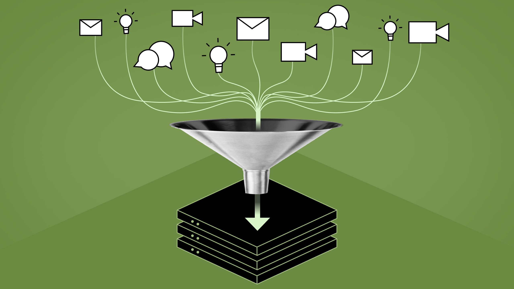
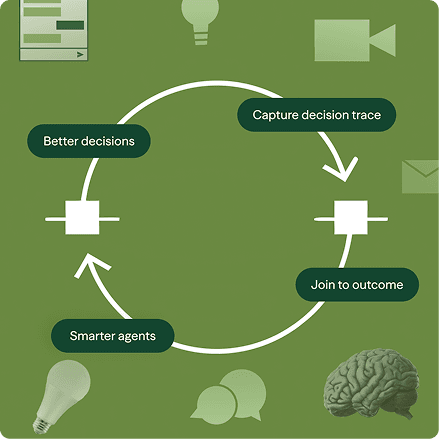

# AI’s trillion-dollar opportunity: Context graphs - Foundation Capital

> 原文链接: https://foundationcapital.com/ideas/context-graphs-ais-trillion-dollar-opportunity

---

	
	
    

    
	
	[ALL IDEAS](../ideas)PERSPECTIVES
# AI’s trillion-dollar opportunity: Context graphs

[Jaya Gupta](../team-members/jaya-gupta)[Ashu Garg](../team-members/ashu-garg) 12 MIN READShow Outline

Posted

Dec 22, 2025

AIENTERPRISEThe last generation of enterprise software created a trillion-dollar ecosystem by becoming systems of record. Salesforce for customers. Workday for employees. SAP for operations. Own the canonical data, own the workflow, own the lock-in.

The debate right now is whether those systems survive the shift to agents. Jamin Ball's recent post "[Long Live Systems of Record](https://cloudedjudgement.substack.com/p/clouded-judgement-121225-long-live)" hit a nerve. Pushing back on the "agents kill everything" narrative, he argues that agents don't replace systems of record, they raise the bar for what a good one looks like.

We agree. Agents are cross-system and action-oriented. The UX of work is separating from the underlying data plane. Agents become the interface, but something still has to be canonical underneath.

Where we go further is this: Ball’s framing assumes the data agents need already lives somewhere, and agents just need better access to it plus better governance, semantic contracts, and explicit rules about which definition wins for which purpose.

That’s half the picture. The other half is the missing layer that actually runs enterprises: **the decision traces **- the exceptions, overrides, precedents, and cross-system context that currently live in Slack threads, deal desk conversations, escalation calls, and people’s heads.

This is the distinction that matters:

**Rules** tell an agent *what should happen in general* (“use official ARR for reporting”)

**Decision traces** capture *what happened in this specific case* (“we used X definition, under policy v3.2, with a VP exception, based on precedent Z, and here’s what we changed”).

Agents don’t just need rules. They need access to the decision traces that show how rules were applied in the past, where exceptions were granted, how conflicts were resolved, who approved what, and which precedents actually govern reality.

This is where systems of agents startups have a structural advantage. They sit **in the execution path**. They see the full context at decision time: what inputs were gathered across systems, what policy was evaluated, what exception route was invoked, who approved, and what state was written. If you persist those traces, you get something that doesn’t exist in most enterprises today: a queryable record of how decisions were made.

We call the accumulated structure formed by those traces a **context graph**: not “the model’s chain-of-thought,” but a living record of decision traces stitched across entities and time so precedent becomes searchable. Over time, that context graph becomes the real source of truth for autonomy - because it explains not just *what* happened, but *why it was allowed* to happen.

The core question isn’t whether existing systems of record survive. It’s whether entirely new ones emerge - systems of record for decisions, not just objects - and whether those become the next trillion-dollar platforms.

#### About Ashu

Ashu is a Partner at Foundation Capital, investing in enterprise software with a focus on AI, data infrastructure, and cybersecurity. An early investor in Databricks, Cohesity, Eightfold, and Anyscale, he helps technical founders find product-market fit and scale. Previously, he held leadership roles at Microsoft, McKinsey & Company, and Cadence Design Systems.

[More about Ashu](https://foundationcapital.com/team-members/ashu-garg)

## What systems of record don’t capture

Agents are shipping into real workflows - contract review, quote-to-cash, support resolution - and teams are hitting a wall that governance alone can't solve.

The wall isn't missing data. It's missing decision traces. Agents run into the same ambiguity humans resolve every day with judgment and organizational memory. But the inputs to those judgments aren't stored as durable artifacts. Specifically:

- **Exception logic that lives in people's heads.** "We always give healthcare companies an extra 10% because their procurement cycles are brutal." That's not in the CRM. It's tribal knowledge passed down through onboarding and side conversations.
- **Precedent from past decisions.** "We structured a similar deal for Company X last quarter - we should be consistent." No system links those two deals or records why the structure was chosen.
- **Cross-system synthesis.** The support lead checks the customer's ARR in Salesforce, sees two open escalations in Zendesk, reads a Slack thread flagging churn risk, and decides to escalate. That synthesis happens in their head. The ticket just says "escalated to Tier 3."
- **Approval chains that happen outside systems.** A VP approves a discount on a Zoom call or in a Slack DM. The opportunity record shows the final price. It doesn't show who approved the deviation or why.

This is what "never captured" means. Not that the data is dirty or siloed, but that the reasoning connecting data to action was never treated as data in the first place.

## The context graph is the enduring layer

When startups instrument the agent orchestration layer to emit a decision trace on every run, they get something enterprises almost never have today: a structured, replayable history of how context turned into action.

*What does this look like in practice?* A renewal agent proposes a 20% discount. Policy caps renewals at 10% unless a service-impact exception is approved. The agent pulls three SEV-1 incidents from PagerDuty, an open “cancel unless fixed” escalation in Zendesk, and the prior renewal thread where a VP approved a similar exception last quarter. It routes the exception to Finance. Finance approves. The CRM ends up with one fact: “20% discount.”

Once you have decision records, the “why” becomes first-class data. Over time, these records naturally form a **context graph**: the entities the business already cares about (accounts, renewals, tickets, incidents, policies, approvers, agent runs) connected by decision events (the moments that matter) and “why” links. Companies can now audit and debug autonomy and turn exceptions into precedent instead of re-learning the same edge case in Slack every quarter.

**The feedback loop is what makes this compound.** Captured decision traces become searchable precedent. And every automated decision adds another trace to the graph.

None of this requires full autonomy on day one. It starts with human-in-the-loop: the agent proposes, gathers context, routes approvals, and records the trace. Over time, as similar cases repeat, more of the path can be automated because the system has a structured library of prior decisions and exceptions. Even when a human still makes the call, the graph keeps growing, because the workflow layer captures the inputs, approval, and rationale as durable precedent instead of letting it die in Slack.

### Get insights directly to your inbox.

## Why incumbents can't build the context graph

Ball is optimistic that existing players evolve into this architecture. Warehouses become "truth registries,” while CRMs become "state machines with APIs." His is a narrative of evolution, not replacement.

That might work for making existing data more accessible. It doesn't work for capturing decision traces.

**Operational incumbents are siloed and prioritize current state.**

Salesforce is pushing Agentforce, ServiceNow has Now Assist, and Workday is building agents for HR. Their pitch is “we have the data, now we add the intelligence.”

But these agents inherit their parent's architectural limitations. Salesforce is built on current state storage: it knows what the opportunity looks like now, not what it looked like when the decision was made. When a discount gets approved, the context that justified it isn't preserved. You can't replay the state of the world at decision time, which means you can't audit the decision, learn from it, or use it as precedent.

They also inherit their parent's blind spots. A support escalation doesn't live in Zendesk alone. It depends on customer tier from the CRM, SLA terms from billing, recent outages from PagerDuty, and the Slack thread flagging churn risk. No incumbent sees this because no incumbent sits in the cross-system path.

**The warehouse players have a different problem: they're in the read path, not the write path.**

Ball positions Snowflake and Databricks as the "truth registry" layer. Both are leaning in - Snowflake pushing Cortex and acquiring Streamlit, Databricks acquiring Neon and launching Lakebase and AgentBricks. The pitch: data platforms replace systems of record and become the foundation for AI agents.

Warehouses do have a time-based view. You can query historical snapshots, track how metrics changed, and compare state across periods. But warehouses receive data via ETL after decisions are made. By the time data lands in Snowflake, the decision context is gone.

A system that only sees reads, after the fact, can't be the system of record for decision lineage. It can tell you what happened, but it can't tell you why.

Databricks is further along in putting the pieces together. But being close to where agents get built isn't the same as being in the execution path where decisions happen.

**Systems of agents startups have a structural advantage: they're in the orchestration path.**

When an agent triages an escalation, responds to an incident, or decides on a discount, it pulls context from multiple systems, evaluates rules, resolves conflicts, and acts. The orchestration layer sees the full picture: what inputs were gathered, what policies applied, what exceptions were granted, and why. Because it's executing the workflow, it can capture that context at decision time - not after the fact via ETL, but in the moment, as a first-class record.

**That's the context graph, and that will be the single most valuable asset for companies in the era of AI.**

**Incumbents will fight back. **They'll try acquisitions to bolt on orchestration capabilities. They'll lock down APIs and adopt egress fees to make data extraction expensive - the same playbook hyperscalers used. They'll build their own agent frameworks and push "keep everything in our ecosystem" narratives.

But capturing decision traces requires being in the execution path at commit time, not bolting on governance after the fact. Incumbents can make extraction harder, but they can't insert themselves into an orchestration layer they were never part of.

## Three paths for startups

Systems of agents startups will take different paths, each of which has its own tradeoffs.

**Some will replace existing system of records from day one.** A CRM or ERP rebuilt around agentic execution, with event-sourced state and policy capture native to the architecture. This is hard because incumbents are entrenched, but it becomes viable at transition moments.

Of the many startups going after the AI SDR category, [Regie](https://www.regie.ai/) has chosen to build an AI-native sales engagement platform to replace legacy platforms like Outreach/Salesloft, which were designed for humans executing sequences across a fragmented toolchain. Regie is designed for a mixed team where the agent is a first-class actor: it can prospect, generate outreach, run follow-ups, handle routing, and escalate to humans.

**Some will replace modules rather than entire systems.** These startups target specific sub-workflows where exceptions and approvals concentrate, then become the system of record for those decisions while syncing final state back to the incumbent.

[Maximor](https://www.maximor.ai/) is doing this in finance: automating cash, close management, and core accounting workflows without ripping out the GL. The ERP remains the ledger, but Maximor becomes the source of truth where the reconciliation logic lives.

**Some will create entirely new systems of record.** These startups start as orchestration layers, but they persist what enterprises never systematically stored: the decision-making trace. Over time that replayable lineage becomes the authoritative artifact. The agent layer stops being "just automation" and becomes the place the business goes to answer "why did we do that?"

[PlayerZero](https://playerzero.ai/?matchtype=&utm_source=google&utm_medium=cpc&utm_campaign=23361480948&utm_content=&utm_term=&hsa_acc=6526734515&hsa_cam=23361480948&hsa_grp=&hsa_ad=&hsa_src=x&hsa_tgt=&hsa_kw=&hsa_mt=&hsa_net=adwords&hsa_ver=3&gad_source=1&gad_campaignid=23370607165&gbraid=0AAAAABaTSHE2ca_tvJn9RsT1IJaFH_3wo&gclid=Cj0KCQiAjJTKBhCjARIsAIMC44-P3pLng0LsFJ7xbLVAtsAaJAlgiyzjnC3gezNwboiSvZdDlNkGS1YaAkNDEALw_wcB) exemplifies this pattern. Production engineering sits at the intersection of SRE, support, QA, and dev: a classic "glue function" where humans carry context that software doesn't capture. PlayerZero starts by automating L2/L3 support, but the real asset is the context graph it builds: a living model of how code, config, infrastructure, and customer behavior interact in reality. That graph becomes the source of truth for "why did this break?" and "will this change break production?": questions no existing system can answer.

**As startups pursue these paths, observability for agents will become critical infrastructure.** As decision traces accumulate and context graphs grow, enterprises will need to monitor, debug, and evaluate agent behavior at scale.

[Arize](https://arize.com/) is building the observability layer for this new stack - giving teams visibility into how agents reason, where they fail, and how their decisions perform over time. Just as Datadog became essential infrastructure for monitoring applications, Arize is positioned to become essential infrastructure for monitoring and improving agent decision quality.

Ashu Garg, Jaya Gupta

#### The compounding asset enterprise software never had

Consumer platforms built one of the most powerful business models of the last two decades around a compounding loop: every user interaction became a signal that improved the system. Netflix, Meta, Amazon, TikTok, and Google did not just record outcomes.

[Read the article](https://foundationcapital.com/ideas/the-compounding-loop-enterprise-software-never-had)
## Key signals for founders

The signals for where to build overlap, but they aren't identical.

**Two signals apply to all three opportunities:**

**High headcount.** If a company has 50 people doing a workflow manually (routing tickets, triaging requests, or reconciling data between systems), that's a signal. The labor exists because the decision logic is too complex to automate with traditional tooling.

**Exception-heavy decisions.** Routine, deterministic workflows don't need decision lineage: the agent just executes. The interesting surfaces are where the logic is complex, where precedent matters, and where "it depends" is the honest answer. Think use cases like deal desks, underwriting, compliance reviews, and escalation management.

**One signal points specifically to new system of record opportunities:**

**Organizations that exist at the intersection of systems.** RevOps exists because someone has to reconcile sales, finance, marketing, and customer success. DevOps exists because someone has to bridge development, IT, and support. Security Ops sits between IT, engineering, and compliance.

These "glue" functions are a tell. They emerge precisely because no single system of record owns the cross-functional workflow. The org chart creates a role to carry the context that software doesn't capture.

An agent that automates that role doesn’t just run steps faster. It can persist the decisions, exceptions, and precedents the role was created to produce. That’s the path to a new system of record: not by ripping out an incumbent, but by capturing a category of truth that only becomes visible once agents sit in the workflow.

## Systems of record, reimagined

The question isn’t whether systems of record survive - they will. The question is whether the next trillion-dollar platforms are built by adding AI to existing data, or by capturing the decision traces that make data actionable.

We think it’s the latter. And the startups building context graphs today are laying the foundation.

## Get insights directly to your inbox.

**Palo Alto**

[550 High St, 3rd Floor

Palo Alto, CA 94301](https://www.google.com/maps/place/550+High+St,+Palo+Alto,+CA+94301,+USA/@37.4432734,-122.1650931,878m/data=!3m2!1e3!4b1!4m6!3m5!1s0x808fbb3a12f61f49:0xf37bbca7ad1c8ae3!8m2!3d37.4432692!4d-122.1625182!16s%2Fg%2F11fzv5pkpj?entry=ttu&g_ep=EgoyMDI2MTAxOS4wIKXMDSoASAFQAw%3D%3D)

**San Francisco**

[2 Shaw Alley, 4th Floor](https://www.google.com/maps/place/2+Shaw+Alley+%234th,+San+Francisco,+CA+94105,+USA/@37.7887197,-122.3983837,16z/data=!3m1!4b1!4m6!3m5!1s0x80858063262e8a1b:0x8ea9b85b6f7a2a88!8m2!3d37.7887197!4d-122.3983837!16s%2Fg%2F11y3nh00g2?entry=ttu&g_ep=EgoyMDI1MDkyMy4wIKXMDSoASAFQAw%3D%3D)
[San Francisco, CA 94105](https://www.google.com/maps/place/2+Shaw+Alley+%234th,+San+Francisco,+CA+94105,+USA/@37.7887197,-122.3983837,16z/data=!3m1!4b1!4m6!3m5!1s0x80858063262e8a1b:0x8ea9b85b6f7a2a88!8m2!3d37.7887197!4d-122.3983837!16s%2Fg%2F11y3nh00g2?entry=ttu&g_ep=EgoyMDI1MDkyMy4wIKXMDSoASAFQAw%3D%3D)

[Work at our companies](https://jobs.foundationcapital.com/companies)

[Terms of Use](../terms-of-use)

[Privacy Policy](../privacy-policy)

© Foundation Capital 
2026. All rights reserved

	
	
	
	
                
                
	
	

	
    

    

Cookie Settings

We use cookies to personalize content, run ads, and analyze traffic. Read our [Privacy Policy](/privacy-policy).

[reCAPTCHA](https://www.google.com/recaptcha/enterprise/anchor?ar=1&k=6LdlecEsAAAAACuTZYx7N_lOR1XfXljZgAIcTN5d&co=aHR0cHM6Ly9mb3VuZGF0aW9uY2FwaXRhbC5jb206NDQz&hl=zh-CN&v=4i3aN5wAweL7i3ADI7BSX4B-&size=invisible&anchor-ms=20000&execute-ms=30000&ovv=CADq00gF&cb=y30ibludkwz4)

[https://framer.com/edit?framerSiteId=215e7d9ad410d4704ccd94c05a3327e81718a81cb1e94e4df450caa2278975aa&source=foundationcapital.com&features=%7B%22editorBarDisableFrameAncestorsSecurity%22%3Afalse%7D&loadStart=1794794943036](https://framer.com/edit?framerSiteId=215e7d9ad410d4704ccd94c05a3327e81718a81cb1e94e4df450caa2278975aa&source=foundationcapital.com&features=%7B%22editorBarDisableFrameAncestorsSecurity%22%3Afalse%7D&loadStart=1794794943036)

