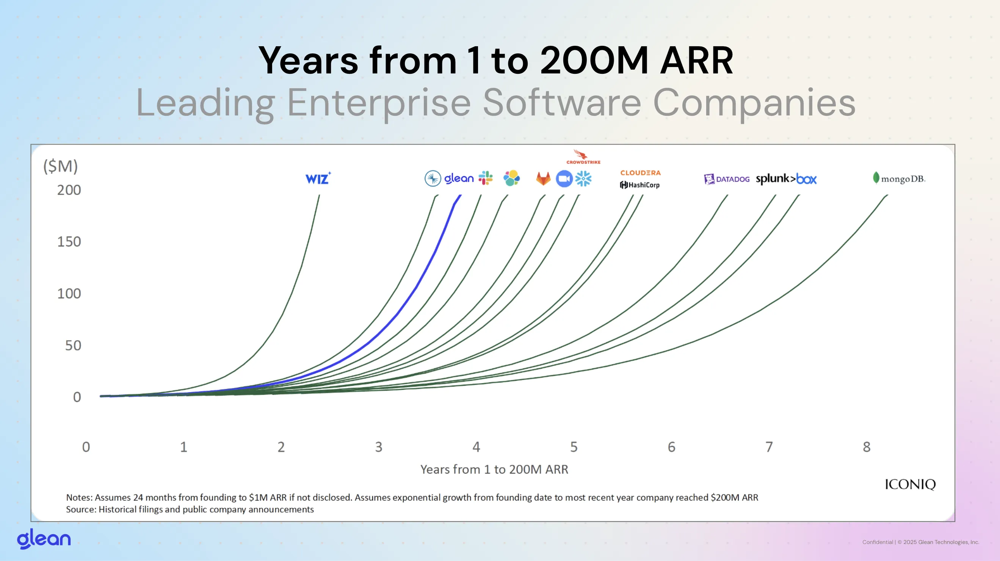

## Key Takeaways / 核心洞察

> 阅读笔记（凡哥）：以下 2 点为归档时补充的解读与引申，非原文内容；原文全文与逐段中英对照见下文。

### 1. ARR 突破 2 亿美元、9 个月翻番 / $200M ARR, doubled in nine months

**原文明确写出**：新闻稿发布于 **2025 年 12 月 8 日**（页面 `Published Dec 08, 2025`，正文 dateline `December 8, 2025 - Palo Alto, CA`）。原句是 `Work AI leader Glean today announced it has doubled its annual recurring revenue (ARR) to $200 million, nine months after surpassing the $100 million milestone.` —— 即 2 亿美元是「截至 2025-12-08 宣布达到」，翻番的参照点是 9 个月前刚突破 1 亿美元（约 2025 年 3 月），不是「9 个月内从零做到 2 亿」。标题里的 `Doubling Revenue in Nine Months` 是同一含义。

**事实校准**：你写的「2025 年 12 月」精确到月是对的，精确日期是 12 月 8 日。另外原文是 `doubled ... to $200 million`，即「翻倍**到** 2 亿」（此前 1 亿），不是「增长了 2 亿」。随稿配图 `Years from 1 to 200M ARR — Leading Enterprise Software Companies` 把 Glean 与其他企业软件公司「从 1 亿到 2 亿 ARR 所用年数」做了曲线对比，是这一速度主张的视觉佐证。

### 2. ARR 人效约 20 万美元/人/年 / ARR per employee ≈ $200K

**笔记作者推算（原文没有这个指标）**：新闻稿**没有**给出人效，只给了两个数 —— `$200 million` ARR，以及 `with more than 1,000 employees`（原句 `Today, Glean stands among the largest and fastest-growing pure-play enterprise AI companies in the world, with more than 1,000 employees and customers spanning over 27 countries.`）。两者出自同一篇 2025-12-08 的稿子，**时点是对齐的**，可以相除：`2 亿美元 ÷ 1,000 人 = 20 万美元 / 人 / 年`。

**但这是上限，不是精确值**：员工数是 `more than 1,000`（下界），实际人数更多则人效更低，所以严谨表述应为「**不超过 20 万美元/人/年**」（`< $200K`），而不是「等于 20 万」。另外 ARR 是年化经常性收入 run-rate，不是已确认的年度营收；这个比值是 SaaS 常用的 `ARR per employee` 效率指标，不能等同于人均创收、人均利润或人均产出。

**原文可佐证的规模数据（但都不是人效的直接证据）**：企业全量部署数翻倍以上、`$1M+` 合同段近乎增长三倍、40% wDAU/wMAU、年化 20T token 消耗、累计索引 27B+ 文档。这些解释了规模扩张，无法反推单位员工效率。

> 页面日期: Dec 08, 2025（Published / 新闻稿 dateline: December 8, 2025） | 来源: Glean Press

> 原文链接: https://www.glean.com/press/glean-surpasses-200m-in-arr-for-enterprise-ai-doubling-revenue-in-nine-months

**December 8, 2025 - Palo Alto, CA -** Work AI leader Glean today announced it has doubled its annual recurring revenue (ARR) to $200 million, nine months after surpassing the $100 million milestone. The achievement places Glean among the fastest-growing pure-play enterprise software companies of the decade and underscores the accelerating demand for AI that drives real business outcomes.

**2025 年 12 月 8 日，加州帕洛阿尔托 ——** Work AI 领域领导者 Glean 今日宣布，其年度经常性收入（ARR）已翻倍至 2 亿美元，距突破 1 亿美元里程碑仅九个月。这一成绩使 Glean 跻身十年来增长最快的纯企业级软件公司之列，也印证了市场对「能带来真实业务成果的 AI」的需求正在加速。

With this milestone, Glean has more than doubled its enterprise footprint and expanded across North America, Europe, and Asia-Pacific. Global employees rely on Glean to work smarter with AI, a reflection of the company’s deep integration into the modern enterprise stack and the measurable productivity gains customers are seeing.

伴随这一里程碑，Glean 的企业客户覆盖面扩大了一倍以上，并拓展至北美、欧洲与亚太地区。全球员工借助 Glean 用 AI 更聪明地工作，这既反映出该公司与现代企业技术栈的深度融合，也反映出客户获得的可量化生产力提升。

## From Search to Agentic Action: A New Era of Work AI / 从搜索到智能体行动：Work AI 的新纪元

Glean was founded on a simple premise: AI should help people do their best work by understanding their context. Today, Glean stands among the largest and fastest-growing pure-play enterprise AI companies in the world, with more than 1,000 employees and customers spanning over 27 countries. This fiscal year, the company has surpassed multiple achievements, including:

Glean 创立于一个朴素的前提：AI 应当通过理解人的上下文，帮助人们把工作做到最好。如今，Glean 已成为全球规模最大、增长最快的纯企业级 AI 公司之一，拥有超过 1,000 名员工，客户遍及 27 个以上国家。本财年，公司取得了多项成绩，包括：

- **Shipped 200 new features:** Keeping pace with the rapid pace of AI and enterprise demand, Glean introduced a wave of innovations across its platform, including Glean Agents, an open, horizontal environment for building, deploying, and governing AI agents at work. Combined with the latest Agentic Engine 2 for deeper reasoning and orchestration and its third-generation AI Assistant, Glean has evolved from intelligent search into the backbone of context-driven automation. / **交付 200 项新功能：** 为跟上 AI 与企业需求的快速演进，Glean 在平台上密集推出创新，其中包括 Glean Agents —— 一个用于在工作场景中构建、部署与治理 AI 智能体的开放式横向环境。结合用于更深推理与编排的最新 Agentic Engine 2，以及第三代 AI Assistant，Glean 已从智能搜索演进为上下文驱动自动化的底座。
- **Indexed more than 27B documents since inception:** Glean’s platform securely connects knowledge across more than 100+ of the most popular enterprise SaaS applications, indexing data in a permissions-sensitive manner to help organizations harness their full institutional intelligence for more accurate, contextual AI experiences. / **累计索引超 270 亿份文档：** Glean 平台以安全方式连接 100 多款主流企业 SaaS 应用中的知识，按权限敏感的方式建立索引，帮助组织把全部机构智慧用于更准确、更具上下文的 AI 体验。
- **Expanded its strategic partner ecosystem:** Glean deepened its collaborations with AWS, Google, and Microsoft, in addition to Databricks, Dell Technologies, Palo Alto Networks, Snowflake, Workday, and Zoom, extending Work AI securely across cloud, data, security, and industry environments and advancing interoperability across the enterprise stack. / **扩展战略伙伴生态：** Glean 深化了与 AWS、Google、Microsoft 的合作，并联合 Databricks、Dell Technologies、Palo Alto Networks、Snowflake、Workday 与 Zoom，把 Work AI 安全地延伸到云、数据、安全与行业环境，推进企业技术栈的互操作性。

## Enterprise Adoption and Momentum at Scale / 企业级采用与规模化势能

Glean’s product innovation has fueled an inflection point in enterprise adoption. What began as targeted use cases is now translating into widespread, habitual usage across industries and functions - including at global leaders like Booking.com, Comcast, eBay, Intuit, LinkedIn, Pinterest, Samsung, and Zillow. The result is clear momentum in both scale and engagement. In the past year alone, Glean has:

产品创新把 Glean 的企业级采用推到了拐点。最初只是定向场景，如今已变成跨行业、跨职能的广泛高频使用 —— 包括 Booking.com、Comcast、eBay、Intuit、LinkedIn、Pinterest、Samsung 与 Zillow 等全球领先企业。规模与活跃度都呈现出明确势能。仅过去一年，Glean 就：

- **More than doubled enterprise deployments:** The number of organizations deploying Glean company-wide has surged, while the $1M+ contract segment has grown nearly threefold. This expansion reflects how enterprises are moving beyond pilot programs to make Glean a core layer of their productivity and knowledge infrastructure. / **全公司级部署数量翻倍以上：** 在全组织范围部署 Glean 的客户数大幅增长，百万美元以上合同段规模近乎增至三倍。这一扩张说明企业正走出试点，把 Glean 变成生产力与知识基础设施的核心层。
- **Maintained an industry-leading 40% wDAU/wMAU ratio:** Across its customer base, user engagement is deep and habitual: the average employee now performs five queries a day - on par with consumer web search behavior - while maintaining a 40% wDAU/wMAU ratio, more than twice the SaaS industry benchmark. / **维持行业领先的 40% 周活／月活比：** 在客户群体中，用户使用深入且成习惯：平均每位员工每天发起 5 次查询，已与消费级网页搜索行为相当，同时保持 40% 的 wDAU/wMAU 比值，是 SaaS 行业基准的两倍以上。
- **Surpassed 20 trillion tokens-per-year run rate:** Glean customers are now consuming more than 20T tokens annually on the platform, with token consumption doubling in the past quarter alone. This level of usage places Glean among the highest-scale enterprise consumers of foundation models, reflecting how deeply search, assistant, and agentic workflows are embedded across customers’ daily operations. / **年化 token 消耗突破 20 万亿：** Glean 客户在平台上的年 token 消耗已超过 20T，仅上一个季度就翻了一倍。这一用量使 Glean 跻身基础模型最大规模的企业级消费方之列，也反映出搜索、助手与智能体工作流已深嵌进客户的日常运营。

## Industry Recognition and Category Leadership / 行业认可与品类领导地位

Glean’s momentum has not only reshaped how enterprises work, but it has also earned recognition from some of the most respected names in business and technology. This year, Glean was:

Glean 的势能不仅重塑了企业的工作方式，也赢得了商业与科技领域最具分量的机构的认可。今年，Glean：

- Recognized as a **2025 CNBC Disruptor 50** organization / 入选 **2025 年 CNBC Disruptor 50** 榜单
- Named to **Fast Company’s Most Innovative Companies 2025** list, the only enterprise AI company to earn a top 10 ranking / 入选 **《快公司》2025 年最具创新力公司**榜单，且是唯一进入前十的企业级 AI 公司
- Spotlighted by **Bloomberg** as one of the 24 AI startups to watch in 2026 / 被 **彭博社**列为 2026 年值得关注的 24 家 AI 初创公司之一
- Recognized by **Gartner** as a Tech Innovator in Agentic AI / 被 **Gartner** 评为智能体 AI 领域的技术创新者
- Recognized on the **Forbes AI 50** and **Cloud 100** lists / 入选 **福布斯 AI 50** 与 **Cloud 100** 榜单

Together, these honors underscore Glean’s position as one of the most trusted and transformative companies in the new era of Work AI.

这些荣誉共同印证了 Glean 在 Work AI 新时代中「最受信赖、最具变革力公司之一」的位置。

## Executive Commentary / 高管评论

“We’re still in the early days of what AI will do for work. The next decade won’t be defined by who builds the biggest model, but by who builds the most trusted and useful systems on top of them. That’s the opportunity we’re focused on, and this milestone reflects how quickly enterprises are embracing that shift. They’re not experimenting anymore - they’re operationalizing AI to drive ROI at scale.” - **Arvind Jain, Founder & CEO, Glean**

「AI 能为工作带来什么，我们现在仍处在早期。下一个十年的定义者，不会是谁造出了最大的模型，而是谁在模型之上建起了最可信、最有用的系统。这正是我们专注的机会，而这个里程碑反映了企业拥抱这一转变有多快。他们已经不再做试验了 —— 他们在规模化地把 AI 投入运营以驱动投资回报。」—— **Arvind Jain，Glean 创始人兼 CEO**

## Learn More / 了解更多

- [Register](https://www.glean.com/glean-live/?utm_source=press&utm_medium=referral&utm_campaign=200m-arr&utm_content=glean-live-dec-10) for *Glean:LIVE - Agents of Change* on December 10 at 10 AM PT, where Glean will unveil the next evolution of AI at work / [报名](https://www.glean.com/glean-live/?utm_source=press&utm_medium=referral&utm_campaign=200m-arr&utm_content=glean-live-dec-10)参加 12 月 10 日上午 10 点（太平洋时间）的 *Glean:LIVE - Agents of Change*，Glean 将在会上发布工作场景 AI 的下一步演进
- Blog: [Glean surpasses $200M ARR as enterprises operationalize AI](https://www.glean.com/blog/glean-200m-arr-milestone) / 博客：[Glean ARR 突破 2 亿美元，企业开始规模化运营 AI](https://www.glean.com/blog/glean-200m-arr-milestone)

## About Glean / 关于 Glean

Glean is the Work AI platform that helps everyone work smarter with AI. Glean Assistant gives every employee a powerful enterprise AI assistant that connects to and understands company data via Glean’s Enterprise Graph, and Glean Agents empowers everyone to create, use, and manage AI agents using natural language. Powered by Glean’s search and agentic engine, Glean’s agents automate work across the organization at scale, while ensuring permissions enforcement, full referenceability, governance, and security. With over 100 connectors, LLM choice, APIs for customization, and no need for costly professional services, Glean delivers scalable, turnkey implementation of a complex AI ecosystem on one horizontal platform.

Glean 是帮助每个人用 AI 更聪明工作的 Work AI 平台。Glean Assistant 为每位员工提供强大的企业级 AI 助手，通过 Glean 的 Enterprise Graph 连接并理解公司数据；Glean Agents 则让每个人都能用自然语言创建、使用和管理 AI 智能体。依托 Glean 的搜索与智能体引擎，其智能体可在组织范围内规模化自动化工作，同时确保权限执行、完整可溯源、治理与安全。凭借 100 多个连接器、可选的 LLM、用于定制的 API，以及无需昂贵专业服务，Glean 在单一横向平台上交付了复杂 AI 生态的可扩展、开箱即用落地。

**Connect with Us!** [Blog](https://www.glean.com/blog) [LinkedIn](https://www.linkedin.com/company/gleanwork/posts/?feedView=all) [Twitter X](https://twitter.com/gleanwork?lang=en)

关注我们：[博客](https://www.glean.com/blog) [LinkedIn](https://www.linkedin.com/company/gleanwork/posts/?feedView=all) [Twitter X](https://twitter.com/gleanwork?lang=en)

## Contact / 媒体联系

Sierra Dowling [press@glean.com](mailto:press@glean.com)

媒体联系人 Sierra Dowling，邮箱 [press@glean.com](mailto:press@glean.com)
