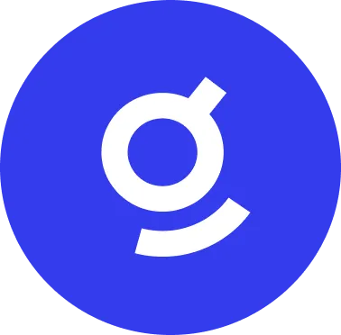
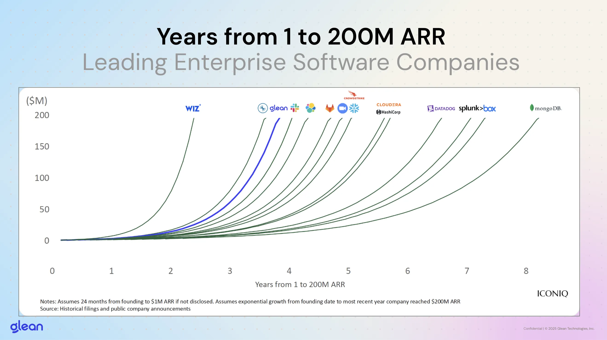

# Glean Surpasses $200M in ARR for Enterprise AI, Doubling Revenue in Nine Months | Glean Press

*See how Glean works.*

> 日期: Dec 08, 2025

> 原文链接: https://www.glean.com/press/glean-surpasses-200m-in-arr-for-enterprise-ai-doubling-revenue-in-nine-months

---

# Glean Surpasses $200M in ARR for Enterprise AI, Doubling Revenue in Nine Months

Glean

**December 8, 2025 - Palo Alto, CA - **Work AI leader Glean today announced it has doubled its annual recurring revenue (ARR) to $200 million, nine months after surpassing the $100 million milestone. The achievement places Glean among the fastest-growing pure-play enterprise software companies of the decade and underscores the accelerating demand for AI that drives real business outcomes.

With this milestone, Glean has more than doubled its enterprise footprint and expanded across North America, Europe, and Asia-Pacific. Global employees rely on Glean to work smarter with AI, a reflection of the company’s deep integration into the modern enterprise stack and the measurable productivity gains customers are seeing.

**From Search to Agentic Action: A New Era of Work AI**

Glean was founded on a simple premise: AI should help people do their best work by understanding their context. Today, Glean stands among the largest and fastest-growing pure-play enterprise AI companies in the world, with more than 1,000 employees and customers spanning over 27 countries. This fiscal year, the company has surpassed multiple achievements, including:

- **Shipped 200 new features: **Keeping pace with the rapid pace of AI and enterprise demand, Glean introduced a wave of innovations across its platform, including Glean Agents, an open, horizontal environment for building, deploying, and governing AI agents at work. Combined with the latest Agentic Engine 2 for deeper reasoning and orchestration and its third-generation AI Assistant, Glean has evolved from intelligent search into the backbone of context-driven automation.
- **Indexed more than 27B documents since inception: **Glean’s platform securely connects knowledge across more than 100+ of the most popular enterprise SaaS applications, indexing data in a permissions-sensitive manner to help organizations harness their full institutional intelligence for more accurate, contextual AI experiences.
- **Expanded its strategic partner ecosystem: **Glean deepened its collaborations with AWS, Google, and Microsoft, in addition to Databricks, Dell Technologies, Palo Alto Networks, Snowflake, Workday, and Zoom, extending Work AI securely across cloud, data, security, and industry environments and advancing interoperability across the enterprise stack.

**Enterprise Adoption and Momentum at Scale**

Glean’s product innovation has fueled an inflection point in enterprise adoption. What began as targeted use cases is now translating into widespread, habitual usage across industries and functions - including at global leaders like Booking.com, Comcast, eBay, Intuit, LinkedIn, Pinterest, Samsung, and Zillow. The result is clear momentum in both scale and engagement. In the past year alone, Glean has:

- **More than doubled enterprise deployments: **The number of organizations deploying Glean company-wide has surged, while the $1M+ contract segment has grown nearly threefold. This expansion reflects how enterprises are moving beyond pilot programs to make Glean a core layer of their productivity and knowledge infrastructure.
- **Maintained an industry-leading 40% wDAU/wMAU ratio:** Across its customer base, user engagement is deep and habitual: the average employee now performs five queries a day - on par with consumer web search behavior - while maintaining a 40% wDAU/wMAU ratio, more than twice the SaaS industry benchmark.
- **Surpassed 20 trillion tokens-per-year run rate: **Glean customers are now consuming more than 20T tokens annually on the platform, with token consumption doubling in the past quarter alone. This level of usage places Glean among the highest-scale enterprise consumers of foundation models, reflecting how deeply search, assistant, and agentic workflows are embedded across customers’ daily operations.

**Industry Recognition and Category Leadership**

Glean’s momentum has not only reshaped how enterprises work, but it has also earned recognition from some of the most respected names in business and technology. This year, Glean was:

- Recognized as a **2025 CNBC Disruptor 50** organization
- Named to **Fast Company’s Most Innovative Companies 2025** list, the only enterprise AI company to earn a top 10 ranking
- Spotlighted by **Bloomberg** as one of the 24 AI startups to watch in 2026
- Recognized by **Gartner** as a Tech Innovator in Agentic AI
- Recognized on the **Forbes AI 50** and **Cloud 100** lists

Together, these honors underscore Glean’s position as one of the most trusted and transformative companies in the new era of Work AI.

**Executive Commentary**

“We’re still in the early days of what AI will do for work. The next decade won’t be defined by who builds the biggest model, but by who builds the most trusted and useful systems on top of them. That’s the opportunity we’re focused on, and this milestone reflects how quickly enterprises are embracing that shift. They’re not experimenting anymore - they’re operationalizing AI to drive ROI at scale.” - **Arvind Jain, Founder & CEO, Glean**

**Learn More:**

- [Register](https://www.glean.com/glean-live/?utm_source=press&utm_medium=referral&utm_campaign=200m-arr&utm_content=glean-live-dec-10) for *Glean:LIVE - Agents of Change* on December 10 at 10 AM PT, where Glean will unveil the next evolution of AI at work
- Blog: [Glean surpasses $200M ARR as enterprises operationalize AI](https://www.glean.com/blog/glean-200m-arr-milestone)

**About Glean
‍**Glean is the Work AI platform that helps everyone work smarter with AI. Glean Assistant gives every employee a powerful enterprise AI assistant that connects to and understands company data via Glean’s Enterprise Graph, and Glean Agents empowers everyone to create, use, and manage AI agents using natural language. Powered by Glean’s search and agentic engine, Glean’s agents automate work across the organization at scale, while ensuring permissions enforcement, full referenceability, governance, and security. With over 100 connectors, LLM choice, APIs for customization, and no need for costly professional services, Glean delivers scalable, turnkey implementation of a complex AI ecosystem on one horizontal platform.

**Connect with Us! **[Blog](https://www.glean.com/blog)[LinkedIn](https://www.linkedin.com/company/gleanwork/posts/?feedView=all)[Twitter X](https://twitter.com/gleanwork?lang=en)

**Contact
‍**Sierra Dowling[press@glean.com](mailto:press@glean.com)

