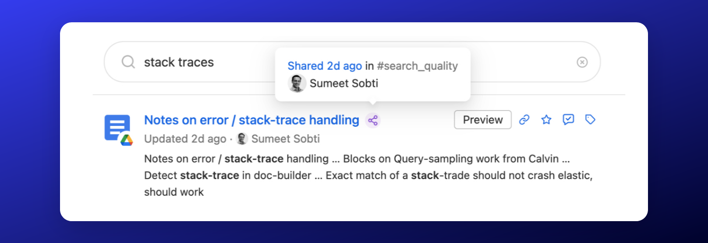
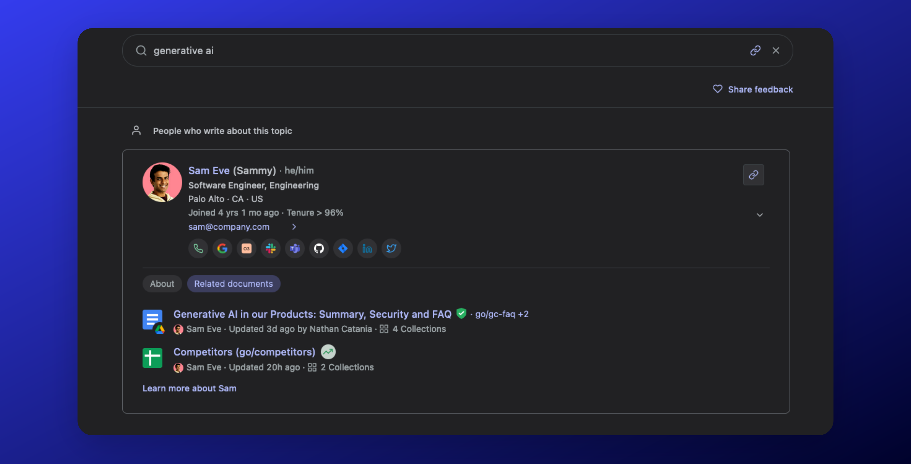
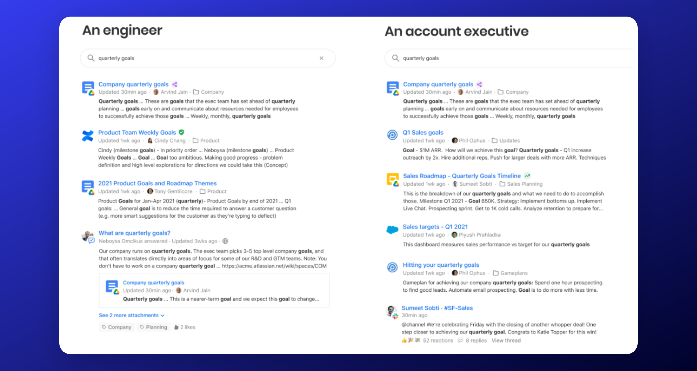
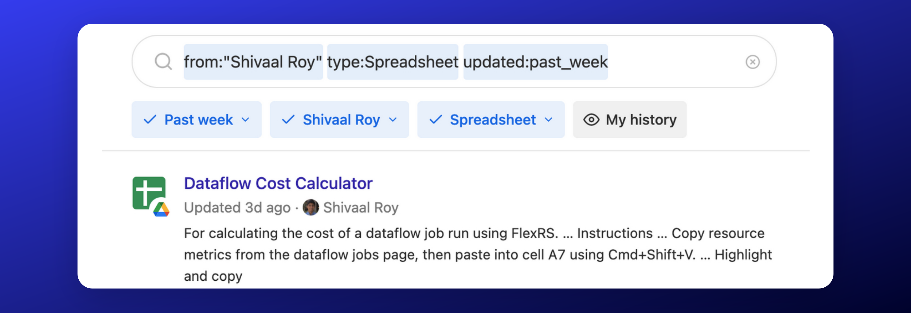

## Reading Notes / 阅读笔记

> 阅读笔记（凡哥，2026-11-14）：以下为归档时补充的核查与归纳，非原文内容；截图描述基于逐张查看本文 4 张图片。标注「原文事实」「截图可见」的可在本文核对，标注「归档者推断」的属阅读延伸，不是 Glean 官方文档的论述。原文全文与逐段中英对照见下文。

### 1. What the screenshots show — and where they stop / 界面截图展示了什么，又止步于哪里

**原文事实**：本文是 Glean 官方文档的概览页，正文用短段落加列表概述能力（智能内容理解、组织上下文、个性化、实时更新、高级筛选），没有给出索引结构、排序算法、权限模型或图谱 schema 等技术细节。4 张配图都是产品界面截图，不是架构图或数据示意图。

**截图可见（逐张核对）**：

**图 1（img_01）**：一条搜索结果卡片。搜索框关键词为 `stack traces`，结果标题是「Notes on error / stack-trace handling」，卡片上可见 `Updated 2d ago · Sumeet Sobti`、正文摘要，以及 `Preview`、复制链接、收藏、勾选、标签等操作图标；搜索框下的悬停提示写着 `Shared 2d ago in #search_quality` 与 `Sumeet Sobti`。注意：这张图在原文里的替代文字和图注写的是 Knowledge graph visualization / 知识图谱可视化，但画面里并没有任何节点、连线或图谱图形，而是一张普通搜索结果卡片。正文中「Glean 为组织内容与交互构建知识图谱」只是一句引用式陈述，截图并没有为它提供可视化证据。

**图 2（img_02）**：深色主题的「People who wrote about this topic」侧栏，搜索词 `generative ai`。画面是一位工程师的档案卡片，含姓名、职位（Software Engineer / Engineering）、地点（New York City）、入职年限、反馈响应率等字段，下方有 About 与 Shared Documents 分组及若干关联文档，底部还有 `Learn more about Sam` 的追问入口。对应正文的「人员与实体识别／员工洞察」。

**图 3（img_03）**：两个并排的结果栏，分别标注 `An engineer` 与 `An account executive`，各自返回不同的文档结果集。这是全篇最直接的一张能力示意——结果随角色而变，对应「个性化搜索体验」；但两栏只呈现结果差异，没有说明差异由哪个信号或权重造成。

**图 4（img_04）**：搜索框里是命令行式语法 `from:"Shivali Roy" type:Spreadsheet updated:past_week`，下方是 `Past week`、`Shivali Roy`、`Spreadsheet`、`My history` 四个筛选标签，以及一条表格结果卡片「Dataflow Cost Calculator」（`Updated 3d ago · Shivali Roy`）。对应正文的「高级筛选」。

**归档者推断**：截图把「能力长什么样」讲清了，却基本止步于界面层——看得到结果卡片的样式、可用的筛选控件和个性化差异，看不到相关性怎么算、按什么排序、索引里究竟存了哪些字段。因此这批截图足以用来介绍产品体验，却不足以评估 Glean 检索与图谱的技术深度；图 1 图注与实际画面不符，也说明不宜把截图当作技术示意来引用。若要判断技术细节，仍需另找 Glean 的架构／索引类文档。

### 2. Document properties used for indexing / 索引用到的文档属性

**原文事实**：本文没有给出字段级的索引清单，但有三处直接写到「哪些内容／属性被索引或可用于检索」。其一是 Intelligent Content Understanding，被搜索的内容类型包括 Document contents、Comments and discussions、@mentions、User activity、File attachments、Team messages（文档正文、评论与讨论、@提及、用户活动、文件附件、团队消息）。其二是 Custom Metadata Support，原文明确写着 Automatically indexes and makes searchable，下面列了 Custom application fields、Organization-specific metadata、User-defined attributes（自定义应用字段、组织专属元数据、用户定义属性）——这是全文最接近「索引用到的文档属性」的一处。其三是 Advanced Filtering 里的 Custom metadata fields，说明这些自定义字段可作为筛选维度被查询。

**原文事实（相邻但不等同）**：文中另有多组用于排序与个性化的「信号」，容易被一并当成索引属性，但原文并未说它们被索引：Organizational Context 下的 Document access patterns、Content sharing frequency、Cross-application references、Team discussions and interactions、User collaboration patterns；Continuous Learning 下又重复了一组几乎相同的信号；Personalization factors 下的 User role and department、Team membership、Reporting structure、Office location、Past activity and interactions、Collaboration patterns；以及 Real-time Content Updates 里提到的 Tracking content deletions and permissions（内容删除与权限变更）。

**截图可见**：图 4 的筛选语法把上面一部分属性落到了可查询的字段上——`from:` 对应作者、`type:` 对应文档类型、`updated:past_week` 对应更新时间，`Past week`／`My history` 则对应时间与个人活动维度；图 1 卡片上的 `Updated 2d ago`、`Shared 2d ago in #search_quality`、应用来源图标、作者 Sumeet Sobti，以及图 2 的来源系统名称与人物档案，也能看到时间、来源、作者、协作渠道这些属性在结果中被回显。换句话说，截图比正文更具体地暴露了「作者／类型／时间／来源」这组实际可用的文档属性。

**归档者推断**：把正文三处与截图合起来看，本文隐含的文档属性大致可分四类——内容本体（正文、评论、附件、@提及、团队消息）、自定义元数据（应用字段、组织专属、用户定义）、来源与归属（来源系统、作者、类型、时间）、组织与权限信号（访问／分享／引用／协作模式、删除与权限变更）。其中只有前两类被原文明确说成「建索引并支持检索」，后两类属排序／个性化信号或界面可查询维度，是否真正进入索引、以何种结构存储，本文没有交代。这个区分对「按对象名／按属性搜索」这类需求很关键：这页官方文档只承诺了自定义元数据字段可检索，并未承诺任意属性都能作为过滤条件。

> 来源: Glean 官方文档（docs.glean.com） | 最后更新: Sep 29, 2026

> 原文链接: https://docs.glean.com/administration/search/about

Glean Search delivers an intelligent enterprise search experience that goes beyond traditional search engines. It comprehensively understands your organization's content, language patterns, and user needs to provide highly relevant results without requiring manual configuration.

Glean Search 提供超越传统搜索引擎的智能企业搜索体验。它全面理解组织的内容、语言模式和用户需求，无需人工配置就能给出高度相关的结果。

## Core Capabilities / 核心能力

### Intelligent Content Understanding / 智能内容理解

Glean seamlessly searches across all content types within your connected applications, including:

Glean 能无缝搜索已连接应用中的全部内容类型，包括：

- Document contents / 文档正文
- Comments and discussions / 评论与讨论
- @mentions / @提及
- User activity / 用户活动
- File attachments / 文件附件
- Team messages / 团队消息

### Natural Language Processing / 自然语言处理

Powered by advanced deep learning and Generative AI, Glean understands:

依托先进的深度学习与生成式 AI，Glean 能理解：

- Natural language queries / 自然语言查询
- Industry-standard acronyms / 行业通用缩写
- Organization-specific terminology / 组织特有术语
- Custom synonyms and abbreviations / 自定义同义词与缩略语

## Enterprise Intelligence / 企业智能

> Glean builds a comprehensive knowledge graph of your organization's content and interactions to surface the most relevant information for each query.

> Glean 会为组织的内容与交互构建一张全面的知识图谱，为每次查询找出最相关的信息。

### Organizational Context / 组织上下文

Glean analyzes various signals to understand content importance, including:

Glean 分析多种信号来判断内容的重要性，包括：

- Document access patterns / 文档访问模式
- Content sharing frequency / 内容分享频次
- Cross-application references / 跨应用引用
- Team discussions and interactions / 团队讨论与互动
- User collaboration patterns / 用户协作模式

Knowledge graph visualization showing content relationships

展示内容关联关系的知识图谱可视化

### People and Entity Recognition / 人与实体识别

### Employee Insights / 员工洞察

Glean aggregates information across tools to provide comprehensive employee profiles and expertise identification.

Glean 跨工具聚合信息，给出完整的员工档案与专长识别。

### Customer Intelligence / 客户情报

Creates unified customer views by combining data from:

整合以下来源的数据，形成统一的客户视图：

- Salesforce / 客户关系管理系统（Salesforce）
- Zendesk / 客服工单系统（Zendesk）
- Jira / 问题跟踪系统（Jira）
- Other connected systems / 其他已连接系统

Employee profile view showing aggregated information

展示聚合信息的员工档案视图

### Personalized Search Experience / 个性化搜索体验

> Glean personalizes search results based on multiple user attributes and behaviors to ensure maximum relevance.

> Glean 基于用户的多种属性与行为对搜索结果做个性化，确保相关性最大化。

Personalization factors include:

个性化因素包括：

- User role and department / 用户角色与部门
- Team membership / 团队成员关系
- Reporting structure / 汇报关系
- Office location / 办公地点
- Past activity and interactions / 历史活动与交互
- Collaboration patterns / 协作模式

Example of personalized search results

个性化搜索结果示例

## Advanced Features / 高级功能

### Real-time Content Updates / 实时内容更新

Glean maintains fresh search results by:

Glean 通过以下方式保持搜索结果的新鲜度：

- Continuously monitoring content changes / 持续监测内容变更
- Indexing new content as it's created / 新内容一产生就建索引
- Updating existing content within minutes / 在数分钟内更新已有内容
- Tracking content deletions and permissions / 跟踪内容删除与权限变化

### Power User Capabilities / 高级用户能力

### Advanced Filtering / 高级筛选

Access powerful filtering through:

可通过以下方式使用强大的筛选能力：

- UI-based filters / 界面筛选器
- Command-line style search syntax / 命令行式搜索语法
- Custom metadata fields / 自定义元数据字段

### Custom Metadata Support / 自定义元数据支持

Automatically indexes and makes searchable:

自动建立索引并支持检索：

- Custom application fields / 自定义应用字段
- Organization-specific metadata / 组织专属元数据
- User-defined attributes / 用户定义属性

Advanced search interface with filters

带筛选器的高级搜索界面

### Continuous Learning / 持续学习

Glean's ranking algorithm continuously improves based on:

Glean 的排序算法基于以下信号持续进化：

- User interactions with search results / 用户与搜索结果的交互
- Document access patterns / 文档访问模式
- Content sharing frequency / 内容分享频次
- Cross-application references / 跨应用引用
- Team collaboration signals / 团队协作信号

## Search Tips / 搜索技巧

### Basic Search / 基础搜索

Enter any keywords or phrases you remember from a document - Glean will understand context and find relevant results.

输入你记得的任意关键词或短语，Glean 会理解上下文并找出相关结果。

### Exact Matches / 精确匹配

Use quotation marks around specific words or phrases to require their inclusion in search results.

给特定词或短语加上引号，要求搜索结果必须包含它们。

### People Search / 人员搜索

Search for colleagues by name to access:

按姓名搜索同事，可查看：

- Contact information / 联系信息
- Organizational structure / 组织结构
- Recent documents / 最近文档
- Activity history / 活动历史
