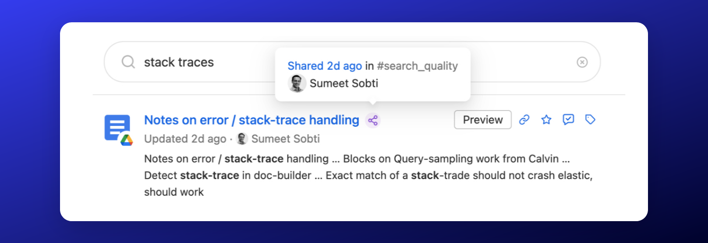
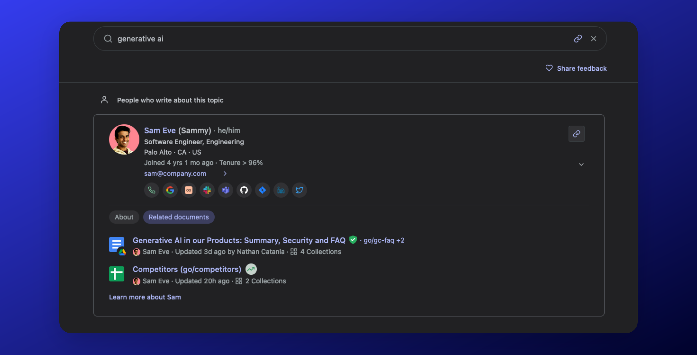
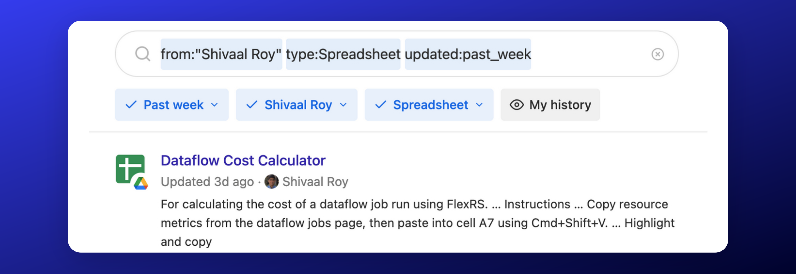

Glean Search delivers an intelligent enterprise search experience that goes beyond traditional search engines. It comprehensively understands your organization's content, language patterns, and user needs to provide highly relevant results without requiring manual configuration.

## Core Capabilities​

### Intelligent Content Understanding

Glean seamlessly searches across all content types within your connected applications, including:

- Document contents
- Comments and discussions
- @mentions
- User activity
- File attachments
- Team messages

### Natural Language Processing

Powered by advanced deep learning and Generative AI, Glean understands:

- Natural language queries
- Industry-standard acronyms
- Organization-specific terminology
- Custom synonyms and abbreviations

## Enterprise Intelligence​

infoGlean builds a comprehensive knowledge graph of your organization's content and interactions to surface the most relevant information for each query.

### Organizational Context​

Glean analyzes various signals to understand content importance, including:

- Document access patterns
- Content sharing frequency
- Cross-application references
- Team discussions and interactions
- User collaboration patterns

Knowledge graph visualization showing content relationships

### People and Entity Recognition​

### Employee Insights

Glean aggregates information across tools to provide comprehensive employee profiles and expertise identification.

### Customer Intelligence

Creates unified customer views by combining data from:

- Salesforce
- Zendesk
- Jira
- Other connected systems

Employee profile view showing aggregated information

### Personalized Search Experience​

infoGlean personalizes search results based on multiple user attributes and behaviors to ensure maximum relevance.

Personalization factors include:

- User role and department
- Team membership
- Reporting structure
- Office location
- Past activity and interactions
- Collaboration patterns

Example of personalized search results

## Advanced Features​

### Real-time Content Updates​

Glean maintains fresh search results by:

- Continuously monitoring content changes
- Indexing new content as it's created
- Updating existing content within minutes
- Tracking content deletions and permissions

### Power User Capabilities​

### Advanced Filtering

Access powerful filtering through:

- UI-based filters
- Command-line style search syntax
- Custom metadata fields

### Custom Metadata Support

Automatically indexes and makes searchable:

- Custom application fields
- Organization-specific metadata
- User-defined attributes

Advanced search interface with filters

### Continuous Learning​

Glean's ranking algorithm continuously improves based on:

- User interactions with search results
- Document access patterns
- Content sharing frequency
- Cross-application references
- Team collaboration signals

## Search Tips​

Enter any keywords or phrases you remember from a document - Glean will understand context and find relevant results.

Use quotation marks around specific words or phrases to require their inclusion in search results.

Search for colleagues by name to access:

- Contact information
- Organizational structure
- Recent documents
- Activity history

© 2026, Glean Technologies, Inc.Was this page helpful?On this page- [Core Capabilities](#core-capabilities)
- [Enterprise Intelligence](#enterprise-intelligence)  - [Organizational Context](#organizational-context)
  - [People and Entity Recognition](#people-and-entity-recognition)
  - [Personalized Search Experience](#personalized-search-experience)
- [Advanced Features](#advanced-features)  - [Real-time Content Updates](#real-time-content-updates)
  - [Power User Capabilities](#power-user-capabilities)
  - [Continuous Learning](#continuous-learning)
- [Search Tips](#search-tips)

