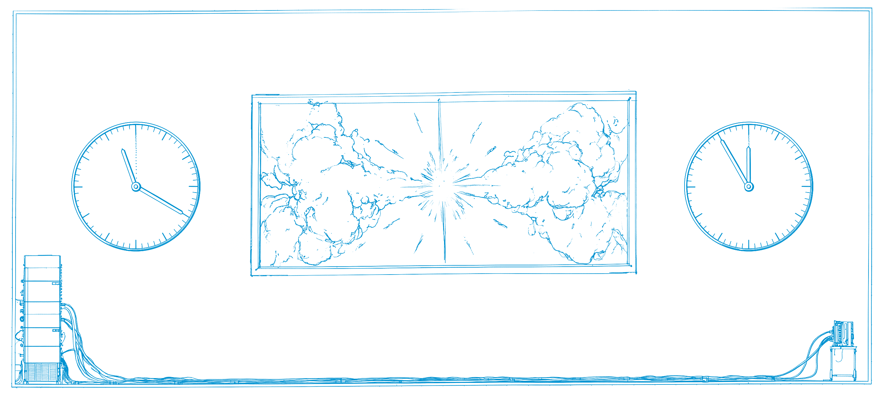
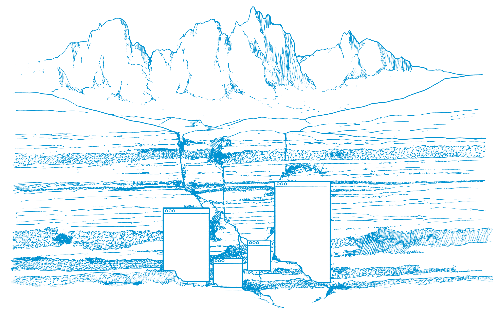
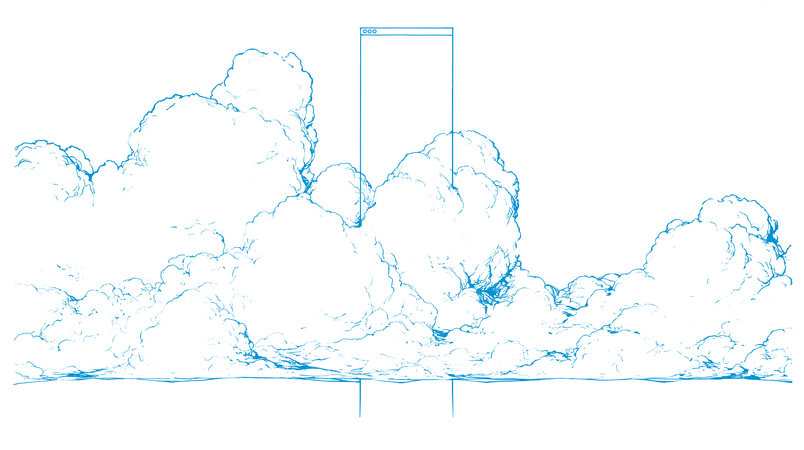
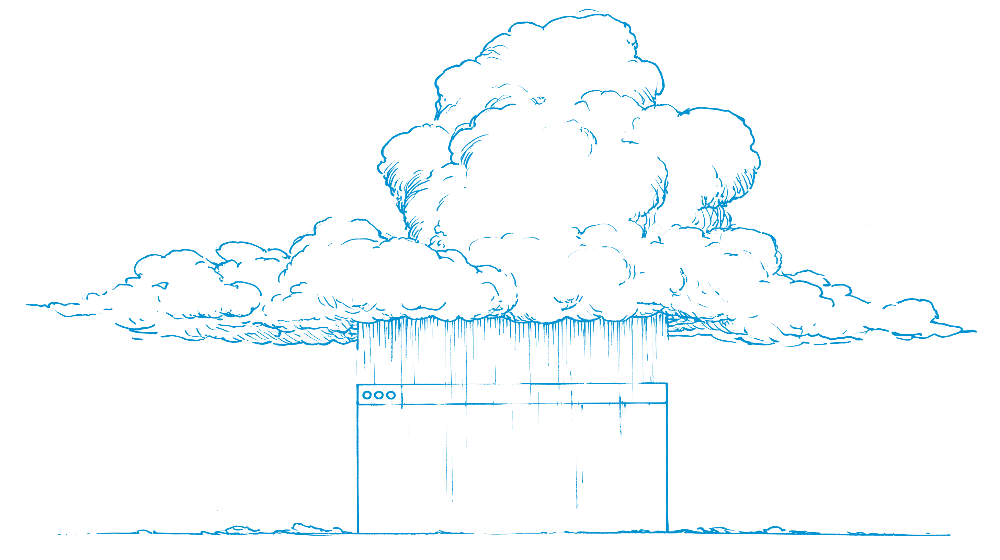
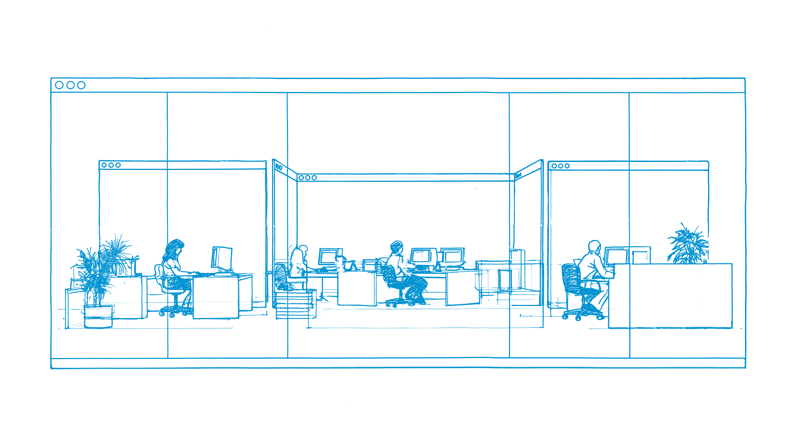
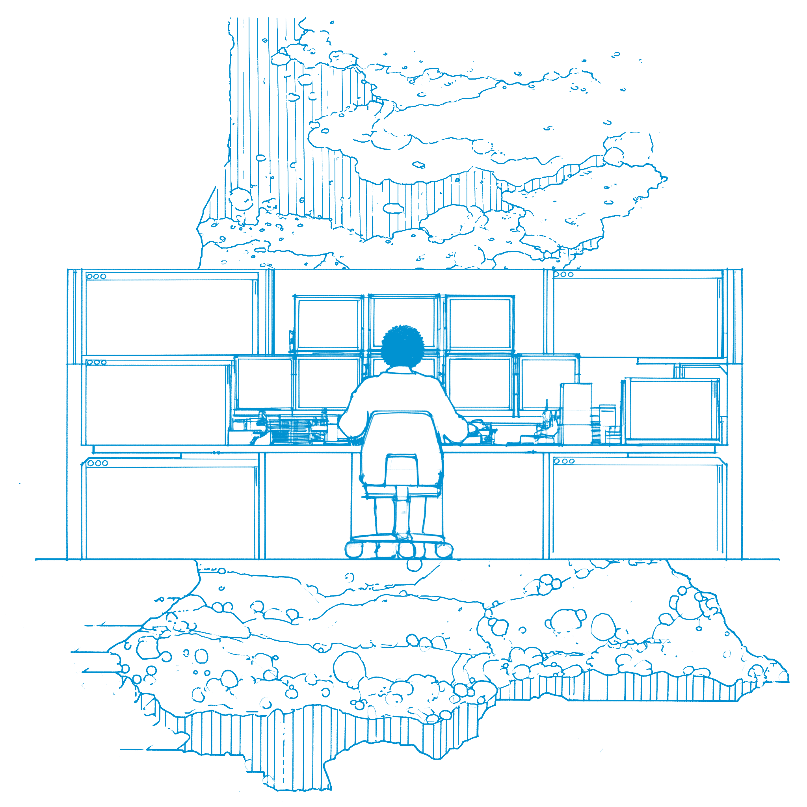

> 作者: Dan Shipper | 日期: 2026-10-15

> 原文链接: https://every.to/p/how-codex-happened

Inside OpenAI’s comeback in coding, from a failed launch to the app that took over ChatGPT

OpenAI 在编程上的翻盘：从一次失败的发布，到接管 ChatGPT 的那款应用

By Dan Shipper

作者 Dan Shipper

I can remember exactly when I began to think that OpenAI would lose the mandate of heaven—the seemingly insurmountable lead they had built in AI coding since ChatGPT originally took off. I was in their Mission Bay office, in the summer of 2025, the night before the launch of [GPT-5](https://every.to/vibe-check/gpt-5?utm_cta_source=p_how_codex_happened_before_launch_gpt_5_1).

我清楚记得自己从哪一刻开始觉得，OpenAI 会失去天命——自 ChatGPT 最初爆火以来，他们在 AI 编程上建立起的那份看似不可撼动的领先。那是 2025 年夏天，我在他们的 Mission Bay 办公室，正是[GPT-5](https://every.to/vibe-check/gpt-5)发布的前一夜。

There was a certain buzz to the building. The overhead lights burned like stage lights, and people seemed to walk the warm rusts and browns of its halls just a little faster than usual. Even the gravity felt heavier—as if the sheer size of the following day’s launch had drawn the rest of the world into its orbit.

楼里有一种躁动。头顶的灯像舞台灯一样亮，人们走在暖锈色和棕色的走廊里，步子似乎比平时快一点。连重力都更沉了——仿佛第二天那场发布的体量，把世界其余部分都吸进了它的轨道。

[This made what I had come to say a little awkward.](/p/how-codex-happened/interviews/alex/?cite=awkward-revisit&utm_cta_source=p_how_codex_happened_before_launch_cite_awkward_revisit#final-20261015-0003)

[这让我接下来要说的话有点尴尬。](https://every.to/p/how-codex-happened/interviews/alex/)

Every, the company I run, had begun to build a reputation for testing new AI models on real work and explaining what they could—and couldn’t—do. OpenAI had given us access to GPT-5 about a month before launch so we could help them understand the model’s strengths and weaknesses and publish our Vibe Check—a detailed review—on launch day.

我创办的公司 Every，已经开始因在真实工作中测试新 AI 模型、并讲清楚它们能做什么、不能做什么而出名。OpenAI 在发布前大约一个月就把 GPT-5 给了我们，好让我们帮他们看清模型的强弱，并在发布当天刊出我们的 Vibe Check——一篇详细评测。

Ten of us had spent a week in a house in upstate New York for a team retreat, eating and working together at one long wooden table and gathering on a couch in front of a big screen to test the long-awaited model. We were especially excited to try it for coding, where AI was advancing fastest. But while we liked it for everyday use, our reaction to it in Codex was muted.

我们十个人在纽约州北部的一栋房子里闭关一周，围着一张长木桌一起吃饭、干活，又挤在大屏幕前的沙发上测试这个盼了很久的模型。我们尤其想试它写代码，因为 AI 在那里前进得最快。日常使用我们喜欢它，但在 Codex 里的反应却很平淡。

Today, Codex is the centerpiece of OpenAI’s comeback—the product that has swallowed ChatGPT from the inside and become the foundation for everything the company is building next. But that summer it was still a scrappy effort to build an AI software engineer. A [version launched in the cloud](https://every.to/vibe-check/vibe-check-codex-openai-s-new-coding-agent?utm_cta_source=p_how_codex_happened_before_launch_version_launched_in_the_cloud_1) a few months earlier hadn’t found product-market fit, and the team was mid-pivot to a new version that ran on a developer’s computer in their terminal and in their code editor.

今天，Codex 是 OpenAI 翻盘的核心——它从内部吞掉了 ChatGPT，成了公司下一步一切的基础。但那个夏天，它还只是一次草创，想做出一个 AI 软件工程师。几个月前[在云端发布的一个版本](https://every.to/vibe-check/vibe-check-codex-openai-s-new-coding-agent)没有找到产品市场契合，团队正在转向新版本：跑在开发者自己的电脑上，进终端，也进代码编辑器。

In Codex, GPT-5 was fast, and it seemed smart. One of our most technical engineers, [Naveen Naidu](https://every.to/@naveen_6804?utm_cta_source=p_how_codex_happened_before_launch_naveen_naidu_1), had used it to track down a mysterious freeze in his voice dictation app [Monologue](https://monologue.to/) that had stumped him for days. But it also seemed to stop too early, as if it were overly wary of stepping outside the bounds of what it was allowed to do. It felt designed to be used as a pair programmer.

在 Codex 里，GPT-5 很快，看起来也聪明。我们最懂技术的工程师之一[Naveen Naidu](https://every.to/@naveen%5F6804)，用它追查自己语音听写应用[Monologue](https://monologue.to/)里一个困扰他好几天的神秘卡死。但它也停得太早，像是过分小心，不敢走出被允许的边界。它感觉是按结对程序员来设计的。

As a team, we were moving beyond step-by-step collaboration with AI models. Using Anthropic’s terminal agent, Claude Code, a group of us led by [Kieran Klaassen](https://every.to/@kieran_1355?utm_cta_source=p_how_codex_happened_before_launch_kieran_klaassen_1) had started handing entire tasks to Opus 4 and walking away until a finished feature—or sometimes an entire app—came back. With minimal help from an engineer, staff writer [Katie Parrott](https://every.to/@katie.parrott12?utm_cta_source=p_how_codex_happened_before_launch_katie_parrott_1) built and deployed her own AI content management system in a few days. It had some bugs, but building it would previously have been out of reach.

作为一个团队，我们已经在越过和 AI 模型一步步协作的阶段。用 Anthropic 的终端智能体 Claude Code，由[Kieran Klaassen](https://every.to/@kieran%5F1355)带队的一组人开始把整项任务交给 Opus 4，然后走开，直到一个做完的功能——有时是整个应用——回来。在工程师很少帮忙的情况下，专职作者[Katie Parrott](https://every.to/@katie.parrott12)几天内就搭好并部署了自己的 AI 内容管理系统。它有些 bug，但以前这根本做不出来。

Next to Opus 4 inside Claude Code, GPT-5 inside Codex felt boxed in.

放在 Claude Code 里的 Opus 4 旁边，Codex 里的 GPT-5 显得束手束脚。

Sharing what we’d found in our testing had brought me to a conference room in OpenAI’s office with **Lindsay McCallum** from the communications team and **Alexander Embiricos** from the Codex team. I sensed that McCallum, who has a keen radar for vibe shifts in the market, had set up the conversation so I could explain to Embiricos why I suddenly wouldn’t shut up about this new way of working.

为了分享测试里的发现，我进了 OpenAI 办公室的一间会议室，对面是传播团队的 Lindsay McCallum，旁边是 Codex 团队的 Alexander Embiricos。我感觉 McCallum 对市场气氛的变化很敏锐，她安排这次谈话，是要我向 Embiricos 解释，我为什么突然对这种新工作方式停不下来。

McCallum was typing with intense focus on her laptop across the conference table from me. Embiricos sat beside me, coding while he talked, which I took as a good sign. He was rushing to finish a GPT-5 release feature that would let the agent pause and ask a human for permission to access files or run commands outside its sandbox.

McCallum 在会议桌对面全神贯注地敲着笔记本。Embiricos 坐在我旁边，边说话边写代码，我把这当成好迹象。他正赶着完成 GPT-5 的一项发布功能：让智能体停下来，请求人类允许它访问 sandbox 之外的文件或运行命令。

“With Claude Code, you just let it rip,” I told Embiricos. “GPT-5 feels a little timid—like it’s held back by the sandbox and it seems afraid to use its own power.”

“用 Claude Code，你就是放开让它干，”我对 Embiricos 说。“GPT-5 有点胆小——像被 sandbox 拽住，好像害怕用出自己的力气。”

The tapping of McCallum’s keys slowed. “Tell Alexander about this new engineering workflow you have,” I remember her saying without looking up from her laptop.

McCallum 敲键盘的声音慢了下来。“跟 Alexander 讲讲你们这套新的工程工作流，”我记得她头也不抬地说。

Embiricos swiveled his chair to focus fully on me.

Embiricos 把椅子转过来，完全对着我。

“We don’t even really look at the code anymore,” I began. But I blushed as I said it. I felt ridiculous explaining agentic delegation to Embiricos, of all people—building an autonomous coding agent was his job. I also wasn’t sure, at the time, that our engineering approach would work beyond our tiny team.

“我们其实已经不怎么看代码了，”我开口。但说的时候我脸红了。向 Embiricos 解释智能体委托，我觉得荒唐——造一个自主编程智能体本来就是他的工作。我当时也不确定，我们这套工程方法出了这个小团队还能不能成立。

A Slack ping lit up Embiricos’s screen and broke the sudden quiet of the conference room. He muted his computer and pushed its lid three-quarters shut—just enough to keep his Codex agent thinking.

一声 Slack 提示点亮了 Embiricos 的屏幕，打断了会议室突然的安静。他把电脑静音，把盖子推到四分之三合上——刚好让他的 Codex 智能体继续想。

Leaving Mission Bay that night, I wondered if OpenAI was building the perfect tool for a dying workflow. Burned once by its failed cloud agent, the company looked like it was retreating to the code editor, where AI helped programmers work step by step. Meanwhile, Claude Code was taking off among people handing over entire tasks and walking away.

那天晚上离开 Mission Bay，我在想 OpenAI 是不是在为一套正在死去的工作流打造完美工具。云端智能体失败过一次之后，公司看起来退回了代码编辑器，让 AI 帮程序员一步步干活。与此同时，Claude Code 正在那些把整项任务交出去然后走开的人中间起飞。

There were good reasons to stay in the editor. After GPT-5 launched, the Codex team shipped an extension that tucked Codex into the sidebar of code editors like Microsoft’s Visual Studio Code (VS Code)—where programmers write, run, and debug code—and Cursor. Usage grew more than 10-fold by last October, and the editor extension quickly overtook the terminal to become Codex’s most-used surface.[[1]](/p/how-codex-happened/interviews/alex/?cite=ide-most-used-surface&utm_cta_source=p_how_codex_happened_before_launch_cite_ide_most_used_surface#final-20261015-0153)

留在编辑器里有充分理由。GPT-5 发布后，Codex 团队做了一个扩展，把 Codex 塞进代码编辑器的侧边栏，比如微软的 Visual Studio Code（VS Code）——程序员在那里写代码、运行、调试——以及 Cursor。到去年 10 月，用量增长了十倍以上，编辑器扩展很快超过终端，成为 Codex 用得最多的界面。[1](https://every.to/p/how-codex-happened/interviews/alex/)

In most companies, that would have been the business to double down on. But Embiricos and a small group of engineers, designers, and researchers inside OpenAI had bigger ambitions.

在大多数公司，这就是该加倍押注的生意。但 Embiricos 和 OpenAI 内部一小群工程师、设计师、研究员有更大的野心。

In the months that followed, the Codex team trained and rapidly improved a dedicated line of coding models, separate from those powering ChatGPT, and built a desktop app for managing multiple agents at once. By June 2026, Codex had more than 5 million weekly active users and was spreading beyond programming into other kinds of knowledge work.

接下来几个月，Codex 团队训练并迅速改进了一条专门的编程模型线，和驱动 ChatGPT 的那些分开，还做了一个能同时管理多个智能体的桌面应用。到 2026 年 6 月，Codex 周活跃用户超过 500 万，并开始从编程扩散到其他知识工作。

By July 2026, Codex had merged into the flagship ChatGPT desktop app. Its leader, **Thibault Sottiaux**, had been elevated to head all of OpenAI’s core products and platforms, including ChatGPT, Codex, and the API. Today, Codex and ChatGPT for Work combined have 40 million weekly active users.

到 2026 年 7 月，Codex 并进了旗舰 ChatGPT 桌面应用。它的负责人 Thibault Sottiaux 被提拔，统管 OpenAI 的核心产品与平台，包括 ChatGPT、Codex 和 API。今天，Codex 和 ChatGPT for Work 加起来有 4000 万周活跃用户。

In less than a year, the Codex team went from a failed cloud launch to becoming the foundation for OpenAI’s flagship product—and in doing so, they helped remake the company.

不到一年，Codex 团队从一次失败的云端发布，变成 OpenAI 旗舰产品的基础——也由此重塑了这家公司。

This is the story of how Codex happened.

这就是 Codex 如何诞生的故事。

> *Thinking…*Thinking...

> 思考中……

> *Something is off. The lead I had a year ago isn’t showing up in the results…*

> 有点不对。我一年前的领先，没有出现在结果里……

> *It looks like the problem starts earlier than I assumed…*

> 问题似乎比我以为的更早开始……

> *Going back to the beginning…*

> 回到开头……

> *Thinking…*Thinking...

> 思考中……

> *Something is off. The lead I had a year ago isn’t showing up in the results…*

> 有点不对。我一年前的领先，没有出现在结果里……

> *It looks like the problem starts earlier than I assumed…*

> 问题似乎比我以为的更早开始……

> *Going back to the beginning…*

> 回到开头……

OpenAI’s comeback begins with a simple line: “Thinking....”

OpenAI 的翻盘，从一行简单的字开始：“Thinking....”

In 2026, any time you interact with an AI model on any kind of complex request, you’ll see that word—*thinking*—shimmering in the place where your response will appear.

到了 2026 年，你让 AI 模型处理任何稍微复杂的请求，都会看到这个词——thinking——在回答将要出现的地方闪着。

It might seem like a throwaway: a one-word replacement for the spinning beach ball on macOS or the circling blue ring Windows displays beside its cursor, each a sign that the computer is too busy to respond.

它看起来像随手一写：一个词，代替 macOS 上转圈的沙滩球，或 Windows 光标旁转着的蓝环，都表示电脑忙得来不及回应。

But “Thinking,” in this context, denotes a new style of computing without which Codex would never have happened.

但在这里，“Thinking”指的是一种新的计算方式。没有它，Codex 不会发生。

The first generation of large language models were external processors. They had no shimmering status label for their internal reasoning; instead, they did their thinking directly by responding to you. Whether you asked them to write an email or a line of code, they had to work out their answer [one word at a time](https://every.to/chain-of-thought/how-language-models-work?utm_cta_source=p_how_codex_happened_thinking_one_word_at_a_time_1), with no opportunity to plan ahead or revise afterward.

第一代大语言模型是外置处理器。它们没有闪烁的状态标签来表示内部推理；它们直接用回答你来思考。无论你让它写邮件还是写一行代码，它都得[一个词一个词](https://every.to/chain-of-thought/how-language-models-work)地把答案算出来，没有机会事先规划或事后修改。

In that way, early chat models were like improv actors given a prompt by the audience as the basis for a scene invented on the spot. As these tools composed on the run, their results could be impressive—and sometimes unintentionally funny. (They would insist [“strawberry”](https://every.to/chain-of-thought/openai-s-new-model-strawberry-explained?utm_cta_source=p_how_codex_happened_thinking_strawberry_1) had two r’s, spell it out to prove it, and congratulate themselves at the end.)

这样一来，早期聊天模型像即兴演员：观众给一个提示，场景当场编出来。这些工具边走边写，结果有时惊人，有时又无意间很好笑。（它们会坚持[“strawberry”](https://every.to/chain-of-thought/openai-s-new-model-strawberry-explained)只有两个 r，还把字母拼出来证明，最后恭喜自己。）

Early users of these models noticed that if you asked the model to write out its reasoning step by step before answering, it would often arrive at a better answer. This technique, the same advice as a grade school math teacher would give a student, was called [chain-of-thought prompting](https://every.to/also-true-for-humans/7-22?utm_cta_source=p_how_codex_happened_thinking_chain_of_thought_prompting_1).

这些模型的早期用户发现，如果你要求模型在回答之前把推理一步步写出来，它常常会得到更好的答案。这个技巧，和小学数学老师给学生的建议一样，被称为[chain-of-thought prompting](https://every.to/also-true-for-humans/7-22)。

Chain-of-thought prompting led to the second generation of AI models and the shimmering “Thinking” user interface. Rather than requiring the user to ask the model to work through a problem step by step, OpenAI trained that behavior into the model itself. Before responding, a reasoning model works in a scratch pad, called a reasoning trace, where it can attack a problem from different angles, backtrack out of a blind alley, and pick a path more likely to succeed. It responds only when it has settled on an answer.

chain-of-thought prompting 带来了第二代 AI 模型，以及闪烁的 “Thinking” 界面。OpenAI 不再要求用户让模型逐步解题，而是把这个行为训练进模型本身。回答之前，推理模型在一块草稿纸上工作，叫 reasoning trace。它可以从不同角度攻一个问题，从死胡同退回来，选一条更可能成功的路。只有想清楚了，它才回答。

OpenAI called its first model of this kind [o1](https://every.to/chain-of-thought/openai-s-o1-model-explained?utm_cta_source=p_how_codex_happened_thinking_o1_1) and released a preview of it in September 2024. Until then, progress had depended mainly on training larger models for longer. With o1, OpenAI found that the same model could improve its answers on a difficult problem simply by spending more time on it.

OpenAI 把这类模型的第一个叫做[o1](https://every.to/chain-of-thought/openai-s-o1-model-explained)，并在 2024 年 9 月发布了预览版。在那之前，进步主要靠把更大的模型训练得更久。有了 o1，OpenAI 发现同一个模型只要在难题上多花时间，答案就会更好。

One kind of work stood to gain more from this than any other: programming. Programming is uniquely suited to reasoning models because it offers a closed loop: A model can edit code, run it, and see within seconds whether the change worked, allowing it to test and revise fixes on its own without needing a person to check.

有一类工作从中得到的比其他都多：编程。编程特别适合推理模型，因为它有闭环：模型可以改代码、跑代码，几秒内就知道改动有没有用，于是自己测试、自己修正，不需要人来检查。

Left to think for long enough, theoretically, a reasoning model could do any programming task by itself.

理论上，只要让它想得够久，推理模型可以自己完成任何编程任务。

Building an AI programmer has been a goal at OpenAI for so long that Codex has had many beginnings—starting with its name.[[2]](/p/how-codex-happened/interviews/tibo/?cite=many-codex-beginnings&utm_cta_source=p_how_codex_happened_many_beginnings_cite_many_codex_beginnings#final-20261015-0010)

在 OpenAI，做一个 AI 程序员这个目标存在了很久，久到 Codex 有过许多次开始——从它的名字就开始了。[2](https://every.to/p/how-codex-happened/interviews/tibo/)

The first Codex, released in 2021, was a version of [GPT-3](https://every.to/chain-of-thought/gpt-3-is-the-best-journal-you-ve-ever-used?utm_cta_source=p_how_codex_happened_many_beginnings_gpt_3_1) fine-tuned on public code that powered the original [GitHub Copilot](https://every.to/chain-of-thought/i-spent-24-hours-with-github-copilot-workspaces?utm_cta_source=danshipper_main_a_22). Three years later, in the weeks after o1’s preview showed what reasoning models could do, a prompt from leadership set several groups across OpenAI chasing the dream again from different directions.

第一个 Codex 在 2021 年发布，是[GPT-3](https://every.to/chain-of-thought/gpt-3-is-the-best-journal-you-ve-ever-used)在公开代码上微调的版本，驱动了最初的[GitHub Copilot](https://every.to/chain-of-thought/i-spent-24-hours-with-github-copilot-workspaces)。三年后，o1 预览展示了推理模型能做什么，领导层的一句提示，让 OpenAI 好几个组从不同方向重新追这个梦。

One of those beginnings came from Embiricos in late 2024.

其中一次开始，来自 2024 年末的 Embiricos。

“The first real, massive ‘feel-the-AGI’ moment for me was [when] I saw someone running a reasoning model that was connected to a terminal,”[[3]](/p/how-codex-happened/interviews/alex/?cite=the-terminal&utm_cta_source=p_how_codex_happened_many_beginnings_cite_the_terminal#final-20261015-0034) he told me, referring to when an AI stops feeling like a tool and starts feeling like a machine that can think and act like a human. “I know [it’s] not exciting now,” but watching it read files, run commands, and work through errors on its own “was fucking cool.”

“对我来说，第一次真正、巨大的 feel-the-AGI 时刻，是当我看到有人跑一个连着终端的推理模型，”[3](https://every.to/p/how-codex-happened/interviews/alex/)他对我说。他指的是 AI 不再像工具，而开始像一台能像人一样思考和行动的机器。“我知道现在这已经不新鲜了，”但看着它自己读文件、跑命令、把错误想通，“真他妈酷。”

Embiricos, the product lead I’d met on the eve of GPT-5, had come to OpenAI earlier that year when it acquired Multi, a multiplayer screen-sharing tool for programmers he’d cofounded. At OpenAI he’d pursued a related idea: letting humans and agents work together inside the apps they used. He chased that vision first on the ChatGPT desktop app and then on [Atlas](https://every.to/vibe-check/vibe-check-openai-s-new-ai-browser-atlas?utm_cta_source=p_how_codex_happened_many_beginnings_atlas_1), an AI-powered browser,[[4]](/p/how-codex-happened/interviews/alex/?cite=desktop-before-atlas&utm_cta_source=p_how_codex_happened_many_beginnings_cite_desktop_before_atlas#final-20261015-0028) but [the models at the time were too slow and clumsy at reading a user’s screen](/p/how-codex-happened/interviews/alex/?cite=multimodal-bet&utm_cta_source=p_how_codex_happened_many_beginnings_cite_multimodal_bet#final-20261015-0010) to be useful.

Embiricos 是我在 GPT-5 前夜见过的那位产品负责人。那一年早些时候 OpenAI 收购了 Multi——他联合创办的、给程序员用的多人屏幕共享工具——他随之加入。在 OpenAI，他追一个相关的想法：让人和智能体在他们正在用的应用里一起工作。他先在 ChatGPT 桌面应用上追这个愿景，然后是[Atlas](https://every.to/vibe-check/vibe-check-openai-s-new-ai-browser-atlas)，一个 AI 浏览器，[4](https://every.to/p/how-codex-happened/interviews/alex/)但[当时的模型读用户屏幕又慢又笨](https://every.to/p/how-codex-happened/interviews/alex/)，并不好用。

In the terminal, though, the models didn’t have to read a screen—they could work directly in text and code. Seeing an early reasoning model in the terminal convinced Embiricos that they could power a real coding product. Coding wasn’t yet his full-time job, but he immediately started sketching one. For it to work, he believed, users would need to see what the model was doing every 30 seconds, or at most every minute.

在终端里，模型却不必读屏幕——它们可以直接在文本和代码里工作。看到早期推理模型在终端里干活，Embiricos 确信它们能撑起一个真正的编程产品。编程还不是他的全职工作，但他立刻开始画草图。他认为，要让它成立，用户最多每 30 秒、至多每一分钟，就得看见模型在做什么。

Speed was the problem again. Most AI coding products at the time grew around VS Code. GitHub Copilot added AI autocomplete through an extension; Cursor and Windsurf built their own editors on VS Code’s open-source code, adding AI chat alongside the programmer’s work.

速度又成了问题。当时大多数 AI 编程产品都长在 VS Code 周围。GitHub Copilot 用扩展加上了 AI 自动补全；Cursor 和 Windsurf 在 VS Code 的开源代码上做了自己的编辑器，在程序员干活的旁边加上 AI 聊天。

These tools depended on a tight feedback loop. Copilot completed the line you were typing; Cursor and Windsurf answered questions within seconds. None asked the model to work on its own for long, because the models couldn’t. OpenAI’s early reasoning models were the reverse: slow and weak when their thinking time was cut short.

这些工具依赖很紧的反馈循环。Copilot 补全你正在打的那一行；Cursor 和 Windsurf 几秒内回答问题。没有一个让模型自己干很久，因为模型做不到。OpenAI 早期的推理模型正好相反：思考时间被砍短时，又慢又弱。

Could he turn their flaw—the time it took to get a response—into an advantage?

他能不能把它们的缺陷——得到回应要花的时间——变成优势？

Meanwhile, in another part of OpenAI, Sottiaux, who goes by Tibo, was trying to turn reasoning models back on themselves: using their powers to help researchers build the next generation of models.

与此同时，在 OpenAI 的另一处，外号 Tibo 的 Sottiaux 正试着把推理模型反过来用在它们自己身上：用它们的能力帮研究员做出下一代模型。

“I got involved with coding agents around December 2024,”[[5]](/p/how-codex-happened/interviews/tibo/?cite=research-start-december&utm_cta_source=p_how_codex_happened_building_the_builders_cite_research_start_december#final-20261015-0012) he told me. We were sitting in the OpenAI cafeteria. His glossy brown hair fell to one side, and he wore thin wire glasses that caught the afternoon light. If above the nose he looked like an architect, below he was all programmer: A beard of brown stubble paired with a dark brown hoodie printed with “Research and Deployment Co,” and a slice of pepperoni pizza in hand.

“我大约在 2024 年 12 月开始做编程智能体，”[5](https://every.to/p/how-codex-happened/interviews/tibo/)他对我说。我们坐在 OpenAI 食堂。他光亮的棕发垂向一边，细金属框眼镜映着午后的光。鼻子以上他像建筑师，鼻子以下全是程序员：棕色胡茬，深棕色连帽衫上印着 “Research and Deployment Co”，手里一片意式辣香肠披萨。

The goal, he told me between bites of pizza, “was to help us write infrastructure and do research faster.”[[6]](/p/how-codex-happened/interviews/tibo/?cite=research-infrastructure-purpose&utm_cta_source=p_how_codex_happened_building_the_builders_cite_research_infrastructure_purpose#final-20261015-0030)

他在两口披萨之间告诉我，目标“是帮我们更快地写基础设施、做研究。”[6](https://every.to/p/how-codex-happened/interviews/tibo/)

Sottiaux had spent much of his career building infrastructure for researchers, first at DeepMind and then at OpenAI. Research infrastructure—the shared code that AI researchers rely on to run, evaluate, reproduce, and deploy experiments—might seem like an odd origin story for the person who would eventually lead Codex. When you think of infrastructure, you might think of servers and undersea cables, the tech world’s equivalent of plumbing: necessary, but invisible until a pipe springs a leak.

Sottiaux 职业生涯的大部分时间都在给研究员做基础设施，先在 DeepMind，后在 OpenAI。研究基础设施——AI 研究员用来运行、评估、复现和部署实验的共享代码——听起来不像是最终领导 Codex 的人该有的出身。说到基础设施，你会想到服务器和海底电缆，科技世界的管道：必要，但只有漏水时才被看见。

In the AI world, though, infrastructure—and particularly research infrastructure—is where much of the action happens. If you can cut the time it takes to run an experiment, you can run more experiments and get a better model sooner.

可在 AI 世界，基础设施——尤其是研究基础设施——正是事情发生的地方。如果你能缩短一次实验的时间，就能跑更多实验，更早得到更好的模型。

“At what point did you split out the model line?” I asked. “How did you decide?” I wanted to fast-forward to the action. Having its own model line felt core to Codex’s magic, and I pictured a meeting inside OpenAI where Sottiaux, president and cofounder **Greg Brockman**, or CEO **Sam Altman** made the farsighted choice to separate Codex from the rest of ChatGPT—giving the team the freedom to ship quickly and upend the company from within.

“你们是在哪个节点把模型线拆出去的？”我问。“怎么决定的？”我想快进到高潮。拥有自己的模型线，我觉得是 Codex 魔力的核心。我脑海里有一场 OpenAI 内部会议：Sottiaux、总裁兼联合创始人 Greg Brockman，或 CEO Sam Altman，做出有远见的选择，把 Codex 从 ChatGPT 其余部分分开——给团队快速发布的自由，并从内部掀翻公司。

“[There was no decision to split off the model line](/p/how-codex-happened/interviews/tibo/?cite=no-model-split-decision&utm_cta_source=p_how_codex_happened_building_the_builders_cite_no_model_split_decision#final-20261015-0028),” Sottiaux said matter-of-factly. At the start, he said, “this was a research exploration and an optimization of our velocity.”

“[并没有一个把模型线拆出去的决定](https://every.to/p/how-codex-happened/interviews/tibo/)，”Sottiaux 平淡地说。一开始，他说，“这是一次研究探索，也是对我们速度的优化。”

Rather than building a model for public consumption, Sottiaux’s group trained internal coding agents on OpenAI’s monorepo,[[7]](/p/how-codex-happened/interviews/tibo/?cite=monorepo-training&utm_cta_source=p_how_codex_happened_building_the_builders_cite_monorepo_training#final-20261015-0012) the single repository where all of the organization’s code lives. The agents wrote the Python code OpenAI’s researchers needed to run and improve the systems that built new models. Those researchers used the agents every day, giving the team a tight feedback loop.

Sottiaux 的组没有去做给公众用的模型，而是在 OpenAI 的 monorepo 上训练内部编程智能体，[7](https://every.to/p/how-codex-happened/interviews/tibo/)那个存放全组织代码的单一仓库。智能体写下研究员运行和改进造新模型的系统所需的 Python。研究员每天用这些智能体，给团队一个很紧的反馈循环。

“We were seeing rapid gains on coding,” Sottiaux said. His team was training models frequently, using techniques that differed from—and for a while, were hard to reconcile with—how the larger organization trained models for the public.

“我们在编程上看到很快的进展，”Sottiaux 说。他的团队频繁训练模型，用的技术和更大组织训练面向公众的模型不同——有一段时间甚至很难调和。

Sottiaux, like everyone else at the AI labs, is tight-lipped about those training techniques. But it became clear they were working: His group had successfully turned the models back on the research process that created them, and researchers were using those models to make the next generation.[[8]](/p/how-codex-happened/interviews/tibo/?cite=recursive-improvement&utm_cta_source=p_how_codex_happened_building_the_builders_cite_recursive_improvement#final-20261015-0030)

和 AI 实验室里的所有人一样，Sottiaux 对这些训练技术守口如瓶。但它们显然有效：他的组成功地把模型反过来用在造出它们的研究过程上，研究员又用这些模型做出下一代。[8](https://every.to/p/how-codex-happened/interviews/tibo/)

Engineers call this bootstrapping. Make a model that’s good at helping researchers run experiments, and the researchers can use it to build a more powerful one, which runs better experiments, which leads to a better model, and so on.

工程师把这叫 bootstrapping。做一个擅长帮研究员跑实验的模型，研究员就能用它做出更强的模型，更强的模型跑出更好的实验，再导向更好的模型，如此循环。

This effort supplied one half of what became Codex: agents that could improve the [infrastructure](https://every.to/p/openai-infrastructure?utm_cta_source=p_how_codex_happened_building_the_builders_infrastructure_1) for building new models. To become a product that the rest of the company could use—and that would eventually make its way beyond the confines of OpenAI—it needed the other half: Embiricos’s thesis about how people should work with those agents.

这件事提供了后来成为 Codex 的一半：能改进造新模型所需[基础设施](https://every.to/p/openai-infrastructure)的智能体。要变成公司其他人能用、并最终走出 OpenAI 的产品，它还需要另一半：Embiricos 关于人该如何与这些智能体一起工作的论点。

> *Thinking…*Thinking...

> 思考中……

> *Three approaches so far…*

> 到目前有三种做法……

> *Two of them overlap…*

> 其中两种重叠了……

> *I’ll merge those and continue with what works…*

> 我把它们合并，继续用有效的那部分……

> *Thinking…*Thinking...

> 思考中……

> *Three approaches so far…*

> 到目前有三种做法……

> *Two of them overlap…*

> 其中两种重叠了……

> *I’ll merge those and continue with what works…*

> 我把它们合并，继续用有效的那部分……

After exploration comes convergence.

探索之后，是收敛。

We can picture OpenAI from above in the last months of 2024 and early 2025. After coding became a top-level company goal,[[9]](/p/how-codex-happened/interviews/greg/?cite=coding-company-goal&utm_cta_source=p_how_codex_happened_convergence_cite_coding_company_goal#final-20261015-0002) several teams of individuals including Sottiaux and Embiricos had started working at oblique angles on the same question.

我们可以从高处看 2024 年最后几个月和 2025 年初的 OpenAI。编程成为公司一级目标之后，[9](https://every.to/p/how-codex-happened/interviews/greg/)包括 Sottiaux 和 Embiricos 在内的好几组人，开始从斜角攻同一个问题。

The open question, Brockman told me, was the right “form factor”:[[10]](/p/how-codex-happened/interviews/greg/?cite=form-factor-search&utm_cta_source=p_how_codex_happened_convergence_cite_form_factor_search#final-20261015-0006) whether the agent belonged in a terminal where developers execute commands, in an editor where they write code, or in the cloud working on its own computer. Some of these paths were blind alleys, but at the time nobody knew which.

Brockman 告诉我，开放问题是正确的 “form factor”：[10](https://every.to/p/how-codex-happened/interviews/greg/)智能体该待在开发者执行命令的终端里，待在他们写代码的编辑器里，还是在云端、在它自己的电脑上工作。有些路是死胡同，但当时没人知道是哪几条。

“There’s some sense in which OpenAI is betting on a series of startups, but they’re all internal,” Altman said in [an interview with](https://stratechery.com/2025/an-interview-with-openai-ceo-sam-altman-about-devday-and-the-ai-buildout/#the-investor-mindset) **Ben Thompson** [in 2025](https://stratechery.com/2025/an-interview-with-openai-ceo-sam-altman-about-devday-and-the-ai-buildout/#the-investor-mindset). This spirit of parallel inquiry inside of the company [sometimes feels chaotic and wasteful](/p/how-codex-happened/interviews/andrew/?cite=startup-chaos&utm_cta_source=p_how_codex_happened_convergence_cite_startup_chaos#final-20261015-0049) to a few insiders I spoke to. [Who wants to work on the team that built the third-best agent product inside of OpenAI?](/p/how-codex-happened/interviews/greg/?cite=unglamorous-work&utm_cta_source=p_how_codex_happened_convergence_cite_unglamorous_work#final-20261015-0018) Having run a similar strategy at my own company, I know that there’s a thin line between creating space to explore and creating an utter mess.

“在某种意义上，OpenAI 是在押注一连串创业公司，只是它们都在内部，”Altman 在[2025 年接受](https://stratechery.com/2025/an-interview-with-openai-ceo-sam-altman-about-devday-and-the-ai-buildout/)[Ben Thompson 的采访](https://stratechery.com/2025/an-interview-with-openai-ceo-sam-altman-about-devday-and-the-ai-buildout/)时说。公司内部这种并行探究，[有时让我访谈过的几个内部人觉得混乱而浪费](https://every.to/p/how-codex-happened/interviews/andrew/)。[谁想待在 OpenAI 里做出第三好智能体产品的那个组？](https://every.to/p/how-codex-happened/interviews/greg/)我自己的公司也用过类似策略，我知道：给探索留空间，和搞成一团乱，中间只有一条细线。

But in watching OpenAI—and despite the internal grumbling I’ve heard—I have also come to see it as necessary when the frontier keeps moving. In AI, fast [“sustaining”](https://www.christenseninstitute.org/graphic/disruptive-vs-sustaining-innovations/) progress at the model level—to use the late Harvard professor **Clayton Christensen**’s term—makes new kinds of apps possible, constantly disrupting the ones that came before.

但看着 OpenAI——尽管我听到内部抱怨——我也开始觉得，当前沿一直在动，这是必要的。在 AI 里，模型层面快速的[“sustaining”](https://www.christenseninstitute.org/graphic/disruptive-vs-sustaining-innovations/)进步——用已故哈佛教授 Clayton Christensen 的说法——不断让新种类的应用成为可能，也不断打乱之前那些。

A model that can finish a line of code works well as an autocomplete tool; a model that can think for 30 seconds can answer questions in a chat sidebar; a model that can work for an hour wants to be something else entirely. Building a successful product around the previous model doesn’t mean you know what’s next. You need several teams trying different ideas, then bringing their work together once you see what’s useful.

能补完一行代码的模型，适合做自动补全；能想 30 秒的模型，可以在聊天侧边栏里回答问题；能连续工作一小时的模型，想成为完全不同的东西。围绕上一个模型做成了产品，并不意味着你知道下一步。你需要几个团队试不同想法，等看清什么有用，再把工作合到一起。

By early 2025 OpenAI was ready to do just that. “Eventually, we thought we should combine forces with another effort, which was called Scientist Assistant,”[[11]](/p/how-codex-happened/interviews/tibo/?cite=scientific-assistant-merge&utm_cta_source=p_how_codex_happened_convergence_cite_scientific_assistant_merge#final-20261015-0020) Sottiaux told me—a merger that brought him together with Embiricos. Across the various internal coding efforts, Brockman said, “We ended up merging two of them. And then merging another two of them.”[[12]](/p/how-codex-happened/interviews/greg/?cite=efforts-converge&utm_cta_source=p_how_codex_happened_convergence_cite_efforts_converge#final-20261015-0006) The combined team was a small multidisciplinary crew of technical product thinkers like Embiricos, infrastructure and engineering wizards like Sottiaux, and researchers like **Mia Glaese**.

到 2025 年初，OpenAI 准备这么做了。“最终，我们觉得应该和另一项努力合并，它叫 Scientist Assistant，”[11](https://every.to/p/how-codex-happened/interviews/tibo/)Sottiaux 告诉我——这次合并把他和 Embiricos 带到一起。Brockman 说，在各种内部编程努力里，“我们最后合并了其中两个。然后又合并了另外两个。”[12](https://every.to/p/how-codex-happened/interviews/greg/)合并后的团队很小，跨学科：像 Embiricos 这样的技术产品思考者，像 Sottiaux 这样的基础设施和工程高手，以及像 Mia Glaese 这样的研究员。

Glaese came to OpenAI from DeepMind, where she worked on Gemini and model alignment. At OpenAI, she was responsible for the data used for model training and alignment,[[13]](/p/how-codex-happened/interviews/mia/?cite=glaese-data-alignment&utm_cta_source=p_how_codex_happened_convergence_cite_glaese_data_alignment#final-20261015-0008) meaning she specialized in getting and using data that would shape the specific behaviors of the models.

Glaese 从 DeepMind 来到 OpenAI，在那里做过 Gemini 和模型对齐。在 OpenAI，她负责模型训练和对齐所用的数据，[13](https://every.to/p/how-codex-happened/interviews/mia/)也就是专门获取并使用能塑造模型具体行为的数据。

On one level, she is the ultimate unsentimental empiricist. In our interview, she was unapologetically quantitative: “Just trusting vibes is not that useful in research,” she said. Yet when she talks about the process of making a model, she is quick to laugh at how much of it is a leap into the unknown.

在一个层面上，她是彻底不感情用事的经验主义者。采访里她毫不道歉地定量：“做研究只靠感觉没用，”她说。可谈到造模型的过程，她很快笑起来：其中有多少是跳进未知。

“Every time we train a model, we go on this magical adventure where we’re like, ‘How are we gonna do that?’” she said.

“每次训练一个模型，我们都像去一场魔法冒险，心想，‘我们到底要怎么做？’”她说。

This sort of multidisciplinary team, with product people and researchers working side by side, is somewhat unusual in AI. AI has historically been a research-driven field with the best researchers fetching multimillion-dollar **LeBron James**–sized contracts for their services while everyone else is paid industry-standard engineering salaries. (AI labs have long tried to counter the exalted superstar dynamic by giving most technical employees, whether they are researchers or not, the job title “Member of Technical Staff.”)

这种产品人和研究员并肩的跨学科团队，在 AI 里有点不寻常。AI 历史上是研究驱动的领域，最好的研究员能拿到数百万美元、LeBron James 级别的合同，其他人拿的是行业标准的工程薪水。（AI 实验室长期试图压住这种巨星动态，给大多数技术员工——无论是不是研究员——同一个职称：“Member of Technical Staff”。）

Working alongside the product team gave Glaese and the other researchers a chance to see how their models were being used—and hear what people wanted them to do next. Product people could ask, “[Wouldn’t it be amazing if the model could do this thing?](/p/how-codex-happened/interviews/mia/?cite=research-product-together&utm_cta_source=p_how_codex_happened_convergence_cite_research_product_together#final-20261015-0077)” Then researchers could bring it to life. It was Sottiaux’s bootstrapping loop again, this time running between a model and the product built on it.

和产品团队一起工作，让 Glaese 和其他研究员看见模型被怎么用，也听见人们接下来想让它们做什么。产品人可以问：“[如果模型能做这件事，不是很惊人吗？](https://every.to/p/how-codex-happened/interviews/mia/)”然后研究员把它做出来。这又是 Sottiaux 的 bootstrapping 循环，这次跑在模型和建在它上面的产品之间。

OpenAI finally had its Codex team—product, design, and research—all working together. Now they just had to decide what to build.

OpenAI 终于有了自己的 Codex 团队——产品、设计、研究——一起工作。现在他们只要决定做什么。

> *Thinking...
> I could try the terminal, the editor, or the cloud…*

> 思考中……
> 我可以试终端、编辑器，或者云端……

> *Which approach fits the models I have?*

> 哪种做法适合我手头的模型？

> *Our researchers work in the cloud. Could other developers work there, too?*

> 我们的研究员在云端工作。其他开发者也能在那里工作吗？

> *Thinking…Thinking...I could try the terminal, the editor, or the cloud…*

> 思考中……我可以试终端、编辑器，或者云端……

> *Which approach fits the models I have?*

> 哪种做法适合我手头的模型？

> *Our researchers work in the cloud. Could other developers work there, too?*

> 我们的研究员在云端工作。其他开发者也能在那里工作吗？

At Anthropic, a promising approach had already begun to take off.

在 Anthropic，一种有希望的做法已经开始起飞。

On February 24, 2025, the company released [Claude 3.7 Sonnet](https://www.anthropic.com/news/claude-3-7-sonnet) and, with it, a [research preview of Claude Code](https://every.to/vibe-check/vibe-check-claude-3-7-sonnet-and-claude-code?utm_cta_source=p_how_codex_happened_the_cloud_research_preview_of_claude_code_1). Unlike Cursor and similar tools, Claude Code had no built-in code editor. It ran in the terminal and worked directly on the files on your own computer: You told it what you wanted, and it read the code, made the changes, and ran them.

2025 年 2 月 24 日，该公司发布了[Claude 3.7 Sonnet](https://www.anthropic.com/news/claude-3-7-sonnet)，并随之发布了[Claude Code 的研究预览](https://every.to/vibe-check/vibe-check-claude-3-7-sonnet-and-claude-code)。和 Cursor 一类工具不同，Claude Code 没有内置代码编辑器。它跑在终端里，直接改你自己电脑上的文件：你告诉它要什么，它读代码、改代码、再跑起来。

Because it ran on your own computer, its work landed in the same files you were already working in, with the same tools you already had installed, and with the context of everything you’d done together so far. You could interrupt it mid-task. You could also bring lessons learned from one session into the next so that your system improved and compounded over time—something that Codex Cloud, with its ephemeral cloud computers, didn’t allow for.

因为它跑在你自己的电脑上，成果落在你已经在用的同一批文件里，用你已经装好的同一套工具，也带着你们一起做过的全部上下文。你可以中途打断它。你也可以把这一次学到的带进下一次，让系统随时间变好、叠加——Codex Cloud 那些用完即弃的云电脑做不到这一点。

Developers took to Claude Code quickly. At Every, for example, **Edmar Ferreira** wrote in a March 2025 [Vibe Check](https://every.to/vibe-check/vibe-check-claude-3-7-sonnet-and-claude-code?utm_cta_source=p_how_codex_happened_the_cloud_vibe_check_1) that “Claude Code is better than anything that I have used on the agent front.” The rest of the team had begun to agree.

开发者很快接受了 Claude Code。比如在 Every，Edmar Ferreira 在 2025 年 3 月的一篇[Vibe Check](https://every.to/vibe-check/vibe-check-claude-3-7-sonnet-and-claude-code)里写道：“在智能体这件事上，Claude Code 比我用过的任何东西都好。”团队其他人开始同意。

By the spring of 2025, the merged Codex team—Embiricos, Sottiaux, Glaese, and a handful of others—set its sights on a different vision for the future of software engineering: Codex Cloud. They envisioned an agent in the cloud, with access to its own computer, designed for asynchronous work that would allow users to delegate coding tasks from their computer or their phone. They gave themselves roughly seven weeks to build and launch it.[[14]](/p/how-codex-happened/interviews/tibo/?cite=seven-week-cloud-sprint&utm_cta_source=p_how_codex_happened_the_cloud_cite_seven_week_cloud_sprint#final-20261015-0020)

到 2025 年春天，合并后的 Codex 团队——Embiricos、Sottiaux、Glaese，再加上几个人——把目光投向软件工程未来的另一种图景：Codex Cloud。他们设想云端有一个智能体，能用自己的电脑，为异步工作而设计，让用户从电脑或手机上把编程任务委托出去。他们给自己大约七周来做完并发布。[14](https://every.to/p/how-codex-happened/interviews/tibo/)

You could click Codex in ChatGPT’s sidebar and open a workspace where you could describe a task and hit “Code.” The assignment peeled off into a queue, clearing the prompt box for the next one. Codex copied your codebase into an isolated cloud machine, edited files, and ran tests and linters—tools that scan code for common mistakes. It returned a summary, a diff of the changes, and a button to open a pull request.

你可以在 ChatGPT 侧边栏点 Codex，打开一个工作区，描述任务，再按 “Code”。任务剥进队列，提示框清空，等下一个。Codex 把你的代码库复制到一台隔离的云机器上，改文件，跑测试和 linter——扫描代码常见错误的工具。它返回摘要、改动的 diff，以及一个打开 pull request 的按钮。

Codex Cloud launched on May 16, 2025, nearly three months before the night I met with McCallum and Embiricos in Mission Bay. It was “very successful internally,”[[15]](/p/how-codex-happened/interviews/tibo/?cite=cloud-internal-success&utm_cta_source=p_how_codex_happened_the_cloud_cite_cloud_internal_success#final-20261015-0024) Sottiaux told me. Outside OpenAI, its launch drew interest but little sustained use.[[16]](/p/how-codex-happened/interviews/alex/?cite=cloud-usage-limits&utm_cta_source=p_how_codex_happened_the_cloud_cite_cloud_usage_limits#final-20261015-0108)

Codex Cloud 于 2025 年 5 月 16 日发布，差不多是我在 Mission Bay 见 McCallum 和 Embiricos 的三个月前。Sottiaux 告诉我，它“在内部非常成功”。[15](https://every.to/p/how-codex-happened/interviews/tibo/)在 OpenAI 之外，发布引起了兴趣，但持续使用很少。[16](https://every.to/p/how-codex-happened/interviews/alex/)

To get it working, developers had to recreate their laptop’s software, permissions, and settings in the cloud[[17]](/p/how-codex-happened/interviews/tibo/?cite=cloud-friction-evidence&utm_cta_source=p_how_codex_happened_the_cloud_cite_cloud_friction_evidence#final-20261015-0024)—a process that could take hours, as you needed to copy over credentials and install critical software packages. Once set up, it could deliver on a well-specified task. But you couldn’t interrupt it to correct its course, and even a follow-up prompt started a fresh cloud computer.

要让它工作，开发者得在云端重建笔记本上的软件、权限和设置[17](https://every.to/p/how-codex-happened/interviews/tibo/)——这个过程可能要几小时，因为你得拷贝凭证、安装关键软件包。搭好之后，它能完成规格清楚的任务。但你不能中途打断它来纠偏，哪怕一句后续提示也会新开一台云电脑。

“It’s a tool you’ll reach for if you’re a tech lead adding features or fixing bugs on an existing codebase. If you’re trying to vibe code a new one-person billion-dollar SaaS company, look elsewhere,” I wrote in our launch-day [Vibe Check](https://every.to/vibe-check/vibe-check-codex-openai-s-new-coding-agent?utm_cta_source=p_how_codex_happened_the_cloud_vibe_check_2).

“如果你是技术负责人，在已有代码库上加功能或修 bug，你会伸手去拿这个工具。如果你想 vibe code 一家一个人的十亿美元 SaaS 公司，看别处，”我在发布当天的[Vibe Check](https://every.to/vibe-check/vibe-check-codex-openai-s-new-coding-agent)里写道。

Inside OpenAI, standardized development environments had made setup automatic, and the researchers had clearly defined work to hand off. The team’s own working environment had hidden how much they were asking of everyone else.

在 OpenAI 内部，标准化的开发环境让设置自动完成，研究员要交出去的工作也定义得很清楚。团队自己的工作环境，掩盖了他们在要求其他人做多少事。

The product wasn’t the only thing holding Codex Cloud back. “It was too early because the models weren’t smart enough,”[[18]](/p/how-codex-happened/interviews/alex/?cite=cloud-model-limits&utm_cta_source=p_how_codex_happened_the_cloud_cite_cloud_model_limits#final-20261015-0052) Embiricos said.

拖住 Codex Cloud 的不只是产品。“它太早了，因为模型还不够聪明，”[18](https://every.to/p/how-codex-happened/interviews/alex/)Embiricos 说。

“[We were kind of approaching it with this more future vision](/p/how-codex-happened/interviews/mia/?cite=meet-users-on-laptops&utm_cta_source=p_how_codex_happened_the_cloud_cite_meet_users_on_laptops#final-20261015-0040),” Glaese told me. “We didn’t do this like, ‘Let’s go to the people where they are,’” which was “on their laptop.”

“[我们有点是拿一个更未来的愿景去接近它](https://every.to/p/how-codex-happened/interviews/mia/)，”Glaese 告诉我。“我们没有做成‘到人们所在的地方去’，”而那个地方是“在他们的笔记本上”。

Why then did OpenAI [skip the terminal form factor](/p/how-codex-happened/asides/codex-cli/?utm_cta_source=p_how_codex_happened_the_cloud_skip_the_terminal_form_factor_1) that began to work for Anthropic?

那 OpenAI 为什么[跳过了终端这个 form factor](https://every.to/p/how-codex-happened/asides/codex-cli/)？它后来对 Anthropic 开始管用。

“We didn’t skip it,” Sottiaux told me in our cafeteria conversation, referring to an unreleased internal prototype. “[We built a version of that and then discarded it after a month to go for the full cloud version](/p/how-codex-happened/interviews/tibo/?cite=discarded-internal-cli&utm_cta_source=p_how_codex_happened_the_cloud_cite_discarded_internal_cli#final-20261015-0022).”

“我们没有跳过，”Sottiaux 在食堂谈话里告诉我，指的是一个未发布的内部原型。“[我们做了一个版本，一个月后丢掉，去追求完整的云端版本](https://every.to/p/how-codex-happened/interviews/tibo/)。”

“Why?” I asked. I knew somewhere out the large floor-to-ceiling windows on all sides of me, if I really looked, I could probably find Anthropic’s office on the horizon. I could certainly walk there without much trouble. San Francisco is a small town.

“为什么？”我问。我知道，如果我真的看，落地窗外的某个地方，地平线上大概能找到 Anthropic 的办公室。我当然可以不太费劲地走过去。旧金山是个小镇。

“Because we were optimizing for what we thought we would benefit from the most if we were willing to invest a lot in the setup,”[[19]](/p/how-codex-happened/interviews/tibo/?cite=internal-cloud-optimization&utm_cta_source=p_how_codex_happened_the_cloud_cite_internal_cloud_optimization#final-20261015-0024) he said.

“因为我们在优化的是：如果我们愿意在设置上投入很多，什么会让我们受益最多，”[19](https://every.to/p/how-codex-happened/interviews/tibo/)他说。

Behind that answer was a belief I’d heard over and over from people inside of OpenAI. To them, the ideal form of an AI agent has always been one that works autonomously for you in the cloud, that doesn’t stop responding when you shut your laptop lid. Brockman had said the same thing in our interview: “If you project into the future, the right form factor is an AI in the cloud that has its own laptop. And so we actually built that.”[[20]](/p/how-codex-happened/interviews/greg/?cite=cloud-agent-ambition&utm_cta_source=p_how_codex_happened_the_cloud_cite_cloud_agent_ambition#final-20261015-0006)

这个回答背后，是我从 OpenAI 内部的人那里一遍遍听到的信念。对他们来说，AI 智能体的理想形态一直是：在云端自主为你工作，你合上笔记本盖它也不停止回应。Brockman 在采访里说了同样的话：“如果你投射到未来，正确的 form factor 是云端里一台有自己笔记本的 AI。所以我们真的把它做出来了。”[20](https://every.to/p/how-codex-happened/interviews/greg/)

That choice was also a truce with model limits. The team built the first Cloud product around models that could spend longer working on a task,[[21]](/p/how-codex-happened/interviews/alex/?cite=async-product-choice&utm_cta_source=p_how_codex_happened_the_cloud_cite_async_product_choice#final-20261015-0047) rather than respond to a programmer moment by moment.

这个选择也是和模型限制的休战。团队围绕能在一项任务上工作更久的模型来做第一个 Cloud 产品，[21](https://every.to/p/how-codex-happened/interviews/alex/)而不是对程序员的每一步立刻回应。

OpenAI did, in fact, release a small, [open-source Codex command-line interface](/p/how-codex-happened/interviews/tibo/?cite=open-source-reasons&utm_cta_source=p_how_codex_happened_the_cloud_cite_open_source_reasons#final-20261015-0036) (CLI) reminiscent of Claude Code on April 16, exactly one month before Codex Cloud. It was one more of Codex’s many beginnings.

OpenAI 事实上在 4 月 16 日发布了一个很小的、开源的 Codex 命令行界面（CLI），让人想起 Claude Code，正好在 Codex Cloud 之前一个月。[开源的 Codex 命令行界面](https://every.to/p/how-codex-happened/interviews/tibo/)它是 Codex 许多次开始中的又一次。

Embiricos described that public CLI as a separate side project built “heroically by, like, two people.”[[41]](/p/how-codex-happened/interviews/alex/?cite=two-person-cli&utm_cta_source=p_how_codex_happened_the_cloud_cite_two_person_cli#final-20261015-0126) But this CLI was not where OpenAI had placed most of its resources—or the specialized model it was training for Codex Cloud. “You couldn’t even use the Codex model in the CLI,” he said.

Embiricos 把那个公开 CLI 描述成一个单独的边角项目，“英勇地，大概由两个人”做成。[41](https://every.to/p/how-codex-happened/interviews/alex/)但 OpenAI 并没有把大部分资源——或它为 Codex Cloud 训练的专用模型——放在这个 CLI 上。“你甚至不能在 CLI 里用 Codex 模型，”他说。

Running an agent on a user’s computer also raised safety questions. A coding agent could do more than suggest code: It could edit files and run commands on the user’s computer. “As a company, we have a very conservative safety stance,”[[42]](/p/how-codex-happened/interviews/alex/?cite=cli-safety-constraint&utm_cta_source=p_how_codex_happened_the_cloud_cite_cli_safety_constraint#final-20261015-0130) Embiricos said. “We actually had to do a lot of work to figure out how to get comfortable deploying that level of capability.” Early users instead had to run the CLI with a general-purpose model—[o4-mini](https://every.to/vibe-check/vibe-check-openai-s-o3-gpt-4-1-and-o4-mini?utm_cta_source=p_how_codex_happened_the_cloud_o4_mini_1) by default—that hadn’t been built to work as a coding agent. The CLI existed, but the attention of the team—and its best model—was on Cloud.

在用户电脑上跑智能体也带来安全问题。编程智能体不止建议代码：它能改文件、在用户电脑上跑命令。“作为一家公司，我们的安全立场非常保守，”[42](https://every.to/p/how-codex-happened/interviews/alex/)Embiricos 说。“我们其实做了很多工作，才弄清楚怎样才放心地部署这种能力。”早期用户反而得用一个通用模型来跑 CLI——默认是[o4-mini](https://every.to/vibe-check/vibe-check-openai-s-o3-gpt-4-1-and-o4-mini)——它并不是为当编程智能体而做的。CLI 存在，但团队的注意力，以及它最好的模型，都在 Cloud 上。

The problem was it didn’t work. The Cloud product failed to find product-market fit. The team’s engineering manager left for Cursor, the front-runner in AI coding with a valuation of $9 billion. Around this time, OpenAI reportedly [reached a $3 billion agreement](https://www.bloomberg.com/news/articles/2025-05-06/openai-reaches-agreement-to-buy-startup-windsurf-for-3-billion) to acquire Windsurf, Cursor’s closest competitor. That deal would fall apart [in July](https://techcrunch.com/2025/07/11/windsurfs-ceo-goes-to-google-openais-acquisition-falls-apart).

问题是它没用。Cloud 产品没有找到产品市场契合。团队的工程经理去了 Cursor，当时 AI 编程的领先者，估值 90 亿美元。大约同一时间，OpenAI 据报[达成了 30 亿美元的协议](https://www.bloomberg.com/news/articles/2025-05-06/openai-reaches-agreement-to-buy-startup-windsurf-for-3-billion)要收购 Windsurf，Cursor 最接近的竞争对手。这笔交易[在 7 月](https://techcrunch.com/2025/07/11/windsurfs-ceo-goes-to-google-openais-acquisition-falls-apart)破裂。

“The most challenging time was when we felt like we didn’t know what to do. Or we knew what to do, but it was really hard to see that [progress] actually happening,” Embiricos told me.

“最难的时候，是我们觉得不知道该做什么。或者我们知道该做什么，但很难看见进展真的发生，”Embiricos 告诉我。

For the first time, the Codex team—and to an extent OpenAI’s larger coding ambitions—were lost in the wilderness.

第一次，Codex 团队——在某种程度上也包括 OpenAI 更大的编程野心——在荒野里迷路了。

> *Thinking…*Thinking...

> 思考中……

> *Hmm, this worked in our environment. Why isn’t it working for users?…*

> 嗯，这在我们的环境里是好的。为什么对用户不好？……

> *Maybe I’m trying to fix the wrong thing…*

> 也许我在修错东西……

> *Going back to the local approach I set aside…*

> 回到我放下的本地做法……

> *There’s something here. But I’ll need to rebuild it…*

> 这里有东西。但我得把它重建……

> *Thinking…*Thinking...

> 思考中……

> *Hmm, this worked in our environment. Why isn’t it working for users?…*

> 嗯，这在我们的环境里是好的。为什么对用户不好？……

> *Maybe I’m trying to fix the wrong thing…*

> 也许我在修错东西……

> *Going back to the local approach I set aside…*

> 回到我放下的本地做法……

> *There’s something here. But I’ll need to rebuild it…*

> 这里有东西。但我得把它重建……

What makes a reasoning model powerful is its ability to backtrack. If it believes a bug lives in a particular part of the code and rewrites it, only to find the bug is still there, it does not typically continue marching confidently in the wrong direction. It can reconsider its assumptions, broaden its search for solutions, and decide on a new, more promising path based on what it’s learned.

推理模型强大的地方，是它能回头。如果它相信 bug 在代码的某一处，并重写了那里，结果 bug 还在，它通常不会自信地继续朝错误方向走。它可以重新考虑假设，扩大搜索，根据已经学到的，决定一条更有希望的新路。

This ability to use mistakes to course-correct is what allows reasoning models to find answers that were not obvious at the start.

用错误来纠偏的能力，让推理模型找到一开始并不明显的答案。

In the aftermath of the Cloud launch, in the late spring and summer of 2025, the Codex team was ready to try another path. At the time, the project occupied what designer **Ed Bayes**—who had recently joined the team—recalled as “the backwaters” of OpenAI. “If you wanted to be the sexy designer,” he told me, “you work[ed] on ChatGPT.”

Cloud 发布之后，2025 年春末和夏天，Codex 团队准备试另一条路。当时这个项目占据着设计师 Ed Bayes——他刚加入团队——记得的 OpenAI “死水区”。“如果你想当那个性感的设计师，”他告诉我，“你去 ChatGPT 上干活。”

Here, into this neglected outpost, Sottiaux ascended as the team’s engineering manager. “I took over the team, and then I changed the direction quite a bit,”[[22]](/p/how-codex-happened/interviews/tibo/?cite=tibo-takes-over&utm_cta_source=p_how_codex_happened_backtracking_cite_tibo_takes_over#final-20261015-0030) he told me. “We pivoted to local.”

就在这个被忽视的前哨，Sottiaux 升为团队的工程经理。“我接手了团队，然后把方向改了不少，”[22](https://every.to/p/how-codex-happened/interviews/tibo/)他告诉我。“我们转向了本地。”

“Local” meant running the agent on the developer’s own computer, the way Claude Code did, instead of in the cloud. They started with [the local Codex CLI](/p/how-codex-happened/asides/codex-cli/?utm_cta_source=p_how_codex_happened_backtracking_the_local_codex_cli_1) that, as Embiricos mentioned, had been “heroically” built as a two-person side project. Rather than start adding features to it immediately, which would quickly generate momentum, Sottiaux took a different tack. He decided to rewrite the agent.[[23]](/p/how-codex-happened/interviews/tibo/?cite=agent-rewrite-bet&utm_cta_source=p_how_codex_happened_backtracking_cite_agent_rewrite_bet#final-20261015-0032)

“本地”意思是让智能体跑在开发者自己的电脑上，像 Claude Code 那样，而不是在云端。他们从[本地的 Codex CLI](https://every.to/p/how-codex-happened/asides/codex-cli/)起步。Embiricos 说过，它是被“英勇地”做成的两人边角项目。Sottiaux 没有立刻往上加功能——那会很快产生惯性——他换了做法。他决定重写智能体。[23](https://every.to/p/how-codex-happened/interviews/tibo/)

“We were kind of slow to have really good CLI features,”[[24]](/p/how-codex-happened/interviews/tibo/?cite=cli-feature-delay&utm_cta_source=p_how_codex_happened_backtracking_cite_cli_feature_delay#final-20261015-0032) he told me, “because we were so busy developing the agent.”

“我们在真正好的 CLI 功能上有点慢，”[24](https://every.to/p/how-codex-happened/interviews/tibo/)他告诉我，“因为我们忙着开发智能体。”

The CLI was the interface users interacted with, but Sottiaux’s priority was the machinery underneath: the agent that read files, ran commands, and more. He wanted to improve it and separate it from the terminal interface so it could live anywhere—inside a code editor, a desktop or mobile app, the cloud, or ChatGPT itself.

CLI 是用户接触的界面，但 Sottiaux 优先的是底下的机器：读文件、跑命令，以及更多事情的那个智能体。他想改进它，并把它从终端界面里拆出来，让它能住在任何地方——代码编辑器、桌面或移动应用、云端，或 ChatGPT 本身。

The team rebuilt the agent in Rust,[[25]](/p/how-codex-happened/interviews/tibo/?cite=shared-agent-infrastructure&utm_cta_source=p_how_codex_happened_backtracking_cite_shared_agent_infrastructure#final-20261015-0032) a language designed for systems where speed and safety matter. The same machinery could then power both the terminal CLI and, later, the editor extension.

团队用 Rust 重建了智能体，[25](https://every.to/p/how-codex-happened/interviews/tibo/)这是为速度和安全都要紧的系统设计的语言。同一套机器后来既能驱动终端 CLI，也能驱动编辑器扩展。

What they still lacked, though, was a model good enough to drive it.

他们仍然缺的，是一个好到能驱动它的模型。

While the Codex team was rebuilding its agent under Sottiaux’s leadership, **Michelle Pokrass** was working to make GPT-5 better at real-world programming.

Codex 团队在 Sottiaux 领导下重建智能体的同时，Michelle Pokrass 正在让 GPT-5 更擅长真实世界的编程。

Pokrass, who had led research on [GPT-4.1](https://every.to/vibe-check/vibe-check-openai-s-o3-gpt-4-1-and-o4-mini?utm_cta_source=p_how_codex_happened_backtracking_gpt_4_1_1), led post-training—refining an already trained model’s behavior so it could handle real programming work—with a focus on customers who had asked for better interactive coding.[[26]](/p/how-codex-happened/interviews/alex/?cite=interactive-coding-customers&utm_cta_source=p_how_codex_happened_backtracking_cite_interactive_coding_customers#final-20261015-0157)

Pokrass 曾领导[GPT-4.1](https://every.to/vibe-check/vibe-check-openai-s-o3-gpt-4-1-and-o4-mini)的研究，她负责 post-training——打磨一个已经训练好的模型的行为，让它能处理真实编程工作——重点是那些要求更好交互式编程的客户。[26](https://every.to/p/how-codex-happened/interviews/alex/)

A coding model can be like a student with a perfect SAT score who has never held a job. OpenAI’s models had excelled at coding competitions, but those results hadn’t carried over to everyday engineering. “[They never had seen a messy codebase or how a programmer might interrupt it halfway through](/p/how-codex-happened/interviews/greg/?cite=messy-codebases&utm_cta_source=p_how_codex_happened_backtracking_cite_messy_codebases#final-20261015-0002),” Brockman told me.

编程模型可以像一个 SAT 满分、却从没上过班的学生。OpenAI 的模型在编程竞赛里很强，但这些结果没有带到日常工程里。“[它们从没见过混乱的代码库，也没见过程序员会在中途打断它](https://every.to/p/how-codex-happened/interviews/greg/)，”Brockman 告诉我。

To give the book-smart models real-world experience, Pokrass and her team sat with programmers and watched them work to see where the models broke down and turned those failures into repeatable training tasks.

为了给这些书本聪明的模型真实世界的经验，Pokrass 和她的团队坐在程序员旁边看他们工作，看模型在哪里垮掉，再把那些失败变成可重复的训练任务。

That was how OpenAI arrived at the model—and the moment—that had brought me to that conference room in Mission Bay in August 2025.

OpenAI 就是这样到达那个模型，以及那个时刻：2025 年 8 月，把我带到 Mission Bay 那间会议室的时刻。

Seen from inside the Codex team’s tumultuous summer, the caution I had felt in GPT-5 that night made sense. Burned by trying to leap straight to full autonomy with Codex Cloud and guided by customers asking for a better interactive collaborator, OpenAI had built a model that excelled at working *with* a human programmer step by step. It could understand how the pieces of a messy codebase fit together, explain its plan, investigate a bug, and pause to ask before stepping out of line.

从 Codex 团队那个动荡夏天的内部看，我那晚在 GPT-5 里感到的谨慎说得通。被 Codex Cloud 一步跳到完全自主烫过，又被要求更好交互协作者的客户引导着，OpenAI 做了一个擅长和人类程序员一步步一起工作的模型。它能理解混乱代码库的各块如何咬合，解释计划，调查 bug，并在越界之前停下来问。

Compared with Claude Code, GPT-5 in the Codex CLI still felt behind to us at Every. Kieran wrote in our [launch-day Vibe Check](https://every.to/vibe-check/gpt-5?utm_cta_source=p_how_codex_happened_backtracking_launch_day_vibe_check_1), “GPT-5 is a Sonnet 3.5 killer, not a leap into the future.” But for the vast majority of software engineers at the time, a careful collaborator was what they wanted. Delegating production code to autonomous agents was still commonly snorted at by programmers used to writing every line by hand.

和 Claude Code 比，Codex CLI 里的 GPT-5 对我们 Every 来说仍然落后。Kieran 在我们[发布当天的 Vibe Check](https://every.to/vibe-check/gpt-5)里写道：“GPT-5 是 Sonnet 3.5 的杀手，不是跃入未来。”但对当时绝大多数软件工程师来说，一个小心的协作者正是他们想要的。把生产代码委托给自主智能体，仍被习惯手写每一行的程序员嗤之以鼻。

“[I don’t let it drive my code](/p/how-codex-happened/asides/dhh-later/?utm_cta_source=p_how_codex_happened_backtracking_i_don_t_let_it_drive_my_code_1),” **David Heinemeier Hansson**, the creator of Ruby on Rails and an influential voice in the engineering community, said [around the time of the GPT-5 launch](https://lexfridman.com/dhh-david-heinemeier-hansson-transcript/). “The joy of a programmer, of me as a programmer, is to type the code myself.” Besides, when the agent drove, he said, “I can literally feel competence draining out of my fingers.” (By January 2026 he would [write that AI agents](https://world.hey.com/dhh/promoting-ai-agents-3ee04945) were “fully capable of producing production-grade contributions to real-life code bases,” and at [Rails World](https://devops.com/dhh-declares-end-of-hand-writing-code-at-rails-world-2026/) in September he declared the end of writing code by hand at his company.)

“[我不让它开我的代码](https://every.to/p/how-codex-happened/asides/dhh-later/)，”Ruby on Rails 的创造者、工程圈有影响力的声音 David Heinemeier Hansson，在[GPT-5 发布前后](https://lexfridman.com/dhh-david-heinemeier-hansson-transcript/)说。“程序员的快乐，我作为程序员的快乐，是自己把代码打出来。”而且，当智能体来开的时候，他说，“我能真切感到能力从手指里流走。”（到 2026 年 1 月，他会[写道，AI 智能体](https://world.hey.com/dhh/promoting-ai-agents-3ee04945)已经“完全有能力对真实代码库做出生产级贡献”，并在 9 月的[Rails World](https://devops.com/dhh-declares-end-of-hand-writing-code-at-rails-world-2026/)上宣布，他的公司结束手写代码。）

When the Codex team followed up the GPT-5 launch in late August with an extension for VS Code and Cursor, those developers flocked to it. Their enthusiasm gave OpenAI every reason to keep improving the extension. Each new user and feature request pulled the team toward helping programmers work step by step and away from building agents that could take on whole tasks.

Codex 团队在 8 月下旬跟上 GPT-5 发布，做了 VS Code 和 Cursor 的扩展，那些开发者涌了过来。他们的热情给了 OpenAI 一切理由继续改进扩展。每一个新用户和功能请求，都把团队拉向帮助程序员一步步工作，拉离能接手整项任务的智能体。

For Embiricos, though, the same launch meant the team could pursue their larger ambitions. After months in the wilderness, the rebuilt local agent finally had a model capable of driving it.

但对 Embiricos 来说，同一次发布意味着团队可以追求更大的野心。在荒野里几个月之后，重建的本地智能体终于有了一个能驱动它的模型。

Once they shipped GPT-5 with the revamped CLI, he told me, “it created this self-fulfilling flywheel.”

他们把 GPT-5 和翻新的 CLI 一起发出去之后，他告诉我，“它造成了这个自我实现的飞轮。”

He remembered thinking, “Finally we can fight now.”

他记得当时想：“我们终于可以打了。”

> *Thinking…*
> Thinking...
> *The CLI and editor extension are finally taking off…*

> 思考中……
> CLI 和编辑器扩展终于起飞了……

> *Customers love the sidebar, and Claude Code is the product to beat in the terminal…*

> 客户喜欢侧边栏，Claude Code 是终端里要打败的产品……

> *Let’s double down on the editor extension and catch up in the terminal…*

> 我们加倍押编辑器扩展，并在终端里追上……

> *Interrupted by Tibo*

> 被 Tibo 打断

> *Thinking…*
> Thinking...
> *The CLI and editor extension are finally taking off…*

> 思考中……
> CLI 和编辑器扩展终于起飞了……

> *Customers love the sidebar, and Claude Code is the product to beat in the terminal…*

> 客户喜欢侧边栏，Claude Code 是终端里要打败的产品……

> *Let’s double down on the editor extension and catch up in the terminal…*

> 我们加倍押编辑器扩展，并在终端里追上……

> *[Interrupted by Tibo]Interrupted by Tibo*

> 被 Tibo 打断

With the Codex CLI and VS Code extension exploding in popularity, the logical choice would be to continue to invest in both of them.

Codex CLI 和 VS Code 扩展人气爆炸时，合乎逻辑的选择是继续对两者投资。

Instead, the Codex team did something unexpected.

Codex 团队却做了一件出人意料的事。

“[We decided we should continue maintaining the CLI, but the next biggest immediate investment should be a native desktop app](/p/how-codex-happened/interviews/tibo/?cite=desktop-investment&utm_cta_source=p_how_codex_happened_the_desktop_bet_cite_desktop_investment#final-20261015-0038),” Sottiaux told me.

“[我们决定继续维护 CLI，但下一个最大的立即投资应该是原生桌面应用](https://every.to/p/how-codex-happened/interviews/tibo/)，”Sottiaux 告诉我。

Inside OpenAI, he could see the models completing longer tasks and drawing on information from outside the codebase, with voice and images on the way. People would soon be running several agents at once and spending their whole day with them. “It has to be this very rich interface if you’re gonna spend all your time in it,” he said. Trying to juggle half a dozen agents communicating in text, images, voice, and video inside of a text-only window built in the 1970s seemed silly to him.

在 OpenAI 内部，他能看见模型完成更长的任务，并调用代码库之外的信息，语音和图像也在路上。人们很快会同时跑好几个智能体，一整天和它们待在一起。“如果你要把所有时间花在里面，它必须是一个很丰富的界面，”他说。在一个 1970 年代建的纯文本窗口里，同时应付半打用文本、图像、语音和视频交流的智能体，对他来说很傻。

For Embiricos, a local desktop app also pointed toward the workflow that had eluded them with Codex Cloud, where users could not interrupt the agent mid-task. With an app on their own computer, he thought, people could start by working closely with the agent and then, like onboarding a teammate, learn which tasks they could leave to it.[[27]](/p/how-codex-happened/interviews/alex/?cite=interactive-teammate&utm_cta_source=p_how_codex_happened_the_desktop_bet_cite_interactive_teammate#final-20261015-0122) The same interface could eventually take Codex beyond developers to people who would never open a terminal.

对 Embiricos 来说，本地桌面应用也指向他们在 Codex Cloud 上没抓住的工作流：用户不能在任务中途打断智能体。有了自己电脑上的应用，他想，人们可以先和智能体紧挨着工作，然后像带一个队友上手那样，学会哪些任务可以交给它。[27](https://every.to/p/how-codex-happened/interviews/alex/)同一个界面最终可以把 Codex 带到那些永远不会打开终端的人面前。

To help design and build it, Sottiaux brought in **Andrew Ambrosino**, a designer, programmer, and former startup founder.

为了帮忙设计和建造它，Sottiaux 请来了 Andrew Ambrosino，设计师、程序员，也曾是创业公司创始人。

*A team stands before a transparent app-window outline. Four people examine the app window they have built. A person steps inside the app window while others stand nearby. A group gathers inside the app window. Stylized illustration; the figures are not portraits or a literal record of the room.*

Ambrosino reminds me of B.J. Novak’s character in *The Office*: dark hair, thick eyebrows, and a small, tight-lipped smile. In person and online, he gives the sense of [perpetually being inwardly amused](/p/how-codex-happened/interviews/andrew/?cite=pets-shareholders&utm_cta_source=p_how_codex_happened_the_desktop_bet_cite_pets_shareholders#final-20261015-0063); whether or not anyone else joins him in the joke is a consideration but often appears to be somewhat secondary.

Ambrosino 让我想起《办公室》里 B.J. Novak 的角色：黑发，浓眉，小而抿紧的笑。当面和网上，他都给人一种[内心一直觉得好笑](https://every.to/p/how-codex-happened/interviews/andrew/)的感觉；别人会不会一起笑，是个考虑，但常常显得有点次要。

Anyone following him for insights into the future of artificial intelligence might scroll his feed and find a post with 617 likes consisting entirely of a single word: “ai.” Another post is, mysteriously, [“tibo”](/p/how-codex-happened/asides/tibo/?utm_cta_source=p_how_codex_happened_the_desktop_bet_tibo_1) (1,000-plus likes).

如果有人为了人工智能的未来去看他的动态，可能会滑到一条 617 个赞、全文只有一个词的帖子：“ai.” 另一条神秘地是[“tibo”](https://every.to/p/how-codex-happened/asides/tibo/)（一千多个赞）。

(If you’re wondering what he meant by “tibo,” I can report that Sottiaux seems to be consistently on his mind. When I asked him whose comedy he admires, he replied, “Tibo is my comedy idol.” I leave it to the reader to decide how much this clarifies.)

（如果你想知道 “tibo” 是什么意思，我可以报告：Sottiaux 似乎一直在他脑子里。我问他欣赏谁的喜剧，他答：“Tibo 是我的喜剧偶像。”这澄清了多少，留给读者判断。）

When Ambrosino joined the small group working on the app, they knew they wanted to make a desktop app, but not what it would look like.[[28]](/p/how-codex-happened/interviews/andrew/?cite=app-starting-uncertainty&utm_cta_source=p_how_codex_happened_the_desktop_bet_cite_app_starting_uncertainty#final-20261015-0022) All the team knew was that they wanted to make something they would use themselves.

Ambrosino 加入做这个应用的小组时，他们知道要做桌面应用，但不知道它长什么样。[28](https://every.to/p/how-codex-happened/interviews/andrew/)团队只知道，他们想做自己会用的东西。

Their first mandate, Ambrosino told me, was to make the app their main tool for everyday work.[[29]](/p/how-codex-happened/interviews/andrew/?cite=daily-driver-mandate&utm_cta_source=p_how_codex_happened_the_desktop_bet_cite_daily_driver_mandate#final-20261015-0031) “We knew we wanted a surface that could be a daily driver, but [one] that was more lightweight than an IDE,” he said.

他告诉我，第一项任务是让这个应用成为他们日常工作的主工具。[29](https://every.to/p/how-codex-happened/interviews/andrew/)“我们知道想要一个能当 daily driver 的界面，但一个比 IDE 更轻的，”他说。

As Claude Code took off, a handful of apps had begun experimenting with what a home for coding agents might look like outside the terminal. Conductor, a Mac app for running coding agents, had a sidebar of tasks, each with its own agent and chat where you could give instructions and follow the work. ChatGPT supplied another reference point: a list of conversations down the side and a single thread in the middle. The Codex app took “more inspiration from chat than it does VS Code,”[[30]](/p/how-codex-happened/interviews/andrew/?cite=chat-design-inspiration&utm_cta_source=p_how_codex_happened_the_desktop_bet_cite_chat_design_inspiration#final-20261015-0091) Ambrosino said of their design process. Anthropic, too, by that point, had a Claude desktop app.

Claude Code 起飞时，少数应用已经开始试验：编程智能体在终端之外的家可以是什么样。Conductor 是一个跑编程智能体的 Mac 应用，侧边栏是任务，每个任务有自己的智能体和聊天，你可以下指令、跟上进度。ChatGPT 提供了另一个参照：一侧是对话列表，中间是单条线程。Ambrosino 说，他们的设计过程里，Codex 应用“从聊天得到的灵感多于 VS Code”。[30](https://every.to/p/how-codex-happened/interviews/andrew/)到那时，Anthropic 也有了 Claude 桌面应用。

The team worked quickly, answering the basic questions like how users would keep track of their work (each task had its own conversation with an agent), [how the sidebar should be organized](/p/how-codex-happened/interviews/ed/?cite=basic-interface-questions&utm_cta_source=p_how_codex_happened_the_desktop_bet_cite_basic_interface_questions#final-20261015-0009) (conversations grouped by project), and how the basic interface should be laid out (a sidebar of tasks beside the selected conversation).

团队做得很快，回答了基本问题：用户怎么跟踪工作（每个任务有自己和智能体的对话），[侧边栏该怎么组织](https://every.to/p/how-codex-happened/interviews/ed/)（按项目分组的对话），以及基本界面怎么排（任务侧边栏在选中对话旁边）。

Then came a harder question: When an agent got something wrong, could you fix the code yourself by hand inside of Codex? The team decided on a risky answer: No built-in code editor. If you wanted to make any changes to your code, you *had* to ask the agent.

然后是更难的问题：智能体做错时，你能不能在 Codex 里面亲手改代码？团队给了一个冒险的答案：没有内置代码编辑器。如果你想改代码，你必须让智能体去改。

“We specifically wanted it to be a different thing [from a code editor],” Ambrosino told me. Let developers type code in the app, and they’d expect everything else their editor did—undo, search, keyboard shortcuts—and thereby notice what Codex lacked. Meeting, let alone exceeding, these expectations would have required a massive effort from their team of four.

“我们专门想让它成为和代码编辑器不同的东西，”Ambrosino 告诉我。让开发者在应用里打代码，他们就会期待编辑器的一切——撤销、搜索、键盘快捷键——从而注意到 Codex 缺什么。要达到、更不用说超过这些期待，他们四个人的团队得付出巨大努力。

Codex couldn’t win by being a bad code editor. Coding with agents had to be so good that developers wouldn’t miss the editor.

Codex 不能靠做一个糟糕的代码编辑器取胜。用智能体编程必须好到开发者不会想念编辑器。

The only problem was that they were still building a replacement for VS Code *with* VS Code.

唯一的问题是，他们仍在用 VS Code 做一个 VS Code 的替代品。

“Every day Alexander would come in and be like, ‘Let’s go around the table. Are you maining this app? Are you maining this app?’”[[31]](/p/how-codex-happened/interviews/andrew/?cite=maining-the-app&utm_cta_source=p_how_codex_happened_the_desktop_bet_cite_maining_the_app#final-20261015-0031) said Ambrosino.

“每天 Alexander 走进来都会说，‘我们绕桌子问一圈。你在主用这个应用吗？你在主用这个应用吗？’”[31](https://every.to/p/how-codex-happened/interviews/andrew/)Ambrosino 说。

At first the answers were all “no”—none of them was using Codex as their main coding tool. Without a code editor, even a small correction required a conversation with an agent. **Dominik Kundel**, who works in developer experience, wrote in an early Slack message that “it feels cumbersome to have to prompt Codex” just to replace a sentence.

一开始答案全是 “no”——没有人把 Codex 当主要编程工具。没有代码编辑器，哪怕一个小修正也要和智能体对话。做开发者体验的 Dominik Kundel 在早期一条 Slack 里写：“只为换一句话就得提示 Codex，感觉很累赘。”

Even Ambrosino had doubts: “I think ‘no file editing’ is the launch scope I’m most skeptical about,” he wrote in November to the team.

连 Ambrosino 也有疑虑：“我觉得 ‘不能编辑文件’ 是我对发布范围最怀疑的一点，”他在 11 月写给团队。

The outside market made the decision to leave out a code editor look even riskier. In November of 2025, Google [released Antigravity](https://codelabs.developers.google.com/next26/kcc-ops-skill-antigravity), another coding tool [built on VS Code](/p/how-codex-happened/asides/forking/?utm_cta_source=p_how_codex_happened_the_desktop_bet_built_on_vs_code_1), combining AI agents with a full editor.

外部市场让不加代码编辑器的决定看起来更险。2025 年 11 月，Google[发布了 Antigravity](https://codelabs.developers.google.com/next26/kcc-ops-skill-antigravity)，另一个[建在 VS Code 上](https://every.to/p/how-codex-happened/asides/forking/)的编程工具，把 AI 智能体和完整编辑器合在一起。

“We just kinda looked at each other,” Ambrosino recalled. “[Did we make a huge mistake by not forking VS Code?](/p/how-codex-happened/interviews/andrew/?cite=forking-vscode-doubt&utm_cta_source=p_how_codex_happened_the_desktop_bet_cite_forking_vscode_doubt#final-20261015-0024) We felt very conflicted on this, and I don’t think the team even agreed with each other.”

“我们只是互相看了看，”Ambrosino 回忆。“[我们没 fork VS Code，是不是犯了大错？](https://every.to/p/how-codex-happened/interviews/andrew/)我们对此非常矛盾，我觉得团队内部甚至彼此不同意。”

The models powering the app were a problem, too. OpenAI had launched its dedicated Codex model line in September, but by November it still wasn’t good enough for the desktop product they were building. Even a fully featured app would have been “unreleasable because of the quality of the models at that point,”[[32]](/p/how-codex-happened/interviews/andrew/?cite=unreleasable-models&utm_cta_source=p_how_codex_happened_the_desktop_bet_cite_unreleasable_models#final-20261015-0018) Ambrosino told me.

驱动应用的模型也是问题。OpenAI 在 9 月推出了专用的 Codex 模型线，但到 11 月，它对他们正在做的桌面产品仍然不够好。哪怕功能齐全的应用，在那个时点也会“因为模型质量而无法发布，”[32](https://every.to/p/how-codex-happened/interviews/andrew/)Ambrosino 告诉我。

Over the next several weeks, that began to change. On November 19, OpenAI released GPT-5.1 Codex Max, which could code for hours at a time. [GPT-5.2 Codex](https://every.to/vibe-check/vibe-check-gpt-5-2-is-an-incremental-upgrade?utm_cta_source=p_how_codex_happened_the_desktop_bet_gpt_5_2_codex_1) followed on December 18, bringing further improvements in making changes across large codebases.

接下来几周，情况开始变。11 月 19 日，OpenAI 发布了 GPT-5.1 Codex Max，可以连续写代码数小时。[GPT-5.2 Codex](https://every.to/vibe-check/vibe-check-gpt-5-2-is-an-incremental-upgrade)在 12 月 18 日跟上，进一步改进了跨大型代码库做修改的能力。

Glaese worked directly with the rest of the Codex team to further shorten the feedback loop between developer feedback and model improvements. Crucially, [they focused on making Codex work better for the people using it](/p/how-codex-happened/interviews/mia/?cite=prioritize-real-workflows&utm_cta_source=p_how_codex_happened_the_desktop_bet_cite_prioritize_real_workflows#final-20261015-0091), rather than just raising the models’ scores on popular benchmarks. And because the Codex model line was separate from the main ChatGPT model, they could move more quickly without worrying about how those changes would affect the 800 million people using ChatGPT.

Glaese 直接和 Codex 团队其他人一起，进一步缩短开发者反馈和模型改进之间的循环。关键是，他们[专注于让 Codex 对正在使用它的人更好](https://every.to/p/how-codex-happened/interviews/mia/)，而不是只提高模型在流行基准上的分数。因为 Codex 模型线和主 ChatGPT 模型分开，他们可以更快行动，不必担心这些改动会如何影响使用 ChatGPT 的 8 亿人。

By December, more of the team was using the Codex app over their code editors. “I was originally craving a code editor,” Kundel wrote in Slack. “Now most of my changes I just leave inline comments and it’s rapid fast.” Ambrosino found that he still had to steer the model, but he no longer needed to edit its code by hand.[[33]](/p/how-codex-happened/interviews/andrew/?cite=no-longer-hand-editing&utm_cta_source=p_how_codex_happened_the_desktop_bet_cite_no_longer_hand_editing#final-20261015-0041) Glaese, too, became aware that the sentiment had changed internally. “5.2 was a turning point where I was like, ‘Wow, I’m very excited about what this can do[[34]](/p/how-codex-happened/interviews/mia/?cite=glaese-five-two-threshold&utm_cta_source=p_how_codex_happened_the_desktop_bet_cite_glaese_five_two_threshold#final-20261015-0048) for me,’” she said.

到 12 月，团队里更多人用 Codex 应用，而不是代码编辑器。“我原本渴望一个代码编辑器，”Kundel 在 Slack 里写。“现在我大多数改动只留行内评论，而且非常快。”Ambrosino 发现他仍得引导模型，但不再需要亲手改它的代码。[33](https://every.to/p/how-codex-happened/interviews/andrew/)Glaese 也意识到内部情绪变了。“5.2 是一个转折点，我当时想，‘哇，我很兴奋它能为我做什么[34](https://every.to/p/how-codex-happened/interviews/mia/)，’”她说。

Across the industry, the holidays became an [inflection point](https://every.to/context-window/claude-code-in-a-trenchcoat?utm_cta_source=context_window_main_claude_code_in_a_trenchcoat_plus_personal_projects_took_over_the_holiday_break_1), as developers spent Christmas break building entire apps end to end with Anthropic’s [Opus 4.5](https://every.to/vibe-check/vibe-check-opus-4-5-is-the-coding-model-we-ve-been-waiting-for?utm_cta_source=p_how_codex_happened_the_desktop_bet_opus_4_5_1) and OpenAI’s GPT-5.2 without touching a line of code.

整个行业里，假期成了一个[拐点](https://every.to/context-window/claude-code-in-a-trenchcoat)。开发者用圣诞假期，靠 Anthropic 的[Opus 4.5](https://every.to/vibe-check/vibe-check-opus-4-5-is-the-coding-model-we-ve-been-waiting-for)和 OpenAI 的 GPT-5.2，从头到尾做出整个应用，一行代码都不碰。

By early January the whole team was using the Codex app. Now they needed to find out whether the rest of OpenAI would use it, too. If not, Ambrosino said, it was “back to the drawing board.”[[35]](/p/how-codex-happened/interviews/andrew/?cite=internal-pmf-release-gate&utm_cta_source=p_how_codex_happened_the_desktop_bet_cite_internal_pmf_release_gate#final-20261015-0034)

到 1 月初，整个团队都在用 Codex 应用。现在他们要弄清 OpenAI 其他人会不会用。如果不会，Ambrosino 说，就“回到画板”。[35](https://every.to/p/how-codex-happened/interviews/andrew/)

By February the Codex desktop app was gaining wide adoption on the engineering and research teams. OpenAI researcher **Noam Brown** said he had “fully switched” to it, and Brockman, a devoted user of the terminal and the Emacs editor, had, too. He said returning to his old workflow “felt like going back in time.” Altman would [describe](https://venturebeat.com/orchestration/openai-launches-a-codex-desktop-app-for-macos-to-run-multiple-ai-coding) it later as “the most loved internal product we’ve ever had.”

到 2 月，Codex 桌面应用在工程和研究团队里广泛采用。OpenAI 研究员 Noam Brown 说他已经“完全切换”过去。Brockman 是终端和 Emacs 编辑器的忠实用户，他也切换了。他说回到旧工作流“像回到过去”。Altman 后来[描述](https://venturebeat.com/orchestration/openai-launches-a-codex-desktop-app-for-macos-to-run-multiple-ai-coding)它是“我们有过的最被喜爱的内部产品”。

The Codex team had built something that developers inside of OpenAI loved. But Codex Cloud had also been embraced inside OpenAI and flopped once it was launched. Would this time be different?

Codex 团队做出了 OpenAI 内部开发者喜爱的东西。但 Codex Cloud 也曾在 OpenAI 内部被拥抱，一发布就扑街。这一次会不同吗？

> *Thinking…*Thinking...

> 思考中……

> *A lot of people here are using it…*

> 这里很多人在用它……

> *But I’ve mistaken that for success before…*

> 但我以前把这误当成成功……

> *This time it works where the user already works…*

> 这一次，它在用户已经工作的地方管用……

> *Time to test it outside…*

> 是时候到外面测试了……

> *Thinking…*

> 思考中……

> **

> **

> **

> **

The Codex macOS desktop app was released to the public on February 2, 2026. It looked more like a chat app than a code editor: A sidebar held ongoing and historical tasks, and clicking one showed what the agent had done and let you send it further instructions.

Codex 的 macOS 桌面应用在 2026 年 2 月 2 日向公众发布。它看起来更像聊天应用，而不是代码编辑器：侧边栏放着进行中和历史任务，点开一个就能看见智能体做了什么，并继续给它指令。

You could ask one agent to fix a bug, send another off to build a feature, and move between them to answer questions or review their changes. Each could work on its own copy of the code without overwriting the others’ work. You could stay close and steer, or leave several assignments running and come back when they needed you.

你可以让一个智能体修 bug，派另一个去做功能，并在它们之间移动，回答问题或审阅改动。每一个都可以在代码的自己的副本上工作，而不覆盖别人的工作。你可以靠得很近来掌舵，也可以让几项任务跑着，等它们需要你时再回来。

At the time, none of this was especially groundbreaking. The Claude desktop app, for example, had allowed technical and nontechnical users to do the same for months. But the Claude desktop app had been built step by step, starting with Chat, then adding Code, and then adding [Cowork](https://every.to/vibe-check/vibe-check-claude-cowork-is-claude-code-for-the-rest-of-us?utm_cta_source=p_how_codex_happened_the_codex_app_cowork_1)—which made its interface feel confusing and tacked together. It was hard to figure out which tab to use for which task and what set of features or permissions would be available in each.

当时，这些都不是特别开创性的。比如 Claude 桌面应用，已经让技术用户和非技术用户这样做了好几个月。但 Claude 桌面应用是一步步做出来的，先是 Chat，再加 Code，再加[Cowork](https://every.to/vibe-check/vibe-check-claude-cowork-is-claude-code-for-the-rest-of-us)——界面因此显得混乱、拼凑。很难弄清哪个标签该做哪项任务，每个里面有哪些功能或权限。

The Codex app bore [none of these scars](/p/how-codex-happened/asides/late-comer/?utm_cta_source=p_how_codex_happened_the_codex_app_none_of_these_scars_1). When I used it for the first time—alongside the new Codex model released a few days later, [GPT-5.3 Codex](https://every.to/vibe-check/gpt-5-3-codex?utm_cta_source=p_how_codex_happened_the_codex_app_gpt_5_3_codex_1)—it was fast, simple, and totally [agent-native](https://every.to/guides/agent-native?utm_cta_source=p_how_codex_happened_the_codex_app_agent_native_1). There was a fluidity to the experience, a feeling you get when all of the details of a product are right. Because of the team’s early insistence on excluding a code editor, they made sure that the Codex agent could do almost anything inside of the app that a user could do. That meant you didn’t have to dig through settings to, for example, connect a new tool. [Instead, you could just ask the agent.](/p/how-codex-happened/interviews/andrew/?cite=nontechnical-worlds&utm_cta_source=p_how_codex_happened_the_codex_app_cite_nontechnical_worlds#final-20261015-0074)

Codex 应用[没有这些伤疤](https://every.to/p/how-codex-happened/asides/late-comer/)。我第一次用它——旁边是几天后发布的新 Codex 模型[GPT-5.3 Codex](https://every.to/vibe-check/gpt-5-3-codex)——它快、简单，而且完全[agent-native](https://every.to/guides/agent-native)。体验有一种流动感，产品所有细节都对的时候你会有这种感觉。因为团队很早坚持不加代码编辑器，他们确保 Codex 智能体在应用里几乎能做用户能做的任何事。这意味着你不必翻设置去，比如说，连接一个新工具。[你只要问智能体。](https://every.to/p/how-codex-happened/interviews/andrew/)

Partly, this was a latecomer advantage. Because the OpenAI team had started its desktop app after the Claude desktop app added tabs for both Claude Code and Claude Cowork, the Codex team could see a validated trajectory for their app.

一部分，这是后来者的优势。因为 OpenAI 团队是在 Claude 桌面应用已经为 Claude Code 和 Claude Cowork 都加了标签之后才开始做自己的桌面应用，Codex 团队能看见一条已被验证的轨迹。

GPT-5.3 Codex was also a turning point in OpenAI’s model capabilities. According to Glaese, it was the first time they had started to branch out from programming-specific training for the Codex line. They still named it Codex, and she wasn’t claiming it was better at everything. But [the team had begun asking what else a coding agent needed to know to be useful for all kinds of knowledge work](/p/how-codex-happened/interviews/mia/?cite=beyond-coding&utm_cta_source=p_how_codex_happened_the_codex_app_cite_beyond_coding#final-20261015-0024).

GPT-5.3 Codex 也是 OpenAI 模型能力的转折点。Glaese 说，这是他们第一次开始让 Codex 这条线从编程专用训练里分出去。他们仍叫它 Codex，她也没声称它样样都更好。但[团队已经开始问，一个编程智能体还需要知道什么，才能对各种知识工作有用](https://every.to/p/how-codex-happened/interviews/mia/)。

The impact on my workflow was immediate: I switched from using Claude almost exclusively to [using Codex](https://every.to/vibe-check/gpt-5-3-codex?utm_cta_source=p_how_codex_happened_the_codex_app_using_codex_1) for large portions of my work. On [Proof](https://proofeditor.ai/), a document editor I was building, I watched Codex fix [complex bugs](https://every.to/chain-of-thought/when-your-vibe-coded-app-goes-viral-and-then-goes-down?utm_cta_source=p_how_codex_happened_the_codex_app_complex_bugs_1) autonomously without much intervention. Soon I was leaving it working overnight on difficult problems, and anytime I was faced with a particularly gnarly task, I went to Codex first.

对我工作流的影响是立刻的：我从几乎只用 Claude，转向在很大一部分工作里[使用 Codex](https://every.to/vibe-check/gpt-5-3-codex)。在我正在做的文档编辑器[Proof](https://proofeditor.ai/)上，我看着 Codex 在很少干预下自主修好[复杂 bug](https://every.to/chain-of-thought/when-your-vibe-coded-app-goes-viral-and-then-goes-down)。很快我让它通宵处理难题，遇到特别棘手的任务，我第一个去的就是 Codex。

[GPT-5.4](https://every.to/vibe-check/gpt-5-4-openai-is-back?utm_cta_source=p_how_codex_happened_the_codex_app_gpt_5_4_1)’s arrival in early March cemented Codex as my daily driver. It was still an expert coder, but now it explained itself clearly and better understood what I wanted. And because the Codex app had a clean and fast interface, I started to do all of my work inside of it.

[GPT-5.4](https://every.to/vibe-check/gpt-5-4-openai-is-back)在 3 月初到来，把 Codex 钉成我的日常工具。它仍是专家级程序员，但现在能把自己讲清楚，也更懂我想要什么。因为 Codex 应用界面干净又快，我开始把所有工作都放进它里面做。

By then many people at Every were using OpenAI’s tools and models every day too—a reversal from just a few months earlier, when Claude was far and away the dominant choice. As we put it in our [GPT-5.4 Vibe Check](https://every.to/vibe-check/gpt-5-4-openai-is-back?utm_cta_source=p_how_codex_happened_the_codex_app_gpt_5_4_vibe_check_1): OpenAI was back.

到那时，Every 的很多人也每天在用 OpenAI 的工具和模型——和几个月前完全反过来，那时 Claude 遥遥领先。正如我们在[GPT-5.4 Vibe Check](https://every.to/vibe-check/gpt-5-4-openai-is-back)里写的：OpenAI 回来了。

The same thing was happening far beyond Every. By March 19, OpenAI said Codex had passed [2 million weekly users](https://openai.com/index/openai-to-acquire-astral/), while overall usage had grown fivefold since the start of the year. In April, OpenAI added an in-app browser, so the agent could look things up and check its work on a live web page. It could also work across other Mac apps and show previews of documents, slides, and spreadsheets. Even someone who had never written code could ask for a presentation or a budget report and see the result without leaving the app.

Every 之外也一样。到 3 月 19 日，OpenAI 说 Codex 周用户超过[200 万](https://openai.com/index/openai-to-acquire-astral/)，总用量自年初增长了五倍。4 月，OpenAI 加了应用内浏览器，智能体可以查资料，并在真实网页上检查自己的工作。它也能跨其他 Mac 应用工作，并预览文档、幻灯片和表格。哪怕从没写过代码的人，也可以要一份演示或预算报告，不用离开应用就能看到结果。

CHAT

CODEX

CHAT

  CODEX
 By June, Codex had more than 5 million weekly users, and roughly [one in five was a knowledge worker](https://openai.com/index/codex-for-knowledge-work/). On July 9, OpenAI made the Codex desktop app [the new ChatGPT desktop app](https://every.to/context-window/the-urge-to-merge-chatgpt-and-codex?utm_cta_source=p_how_codex_happened_the_codex_app_the_new_chatgpt_desktop_app_1), with chat inside it.[[36]](/p/how-codex-happened/interviews/tibo/?cite=merge-desktop-identity&utm_cta_source=p_how_codex_happened_the_codex_app_cite_merge_desktop_identity#final-20261015-0122) Under the hood, the new ChatGPT still tells your Mac its name is com.openai.codex.

到 6 月，Codex 周用户超过 500 万，大约[五分之一是知识工作者](https://openai.com/index/codex-for-knowledge-work/)。7 月 9 日，OpenAI 把 Codex 桌面应用做成[新的 ChatGPT 桌面应用](https://every.to/context-window/the-urge-to-merge-chatgpt-and-codex)，聊天在里面。[36](https://every.to/p/how-codex-happened/interviews/tibo/)在底层，新的 ChatGPT 仍告诉你的 Mac，它的名字是 com.openai.codex。

Codex Cloud had shipped as a tab inside ChatGPT. Now ChatGPT runs on Codex.

Codex Cloud 曾经作为 ChatGPT 里的一个标签发布。现在 ChatGPT 跑在 Codex 上。

Ed Bayes remembers walking out of the all-hands where the merge was announced, thinking about how far the team had come. What had started as “a few people in the corner” had now become “[the future of ChatGPT](/p/how-codex-happened/interviews/ed/?cite=future-of-chatgpt&utm_cta_source=p_how_codex_happened_the_codex_app_cite_future_of_chatgpt#final-20261015-0001).”

Ed Bayes 记得走出宣布合并的全员会，想着团队走了多远。从“角落里的几个人”开始的东西，现在成了“[ChatGPT 的未来](https://every.to/p/how-codex-happened/interviews/ed/)”。

“This is like a piece of American corporate history,” he told me.

“这就像美国公司史的一块，”他告诉我。

Ten months after the GPT-5 launch, I was back in a conference room with Alexander Embiricos.

GPT-5 发布十个月后，我又和 Alexander Embiricos 坐在一间会议室里。

“I’m just going full honesty here, right?” Embiricos asked.

“我就完全诚实了，对吧？”Embiricos 问。

“Please do,” I said.

“请讲，”我说。

It was early June, a month before the now red-hot Codex was to merge into ChatGPT, and we sat in OpenAI’s downtown Manhattan office. He wore a gray zip-up with the sleeves pushed up. His role had recently changed from product lead for the Codex agent to OpenAI’s head of enterprise product. Behind him was a whiteboard.

那是 6 月初，炙手可热的 Codex 并入 ChatGPT 的一个月前。我们坐在 OpenAI 曼哈顿下城的办公室。他穿着灰色拉链衫，袖子推上去。他的角色刚从 Codex 智能体的产品负责人，变成 OpenAI 企业产品负责人。他身后是一块白板。

I had come to ask Embiricos how his team went on from Codex Cloud’s failure to building what would become the foundation of ChatGPT—and how they had avoided getting stuck in the pair-programming trap I’d worried about in Mission Bay. Most teams build on what’s working. The Codex team hadn’t. What had allowed them to keep moving?

我来问 Embiricos：他的团队如何从 Codex Cloud 的失败，走到后来成为 ChatGPT 基础的东西——以及他们如何没有卡在我在 Mission Bay 担心的结对编程陷阱里。大多数团队在有效的东西上继续盖。Codex 团队没有。是什么让他们一直往前走？

Embiricos picked up a black marker and sketched Codex’s growth on the whiteboard. He started with a short upward curve for Codex Cloud. It was a nice spike, but it flattened out quickly.[[37]](/p/how-codex-happened/interviews/alex/?cite=cloud-growth-curve&utm_cta_source=p_how_codex_happened_the_next_curve_cite_cloud_growth_curve#final-20261015-0108)

Embiricos 拿起一支黑笔，在白板上画出 Codex 的增长。他先为 Codex Cloud 画了一小段向上的曲线。是个不错的尖峰，但很快走平。[37](https://every.to/p/how-codex-happened/interviews/alex/)

Then he drew a steeper, bigger curve for the CLI after GPT-5; another, higher still, for the editor extension. Last came 5.3 Codex and the desktop app, a curve that dwarfed the others.[[38]](/p/how-codex-happened/interviews/alex/?cite=successive-growth-curves&utm_cta_source=p_how_codex_happened_the_next_curve_cite_successive_growth_curves#final-20261015-0116) The first mark now looked like a scratch near the bottom of the board.

然后他为 GPT-5 之后的 CLI 画了一条更陡、更大的曲线；再为编辑器扩展画一条更高的。最后是 5.3 Codex 和桌面应用，一条让其他都显得矮的曲线。[38](https://every.to/p/how-codex-happened/interviews/alex/)第一笔现在看起来像板子底部的一道刮痕。

The curves he drew on the whiteboard looked like a diagram from Christensen’s *The Innovator’s Dilemma*.

他在白板上画的曲线，像 Christensen《创新者的窘境》里的图。

Four product curvesEditorial reconstruction of four qualitative product curves described in the article: Codex Cloud, CLI after GPT-5, IDE extension, and the desktop app with 5.3-Codex. Coordinates, spacing and scale are illustrative, not measured data or a tracing of the two-curve photograph.CodexCloudCLI &GPT-5IDEextensionDesktop app& 5.3-CodexChristensen famously traced how steady advances in hard drives and processors drove the shift from mainframes to minicomputers to desktop PCs, laptops, and eventually phones—each leap in the underlying hardware enabling a simpler form factor that unlocked a larger, less technical market and overtook the last.

四条产品曲线。编辑部根据文中描述重建的四条定性产品曲线：Codex Cloud、GPT-5 之后的 CLI、IDE 扩展，以及带 5.3-Codex 的桌面应用。坐标、间距和比例是示意，不是实测数据，也不是那张双曲线照片的描摹。Codex Cloud、CLI 与 GPT-5、IDE 扩展、桌面应用与 5.3-Codex。Christensen 著名地追溯了硬盘和处理器的稳步进步如何推动从大型机到小型机、到台式 PC、笔记本，最终到手机的转移——底层硬件的每一次跃迁，都让更简单的 form factor 成为可能，打开更大、技术门槛更低的市场，并超过上一个。

A pattern that took half a century inside of a succession of new companies in traditional computing had played out in miniature inside OpenAI in 10 months with a team of just a handful of people. Relentless leaps in the models kept outgrowing the interfaces built around them—forcing the Codex team to move from a code-editor sidebar, to a terminal, to a lightweight desktop app that stripped out the code editor entirely.

传统计算里，花了半个世纪、由一连串新公司完成的模式，在 OpenAI 内部用仅仅一把人、十个月就微缩演完。模型一轮轮跃迁，不断长过围着它们建的界面——迫使 Codex 团队从代码编辑器侧边栏，走到终端，再走到完全拿掉代码编辑器的轻量桌面应用。

In Christensen’s book, the team riding a winning curve almost never rides the next one; the success of the existing product suffocates whatever comes after it. The Codex team avoided that fate partly because OpenAI’s executives had grown up in the startup world studying that exact trap. The company was structured to behave like a portfolio of parallel bets, and the Codex team was given space to iterate on its own product and model line outside of the strictures of ChatGPT’s mammoth scale and user base.

在 Christensen 的书里，骑在一条获胜曲线上的团队几乎从不再骑下一条；现有产品的成功会窒息后来的东西。Codex 团队避开了这个命运，部分因为 OpenAI 的高管在创业世界长大，研究的正是这个陷阱。公司被组织成一组合并行赌注，Codex 团队得到空间，在 ChatGPT 巨大规模和用户群的约束之外，迭代自己的产品和模型线。

Using AI to build AI also changed the physics of product development. In a traditional company, starting a new product requires months of meetings to win budget and engineers—debates where the booming existing product almost always wins. At OpenAI, because the team was using Codex to build Codex, a handful of people could spin up a new surface in weeks.[[39]](/p/how-codex-happened/interviews/tibo/?cite=agents-compress-months&utm_cta_source=p_how_codex_happened_the_next_curve_cite_agents_compress_months#final-20261015-0046)

用 AI 造 AI，也改变了产品开发的物理。在传统公司，开一个新产品要花几个月开会去赢预算和工程师——辩论里，正在爆发的现有产品几乎总是赢。在 OpenAI，因为团队用 Codex 造 Codex，几个人可以在几周内做出一个新界面。[39](https://every.to/p/how-codex-happened/interviews/tibo/)

“It takes way less talking now to convince people,”[[40]](/p/how-codex-happened/interviews/tibo/?cite=less-talking-more-showing&utm_cta_source=p_how_codex_happened_the_next_curve_cite_less_talking_more_showing#final-20261015-0048) Sottiaux had told me.

“现在说服人需要的谈话少多了，”[40](https://every.to/p/how-codex-happened/interviews/tibo/)Sottiaux 曾告诉我。

Looking at the whiteboard, Embiricos had one more new curve to draw. Now that millions of people trusted the agent on their computers, the next step was to return to the vision that had failed the previous spring—an agent that kept working long after you walked away.

看着白板，Embiricos 还有一条新曲线要画。既然几百万人已经信任电脑上的智能体，下一步是回到去年春天失败的那个愿景——一个在你走开之后仍继续工作的智能体。

“We’re gonna move to asynchronous,” he said, “which means we’re gonna have to rehoist to the cloud.”

“我们要转向异步，”他说，“这意味着我们得重新吊回云端。”

This time, I couldn’t help but notice his laptop sitting on the conference table, its lid firmly closed.

这一次，我忍不住注意到他的笔记本放在会议桌上，盖子牢牢合着。

[Dan Shipper](https://every.to/@danshipper?utm_cta_source=post_4512_post_body_dan_shipper_1) is the cofounder and CEO of Every, where he writes the [Chain of Thought](https://every.to/chain-of-thought?utm_cta_source=post_4512_post_body_chain_of_thought_1) column and co-hosts [The Every Podcast](https://every.to/podcast?utm_cta_source=post_4512_post_body_the_every_podcast_1).

[Dan Shipper](https://every.to/@danshipper)是 Every 的联合创始人兼 CEO。他在那里写[Chain of Thought](https://every.to/chain-of-thought)专栏，并共同主持[The Every Podcast](https://every.to/podcast)。
