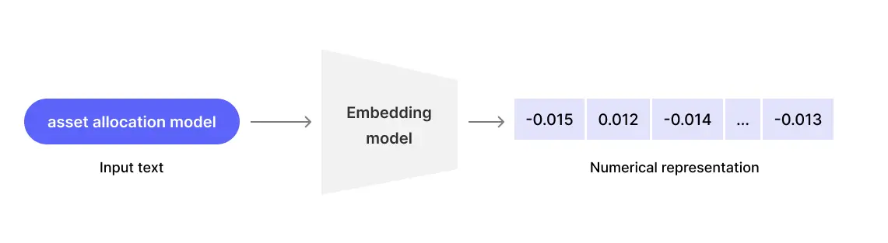
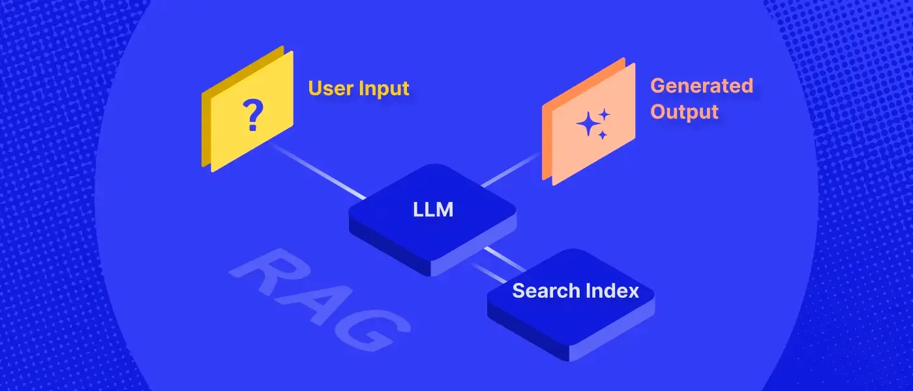
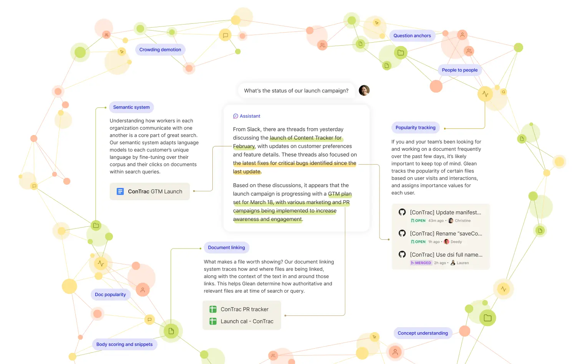
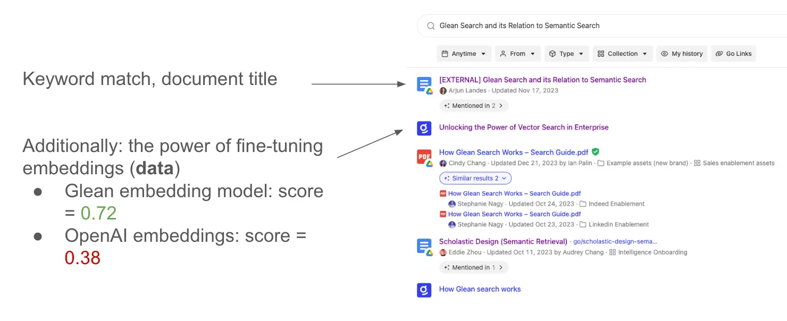
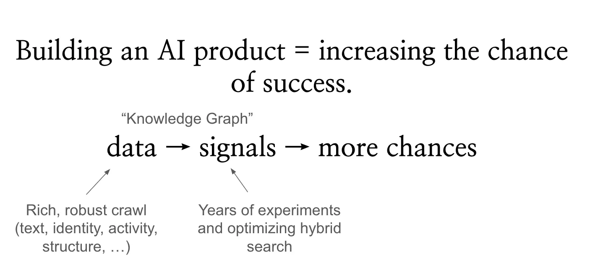
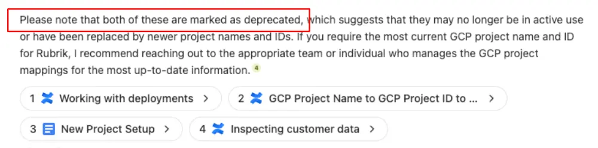
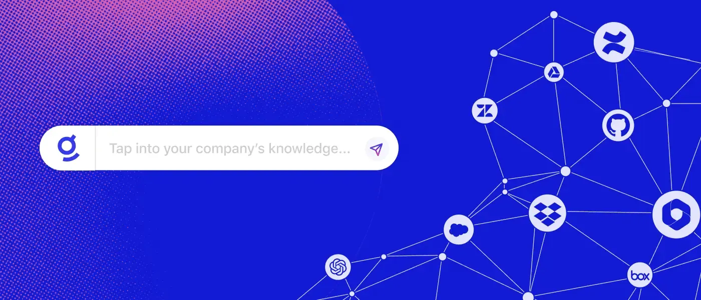

## Key Takeaways / 核心洞察

> 阅读笔记（凡哥）：以下 1 点为归档时补充的解读与引申，非原文内容；原文全文与逐段中英对照见下文。

### 1. Hybrid search: precision × recall / 混合搜索：准确率与召回率兼得

这是一篇 2024 年 5 月的文章，但把「为什么简单 RAG + 向量库不够」讲到了可落地的信号粒度。**文档明确写出的内容**：纯向量搜索把文本映射成固定数值向量、按向量空间距离召回，虽带来语义理解的跃迁，却无法识别组织内内容、人员、活动之间的复杂连接；纯词法（lexical）搜索只做词/短语精确匹配，遇到拼写错误或口语化提问就失效。混合搜索同时拿到两者 —— 准确率（precision）来自关键词匹配，能命中用户输入的精确术语、ID 或标题；召回率（recall）来自语义匹配，措辞不同也能捞出相关文档；当数据横跨 Slack 消息、文档、工单和 wiki 时，两者缺一不可。在此之上，知识图谱是一张由 signals 与 anchors 组成的网络，为文档、人员、活动补足上下文，文章直接列了 9 类信号（normalization、synonymy、structured annotation、国际化、意图分类、文档理解、检索与主题性含 clickboost/hybrid optimization、流行度与新鲜度/部门建模等）。Glean 自列的 4 个技术差异是：知识图谱框架、连接全部企业数据与权限规则的 crawler、LLM 与搜索界面之间的控制层、以及端到端用户体验优化。最直观的证据是 Scholastic 一例：标准向量 RAG 把它答成「纽约的童书出版社」，而 Glean 的混合 RAG 能答出它是内部的向量检索打分系统；再加上 LLM 与搜索界面联动，连检索未命中（retrieval misses）也能给出注意事项和下一步，而不是硬编一个过期答案。

**需要校准的一点**：原文写的是「词法/关键词检索 + 语义向量检索」两类检索混合，知识图谱提供的是上下文与排序信号网络，并非并列的第三种检索方式；把它概括成「RAG + 关键词 + 图谱搜索」是便于理解的 shorthand。（笔记作者的引申，非原文措辞：把向量检索看作「扁平的语义向量空间」、把图谱看作「立体的关系空间」，对应原文里的 `vector space` 与 `network of signals and anchors`；端到端体验提升不是换一个更好的向量库，而是「检索层混合 + 图谱上下文 + LLM/界面联动」三层叠加的结果。文章虽是 2024 年，仍可作为企业 AI 搜索检索层的基线材料回看。）

> 作者: Arvind Jain（CEO） | 页面日期: May 15, 2024（Last updated） | 阅读时长: 5 分钟

> 原文链接: https://www.glean.com/blog/hybrid-vs-rag-vector

Ever since generative AI and LLMs took center stage in the world, workers have been wondering how best to apply these transformative new tools to their workflows. However, many of them ran into similar problems while trying to integrate generative AI into enterprise environments, like privacy breaches, lack of relevance, and a need for better personalization in the results they received.

自生成式 AI 与 LLM 成为焦点以来，员工们一直在思考如何把这些变革性工具用到自己的工作流里。但很多人尝试把生成式 AI 接入企业环境时，都撞上了类似的问题：隐私泄露、结果不相关，以及结果需要更好的个性化。

To address this, most have concluded that the answer lies in [retrieval augmented generation (RAG)](https://www.glean.com/blog/hybrid-vs-rag-vector). RAG separates knowledge retrieval from the generation process via external discovery systems like enterprise search. This enables LLMs and the responses they provide to be grounded in real, external enterprise knowledge that can be readily surfaced, traced, and referenced.

为此，多数人得出的结论是答案在于[检索增强生成（RAG）](https://www.glean.com/blog/hybrid-vs-rag-vector)。RAG 通过企业搜索之类的外部发现系统，把知识检索与生成过程拆开，让 LLM 及其回答能够锚定在真实、外部的企业知识上，并且这些知识可以被轻松呈现、追溯和引用。

### Vector or lexical search alone isn’t enough / 只有向量搜索或词法搜索都不够

Now that enterprises understand that generative AI solutions require a separate retrieval solution, many ask—*why don’t we just put our content into a vector database and implement a simple RAG prompt?* The answer unfortunately isn’t so simple, particularly when it comes to delivering a truly enterprise-ready experience.

既然企业已经明白生成式 AI 方案需要一个独立的检索方案，很多人会问：为什么不直接把内容塞进向量数据库、写一个简单的 RAG prompt 呢？可惜答案没这么简单，尤其当目标交付的是真正企业可用的体验时。

Let’s briefly explore how [vector search](https://www.glean.com/blog/guide-to-vector-search) and databases work for data indexing and retrieval. Embedding models effectively map specific text to a fixed vector of numbers—given a set of words, the model will assign a numerical value that represents it within the database. Then, given a query's text, the system can compute how 'close' the text in the query is to pre-indexed document texts in that vector space, which it then pulls to display in the results.

先简单看看[向量搜索](https://www.glean.com/blog/guide-to-vector-search)和向量数据库如何做数据索引与检索。嵌入模型实际上把特定文本映射成一组固定长度的数值向量 —— 给定一组词，模型会为它分配一个在数据库中代表它的数值。之后给定查询文本，系统就能计算查询文本与已建立索引的文档文本在该向量空间中的「接近程度」，再把最接近的内容取出来展示在结果里。

*Embedding models map text to a fixed vector of numbers*

嵌入模型把文本映射成一组固定长度的数值向量

This step should simply serve as the information retrieval process. LLMs are then strictly used as a reasoning layer to initially call the search/retrieval engine, read limited context, then distill and generate coherent responses given the right information via the vector database.

这一步应当只承担信息检索。LLM 则严格作为推理层：先调用搜索／检索引擎、读取有限的上下文，再基于向量数据库提供的正确信息提炼并生成连贯的回答。

*Retrieval Augmented Generation (RAG)*

检索增强生成（RAG）流程

Although improvements in vector search signal a fundamental shift in semantic understanding, it’s a small piece of the puzzle in delivering high-quality results for enterprise search. Alone, simple vector search is incapable of recognizing the more complex connections between all the content, people, and activity within an organization.

虽然向量搜索的进步标志着语义理解的根本性转变，但它只是「交付高质量企业搜索结果」这块拼图中的一小片。单靠简单的向量搜索，无法识别一个组织内所有内容、人员与活动之间更复杂的连接。

Even more dated are simple lexical search systems, which instead match query terms directly against document content and metadata terms. Although easy to implement, they’re only capable of utilizing exact matches of words or phrases in a database, which poses serious limitations—particularly in the face of human errors when providing queries.

更过时的是简单的词法搜索系统，它们直接把查询词与文档内容和元数据词做匹配。虽然容易实现，却只能利用数据库中词或短语的精确匹配，局限很大 —— 尤其面对用户提问时的人为错误（拼写、表述偏差）。

### Improved results with hybrid search / 混合搜索带来更好的结果

Hybrid search wins in the enterprise because it delivers both precision and recall. Precision comes from keyword matching that catches the exact term, ID, or title a user typed. Recall comes from semantic matching that surfaces relevant documents even when the wording differs. You need both when your data spans Slack messages, docs, tickets, and wikis.

混合搜索在企业场景中胜出，因为它同时交付准确率与召回率。准确率来自关键词匹配，能命中用户输入的精确术语、ID 或标题；召回率来自语义匹配，即使措辞不同也能捞出相关文档。当你的数据横跨 Slack 消息、文档、工单和 wiki 时，两者都需要。

A hybrid search system can combine the strengths of both. Glean's complex RAG solution has four core technical differentiators that set its hybrid search and generative AI apart:

混合搜索系统可以把两者的优势结合起来。Glean 的复杂 RAG 方案有 4 个核心技术差异，让它的混合搜索与生成式 AI 与众不同：

- **Knowledge graph framework** for all enterprise data, with proprietary anchors and signals that powers search / 面向全部企业数据的知识图谱框架，以专有的锚点与信号驱动搜索
- Rich, scalable **crawler** connecting to all enterprise data and permissioning rules / 丰富且可规模化的抓取器，连接所有企业数据与权限规则
- Levels for controlling and optimizing the LLM to Glean's **search interface** / 面向 Glean 搜索界面，对 LLM 进行控制和调优的多层机制
- End-to-end **user experience optimization** / 端到端的用户体验优化

Central to Glean's results is the [knowledge graph](https://www.glean.com/resources/guides/glean-knowledge-graph), a network of signals and anchors that work together to address the problems a builder has to solve. These factors give Glean the rich context behind the documents, people, and activity within an organization, which helps models deliver better results. Signals and anchors are like the clues you need to solve a mystery. The more a solution has to work with, the better the result.

Glean 搜索结果的核心是[知识图谱](https://www.glean.com/resources/guides/glean-knowledge-graph)—— 一张由信号与锚点组成的网络，共同解决构建者必须面对的问题。这些因素为 Glean 提供了组织内文档、人员与活动背后的丰富上下文，帮助模型给出更好的结果。信号和锚点就像破案所需的线索：方案手里的线索越多，结果越好。

For example, Glean's signals actively solve individual search and personalization problems like:

举例来说，Glean 的信号会主动解决一个个具体的搜索与个性化问题：

- Normalization (tokenization, stemming, lemmatization) / 归一化（分词、词干提取、词形还原）
- Synonymy (mining, contextual scoring, acronyms) / 同义关系（挖掘、上下文打分、缩写）
- Structured annotation (concept and entity mining and scoring) / 结构化标注（概念与实体挖掘及打分）
- Internationalization / 国际化
- Intent classification / 意图分类
- Document understanding (salient terms, topic modeling, handling templates, document classification) / 文档理解（显著词、主题建模、模板处理、文档分类）
- Retrieval and topicality (semantic search, term weighting, optionalization, term mixing, anchors, clickboost, hybrid optimization) / 检索与主题性（语义搜索、词项加权、可选化、词项混合、锚点、点击加权 clickboost、混合优化）
- Popularity (personalization, staleness/freshness, department modeling) / 流行度（个性化、陈旧度／新鲜度、部门建模）
- Etc… / 等等

So what's the difference between a system with a complex RAG solution and one without? Here's a quick example of generated results.

那么，有复杂 RAG 方案的系统和没有的系统，差别在哪？来看一个生成结果的简短例子。

At Glean, Scholastic is our approach to integrating semantic search into ranking stacks, focused on retrieval and scoring based on titles, anchors, and headers. Here's what a standard RAG solution might reply compared to Glean when asked about Scholastic:

在 Glean，Scholastic 是我们把语义搜索整合进排序体系的方法，侧重于基于标题、锚点和页眉做检索与打分。当被问到 Scholastic 时，标准 RAG 方案与 Glean 的回答对比如下：

*Countless anchors and signals help build unique knowledge graphs for each enterprise*

无数锚点与信号，共同构建出每家企业独有的知识图谱

So what’s the noticeable difference between a system with a complex RAG solution, and one without? Let’s take a look at a quick example of some generated results.

那么，有复杂 RAG 方案的系统和没有的系统，最明显的差别是什么？来看一个生成结果的简短例子。

Here at Glean, **Scholastic** serves as our approach to integrating semantic search into ranking stacks, focusing on retrieval and scoring based on titles, anchors, and headers. Let’s see what a standard RAG solution might reply in comparison to Glean when asked about Scholastic:

在 Glean，**Scholastic** 是我们把语义搜索整合进排序体系的方法，侧重于基于标题、锚点和页眉做检索与打分。来看看当被问到 Scholastic 时，标准 RAG 方案与 Glean 分别会怎么回答：

**Standard (Vector, simple RAG)**
**Q:** What is Scholastic?
**A:** Scholastic, located in New York City, New York, is a publisher and distributor of children's books, educational technology, and related services…

**Glean (Hybrid, complex RAG)**
**Q:** What is Scholastic?
**A:** Scholastic is our learned vector-based retrieval and scoring system (a play on our keyword-based system, Elastic). It learns item embeddings for documents and messages, and retrieves / scores nearest neighbors for a given query...

标准方案（向量、简单 RAG）
问：Scholastic 是什么？
答：Scholastic 位于纽约市，是一家儿童图书、教育科技及相关服务的出版与发行商……

Glean（混合、复杂 RAG）
问：Scholastic 是什么？
答：Scholastic 是我们基于学习的向量检索与打分系统（名字取自我们基于关键词的系统 Elastic）。它学习文档与消息的条目嵌入，并针对给定查询检索／打分最近邻……

The standard response is completely irrelevant for a workplace query, while Glean’s response understands the assignment and provides exactly what the user is looking for.

对一个职场场景的提问来说，标准方案的回答完全不相关，而 Glean 的回答理解了问题，给出的正是用户要找的东西。

Whether they’re responses delivered by generative AI, or results provided within a search, hybrid, complex RAG solutions augmented by networks of signals and anchors definitively deliver better results than incomplete lexical or vector search solutions. The capability of utilizing proprietary data as the keys and clues to fine-tuning models provides the rich contextualization that enterprise environments need from search and generative AI solutions.

无论输出的是生成式 AI 的回答，还是搜索里的结果，由信号与锚点网络增强的混合、复杂 RAG 方案，结果都确定优于不完整的词法或向量搜索方案。能把专有数据当作微调模型的钥匙与线索，正是企业环境对搜索与生成式 AI 方案所要求的丰富上下文化能力。

*Proprietary data is key to fine-tuning and embedding scores*

专有数据是微调与嵌入打分的关键

In the realm of enterprise search, it's also evident that relying solely on vector or semantic search may not always yield the most optimal results. This is particularly true in scenarios where there's a need for precision—such as when searching for specific terms, documents, or keywords. Vector search, with its inherent fuzziness, might not always align with the precision required in these instances.

在企业搜索领域还有一点很明显：只依赖向量或语义搜索，未必总能得到最优结果。在需要准确率的场景尤其如此 —— 例如搜索特定术语、某篇文档或某个关键词。向量搜索自带模糊性，未必能满足这类场景对精确度的要求。

*It takes signals and anchors, not just raw data, for AI to deliver success*

要让 AI 真正奏效，靠的是信号与锚点，而不只是原始数据

For Glean, our lexical search capabilities also stand out due to the robustness of our data. This strength allows us to not only match queries with high accuracy but also to personalize results amidst a plethora of potential matches. The hybrid search approach that Glean employs marries the best of both worlds, leveraging the precision of lexical search and the nuanced understanding of vector search—all powered by the additional context and nuance provided by the signals and anchors within our knowledge graph.

对 Glean 来说，词法搜索能力同样因数据的扎实而突出。这一优势让我们不仅能高精度地匹配查询，还能在大量潜在匹配中做个性化排序。Glean 采用的混合搜索方案兼取两者之长：既有词法搜索的精确，又有向量搜索细致入微的理解 —— 而背后都由知识图谱中的信号与锚点提供额外上下文与细微差别。

To top it off, Glean’s capability of linking LLMs with our proprietary search interface enables us to handle search and retrieval misses much more gracefully. LLMs integrated with our search interface handle search and retrieval misses much more eloquently. For example, most third-party solutions, when faced with a question they cannot adequately answer, often provide poor information that isn’t fresh or relevant.

更上一层的是，Glean 把 LLM 与自有搜索界面连接起来的能力，让我们能更从容地处理搜索与检索未命中的情况。与搜索界面集成的 LLM 会把这类「没找到」处理得更得体。举例来说，多数第三方方案遇到自己无法充分回答的问题时，往往给出既不新鲜也不相关的糟糕信息。

When it comes to Glean, however, LLMs are provided the additional context they need to clarify caveats and precautions. This additional information enables AI to empower workers with the additional information they need to pursue next steps, or better understand why information they’re receiving may be incomplete.

而在 Glean，LLM 会拿到它需要的额外上下文，用来说明限制条件与注意事项。这些额外信息让 AI 能帮助员工获得推进下一步所需的上下文，或更好理解为什么拿到的信息可能并不完整。

*Glean’s knowledge graph provides additional context for deprecated results*

Glean 的知识图谱为已废弃（deprecated）的结果补充上下文

### The better way forward / 更好的前进方向

If you’re looking to stay ahead of the curve by harnessing the potential of generative AI now and today, Glean is the best way to do it. Glean is always permissions aware, relevant and personalized, fresh and current, as well as universally applicable with your most used applications.

如果你希望现在就借生成式 AI 的潜力保持领先，Glean 是最好的方式。Glean 始终感知权限、结果相关且个性化、内容新鲜及时，并普遍适用于你最常用的应用。

Supercharge your team’s productivity with a generative AI solution that’s truly enterprise-ready. Sign up for a [demo](https://www.glean.com/get-a-demo) today!

用一套真正企业可用的生成式 AI 方案，大幅释放团队生产力。今天就预约[演示](https://www.glean.com/get-a-demo)吧！

