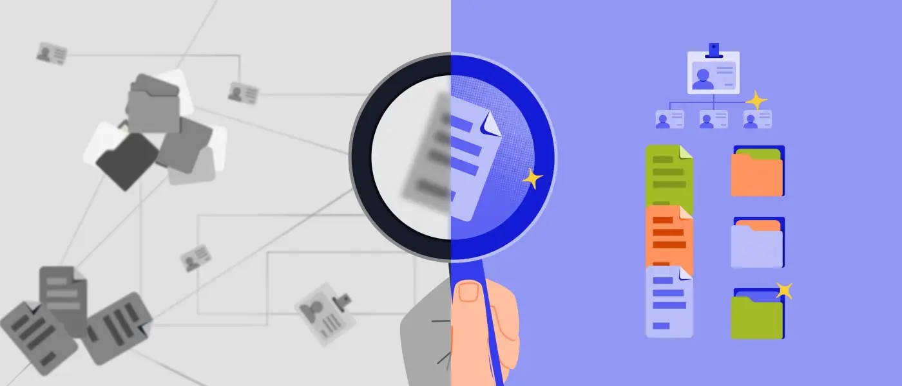
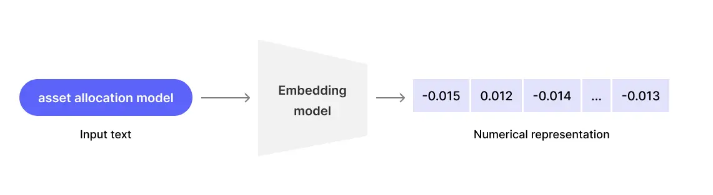
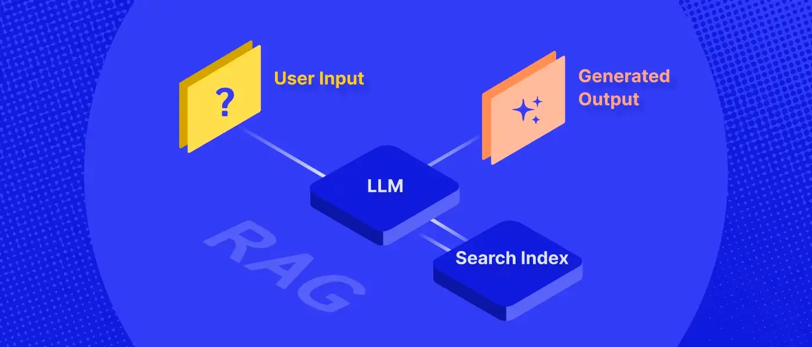
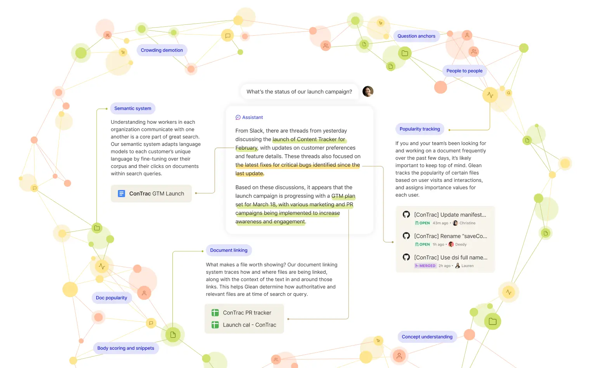
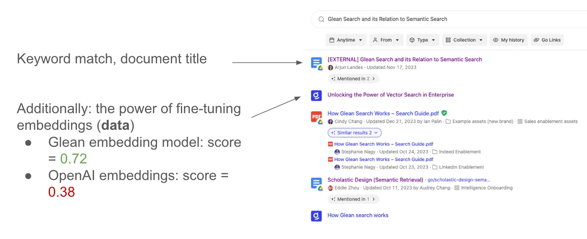
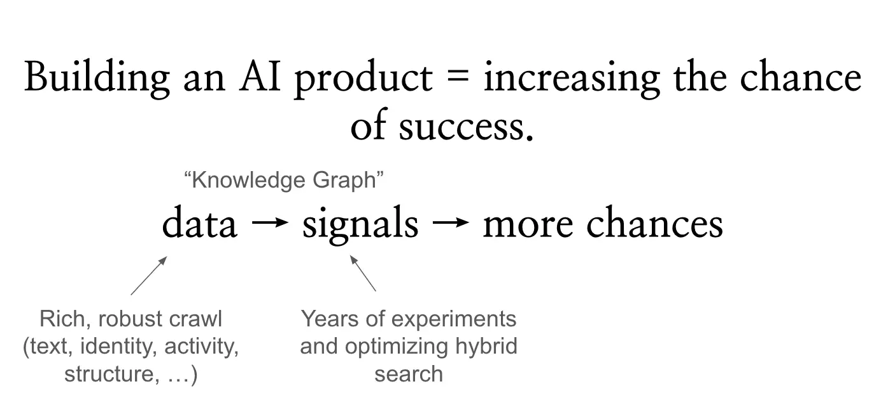
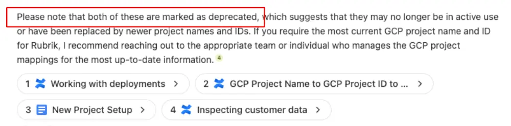
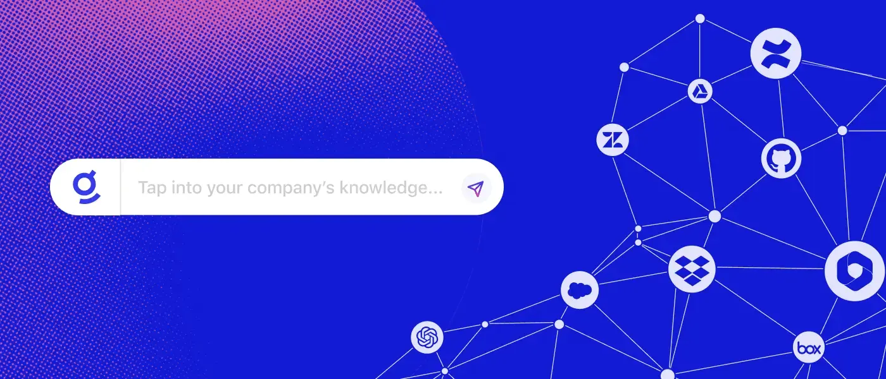

# What sets great retrieval augmented generation apart — and why vector search isn’t enough for AI

*See how Glean works.*

> 作者: Arvind Jain

CEO | 日期: May 15, 2024

> 原文链接: https://www.glean.com/blog/hybrid-vs-rag-vector

---

5minutes read[Arvind Jain

CEO](/authors/arvind-jain)

### Table of contents

[Vector or lexical search alone isn’t enough](#vector-or-lexical-search-alone-isnt-enough)[Improved results with hybrid search](#improved-results-with-hybrid-search)[The better way forward](#the-better-way-forward)[Have questions or want a demo?We’re here to help! Click the button below and we’ll be in touch.Get a Demo](/get-a-demo)Share this article:

Ever since generative AI and LLMs took center stage in the world, workers have been wondering how best to apply these transformative new tools to their workflows. However, many of them ran into similar problems while trying to integrate generative AI into enterprise environments, like privacy breaches, lack of relevance, and a need for better personalization in the results they received.

To address this, most have concluded that the answer lies in [retrieval augmented generation (RAG)](https://www.glean.com/blog/hybrid-vs-rag-vector). RAG separates knowledge retrieval from the generation process via external discovery systems like enterprise search. This enables LLMs and the responses they provide to be grounded in real, external enterprise knowledge that can be readily surfaced, traced, and referenced.

### Vector or lexical search alone isn’t enough

Now that enterprises understand that generative AI solutions require a separate retrieval solution, many ask—*why don’t we just put our content into a vector database and implement a simple RAG prompt?* The answer unfortunately isn’t so simple, particularly when it comes to delivering a truly enterprise-ready experience.

Let’s briefly explore how [vector search](https://www.glean.com/blog/guide-to-vector-search) and databases work for data indexing and retrieval. Embedding models effectively map specific text to a fixed vector of numbers—given a set of words, the model will assign a numerical value that represents it within the database. Then, given a query's text, the system can compute how 'close' the text in the query is to pre-indexed document texts in that vector space, which it then pulls to display in the results.

*Embedding models map text to a fixed vector of numbers*

This step should simply serve as the information retrieval process. LLMs are then strictly used as a reasoning layer to initially call the search/retrieval engine, read limited context, then distill and generate coherent responses given the right information via the vector database.

*Retrieval Augmented Generation (RAG)*

Although improvements in vector search signal a fundamental shift in semantic understanding, it’s a small piece of the puzzle in delivering high-quality results for enterprise search. Alone, simple vector search is incapable of recognizing the more complex connections between all the content, people, and activity within an organization.

Even more dated are simple lexical search systems, which instead match query terms directly against document content and metadata terms. Although easy to implement, they’re only capable of utilizing exact matches of words or phrases in a database, which poses serious limitations—particularly in the face of human errors when providing queries.

### Improved results with hybrid search

Hybrid search wins in the enterprise because it delivers both precision and recall. Precision comes from keyword matching that catches the exact term, ID, or title a user typed. Recall comes from semantic matching that surfaces relevant documents even when the wording differs. You need both when your data spans Slack messages, docs, tickets, and wikis.

A hybrid search system can combine the strengths of both. Glean's complex RAG solution has four core technical differentiators that set its hybrid search and generative AI apart:

- **Knowledge graph framework** for all enterprise data, with proprietary anchors and signals that powers search
- Rich, scalable **crawler** connecting to all enterprise data and permissioning rules
- Levels for controlling and optimizing the LLM to Glean's **search interface**
- End-to-end **user experience optimization**

Central to Glean's results is the [knowledge graph](https://www.glean.com/resources/guides/glean-knowledge-graph), a network of signals and anchors that work together to address the problems a builder has to solve. These factors give Glean the rich context behind the documents, people, and activity within an organization, which helps models deliver better results. Signals and anchors are like the clues you need to solve a mystery. The more a solution has to work with, the better the result.

For example, Glean's signals actively solve individual search and personalization problems like:

- Normalization (tokenization, stemming, lemmatization)
- Synonymy (mining, contextual scoring, acronyms)
- Structured annotation (concept and entity mining and scoring)
- Internationalization
- Intent classification
- Document understanding (salient terms, topic modeling, handling templates, document classification)
- Retrieval and topicality (semantic search, term weighting, optionalization, term mixing, anchors, clickboost, hybrid optimization)
- Popularity (personalization, staleness/freshness, department modeling)
- Etc…

So what's the difference between a system with a complex RAG solution and one without? Here's a quick example of generated results.

At Glean, Scholastic is our approach to integrating semantic search into ranking stacks, focused on retrieval and scoring based on titles, anchors, and headers. Here's what a standard RAG solution might reply compared to Glean when asked about Scholastic:

‍

*Countless anchors and signals help build unique knowledge graphs for each enterprise*

So what’s the noticeable difference between a system with a complex RAG solution, and one without? Let’s take a look at a quick example of some generated results.

Here at Glean, **Scholastic **serves as our approach to integrating semantic search into ranking stacks, focusing on retrieval and scoring based on titles, anchors, and headers. Let’s see what a standard RAG solution might reply in comparison to Glean when asked about Scholastic:

**Standard (Vector, simple RAG)**
**Q:** What is Scholastic? 
**A:** Scholastic, located in New York City, New York, is a publisher and distributor of children's books, educational technology, and related services…

**Glean (Hybrid, complex RAG)**
**Q:** What is Scholastic? 
**A:** Scholastic is our learned vector-based retrieval and scoring system (a play on our keyword-based system, Elastic). It learns item embeddings for documents and messages, and retrieves / scores nearest neighbors for a given query...

The standard response is completely irrelevant for a workplace query, while Glean’s response understands the assignment and provides exactly what the user is looking for.

Whether they’re responses delivered by generative AI, or results provided within a search, hybrid, complex RAG solutions augmented by networks of signals and anchors definitively deliver better results than incomplete lexical or vector search solutions. The capability of utilizing proprietary data as the keys and clues to fine-tuning models provides the rich contextualization that enterprise environments need from search and generative AI solutions.

*Proprietary data is key to fine-tuning and embedding scores*

In the realm of enterprise search, it's also evident that relying solely on vector or semantic search may not always yield the most optimal results. This is particularly true in scenarios where there's a need for precision—such as when searching for specific terms, documents, or keywords. Vector search, with its inherent fuzziness, might not always align with the precision required in these instances.

*It takes signals and anchors, not just raw data, for AI to deliver success*

For Glean, our lexical search capabilities also stand out due to the robustness of our data. This strength allows us to not only match queries with high accuracy but also to personalize results amidst a plethora of potential matches. The hybrid search approach that Glean employs marries the best of both worlds, leveraging the precision of lexical search and the nuanced understanding of vector search—all powered by the additional context and nuance provided by the signals and anchors within our knowledge graph.

To top it off, Glean’s capability of linking LLMs with our proprietary search interface enables us to handle search and retrieval misses much more gracefully. LLMs integrated with our search interface handle search and retrieval misses much more eloquently. For example, most third-party solutions, when faced with a question they cannot adequately answer, often provide poor information that isn’t fresh or relevant.

When it comes to Glean, however, LLMs are provided the additional context they need to clarify caveats and precautions. This additional information enables AI to empower workers with the additional information they need to pursue next steps, or better understand why information they’re receiving may be incomplete.

*Glean’s knowledge graph provides additional context for deprecated results*

### The better way forward

If you’re looking to stay ahead of the curve by harnessing the potential of generative AI now and today, Glean is the best way to do it. Glean is always permissions aware, relevant and personalized, fresh and current, as well as universally applicable with your most used applications.

Supercharge your team’s productivity with a generative AI solution that’s truly enterprise-ready. Sign up for a [demo](https://www.glean.com/get-a-demo) today!

[Back to all stories](/blog)

## 

[Get The Resource](#)

## 

[Get The Resource](#)Work AI for all.[Get a Demo](/get-a-demo)

