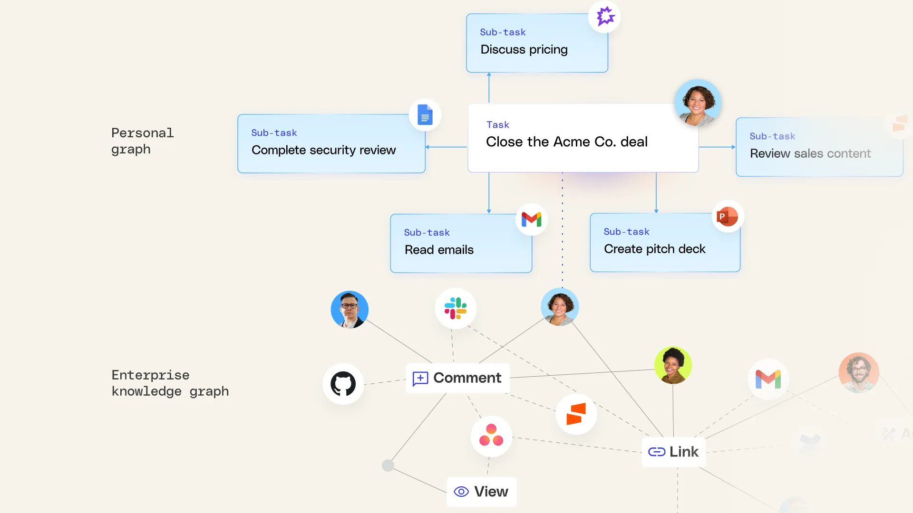
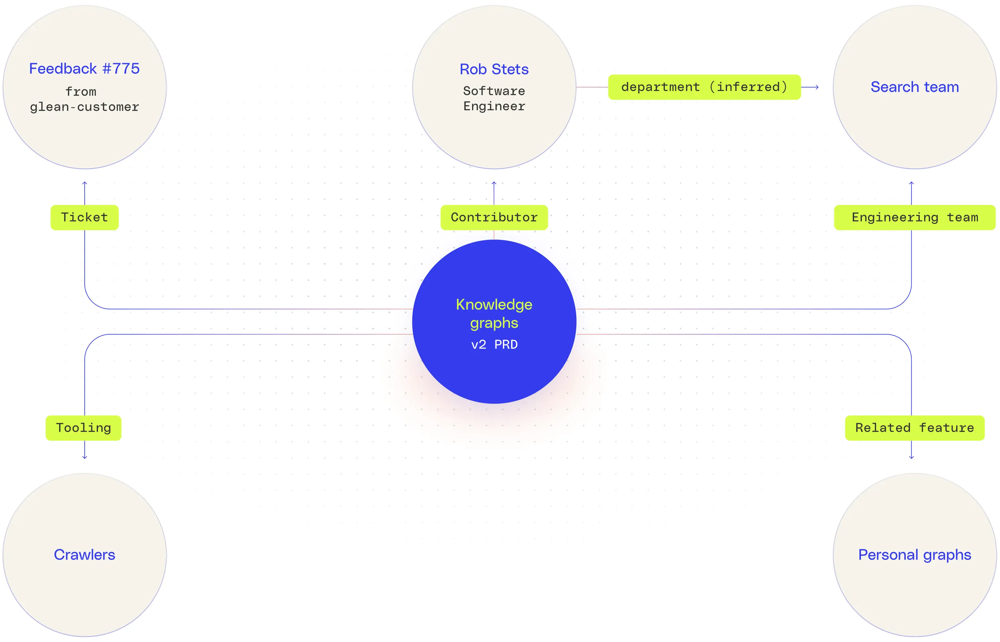
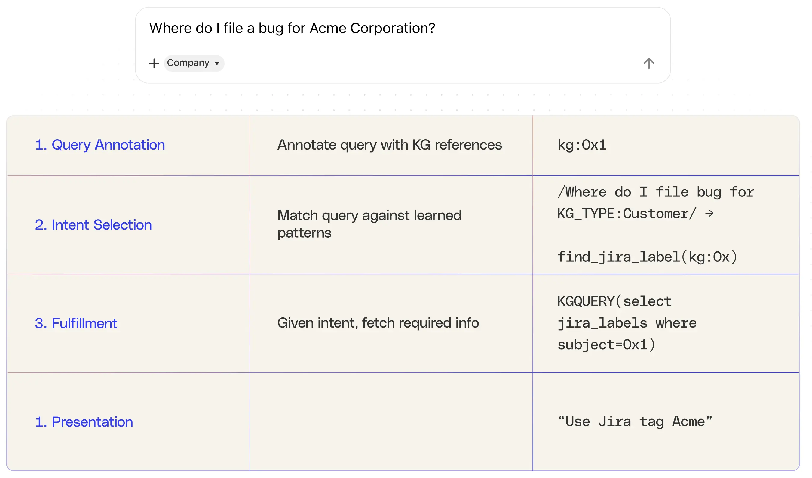
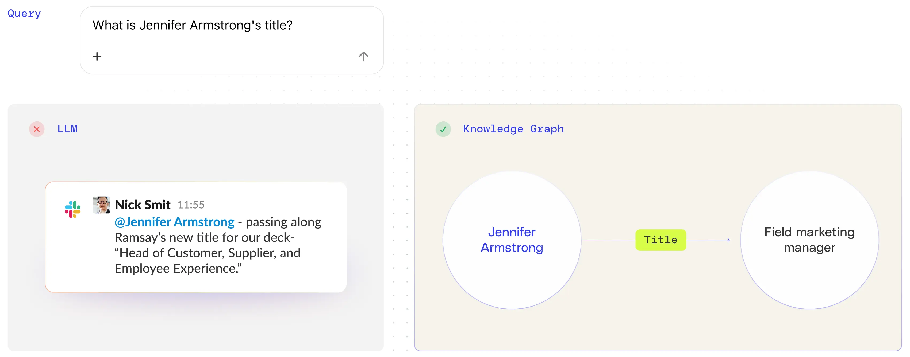
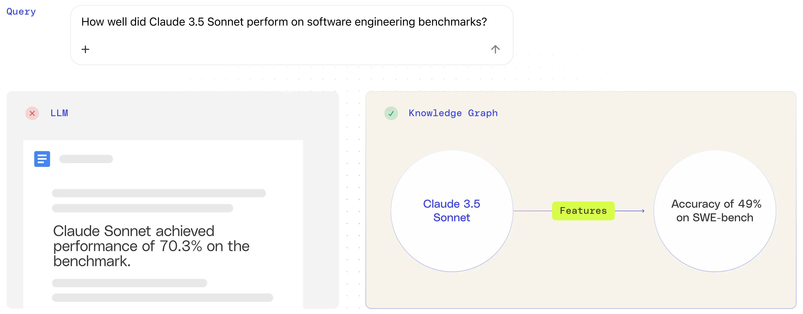
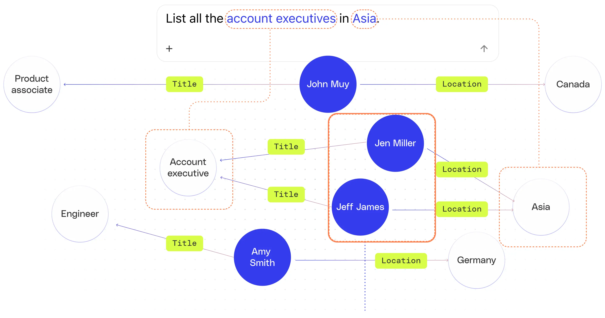
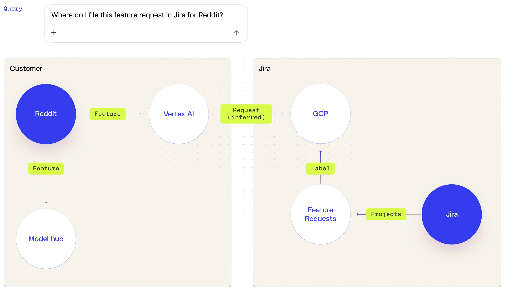
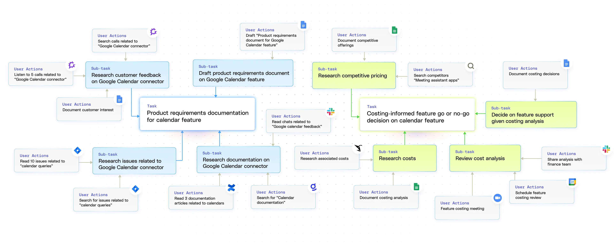
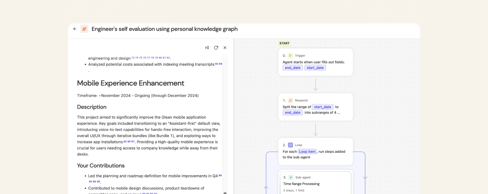

## Key Takeaways / 核心洞察

> 阅读笔记（凡哥）：以下 4 点为归档时补充的解读与引申，非原文内容；原文全文与逐段中英对照见下文。

### 1. Cases: where graphs earn their keep / 案例：图谱的价值边界

文章几乎没有空谈架构，而是用一连串具体案例把图谱的价值和 LLM 的短板讲得很形象：把 Reddit 当客户还是当社交平台、把 Claude 3.7 Sonnet 和 3.5 Sonnet v2 混成一个模型、把一场活动的组织者误认成部门负责人、列出亚洲所有客户主管这类确定性枚举查询、以及项目 X 相对 OKR 进展如何这种要把代码提交映射到业务目标的问题。共同结论是：LLM 不是万能的，它在精确事实召回、枚举、多跳推理和跨实体关系上不可靠，而知识图谱用结构化实体和已验证的关系把回答锚定住。

### 2. Edge properties and provenance / 边属性与来源溯源

文章点出一个容易略过但很关键的细节：三元组之外，每条边还能挂属性——时间戳、访问控制、置信度分数或来源信息（provenance）。例如不只记录「员工 A 汇报给经理 B」，还能记录这段汇报关系何时开始、这条信息是从日历、通讯录还是邮件线程推断出来的。引申一步：正因为来源可追溯，源文档更新时可以按 provenance 定位受影响的边并做增量刷新，而不必全量重建图谱，这是解决图谱更新问题的一个抓手。（文章只举了来源可追溯的例子，没有直接展开增量更新机制；增量刷新属于笔记作者的引申。）

### 3. LLMs over classical NLP and pattern matching / LLM 相比传统 NLP 与模式匹配

图谱构建的前两阶段是实体标注和意图识别。传统做法靠半自动学习：人工播种 find Jira label 这类查询模式，再分析查询日志扩展同一意图的其他说法，本质上是大规模模式匹配；经典机器学习也难以把日历邀请和相关文档编辑这类跨源活动信号统一起来。LLM 出现后，这两个阶段显著更强大、更自动化，不必再手工写模式和消歧规则。（按你的归纳对应传统 NLP / 强化学习路线；文章原词是 semi-automated learning、pattern matching、classical machine learning，未出现 reinforcement learning 一词。）

### 4. The personal graph: real work, not chat history / 个人图谱：建模真实工作而非会话记忆

个人图谱的目标是建模真实工作——识别活跃项目、协作模式和进行中的任务——从而让 Glean 开始提供主动协助，比如突出优先事项、提示冲突、帮人保持条理。它把每个原子动作聚成子任务、再卷成「起草产品简报」这类高层任务，按主题关联到 OKR，还能从评论互动、共享 Slack 频道里看出谁和谁在协作。与典型 AI 聊天工具依赖会话历史的记忆系统不同，个人图谱全面审视个体跨工具、跨系统、跨时间的数字活动，并纳入阅读行为和被动消费信号。

> 作者: Rob Stets（Software Engineer）、Pradeep Vaghela（Software Engineer）、Julie Mills（PMM） | 页面日期: Jun 27, 2025（Last updated） | 阅读时长: 12 分钟

> 原文链接: https://www.glean.com/blog/knowledge-graph-agentic-engine

Building agents that can reliably take action in the enterprise requires systems that mirror how humans make sense of information—by connecting what they read to the people, processes, tools, projects, and strategies around them. These associations come naturally to humans; it’s how we unpack complexity and conflicting information in order to make decisions. For LLMs to do the same, they not only need to reason like humans—they need to use knowledge like humans. That’s why the foundation of every great agentic engine is a knowledge graph that provides models with the right context.

要让智能体在企业里可靠地采取行动，系统必须像人理解信息那样工作——把读到的内容和相关的人、流程、工具、项目、战略联系起来。这种关联对人类是本能，也是我们拆解复杂性、处理相互矛盾的信息并做出决策的方式。LLM 要能做到同样的事，不仅要像人一样推理，还要像人一样使用知识。因此，每一个优秀的智能体引擎，底座都是一个能为模型提供正确上下文的知识图谱。

At Glean, we’ve expanded our knowledge graph with a new layer— a personal graph—which better understands human context at work. It takes personalization beyond chat history by understanding your approach to different types of work and tailoring AI appropriately. Together, these graphs, along with Glean’s hybrid search architecture, form the [system of context](https://www.glean.com/product/system-of-context): a reflection of how each organization works that enables AI to work better for everyone in it.

在 Glean，我们给知识图谱加了一个新层——个人图谱，用来更好地理解人在工作中的上下文。它不止依赖聊天记录，而是理解你处理不同类型工作的方式，据此调整 AI 的表现。这些图谱与 Glean 的混合搜索架构一起，构成了 system of context（上下文系统）：它映照出每个组织的运作方式，让 AI 能为组织里的每个人更好地工作。

## What is a knowledge graph? / 什么是知识图谱？

A knowledge graph is a structured representation of information that captures entities and the relationships between them in a machine-readable format. In enterprise context, knowledge graphs serve as a foundational abstraction layer that connects fragmented data—spanning people, documents, tools, projects, and systems—into a cohesive network. Unlike search indexes, knowledge graphs focus on not just content, but relationships like between customers and support tickets, making them uniquely suited for grounding enterprise AI systems in contextual knowledge.

知识图谱是用机器可读的方式，把实体以及实体之间的关系结构化地表示出来。在企业场景里，知识图谱是基础抽象层，把分散在人、文档、工具、项目和系统之间的数据连成一张有机的网络。与搜索索引不同，知识图谱关注的不只是内容，还有关系，比如客户与支持工单之间的关系，因此特别适合为企业 AI 系统提供上下文知识作为依据。

At the core of a knowledge graph is the triplet structure: (subject, predicate, object). This encodes specific facts or relationships, such as (Engineer A, owns, Jira Ticket B) or (Document X, references, Project Y). These semantic triples form the edges of a graph, which can be traversed to infer additional knowledge or resolve complex queries. In enterprise scenarios, this is surfacing nuanced insights across organizational silos—such as identifying how a product release ties to roadmap documents, contributors, support cases, and customer feedback.

知识图谱的核心是三元组结构：（主语，谓词，宾语）。它编码具体的事实或关系，例如（工程师 A，拥有，Jira 工单 B）或（文档 X，引用，项目 Y）。这些语义三元组构成图的边，可以沿边遍历来推断更多知识或解答复杂查询。在企业场景里，这意味着能跨组织孤岛发现细微洞察，比如看清一次产品发布如何关联到路线图文档、贡献者、支持案例和客户反馈。

The expressiveness of a knowledge graph includes additional facts alongside relationships. Edge properties—such as timestamps, access control, confidence scores, or provenance—can be attached to each relationship, enabling systems to reason with metadata critical for enterprise governance. For example, not only can the graph represent that (Employee A, reports to, Manager B), but it can also track when that reporting relationship began, or whether the information was inferred from a calendar, directory, or email thread. The entire graph in Glean is designed with fine-grain access controls so employees can only see the data that is already shared with them in the source system.

知识图谱的表达力还包括关系之外附加的事实。每条关系都能挂上边属性——例如时间戳、访问控制、置信度分数或来源信息（provenance）——让系统可以基于这些对企业治理至关重要的元数据做推理。举例来说，图里不仅能表示（员工 A，汇报给，经理 B），还能记录这段汇报关系从何时开始，以及这条信息是从日历、通讯录还是邮件线程推断出来的。Glean 的整张图都按细粒度访问控制设计，员工只能看到源系统里本就与他共享的数据。

In practice, enterprise knowledge graphs enable information retrieval across data siloes and avoids hallucinations that are common in semantic search. They serve as the connective tissue of contextual intelligence—enabling AI agents and assistants to understand how data relates.

在实践中，企业知识图谱让跨数据孤岛的信息检索成为可能，也避免了语义搜索里常见的幻觉。它是上下文智能的结缔组织，让 AI 智能体和助手理解数据之间是如何关联的。

## How knowledge graphs work / 知识图谱如何工作

Creating a knowledge graph in the enterprise starts with extracting and identifying meaningful entities from natural language input. Take the example of the word “Reddit.” While it may seem simple, “Reddit” could refer to entirely different entities depending on context. If mentioned by an account manager in the sales organization, it likely refers to a customer. In a marketing conversation, it might point to advertising spend on the social media site “Reddit.” Disambiguating these meanings requires context-aware annotation that considers the user’s role, intent, and surrounding content to correctly identify and map the entity in the knowledge graph.

在企业里构建知识图谱，第一步是从自然语言输入中抽取并识别有意义的实体。以「Reddit」这个词为例，看着简单，但在不同上下文里它可能指向完全不同的实体。如果是销售组织的客户经理提起，多半指某个客户；如果出现在市场讨论里，可能指在社交平台 Reddit 上投的广告。要消歧，就需要结合用户角色、意图和上下文内容做标注，才能把实体正确识别并映射进知识图谱。

Once the entity is annotated, the next step is to understand the intent behind the query. This involves translating the natural language query into a structured representation that can be executed programmatically. Traditionally, this was achieved through semi-automated learning. Human operators would seed known query patterns—such as “find Jira label”—and use them to identify common intents. These seed queries would then be expanded by analyzing query logs to discover other phrasings that map to the same intent. This process resembles large-scale pattern matching, where intent is linked to known entities and query types based on recurring structures in language.

实体标注完，下一步是理解查询背后的意图：把自然语言查询转成可编程执行的结构化表示。传统上这一步靠半自动学习完成——由人工先播种已知的查询模式（比如「find Jira label」）来识别常见意图，再分析查询日志，把映射到同一意图的其他说法扩展进来。这个过程本质上接近大规模模式匹配：依据语言中反复出现的结构，把意图关联到已知实体和查询类型上。

The third phase involves taking the structured intent and executing the appropriate action, often by querying the knowledge graph. For example, a structured query like “find the Jira labels used by Reddit” can be issued to retrieve relevant information. This fulfillment step is where the graph structure proves essential: it enables the system to retrieve precise information by traversing relationships between entities in the graph.

第三阶段是拿结构化意图去执行相应动作，通常是查询知识图谱。例如可以发出「找出 Reddit 使用的 Jira 标签」这样的结构化查询来取回信息。到了这个执行环节，图结构就显得不可或缺：系统能沿实体间的关系遍历，精确取回信息。

With the introduction of LLMs, the first two phases—entity annotation and intent recognition—have become significantly more powerful and automated. LLMs excel at parsing natural language, reducing the need for manual pattern creation and rule-based disambiguation.

LLM 出现后，前两个阶段——实体标注和意图识别——变得强大得多，也自动化得多。LLM 擅长解析自然语言，不再需要大量手工编写模式和基于规则的消歧。

At Glean, we’ve expanded our graph to support thousands of edges with the help of LLMs. Even with LLMs, knowledge graphs are no easy feat to create. More on that later.

在 Glean，我们借助 LLM 把图谱扩展到支持数千种边。不过即便有了 LLM，构建知识图谱依然不轻松，后面会展开。

## Where LLMs fall short in enterprise AI use cases / LLM 在企业 AI 场景中的短板

LLMs are effective at capturing broad semantic associations within their context window, but they struggle with multi-hop reasoning, enterprise-specific language, and understanding process or usage patterns. As a result, LLM-based data extraction tends to be inherently lossy.

LLM 擅长在上下文窗口里捕捉宽泛的语义关联，但在多跳推理、企业特有语言、以及理解流程与使用模式上吃力。因此，基于 LLM 的数据抽取往往天然是有损的。

On their own, LLMs struggle with precise fact recall and tasks that require enumeration—like answering “Who contributed to Project X?” or “List all Jira labels for Customer ABC.” In addition, LLMs may misinterpret natural language or misclassify the user’s intent—issues rooted in NLP misfires. This is where knowledge graphs step in: by grounding responses in structured relationships and verified entities, they help mitigate ambiguity and improve reliability.

单靠 LLM，精确事实召回和需要枚举的任务都很难做好，比如回答「谁参与了项目 X？」或「列出客户 ABC 的所有 Jira 标签」。此外，LLM 还可能误解自然语言或错判用户意图，根源都在 NLP 失误。这正是知识图谱的用武之地：把回答锚定在结构化关系和已验证的实体上，减少歧义、提升可靠性。

### LLMs (over)weight the closeness of terms / LLM 会（过度）依赖词语的相近程度

In enterprise environments, LLMs often struggle with precision, overweighing the closeness of terms. Take, for example, a fictional user, Jennifer Armstrong, a field marketing manager. In a recent query, Jennifer was incorrectly identified as the Head of Customer Supplier and Employee Experience. Tracing the issue back, the LLM had misinterpreted a Slack message about an event she organized, assigning her an incorrect title.

在企业环境里，LLM 常常因为过度看重词语的相近程度而损失精度。举个虚构的例子：区域市场经理 Jennifer Armstrong 在一次查询中被错误地认成了「客户、供应商与员工体验负责人」。追溯下来，是 LLM 误读了一条关于她组织某场活动的 Slack 消息，给她安了一个错误的头衔。

### LLMs conflate entities with similar names / LLM 会混淆名称相近的实体

A similar problem occurs with product naming. Claude 3.7 Sonnet and Claude 3.5 Sonnet v2 are distinct models, but LLMs frequently conflate the two, merging their features or documentation into a single, incorrect answer. Without structural disambiguation, even subtle differences between model versions are easy to misrepresent.

产品命名上也有类似问题。Claude 3.7 Sonnet 和 Claude 3.5 Sonnet v2 是两个不同的模型，但 LLM 经常把两者混为一谈，把特性或文档并进一个错误答案里。没有结构化的消歧，连模型版本间的细微差别都很容易被讲错。

### LLMs struggle with deterministic queries / LLM 难以处理确定性查询

Knowledge graphs help mitigate these issues by grounding queries in known, structured entities. As illustrated in the following diagram, when asked to “List all of the account executives in Asia,” the knowledge graph can identify the query terms “account executives” as a specific job role, as opposed to a general description, and “Asia” as a location. With this information, the system can then perform an exhaustive, deterministic structured query for all employees with the Account Executive role and location in Asia. This is something that LLMs alone struggle to do consistently.

知识图谱把查询锚定在已知的结构化实体上，从而缓解这些问题。如下图所示，当被问到「列出亚洲所有的客户主管」时，知识图谱能把「客户主管」识别为一个具体职位而非泛泛的描述，把「亚洲」识别为地点。有了这些信息，系统就能执行穷尽的、确定性的结构化查询，找出职位为客户主管且地点在亚洲的所有员工。这件事单靠 LLM 很难稳定做到。

### LLMs have a hard time with cross-entity relationships / LLM 难以处理跨实体关系

In more complex tasks—like answering “Where do I file feature requests for Reddit?”—LLMs must disambiguate between Reddit the social platform and Reddit the enterprise customer, recognize that the process involves Jira, and chain these understandings into a coherent workflow. This level of relational reasoning and multi-hop inference is difficult to achieve reliably without a machine-readable knowledge graph that maps these entities, roles, and systems together.

在更复杂的任务里，比如回答「Reddit 的功能需求该提到哪里？」，LLM 得先区分作为社交平台的 Reddit 和作为企业客户的 Reddit，再意识到这个流程要用 Jira，最后把这些理解串成一条连贯的工作流。如果没有一张机器可读的、把这些实体、角色和系统都映射在一起的知识图谱，这种关系推理和多跳推断很难稳定做到。

There’s a continuum of reliability in LLMs. For simple fact recall, LLMs can provide reliable, correct answers—sometimes 100% of the time, especially when the answer is explicit and nearby in accessible context. For more complex, multi-hop, or indirect inferences (“Show all codebases for projects led by X that shipped in Q1 2025”), LLMs become less reliable. Sometimes they can answer correctly, if everything aligns, but often they hallucinate or miss connections. There’s a long tail of difficult or nuanced questions falling outside the zone where LLMs are robust—this is where performance drops sharply and where knowledge graphs reign.

LLM 的可靠性是一个连续谱。简单的事实召回，尤其当答案显式地出现在可访问上下文里且位置很近时，LLM 可以给出可靠甚至 100% 正确的回答。但遇到更复杂、多跳或间接的推断（比如「展示 X 主导的、2025 年第一季度交付的项目对应的所有代码库」），可靠性就下降。有时条件凑齐了它也能答对，但更多时候会产生幻觉或漏掉关联。在 LLM 稳健区之外，还有一条由棘手、微妙问题构成的长尾——那里表现陡降，正是知识图谱的主场。

## Transforming work with knowledge graphs / 用知识图谱改变工作方式

One of the most challenging but frequent questions that any executive needs to figure out is—“How is Project X doing against its OKRs?” This is a high-value, high-intent question that’s difficult to answer in most systems, especially in an engineering context. To respond accurately, the system needs to correlate multiple data sources—specifically code contributions—and map them to the objectives and key results defined for a given project. This correlation allows for an assessment of whether a project is tracking red, yellow, or green.

任何管理者都要面对、也最难回答的高频问题之一是：「项目 X 相对它的 OKR 进展如何？」这是个价值高、意图明确，却在多数系统里很难回答的问题，工程场景尤其如此。要答准，系统得把多个数据源关联起来——具体说就是代码贡献——再映射到该项目定义好的目标与关键结果，才能判断项目是红、黄还是绿。

The challenge lies in determining which code changes are relevant to which OKRs. LLMs struggle here because this isn’t a task that involves interpreting narrative language. Code is terse, structured, and often lacks direct annotations that tie it either to projects or to business goals. The volume of changes is also significant—thousands of commits may exist across a codebase, and only a small fraction may pertain to a specific initiative.

难点在于判断哪些代码改动对应哪些 OKR。LLM 在这里吃力，因为这不是解读叙述性语言的任务：代码简洁、结构化，往往没有直接标注把它关联到项目或业务目标。改动量还很大——一个代码库里可能有数千次提交，其中只有很小一部分与某项具体工作相关。

While LLMs excel at summarizing progress or generating prose once the right signals are identified, they’re not well-suited to surfacing those signals in the first place. For that, you need a system that can map code artifacts—such as directories, files, or components—to specific projects. This involves offline processes, project metadata, and heuristics like directory structure (e.g., a docubuilder/ folder)—all critical components that feed into a knowledge graph.

一旦找准了信号，LLM 很擅长总结进展、生成文字；但「把信号找出来」这件事本身并不适合它。为此你需要一个能把代码制品（目录、文件、组件）映射到具体项目的系统，这涉及离线处理、项目元数据，以及目录结构（比如 docubuilder/ 目录）这类启发式规则——这些都是喂给知识图谱的关键输入。

Once those associations are made, the resulting structured relationships need to be surfaced in the serving path for runtime use. This is where the knowledge graph becomes critical; it provides a structured representation that can be quickly queried at run-time.

关联建立之后，得到的结构化关系还要进入服务路径供运行时使用。知识图谱在这里至关重要：它提供的结构化表示可以在运行时被快速查询。

To help you further reimagine the impact of knowledge graphs in enterprise AI, here are a few more examples:

为了帮你进一步想象知识图谱在企业 AI 里的影响，再给几个例子：

*Sales: Which high-value deals are at risk of slipping because of product feature gaps or repeated P1 support escalations with those accounts? *

销售：哪些高价值交易因为产品能力缺口，或因为客户反复出现 P1 支持升级，而面临流失风险？

This question uses multi-hop reasoning to analyze customer data, product features, and support tickets.

这个问题需要多跳推理，把客户数据、产品功能和支持工单放在一起分析。

*IT: Which system failure triggers multiple redundant alerts across our services, and how can we reduce the noise?*

IT：哪次系统故障会在我们的服务之间触发多条冗余告警，又该如何降噪？

This question understands infra tooling and on-call paging schedule, associates logs with different services, and identifies redundancy to curb the noise.

这个问题要理解基础设施工具和值班排班表，把日志与不同服务关联起来，并识别出冗余，从而抑制噪音。

*HR: Provide me with a personalized up-to-date list of employee onboarding activities.*

HR：给我一份个性化的、实时更新的员工入职活动清单。

Knowledge graphs can speed up onboarding by capturing a team’s activities along with key context—like tools, procedures, and documentation—and using that information to help an LLM generate a prioritized, always up-to-date list of onboarding tasks.

知识图谱把团队活动连同关键上下文（工具、流程、文档）一起记下来，让 LLM 据此生成有优先级、始终最新的入职任务清单，从而加快入职。

*Personal: Help me write my self-assessment for my performance review.*

个人：帮我写绩效评估里的自评。

Knowledge graphs can surface a comprehensive list of employee activities—along with important context like team, goals, and collaborators. Paired with LLMs, they can significantly accelerate the process of drafting and refining a high-quality self-assessment.

知识图谱能给出员工活动的完整清单，并带上团队、目标、协作者等重要上下文。与 LLM 配合，可以显著加快起草和打磨一份高质量自评的过程。

## The hard parts of enterprise knowledge graphs / 企业知识图谱的难点

In enterprises, constructing a high-quality knowledge graph is fundamentally different—and in ways more challenging—than building knowledge graphs like those seen at Google or Bing. The main challenges are privacy sensitivity, the need for scalable algorithms, and the difficulty of identifying key entities and facts when only a relatively small set of documents is available—and manual review isn’t an option.

在企业里构建高质量知识图谱，和 Google、Bing 那种知识图谱根本不是一回事，某些方面还更难。主要挑战有三：隐私敏感性、算法必须可规模化，以及当可用文档集合相对小、又不允许人工审阅时，如何识别出关键实体和事实。

Unlike public web data, enterprise information often contains sensitive, confidential, or regulated content that cannot be freely accessed, manually reviewed, or exposed to a team of human annotators (as is common in public graph projects). Every step in entity extraction must respect organizational privacy, contractual, and legal boundaries. The graph must be structured to support employees getting different levels of access to the data, something that consumer graphs don’t need to design towards. In public settings, teams can manually curate important facts by browsing vast amounts of publicly available data.

与公开的网页数据不同，企业信息常常包含敏感、机密或受监管的内容，不能随意访问、人工查看，也不能交给一队人工标注员（公开图谱项目里这很常见）。实体抽取的每一步都必须遵守组织隐私、合同和法律的边界。图的结构还得支持不同员工看到不同层级的数据，这是消费级图谱不必考虑的。在公开场景里，团队可以浏览海量公开数据，人工整理出重要事实。

In the enterprise, “getting your hands dirty with the data” via manual review is either forbidden or impractical at scale due to privacy and volume. Manual graph building doesn’t scale to thousands of diverse enterprise customers, each with their own data, vocabulary, and security sensitivities. An algorithmic, automated method is essential to process all customers’ corpora without human intervention and to adapt dynamically as new data arrives. The process of extracting, without direct inspection, involves the following steps in enterprise AI:

但在企业里，出于隐私和数据量，「亲自下水看数据」式的人工审阅要么被禁止，要么根本无法规模化。面对成千上万、各自有不同数据、词汇和安全敏感度的企业客户，人工建图不可扩展。必须有一套算法化、自动化的方法，在无人干预的前提下处理所有客户的语料，并随新数据到达动态调整。这种不直接查看数据的抽取过程，在企业 AI 里包含以下步骤：

1. Automated noun extraction: Begin by running algorithms (e.g., NLP noun phrase extraction) over the corpus to pull out all potential entities—automatically and without human review of the data. / 自动名词抽取：先在语料上跑算法（例如 NLP 名词短语抽取），把所有潜在实体抽出来，全程自动、无需人工审阅数据。
2. Frequency and prominence filtering: Not all frequently mentioned terms are important. After initial extraction, common terms (“table”, “Spanish”) are filtered out using statistical and heuristics-driven methods. / 频次与显著性过滤：高频词不等于重要词。初抽之后，用统计和启发式方法把「table」「Spanish」这类常见词滤掉。
3. Evidence of entity importance: To elevate an entity into the knowledge graph, additional signals are used to determine prominence, including: / 实体重要性的证据：要把一个实体提升进知识图谱，还要用额外信号判断其显著性，包括：
  1. Presence in the titles of key documents / 出现在关键文档的标题中
  2. Frequent linking across popular resources / 在热门资源之间被频繁链接
  3. Occurrence in top-shared or accessed files / 出现在分享最多或访问最多的文件里
4. Selective property extraction and predicate identification: For each surfaced entity, algorithms extract descriptive terms and possible relationships (predicates), again prioritizing facts for which strong, repeatable evidence exists (e.g., “document authored by person,” “project led by”). / 选择性属性抽取与谓词识别：对每个浮出的实体，算法抽取描述性词语和可能的关系（谓词），同样优先采信有强证据、可重复验证的事实（例如「文档由某人撰写」「项目由某人主导」）。
5. Continuous, algorithmic refinement: Because no human is reading the private data, the system iteratively improves its filters to reduce the risk of over-inclusion (leaking or bloating the graph with low-value entities) and to adapt to new data structures or signals in each enterprise. / 持续的算法化精修：由于没有人阅读这些私有数据，系统要迭代改进过滤器，降低过度纳入的风险（泄漏信息，或被低价值实体把图撑大），并适配每家企业里新的数据结构与信号。

At Glean, we’ve built a real-time crawler architecture that powers both semantic and lexical search, continuously ingesting enterprise content and metadata. This same infrastructure feeds our knowledge graph—giving us a strong foundation. Over the past six years, we’ve refined this graph with purpose-built algorithms to support increasingly complex reasoning and enterprise workflows that are required for agents.

在 Glean，我们建了实时抓取架构，同时支撑语义搜索和词法搜索，持续摄入企业内容与元数据。同一套基础设施也为知识图谱供数，给了我们一个扎实的底座。过去六年，我们用专门设计的算法不断打磨这张图，以支持智能体所需的、越来越复杂的推理和企业工作流。

## Building on the knowledge graph with the personal graph / 在知识图谱之上构建个人图谱

We’ve recently added a new dimension to the enterprise knowledge graph: the personal graph, which captures employee activity to understand what individuals are working on and the impact of their efforts. The goal is to model real work—identifying active projects, collaboration patterns, and ongoing tasks—so Glean can begin offering proactive assistance, such as surfacing priorities, highlighting conflicts, and helping users stay organized.

我们最近给企业知识图谱加了一个新维度：个人图谱，它捕捉员工活动，用来理解每个人在做什么、以及这些工作产生了什么影响。目标是建模真实工作——识别活跃项目、协作模式和进行中的任务——让 Glean 得以开始提供主动协助，比如突出优先事项、提示冲突、帮用户保持条理。

But the personal graph goes beyond just tuning relevance or capturing interaction history within Glean. It serves as the foundation for personalizing the Glean experience—powering Assistant responses and directing context-aware agents. Unlike memory systems in typical AI chat tools that rely on session history, the personal graph looks holistically at the digital activity of an individual, across tools, systems, and time.

但个人图谱不只是调节相关性，也不只是记录 Glean 内部的交互历史。它是个性化 Glean 体验的基础，为 Assistant 的回答提供支撑，也为具备上下文感知的智能体指明方向。与典型 AI 聊天工具依赖会话历史的记忆系统不同，个人图谱会整体审视一个人跨工具、跨系统、跨时间的数字活动。

To support this, we’ve expanded our crawling infrastructure, capturing far more granular data, including reading behavior and passive consumption signals, to generate dense, real-time streams of digital activity. This provides the foundation for understanding a user’s work context as it's occurring.

为此我们扩展了抓取基础设施，采集粒度细得多的数据，包括阅读行为和被动消费信号，形成密集、实时的数字活动流。这构成了「在用户工作上下文发生的同时就理解它」的基础。

One key reason we can now build personal graphs is the advancement in LLM reasoning. Classical machine learning has struggled to unify activity signals due to the lack of direct identifiers between disparate sources (connecting a calendar invite with edits to a related document). LLMs can process chronological activity streams and reason over them to group related actions into logical units: tasks, projects, or thematic work clusters—even amid sparse signals and task switching.

现在能建个人图谱，一个关键原因是 LLM 推理能力的进步。经典机器学习一直难以统一活动信号，因为不同来源之间缺少直接标识符（比如把一次日历邀请与相关文档的编辑对应起来）。LLM 能处理按时间排列的活动流并据此推理，把相关动作归成逻辑单元：任务、项目或主题性的工作簇——即便信号稀疏、用户还在频繁切换任务。

At Glean, we cluster each atomic action (“created doc X,” “attended meeting Y”, , “executed internal tool Z”) into subtasks, then rolled up into higher-level tasks with context-aware labels like “drafted product brief” or “responded to legal request.” The system further aggregates related tasks by theme—such as multiple documents tied to a product launch—and maps them to organizational objectives like OKRs. By analyzing patterns of collaboration (recurring comment interactions, shared Slack channels), the personal graph reveals not just what’s being done, but who is working together and how—to generate a more complete picture of work dynamics in the enterprise.

在 Glean，我们把每个原子动作（「创建了文档 X」「参加了会议 Y」「执行了内部工具 Z」）聚成子任务，再上卷成带上下文标签的高层任务，比如「起草产品简报」或「回应法务请求」。系统还按主题把相关任务进一步聚合——比如与一次产品发布相关的多份文档——并映射到 OKR 这类组织目标上。通过分析协作模式（反复出现的评论互动、共享的 Slack 频道），个人图谱揭示的不只是「在做什么」，还有「谁在一起做、怎么做」，从而更完整地呈现企业里的工作动态。

Building the personal graph isn’t trivial. For one, not all significant work is digital (in-person meetings and discussions). Even among digital activity, inferring the true intent (is a doc edit a major draft, a fix, or a polish?) is sometimes only possible if the user explicitly marks it ("First Draft" in the doc title). This can make getting the right signals challenging in building out the personal graph.

建个人图谱并不轻松。首先，并非所有重要工作都留痕在数字世界（线下会议和讨论就是）。即便是数字活动，要推断真实意图（一次文档编辑是重大初稿、修补还是润色？）有时只能靠用户显式标注（比如在文档标题里写「初稿」）。这会让建图时拿到正确信号变得困难。

Our crawler architecture gives us a critical head start here. That’s because every data source has its own schema (what "comment" means differs across Jira, GDocs, email, etc.). Creating a common, source-agnostic language and a chronological database is necessary to make multi-source reasoning possible in the enterprise. This is only possible by first indexing your data;[federated search](https://www.glean.com/blog/federated-indexed-enterprise-ai) doesn’t provide the structure or signals needed to connect the dots across sources.

我们的抓取架构在这里给了关键先手：每个数据源都有自己的 schema（「评论」在 Jira、GDocs、邮件里的含义各不相同）。要让跨源推理在企业里可行，必须先建立一套与来源无关的通用语言和时序数据库。而这只有先把数据索引下来才做得到；联邦搜索提供不了把跨源线索串起来所需的结构和信号。

We’re already putting the personal graph to work at Glean—with quickstart agents that can help users summarize what they worked on last week or prepare for performance reviews. These agents give us a feedback loop so that we can continuously iterate on the personal graph.

我们已经在 Glean 里用上个人图谱了——比如帮用户总结上周工作、准备绩效评估的 quickstart 智能体。这些智能体带来反馈闭环，让我们能持续迭代个人图谱。

Glean’s broader view of context is what enables us to serve AI horizontally across the enterprise. Glean is not just answering questions—it’s learning how you work, and adapting alongside you to be your personalized, expert AI assistant and agent platform.

正是 Glean 对上下文的全局视角，让我们能把 AI 横向铺开服务整个企业。Glean 不只是在回答问题，它在学习你如何工作，并随之调整，成为你专属、专业的 AI 助手与智能体平台。

## The system of context in enterprise AI / 企业 AI 里的上下文系统

When we bring together the enterprise knowledge graph and the personal graph, we’re not just able to support complex, high-stakes decisions—we’re able to do so in ways that feel personal to both the organization and the individuals within it.

把企业知识图谱和个人图谱合在一起，我们不仅能支撑复杂、高风险的决策，还能让这些决策对组织和组织里的个人都显得贴合。

As we think about the future of assistants and agents in the enterprise, personalization can’t stop at tailoring responses. These systems need to anticipate needs—resolving blockers before they become issues, surfacing stalled initiatives—and actively coach users toward their goals. That’s where we’re headed.

展望企业里助手与智能体的未来，个性化不能止于把回答措辞调得合口味。这些系统需要预判需求——在阻碍变成问题之前化解它、把停滞的议题浮出来——并主动引导用户朝目标前进。这是我们的方向。

So far, we’ve focused on two key layers: enterprise data and people—arguably the most important assets in any organization. But there’s a third layer: process—how work actually gets done by both people and increasingly agents.

到目前为止，我们聚焦在两层：企业数据和人——可以说是任何组织里最重要的资产。但还有第三层：流程，也就是工作实际是怎么被人、以及越来越多地被智能体完成的。

Processes can be deeply personal, shaped by the people who design them. But many also hum in the background, detached from any one individual. We learn from both. By observing how people work with data, systems, and tools, and how agents are used, we begin to surface and model these processes as part of the system itself.

流程可能高度个人化，被设计它的人塑形；但很多流程也在后台默默运转，不依附于任何个体。两者我们都学。通过观察人如何使用数据、系统和工具，以及智能体如何被使用，我们开始把这些流程浮现出来、建模成系统自身的一部分。

This evolving picture creates a new layer of context—one that doesn’t sit apart from data and people but builds on them. Once you see that web in motion, you realize the system of context isn’t just about organizing information—it’s about orchestrating contextual intelligence. Data is the starting point, but what emerges is a network that continuously adapts, learns, and brings the right context to every AI interaction.

这幅不断演化的图景生成了一层新的上下文——它不独立于数据和人，而是建立在两者之上。一旦看清这张网在运转，你就会明白：上下文系统不只是组织信息，而是在编排上下文智能。数据是起点，最终浮现出来的是一张持续适应、持续学习、并把恰当上下文带到每一次 AI 交互里的网络。

When you see it this way, it becomes clear: LLMs aren’t the only cognitive power in agent systems. The system of context is too.

这样看下来就很清楚了：在智能体系统里，LLM 不是唯一的认知能力，上下文系统同样也是。
