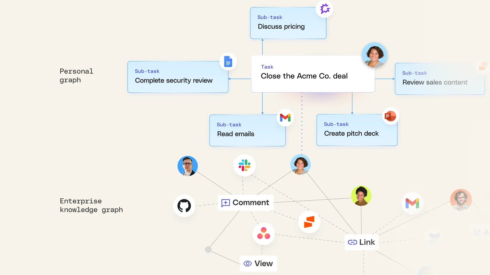
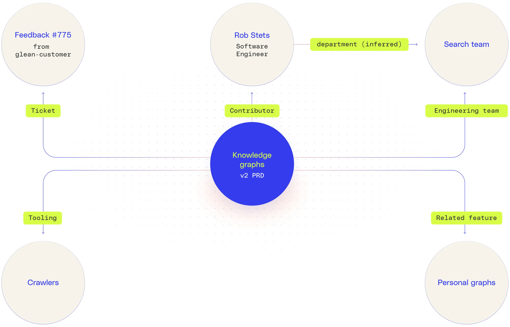
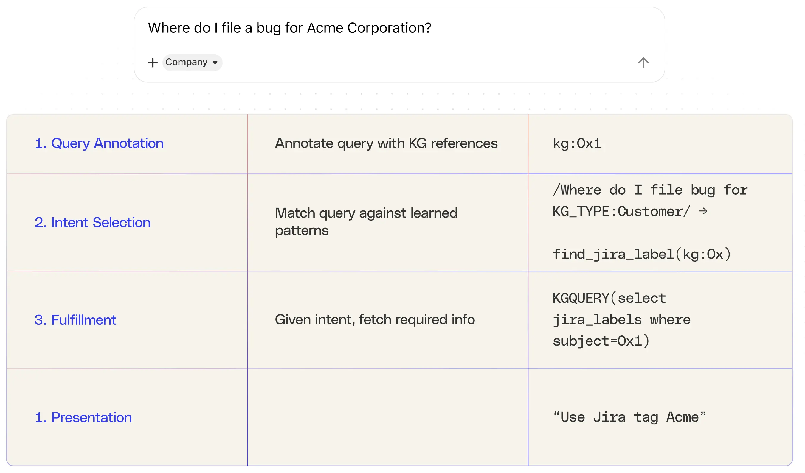
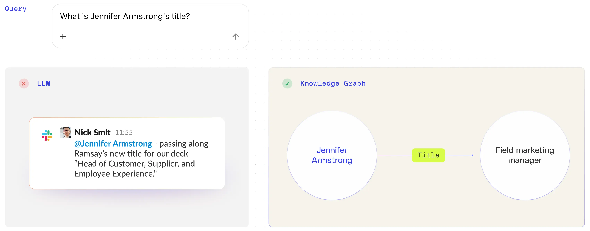
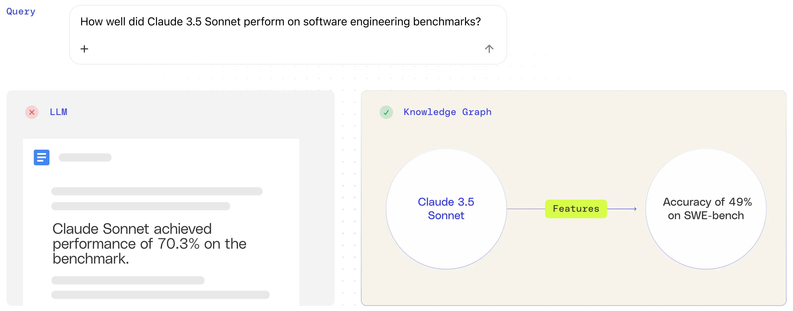
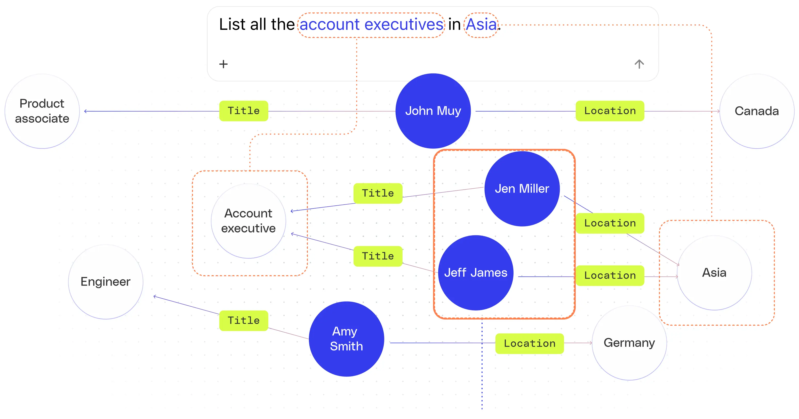
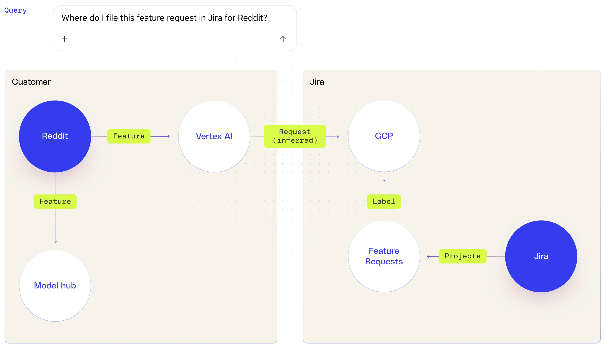
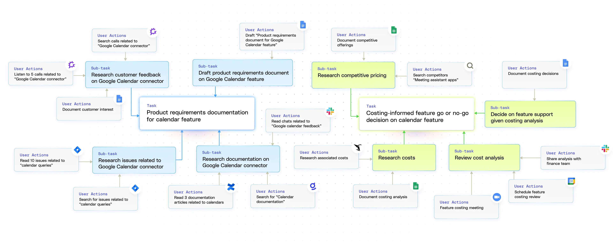
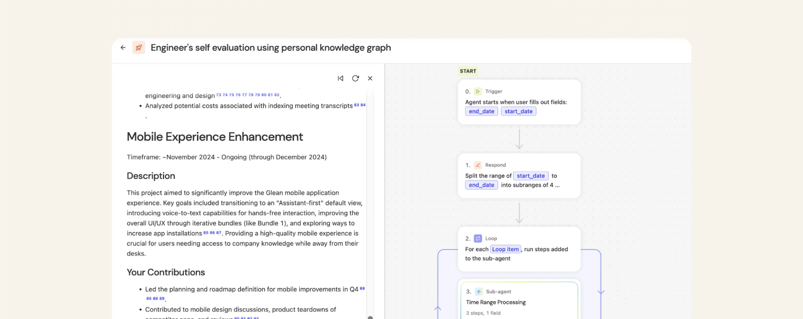

# Knowledge graphs for AI: how they create context

> 作者: Rob Stets（Software Engineer）、Pradeep Vaghela（Software Engineer）、Julie Mills（PMM） | 页面日期: Jun 27, 2025（Last updated） | 阅读时长: 12 分钟

> 原文链接: https://www.glean.com/blog/knowledge-graph-agentic-engine

Building agents that can reliably take action in the enterprise requires systems that mirror how humans make sense of information—by connecting what they read to the people, processes, tools, projects, and strategies around them. These associations come naturally to humans; it’s how we unpack complexity and conflicting information in order to make decisions. For LLMs to do the same, they not only need to reason like humans—they need to use knowledge like humans. That’s why the foundation of every great agentic engine is a knowledge graph that provides models with the right context.

At Glean, we’ve expanded our knowledge graph with a new layer— a personal graph—which better understands human context at work. It takes personalization beyond chat history by understanding your approach to different types of work and tailoring AI appropriately. Together, these graphs, along with Glean’s hybrid search architecture, form the [system of context](https://www.glean.com/product/system-of-context): a reflection of how each organization works that enables AI to work better for everyone in it.

## What is a knowledge graph?

A knowledge graph is a structured representation of information that captures entities and the relationships between them in a machine-readable format. In enterprise context, knowledge graphs serve as a foundational abstraction layer that connects fragmented data—spanning people, documents, tools, projects, and systems—into a cohesive network. Unlike search indexes, knowledge graphs focus on not just content, but relationships like between customers and support tickets, making them uniquely suited for grounding enterprise AI systems in contextual knowledge.

At the core of a knowledge graph is the triplet structure: (subject, predicate, object). This encodes specific facts or relationships, such as (Engineer A, owns, Jira Ticket B) or (Document X, references, Project Y). These semantic triples form the edges of a graph, which can be traversed to infer additional knowledge or resolve complex queries. In enterprise scenarios, this is surfacing nuanced insights across organizational silos—such as identifying how a product release ties to roadmap documents, contributors, support cases, and customer feedback.

The expressiveness of a knowledge graph includes additional facts alongside relationships. Edge properties—such as timestamps, access control, confidence scores, or provenance—can be attached to each relationship, enabling systems to reason with metadata critical for enterprise governance. For example, not only can the graph represent that (Employee A, reports to, Manager B), but it can also track when that reporting relationship began, or whether the information was inferred from a calendar, directory, or email thread. The entire graph in Glean is designed with fine-grain access controls so employees can only see the data that is already shared with them in the source system.

In practice, enterprise knowledge graphs enable information retrieval across data siloes and avoids hallucinations that are common in semantic search. They serve as the connective tissue of contextual intelligence—enabling AI agents and assistants to understand how data relates.

## How knowledge graphs work

Creating a knowledge graph in the enterprise starts with extracting and identifying meaningful entities from natural language input. Take the example of the word “Reddit.” While it may seem simple, “Reddit” could refer to entirely different entities depending on context. If mentioned by an account manager in the sales organization, it likely refers to a customer. In a marketing conversation, it might point to advertising spend on the social media site “Reddit.” Disambiguating these meanings requires context-aware annotation that considers the user’s role, intent, and surrounding content to correctly identify and map the entity in the knowledge graph.

Once the entity is annotated, the next step is to understand the intent behind the query. This involves translating the natural language query into a structured representation that can be executed programmatically. Traditionally, this was achieved through semi-automated learning. Human operators would seed known query patterns—such as “find Jira label”—and use them to identify common intents. These seed queries would then be expanded by analyzing query logs to discover other phrasings that map to the same intent. This process resembles large-scale pattern matching, where intent is linked to known entities and query types based on recurring structures in language.

The third phase involves taking the structured intent and executing the appropriate action, often by querying the knowledge graph. For example, a structured query like “find the Jira labels used by Reddit” can be issued to retrieve relevant information. This fulfillment step is where the graph structure proves essential: it enables the system to retrieve precise information by traversing relationships between entities in the graph.

With the introduction of LLMs, the first two phases—entity annotation and intent recognition—have become significantly more powerful and automated. LLMs excel at parsing natural language, reducing the need for manual pattern creation and rule-based disambiguation.

At Glean, we’ve expanded our graph to support thousands of edges with the help of LLMs. Even with LLMs, knowledge graphs are no easy feat to create. More on that later.

## Where LLMs fall short in enterprise AI use cases

LLMs are effective at capturing broad semantic associations within their context window, but they struggle with multi-hop reasoning, enterprise-specific language, and understanding process or usage patterns. As a result, LLM-based data extraction tends to be inherently lossy.

On their own, LLMs struggle with precise fact recall and tasks that require enumeration—like answering “Who contributed to Project X?” or “List all Jira labels for Customer ABC.” In addition, LLMs may misinterpret natural language or misclassify the user’s intent—issues rooted in NLP misfires. This is where knowledge graphs step in: by grounding responses in structured relationships and verified entities, they help mitigate ambiguity and improve reliability.

### LLMs (over)weight the closeness of terms

In enterprise environments, LLMs often struggle with precision, overweighing the closeness of terms. Take, for example, a fictional user, Jennifer Armstrong, a field marketing manager. In a recent query, Jennifer was incorrectly identified as the Head of Customer Supplier and Employee Experience. Tracing the issue back, the LLM had misinterpreted a Slack message about an event she organized, assigning her an incorrect title.

### LLMs conflate entities with similar names

A similar problem occurs with product naming. Claude 3.7 Sonnet and Claude 3.5 Sonnet v2 are distinct models, but LLMs frequently conflate the two, merging their features or documentation into a single, incorrect answer. Without structural disambiguation, even subtle differences between model versions are easy to misrepresent.

### LLMs struggle with deterministic queries

Knowledge graphs help mitigate these issues by grounding queries in known, structured entities. As illustrated in the following diagram, when asked to “List all of the account executives in Asia,” the knowledge graph can identify the query terms “account executives” as a specific job role, as opposed to a general description, and “Asia” as a location. With this information, the system can then perform an exhaustive, deterministic structured query for all employees with the Account Executive role and location in Asia. This is something that LLMs alone struggle to do consistently.

### LLMs have a hard time with cross-entity relationships

In more complex tasks—like answering “Where do I file feature requests for Reddit?”—LLMs must disambiguate between Reddit the social platform and Reddit the enterprise customer, recognize that the process involves Jira, and chain these understandings into a coherent workflow. This level of relational reasoning and multi-hop inference is difficult to achieve reliably without a machine-readable knowledge graph that maps these entities, roles, and systems together.

There’s a continuum of reliability in LLMs. For simple fact recall, LLMs can provide reliable, correct answers—sometimes 100% of the time, especially when the answer is explicit and nearby in accessible context. For more complex, multi-hop, or indirect inferences (“Show all codebases for projects led by X that shipped in Q1 2025”), LLMs become less reliable. Sometimes they can answer correctly, if everything aligns, but often they hallucinate or miss connections. There’s a long tail of difficult or nuanced questions falling outside the zone where LLMs are robust—this is where performance drops sharply and where knowledge graphs reign.

## Transforming work with knowledge graphs

One of the most challenging but frequent questions that any executive needs to figure out is—“How is Project X doing against its OKRs?” This is a high-value, high-intent question that’s difficult to answer in most systems, especially in an engineering context. To respond accurately, the system needs to correlate multiple data sources—specifically code contributions—and map them to the objectives and key results defined for a given project. This correlation allows for an assessment of whether a project is tracking red, yellow, or green.

The challenge lies in determining which code changes are relevant to which OKRs. LLMs struggle here because this isn’t a task that involves interpreting narrative language. Code is terse, structured, and often lacks direct annotations that tie it either to projects or to business goals. The volume of changes is also significant—thousands of commits may exist across a codebase, and only a small fraction may pertain to a specific initiative.

While LLMs excel at summarizing progress or generating prose once the right signals are identified, they’re not well-suited to surfacing those signals in the first place. For that, you need a system that can map code artifacts—such as directories, files, or components—to specific projects. This involves offline processes, project metadata, and heuristics like directory structure (e.g., a docubuilder/ folder)—all critical components that feed into a knowledge graph.

Once those associations are made, the resulting structured relationships need to be surfaced in the serving path for runtime use. This is where the knowledge graph becomes critical; it provides a structured representation that can be quickly queried at run-time.

To help you further reimagine the impact of knowledge graphs in enterprise AI, here are a few more examples:

*Sales: Which high-value deals are at risk of slipping because of product feature gaps or repeated P1 support escalations with those accounts? *

This question uses multi-hop reasoning to analyze customer data, product features, and support tickets.

*IT: Which system failure triggers multiple redundant alerts across our services, and how can we reduce the noise?*

This question understands infra tooling and on-call paging schedule, associates logs with different services, and identifies redundancy to curb the noise.

*HR: Provide me with a personalized up-to-date list of employee onboarding activities.*

Knowledge graphs can speed up onboarding by capturing a team’s activities along with key context—like tools, procedures, and documentation—and using that information to help an LLM generate a prioritized, always up-to-date list of onboarding tasks.

*Personal: Help me write my self-assessment for my performance review.*

Knowledge graphs can surface a comprehensive list of employee activities—along with important context like team, goals, and collaborators. Paired with LLMs, they can significantly accelerate the process of drafting and refining a high-quality self-assessment.

## The hard parts of enterprise knowledge graphs

In enterprises, constructing a high-quality knowledge graph is fundamentally different—and in ways more challenging—than building knowledge graphs like those seen at Google or Bing. The main challenges are privacy sensitivity, the need for scalable algorithms, and the difficulty of identifying key entities and facts when only a relatively small set of documents is available—and manual review isn’t an option.

Unlike public web data, enterprise information often contains sensitive, confidential, or regulated content that cannot be freely accessed, manually reviewed, or exposed to a team of human annotators (as is common in public graph projects). Every step in entity extraction must respect organizational privacy, contractual, and legal boundaries. The graph must be structured to support employees getting different levels of access to the data, something that consumer graphs don’t need to design towards. In public settings, teams can manually curate important facts by browsing vast amounts of publicly available data.

In the enterprise, “getting your hands dirty with the data” via manual review is either forbidden or impractical at scale due to privacy and volume. Manual graph building doesn’t scale to thousands of diverse enterprise customers, each with their own data, vocabulary, and security sensitivities. An algorithmic, automated method is essential to process all customers’ corpora without human intervention and to adapt dynamically as new data arrives. The process of extracting, without direct inspection, involves the following steps in enterprise AI:

1. Automated noun extraction: Begin by running algorithms (e.g., NLP noun phrase extraction) over the corpus to pull out all potential entities—automatically and without human review of the data.
2. Frequency and prominence filtering: Not all frequently mentioned terms are important. After initial extraction, common terms (“table”, “Spanish”) are filtered out using statistical and heuristics-driven methods.
3. Evidence of entity importance: To elevate an entity into the knowledge graph, additional signals are used to determine prominence, including: 
  1. Presence in the titles of key documents
  2. Frequent linking across popular resources
  3. Occurrence in top-shared or accessed files
4. Selective property extraction and predicate identification: For each surfaced entity, algorithms extract descriptive terms and possible relationships (predicates), again prioritizing facts for which strong, repeatable evidence exists (e.g., “document authored by person,” “project led by”).
5. Continuous, algorithmic refinement: Because no human is reading the private data, the system iteratively improves its filters to reduce the risk of over-inclusion (leaking or bloating the graph with low-value entities) and to adapt to new data structures or signals in each enterprise.

At Glean, we’ve built a real-time crawler architecture that powers both semantic and lexical search, continuously ingesting enterprise content and metadata. This same infrastructure feeds our knowledge graph—giving us a strong foundation. Over the past six years, we’ve refined this graph with purpose-built algorithms to support increasingly complex reasoning and enterprise workflows that are required for agents.

## Building on the knowledge graph with the personal graph

We’ve recently added a new dimension to the enterprise knowledge graph: the personal graph, which captures employee activity to understand what individuals are working on and the impact of their efforts. The goal is to model real work—identifying active projects, collaboration patterns, and ongoing tasks—so Glean can begin offering proactive assistance, such as surfacing priorities, highlighting conflicts, and helping users stay organized.

But the personal graph goes beyond just tuning relevance or capturing interaction history within Glean. It serves as the foundation for personalizing the Glean experience—powering Assistant responses and directing context-aware agents. Unlike memory systems in typical AI chat tools that rely on session history, the personal graph looks holistically at the digital activity of an individual, across tools, systems, and time.

To support this, we’ve expanded our crawling infrastructure, capturing far more granular data, including reading behavior and passive consumption signals, to generate dense, real-time streams of digital activity. This provides the foundation for understanding a user’s work context as it's occurring.

One key reason we can now build personal graphs is the advancement in LLM reasoning. Classical machine learning has struggled to unify activity signals due to the lack of direct identifiers between disparate sources (connecting a calendar invite with edits to a related document). LLMs can process chronological activity streams and reason over them to group related actions into logical units: tasks, projects, or thematic work clusters—even amid sparse signals and task switching.

At Glean, we cluster each atomic action (“created doc X,” “attended meeting Y”, , “executed internal tool Z”) into subtasks, then rolled up into higher-level tasks with context-aware labels like “drafted product brief” or “responded to legal request.” The system further aggregates related tasks by theme—such as multiple documents tied to a product launch—and maps them to organizational objectives like OKRs. By analyzing patterns of collaboration (recurring comment interactions, shared Slack channels), the personal graph reveals not just what’s being done, but who is working together and how—to generate a more complete picture of work dynamics in the enterprise.

Building the personal graph isn’t trivial. For one, not all significant work is digital (in-person meetings and discussions). Even among digital activity, inferring the true intent (is a doc edit a major draft, a fix, or a polish?) is sometimes only possible if the user explicitly marks it ("First Draft" in the doc title). This can make getting the right signals challenging in building out the personal graph.

Our crawler architecture gives us a critical head start here. That’s because every data source has its own schema (what "comment" means differs across Jira, GDocs, email, etc.). Creating a common, source-agnostic language and a chronological database is necessary to make multi-source reasoning possible in the enterprise. This is only possible by first indexing your data;[federated search](https://www.glean.com/blog/federated-indexed-enterprise-ai) doesn’t provide the structure or signals needed to connect the dots across sources.

We’re already putting the personal graph to work at Glean—with quickstart agents that can help users summarize what they worked on last week or prepare for performance reviews. These agents give us a feedback loop so that we can continuously iterate on the personal graph.

Glean’s broader view of context is what enables us to serve AI horizontally across the enterprise. Glean is not just answering questions—it’s learning how you work, and adapting alongside you to be your personalized, expert AI assistant and agent platform.

## The system of context in enterprise AI

When we bring together the enterprise knowledge graph and the personal graph, we’re not just able to support complex, high-stakes decisions—we’re able to do so in ways that feel personal to both the organization and the individuals within it.

As we think about the future of assistants and agents in the enterprise, personalization can’t stop at tailoring responses. These systems need to anticipate needs—resolving blockers before they become issues, surfacing stalled initiatives—and actively coach users toward their goals. That’s where we’re headed.

So far, we’ve focused on two key layers: enterprise data and people—arguably the most important assets in any organization. But there’s a third layer: process—how work actually gets done by both people and increasingly agents.

Processes can be deeply personal, shaped by the people who design them. But many also hum in the background, detached from any one individual. We learn from both. By observing how people work with data, systems, and tools, and how agents are used, we begin to surface and model these processes as part of the system itself.

This evolving picture creates a new layer of context—one that doesn’t sit apart from data and people but builds on them. Once you see that web in motion, you realize the system of context isn’t just about organizing information—it’s about orchestrating contextual intelligence. Data is the starting point, but what emerges is a network that continuously adapts, learns, and brings the right context to every AI interaction.

When you see it this way, it becomes clear: LLMs aren’t the only cognitive power in agent systems. The system of context is too.
