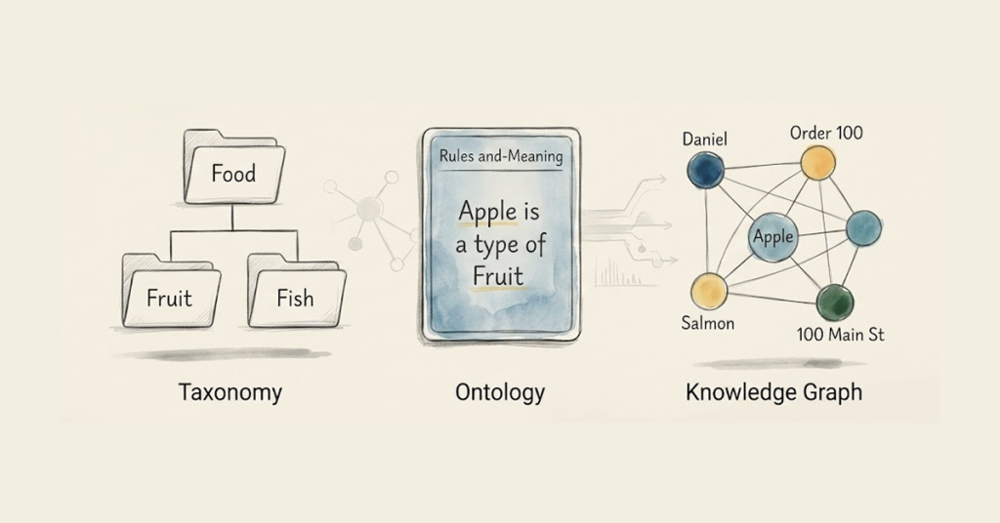
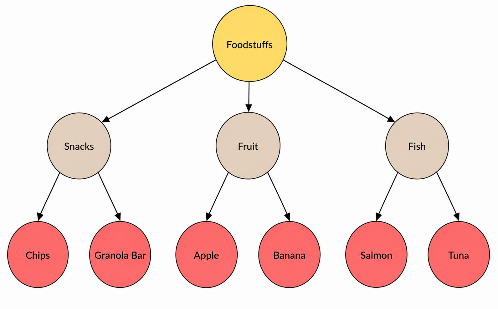
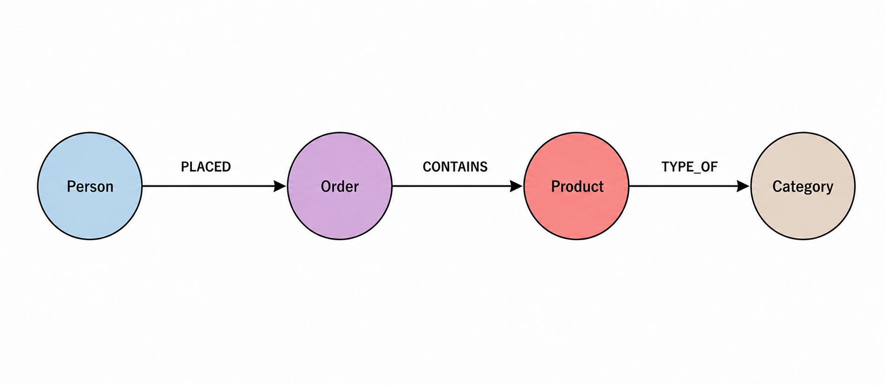
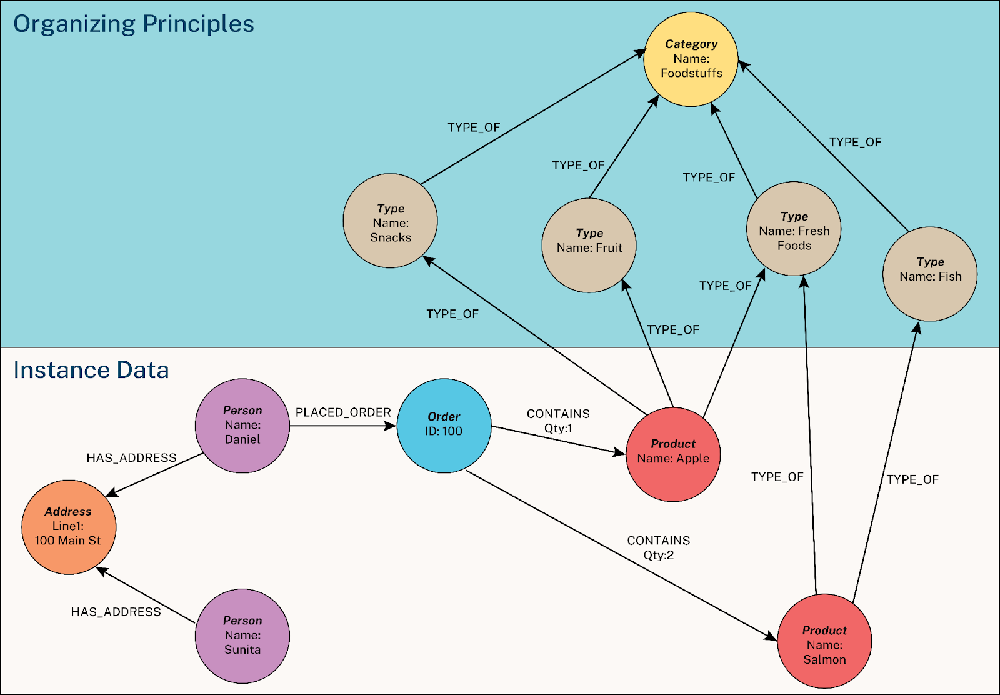

> 作者: John Stegeman（Graph Database Product Specialist, Neo4j） | 日期: June 16, 2026

> 原文链接: https://neo4j.com/blog/knowledge-graph/taxonomy-vs-ontology-vs-knowledge-graph/



AI cannot inherently understand, reason about, or make decisions based on raw data. To transform raw data into actionable knowledge, you must add structure, relationships, and meaning. If you’ve been exploring this space, you’ve likely encountered terms like taxonomy, ontology, and knowledge graph.

AI 本身无法理解原始数据、基于原始数据推理或做决策。要把原始数据变成可行动的知识，必须补上结构、关系和语义。如果你一直在关注这个领域，大概率遇到过分类法（taxonomy）、本体（ontology）和知识图谱（knowledge graph）这些词。

While often used together, they serve different functions. A taxonomy organizes categories as a hierarchy, while an ontology defines the semantic meanings and logical connections between entities. A knowledge graph is the implementation layer that brings these together, storing your instance data while using taxonomies and ontologies as organizing principles.

这些词常被一起提到，但作用不同：分类法把类别组织成层级，本体定义实体之间的语义与逻辑关联，知识图谱则是把两者落地的实现层——存放实例数据，并以分类法和本体作为组织原则。

In essence, the knowledge graph is what you build, while taxonomies and ontologies are the blueprints that provide it with structure and meaning. This post unpacks all three terms and provides a mental model for using them to represent knowledge.

简言之，知识图谱是你要构建的东西，分类法和本体是为它提供结构与语义的蓝图。本文拆解这三个术语，并给出用它们表达知识的心智模型。

More in this guide: / 本指南还包括：

- [What is a taxonomy?](https://neo4j.com/blog/knowledge-graph/taxonomy-vs-ontology-vs-knowledge-graph/#h-what-is-a-taxonomy) / 什么是分类法？
- [What is an ontology?](https://neo4j.com/blog/knowledge-graph/taxonomy-vs-ontology-vs-knowledge-graph/#h-what-is-an-ontology) / 什么是本体？
- [What is a knowledge graph?](https://neo4j.com/blog/knowledge-graph/taxonomy-vs-ontology-vs-knowledge-graph/#h-what-is-a-knowledge-graph) / 什么是知识图谱？
- [How to represent knowledge using taxonomies, ontologies, and knowledge graphs](https://neo4j.com/blog/knowledge-graph/taxonomy-vs-ontology-vs-knowledge-graph/#h-how-to-represent-knowledge-using-taxonomies-ontologies-and-knowledge-graphs) / 如何用分类法、本体和知识图谱表达知识
- [How knowledge graphs enable smarter reasoning in AI agents](https://neo4j.com/blog/knowledge-graph/taxonomy-vs-ontology-vs-knowledge-graph/#h-how-knowledge-graphs-enable-smarter-reasoning-in-ai-agents) / 知识图谱如何让 AI 智能体推理更聪明
- [Build the knowledge layer for AI in Neo4j](https://neo4j.com/blog/knowledge-graph/taxonomy-vs-ontology-vs-knowledge-graph/#h-build-the-knowledge-layer-for-ai-in-neo4j) / 在 Neo4j 构建面向 AI 的知识层
- [FAQ](https://neo4j.com/blog/knowledge-graph/taxonomy-vs-ontology-vs-knowledge-graph/#h-faq) / 常见问题

## What is a taxonomy? / 什么是分类法？

A taxonomy is one of the simplest organizing principles you can use. It sorts entities into categories and subcategories, giving the graph a hierarchical structure for finding, labeling, and navigating information.

分类法是最简单的组织原则之一：把实体归入类别与子类别，让图谱具备层级结构，便于查找、标注和浏览信息。

Think of an online grocery store. A shopper starts in the `Foodstuffs` category, then navigates to the `Fruit`, then to `Apple`. Each step gets more specific, narrowing down from a broader level. These are represented as a hierarchical parent-child tree in a knowledge graph.

以线上杂货店为例：购物者从 `Foodstuffs` 类目进入 `Fruit`，再到 `Apple`，每一步都更具体，从宽泛逐层收窄。在知识图谱里，这些被表示成一棵父子层级树。


*A taxonomy organizes categories into a parent-child hierarchy.*

分类法把类别组织成父子层级。

Taxonomies are traditionally modeled using the [Simple Knowledge Organization System (SKOS)](https://www.w3.org/2004/02/skos/) standards, which support `broader` and `narrower` relationships. But you can also model taxonomies in a knowledge graph with `Entity` nodes connected by relationships such as `SUBCATEGORY_OF`, `PARENT_OF`, or any label of your choice. You can also import SKOS taxonomies into a knowledge graph through [neosemantics](https://neo4j.com/labs/neosemantics/) (n10s).

分类法传统上用 [SKOS 标准](https://www.w3.org/2004/02/skos/)（Simple Knowledge Organization System）建模，支持 `broader` 和 `narrower` 关系。也可以在知识图谱里用 `Entity` 节点搭配 `SUBCATEGORY_OF`、`PARENT_OF` 或任意自定义关系来建模；还可以通过 [neosemantics](https://neo4j.com/labs/neosemantics/) (n10s) 把 SKOS 分类法导入知识图谱。

A taxonomy can tell you that `Apple` belongs under `Fruit`, and that `Fruit` belongs under `Foodstuffs`. A taxonomy is good for:

分类法能告诉你 `Apple` 属于 `Fruit`、`Fruit` 属于 `Foodstuffs`。分类法擅长：

- Consistent labeling and tagging / 一致的标注与打标
- Faceted search and category-based navigation / 分面搜索与按类目浏览
- Controlled vocabularies that prevent parallel naming drift / 用受控词表避免命名各自漂移

But a taxonomy doesn’t capture how these entities relate to one another. It cannot, by itself, tell you that `Apple` is a type of `Fruit` listed under `Foodstuffs`.

但分类法不刻画实体之间如何关联。仅靠它，说不出 `Apple` 是 `Foodstuffs` 下的一种 `Fruit`。

When you need to go beyond hierarchy to define how entities relate, that’s where an ontology comes in.

当你需要超越层级去定义实体关系时，就该本体上场了。

## What is an ontology? / 什么是本体？

An [ontology](https://neo4j.com/blog/knowledge-graph/ontologies-in-neo4j-semantics-and-knowledge-graphs/) describes a domain by providing semantic meanings and logical rules. It provides a model of the important aspects of that domain and how they relate.

[本体](https://neo4j.com/blog/knowledge-graph/ontologies-in-neo4j-semantics-and-knowledge-graphs/)通过给出语义与逻辑规则来描述一个领域，为该领域的重要方面及其相互关系建立模型。

Take the same e-commerce example. An ontology goes beyond the broader/narrower relationships of a taxonomy. It defines exactly how entities are related using logical statements.

还是电商的例子：本体不止于分类法的 broader／narrower 关系，而是用逻辑语句精确定义实体间的关联。

- `Person` placed `Order` / `Person` 下了 `Order`
- `Order` contains `Product` / `Order` 包含 `Product`
- `Product` is a type of `Category` / `Product` 属于一种 `Category`


*An ontology provides semantic meanings and logical connections.*

本体提供语义与逻辑关联。

Ontologies are useful for: / 本体适用于：

- Describing semantic meanings that humans or AI systems can understand. / 描述人类或 AI 系统都能理解的语义。
- Inferencing implicit information through logical deduction. / 通过逻辑演绎推出隐含信息。
- Shared vocabularies for interoperability across systems, such as [Schema.org](http://Schema.org), [FIBO](https://spec.edmcouncil.org/fibo/) in finance, or [SNOMED CT](https://www.snomed.org/what-is-snomed-ct) in healthcare. / 为跨系统互操作提供共享词表，例如金融领域的 [FIBO](https://spec.edmcouncil.org/fibo/)、医疗领域的 [SNOMED CT](https://www.snomed.org/what-is-snomed-ct)，以及通用的 [Schema.org](http://Schema.org)。

Ontologies are traditionally implemented using [the Resource Description Framework (RDF)](https://neo4j.com/blog/knowledge-graph/rdf-vs-property-graphs-knowledge-graphs/), which uses triples as logical statements: subject-predicate-verb. But this approach is fundamentally challenging to describe the relationships and properties of instance data because it needs to decompose them into multiple triples, increasing complexity and query difficulty:

本体传统上用 [资源描述框架 RDF](https://neo4j.com/blog/knowledge-graph/rdf-vs-property-graphs-knowledge-graphs/) 实现，用「主语—谓词—宾语」三元组表达逻辑语句。但这种方式描述实例数据的关系和属性时很吃力：必须拆成多条三元组，复杂度和查询难度都上去了：

- `Apple` is a type of `Fruit` / `Apple` 是一种 `Fruit`
- `Banana` is a type of `Fruit` / `Banana` 是一种 `Fruit`
- `Apple` is a type of `Fresh Food` / `Apple` 属于 `Fresh Food`
- `Banana` is a type of `Fresh Food` / `Banana` 属于 `Fresh Food`
- `Salmon` is a type of `Fresh Food` / `Salmon` 属于 `Fresh Food`
- `Salmon` is a type of `Fish` / `Salmon` 是一种 `Fish`

Knowledge graphs with a [property graph model](https://neo4j.com/blog/knowledge-graph/rdf-vs-property-graphs-knowledge-graphs/) offer a more flexible approach to organizing instance data using ontologies.

采用[属性图模型](https://neo4j.com/blog/knowledge-graph/rdf-vs-property-graphs-knowledge-graphs/)的知识图谱，用本体组织实例数据要灵活得多。

## What is a knowledge graph? / 什么是知识图谱？

A [knowledge graph](https://neo4j.com/blog/knowledge-graph/what-is-knowledge-graph/) connects real-world entities and their relationships in a property graph model that humans and systems can naturally understand. It has four core parts:

[知识图谱](https://neo4j.com/blog/knowledge-graph/what-is-knowledge-graph/)把现实世界的实体及其关系连成属性图，人和系统都能自然理解。它有四个核心部分：

- **Nodes**: the entities in the graph, such as `Person`, `Order`, or `Product`. / 节点：图中的实体，例如 `Person`、`Order`、`Product`。
- **Relationships**: the connections between entities, such as `TYPE_OF`, `PLACED_ORDER`, or `CONTAINS`. / 关系：实体之间的连接，例如 `TYPE_OF`、`PLACED_ORDER`、`CONTAINS`。
- **Properties**: the property keys that describe nodes or relationships, such as `weight`, `storage`, or `price`. / 属性：描述节点或关系的属性键，例如 `weight`、`storage`、`price`。
- **Organizing principles (taxonomies and/or ontologies)**: the structures that give the graph meaning, defining how the graph data is organized and interpreted, such as `Person` -PLACED-> `Order` -CONTAINS-> `Product` -TYPE_OF-> `Type`. / 组织原则（分类法和／或本体）：赋予图谱语义的结构，定义图数据如何组织与解读，例如 `Person` -PLACED-> `Order` -CONTAINS-> `Product` -TYPE_OF-> `Type`。


*A knowledge graph captures instance data as nodes, relationships, and properties, while using taxonomies and ontologies as organizing principles.*

知识图谱用节点、关系和属性承载实例数据，并以分类法和本体作为组织原则。

A knowledge graph can capture taxonomies using nodes and relationships that represent hierarchical structures. It can also capture ontologies using semantic nodes, relationships, and properties to provide meanings and logic. They become the organizing principles that provide meaning and structure to the knowledge graph.

知识图谱可以用表示层级结构的节点和关系承载分类法，也可以用带语义的节点、关系和属性承载本体，让它们成为赋予图谱意义与结构的组织原则。

The property graph model can handle many-to-many relationships or multiple relationships of the same type between the same two nodes. It offers much greater flexibility throughout the development process because it isn’t limited to the predefined structures of a hierarchical taxonomy or an RDF triple. You can query taxonomies and ontologies alongside the instance data in a single [Cypher](https://neo4j.com/docs/getting-started/cypher/) statement.

属性图模型支持多对多关系，也支持同一对节点之间存在多条同类型关系。它不受层级分类法或 RDF 三元组的预定义结构限制，开发过程灵活得多。你还能在一条 [Cypher](https://neo4j.com/docs/getting-started/cypher/) 语句里同时查询分类法、本体和实例数据。

For instance, to find out what products a person named Daniel ordered in the Foodstuffs category, you can use a single query:

例如，要查 Daniel 在 Foodstuffs 类目下买过哪些商品，一条查询就够了：

```
MATCH (d:Person {name: "Daniel"})-[:PLACED]->(o:Order)-[:CONTAINS]->(p:Product)-[:TYPE_OF]->(t:Type)-[:TYPE_OF]-(c:Category {name: "Foodstuffs"})
RETURN d, o, p, t, c
```

This property graph model also makes it simple to query shared attributes, such as finding other persons with the same address as Daniel and what products they ordered:

属性图模型查询共享属性也很简单，比如找出与 Daniel 同地址的其他人，以及他们买过什么：

```
MATCH (d:Person {name: "Daniel"})-[:HAS_Address]->(a:Address)<-[:HAS_ADDRESS]-(other:Person)-[:PLACED]->(o:Order)-[:CONTAINS]->(p:Product)
WHERE d <> other
RETURN a, other, o, p
```

## How to represent knowledge using taxonomies, ontologies, and knowledge graphs / 如何用分类法、本体和知识图谱表达知识

As standalone models, a taxonomy helps you represent hierarchies, and an ontology helps you represent meanings between entities. It’s not a matter of which one to pick, but rather how to use these principles to organize your knowledge.

单独看，分类法表达层级，本体表达实体之间的语义。问题不是二选一，而是怎么用这些原则组织知识。

The best way to represent knowledge is to build a knowledge graph and use taxonomy and/or ontology to provide structure and meaning to it. This approach gives you a complete knowledge system that’s easy to search for, understand, and reason about. Here’s how to do it:

最好的做法是构建知识图谱，再用分类法和／或本体为它提供结构与语义。这样得到的知识体系易于检索、理解和推理。具体步骤：

1. Define the use case and questions you need answers for. / 明确用例，以及需要回答的问题。
2. Define your graph schema. Think of your instance data as nodes, relationships, and properties in the knowledge graph. Then consider how to best organize them. / 定义图模式：把实例数据想成知识图谱里的节点、关系和属性，再考虑如何组织最合适。
- Use **taxonomy** if your data contains categories or hierarchies. Model node labels to represent categories (`Person`, `Order`, `Product`, `Category`). Model relationships between categories to represent hierarchies (Chips–> `Snacks` –> Foodstuffs). / 若数据含类目或层级，用分类法：用节点标签表示类目（`Person`、`Order`、`Product`、`Category`），用类目间关系表示层级（Chips–> `Snacks` –> Foodstuffs）。
- Use **ontology** if your data needs meaning or logical rules. Model relationships to represent logical connections and relationship labels to provide semantic context (`Person` -PLACED-> `Order` -CONTAINS-> `Product` -TYPE_OF-> `Category`). / 若数据需要语义或逻辑规则，用本体：用关系表示逻辑连接，用关系标签提供语义上下文（`Person` -PLACED-> `Order` -CONTAINS-> `Product` -TYPE_OF-> `Category`）。
3. Ingest your instance data into the knowledge graph according to the graph schema. / 按图模式把实例数据导入知识图谱。
4. Adjust the graph schema as your use cases evolve. / 随用例演进调整图模式。

|  | Taxonomy<br>分类法 | Ontology<br>本体 | Knowledge graph<br>知识图谱 |
| --- | --- | --- | --- |
| **What it is**<br>是什么 | Hierarchy tree in parent-child relationships<br>父子关系构成的层级树 | Semantic meanings and logical rules between entities<br>实体之间的语义与逻辑规则 | Graph of nodes, relationships, properties, and organizing principles (taxonomy and/or ontology)<br>由节点、关系、属性以及组织原则（分类法和／或本体）构成的图 |
| **Data model**<br>数据模型 | Labeled property graph, or SKOS<br>带标签的属性图，或 SKOS | Labeled property graph, or RDF<br>带标签的属性图，或 RDF | Labeled property graph<br>带标签的属性图 |
| **Query language**<br>查询语言 | [Cypher](https://neo4j.com/docs/getting-started/cypher/) or [GQL](https://neo4j.com/blog/cypher-and-gql/cypher-gql-world/) in a graph database, or SPARQL in SKOS<br>图数据库中的 Cypher 或 GQL，SKOS 中用 SPARQL | Cypher or GQL after neosemantics (n10s) import, or SPARQL in RDF systems.<br>经 neosemantics (n10s) 导入后用 Cypher 或 GQL，RDF 系统中用 SPARQL | Cypher or GQL<br>Cypher 或 GQL |
| **Purpose**<br>用途 | Classification and tagging<br>分类与打标 | Interoperability and inference<br>互操作与推理 | Graph traversal, multi-hop reasoning, GraphRAG, and AI memory<br>图遍历、多跳推理、GraphRAG 与 AI 记忆 |
| **How to apply**<br>如何应用 | Classify nodes into parent-child relationships<br>把节点归入父子关系 | Define meanings and logical connections between nodes<br>定义节点之间的语义与逻辑连接 | Design a graph schema based on organizing principles and ingest instance data<br>按组织原则设计图模式并导入实例数据 |

## How knowledge graphs enable smarter reasoning in AI agents / 知识图谱如何让 AI 智能体推理更聪明

A knowledge graph with a clear taxonomy or ontology lets AI agents retrieve context that is connected by meaning: which entities are related, how they are related, and where they sit in the broader domain.

带清晰分类法或本体的知识图谱，让 AI 智能体能按语义检索上下文：哪些实体相关、如何相关、在整个领域中处于什么位置。

AI agents retrieve this connected data and perform [multi-step reasoning](https://neo4j.com/blog/genai/knowledge-graph-llm-multi-hop-reasoning/) through [GraphRAG](https://neo4j.com/blog/genai/what-is-graphrag/). Instead of doing a simple vector search that uses a collection of disconnected text chunks, they can traverse relationships throughout the graph.

AI 智能体拿到这些互联数据后，通过 [GraphRAG](https://neo4j.com/blog/genai/what-is-graphrag/) 做[多步推理](https://neo4j.com/blog/genai/knowledge-graph-llm-multi-hop-reasoning/)。它不必依赖一堆互不相连的文本块做简单向量检索，而是可以沿图谱里的关系遍历。

For example, an AI agent answering a product-impact question can traverse from a product to its category, supplier, orders, support tickets, and related documents, rather than retrieving only the chunks that mention the product name. This makes the AI agent’s answers more accurate and explainable. Without a knowledge graph, you can’t depend on an agent’s reasoning.

例如回答产品影响类问题时，智能体可以从产品遍历到类目、供应商、订单、工单和相关文档，而不只检索提到产品名的文本块。这样答案更准确、也更可解释。没有知识图谱，智能体的推理就靠不住。

## Build the knowledge layer for AI in Neo4j / 在 Neo4j 构建面向 AI 的知识层

Knowledge graphs use taxonomies and ontologies to organize data and apply meaning. They represent knowledge in a way that’s easy for AI systems to retrieve, understand, and reason about your data, producing accurate, explainable outputs.

知识图谱用分类法和本体组织数据、赋予语义，让知识的表达方式便于 AI 系统检索、理解和推理，从而产出准确、可解释的结果。

[Neo4j Graph Intelligence Platform](https://neo4j.com/) offers the [knowledge layer](https://neo4j.com/product/knowledge-layer/) for AI-ready data:

[Neo4j 图智能平台](https://neo4j.com/)为 AI 就绪的数据提供[知识层](https://neo4j.com/product/knowledge-layer/)：

- [Neo4j Graph Databases](https://neo4j.com/product/neo4j-graph-database/) stores nodes, relationships, and properties for your knowledge graph using the property graph model. / [Neo4j 图数据库](https://neo4j.com/product/neo4j-graph-database/)用属性图模型存储知识图谱的节点、关系和属性。
- [neosemantics](https://neo4j.com/labs/neosemantics/) (n10s) supports RDF, SKOS, and OWL exchange for self-hosted Neo4j deployments when standards-based interoperability is required. / [neosemantics](https://neo4j.com/labs/neosemantics/) (n10s) 在需要标准互操作时，为自托管 Neo4j 部署提供 RDF、SKOS 和 OWL 交换能力。
- [Neo4j GraphRAG](https://neo4j.com/developer/genai-ecosystem/graphrag-python/) connects LLMs to knowledge graphs for intelligent retrieval and reasoning. / [Neo4j GraphRAG](https://neo4j.com/developer/genai-ecosystem/graphrag-python/) 把大语言模型接到知识图谱上，实现智能检索与推理。
- [Neo4j AuraDB](https://neo4j.com/product/auradb/) provides a managed cloud database for building and running knowledge graphs. / [Neo4j AuraDB](https://neo4j.com/product/auradb/) 提供托管云数据库，用于构建和运行知识图谱。
- [Neo4j Aura Agent](https://neo4j.com/product/aura-agent/) helps you build, test, and deploy AI agents grounded in AuraDB knowledge graphs. / [Neo4j Aura Agent](https://neo4j.com/product/aura-agent/) 帮助构建、测试、部署以 AuraDB 知识图谱为 grounding 的 AI 智能体。
- [Neo4j Agent Memory](https://neo4j.com/labs/agent-memory/) offers the complete memory in a context graph that captures business knowledge, conversations, and decisions for AI agents. / [Neo4j Agent Memory](https://neo4j.com/labs/agent-memory/) 用上下文图谱提供完整记忆，记录业务知识、对话与决策。
- [Neo4j Graph Data Science](https://neo4j.com/product/graph-data-science/) runs graph algorithms for analytics directly on the same knowledge graph. / [Neo4j Graph Data Science](https://neo4j.com/product/graph-data-science/) 直接在同一张知识图谱上运行图算法做分析。

## FAQ / 常见问题

### Is a knowledge graph the same as an ontology? / 知识图谱和本体是一回事吗？

No. A knowledge graph combines instance data with organizing principles. An ontology is a type of organizing principle.

不是。知识图谱把实例数据与组织原则结合在一起，本体只是其中一类组织原则。

### Do I need an ontology to build a knowledge graph? / 建知识图谱必须先有本体吗？

No. Many knowledge graphs start simple and add ontology only when formal semantics or interoperability become necessary.

不必。很多知识图谱从简单结构起步，等确实需要形式化语义或互操作时才补上本体。

### Do I need RDF for ontology? / 本体必须用 RDF 吗？

Not necessarily. A knowledge graph can represent ontology directly through labels, relationships, and properties. For W3C-standard interoperability, [neosemantics](https://neo4j.com/labs/neosemantics/) (n10s) supports RDF, SKOS, and OWL exchange in self-hosted Neo4j graph deployments.

不一定。知识图谱可以直接用标签、关系和属性表达本体；若要 W3C 标准互操作，自托管 Neo4j 部署可用 [neosemantics](https://neo4j.com/labs/neosemantics/) (n10s) 交换 RDF、SKOS 和 OWL。

### What's the difference between a taxonomy and an ontology? / 分类法和本体的区别是什么？

A taxonomy classifies things into a hierarchy. An ontology defines a domain, providing semantic meanings and logical rules.

分类法把事物归入层级；本体定义领域，给出语义与逻辑规则。

### What comes first — taxonomy, ontology, or knowledge graph? / 先做分类法、本体，还是知识图谱？

There is no required order. The knowledge graph is what you build. Taxonomy and ontology are organizing principles you use to organize your knowledge graph. Use a taxonomy to represent categories and hierarchy. Use an ontology to represent formal meanings, logical rules, or interoperability.

没有固定顺序。知识图谱是你要构建的东西，分类法和本体是用来组织它的原则：要表达类目和层级就用分类法，要表达形式化语义、逻辑规则或互操作就用本体。

### Where does GraphRAG fit? / GraphRAG 处在什么位置？

AI agents traverse knowledge graphs via [GraphRAG](https://neo4j.com/blog/genai/what-is-graphrag/) to retrieve connected context and perform multi-step reasoning, producing accurate, explainable outputs.

AI 智能体通过 [GraphRAG](https://neo4j.com/blog/genai/what-is-graphrag/) 遍历知识图谱，检索关联上下文并做多步推理，产出准确、可解释的结果。
