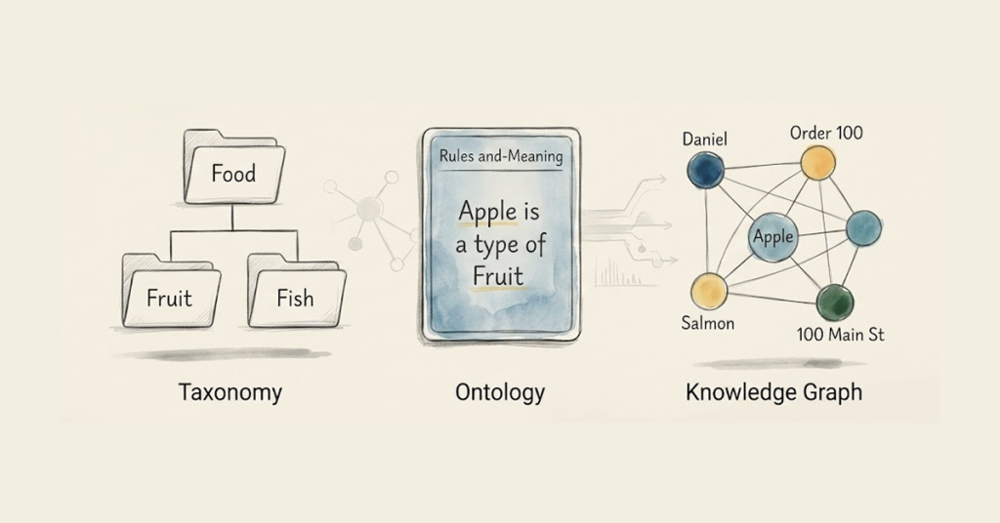
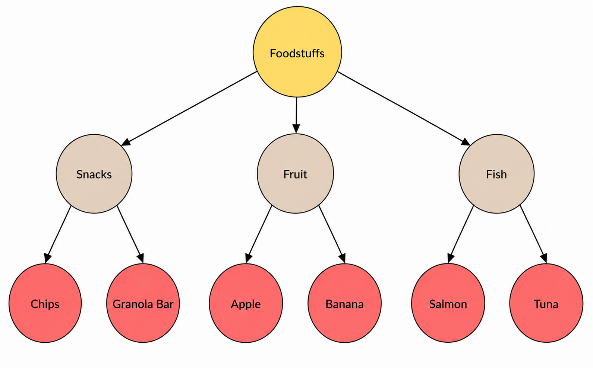
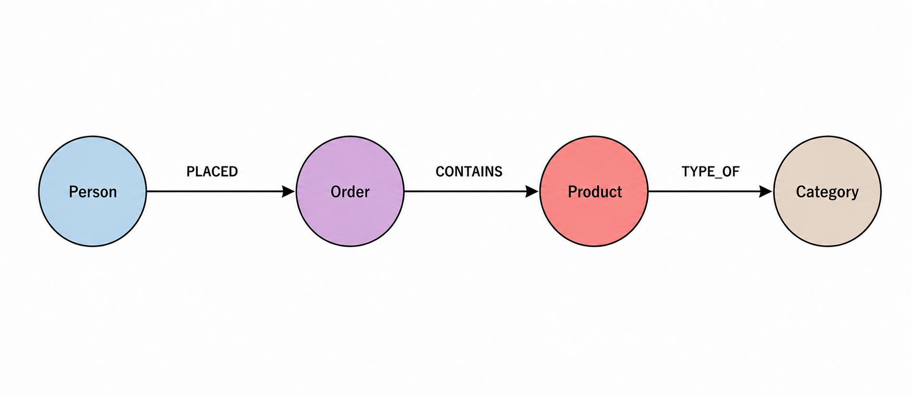
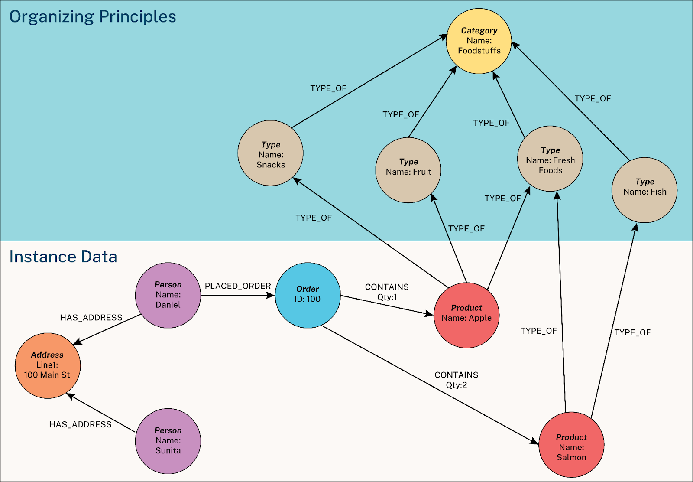

# Taxonomy vs. ontology vs. knowledge graph: What’s the difference?

> 作者: John Stegeman（Graph Database Product Specialist, Neo4j） | 日期: June 16, 2026

> 原文链接: https://neo4j.com/blog/knowledge-graph/taxonomy-vs-ontology-vs-knowledge-graph/



AI cannot inherently understand, reason about, or make decisions based on raw data. To transform raw data into actionable knowledge, you must add structure, relationships, and meaning. If you’ve been exploring this space, you’ve likely encountered terms like taxonomy, ontology, and knowledge graph.

While often used together, they serve different functions. A taxonomy organizes categories as a hierarchy, while an ontology defines the semantic meanings and logical connections between entities. A knowledge graph is the implementation layer that brings these together, storing your instance data while using taxonomies and ontologies as organizing principles.

In essence, the knowledge graph is what you build, while taxonomies and ontologies are the blueprints that provide it with structure and meaning. This post unpacks all three terms and provides a mental model for using them to represent knowledge.

	More in this guide:

	- [What is a taxonomy?](#h-what-is-a-taxonomy)
- [What is an ontology?](#h-what-is-an-ontology)
- [What is a knowledge graph?](#h-what-is-a-knowledge-graph)
- [How to represent knowledge using taxonomies, ontologies, and knowledge graphs](#h-how-to-represent-knowledge-using-taxonomies-ontologies-and-knowledge-graphs)
- [How knowledge graphs enable smarter reasoning in AI agents](#h-how-knowledge-graphs-enable-smarter-reasoning-in-ai-agents)
- [Build the knowledge layer for AI in Neo4j](#h-build-the-knowledge-layer-for-ai-in-neo4j)
- [FAQ](#h-faq)

## What is a taxonomy?

A taxonomy is one of the simplest organizing principles you can use. It sorts entities into categories and subcategories, giving the graph a hierarchical structure for finding, labeling, and navigating information.

Think of an online grocery store. A shopper starts in the `Foodstuffs` category, then navigates to the `Fruit`, then to `Apple`. Each step gets more specific, narrowing down from a broader level. These are represented as a hierarchical parent-child tree in a knowledge graph.


*A taxonomy organizes categories into a parent-child hierarchy.*

Taxonomies are traditionally modeled using the [Simple Knowledge Organization System (SKOS)](https://www.w3.org/2004/02/skos/) standards, which support `broader` and `narrower` relationships. But you can also model taxonomies in a knowledge graph with `Entity` nodes connected by relationships such as `SUBCATEGORY_OF`, `PARENT_OF`, or any label of your choice. You can also import SKOS taxonomies into a knowledge graph through [neosemantics](https://neo4j.com/labs/neosemantics/) (n10s).

A taxonomy can tell you that `Apple` belongs under `Fruit`, and that `Fruit` belongs under `Foodstuffs`. A taxonomy is good for:

- Consistent labeling and tagging
- Faceted search and category-based navigation
- Controlled vocabularies that prevent parallel naming drift

But a taxonomy doesn’t capture how these entities relate to one another. It cannot, by itself, tell you that `Apple` is a type of `Fruit` listed under `Foodstuffs`.

When you need to go beyond hierarchy to define how entities relate, that’s where an ontology comes in.

## What is an ontology?

An [ontology](https://neo4j.com/blog/knowledge-graph/ontologies-in-neo4j-semantics-and-knowledge-graphs/) describes a domain by providing semantic meanings and logical rules. It provides a model of the important aspects of that domain and how they relate.

Take the same e-commerce example. An ontology goes beyond the broader/narrower relationships of a taxonomy. It defines exactly how entities are related using logical statements.

- `Person` placed `Order`
- `Order` contains `Product`
- `Product` is a type of `Category`


*An ontology provides semantic meanings and logical connections.*

Ontologies are useful for:

- Describing semantic meanings that humans or AI systems can understand.
- Inferencing implicit information through logical deduction.
- Shared vocabularies for interoperability across systems, such as [Schema.org](http://Schema.org), [FIBO](https://spec.edmcouncil.org/fibo/) in finance, or [SNOMED CT](https://www.snomed.org/what-is-snomed-ct) in healthcare.

Ontologies are traditionally implemented using [the Resource Description Framework (RDF)](https://neo4j.com/blog/knowledge-graph/rdf-vs-property-graphs-knowledge-graphs/), which uses triples as logical statements: subject-predicate-verb. But this approach is fundamentally challenging to describe the relationships and properties of instance data because it needs to decompose them into multiple triples, increasing complexity and query difficulty:

- `Apple` is a type of `Fruit`
- `Banana` is a type of `Fruit`
- `Apple` is a type of `Fresh Food`
- `Banana` is a type of `Fresh Food`
- `Salmon` is a type of `Fresh Food`
- `Salmon` is a type of `Fish`

Knowledge graphs with a [property graph model](https://neo4j.com/blog/knowledge-graph/rdf-vs-property-graphs-knowledge-graphs/) offer a more flexible approach to organizing instance data using ontologies.

## What is a knowledge graph?

A [knowledge graph](https://neo4j.com/blog/knowledge-graph/what-is-knowledge-graph/) connects real-world entities and their relationships in a property graph model that humans and systems can naturally understand. It has four core parts:

- **Nodes**: the entities in the graph, such as `Person`, `Order`, or `Product`.
- **Relationships**: the connections between entities, such as `TYPE_OF`, `PLACED_ORDER`, or `CONTAINS`.
- **Properties**: the property keys that describe nodes or relationships, such as `weight`, `storage`, or `price`.
- **Organizing principles (taxonomies and/or ontologies)**: the structures that give the graph meaning, defining how the graph data is organized and interpreted, such as `Person` -PLACED-> `Order` -CONTAINS-> `Product` -TYPE_OF-> `Type`.


*A knowledge graph captures instance data as nodes, relationships, and properties, while using taxonomies and ontologies as organizing principles.*

A knowledge graph can capture taxonomies using nodes and relationships that represent hierarchical structures. It can also capture ontologies using semantic nodes, relationships, and properties to provide meanings and logic. They become the organizing principles that provide meaning and structure to the knowledge graph.

The property graph model can handle many-to-many relationships or multiple relationships of the same type between the same two nodes. It offers much greater flexibility throughout the development process because it isn’t limited to the predefined structures of a hierarchical taxonomy or an RDF triple. You can query taxonomies and ontologies alongside the instance data in a single [Cypher](https://neo4j.com/docs/getting-started/cypher/) statement.

For instance, to find out what products a person named Daniel ordered in the Foodstuffs category, you can use a single query:

```
MATCH (d:Person {name: "Daniel"})-[:PLACED]->(o:Order)-[:CONTAINS]->(p:Product)-[:TYPE_OF]->(t:Type)-[:TYPE_OF]-(c:Category {name: "Foodstuffs"})
RETURN d, o, p, t, c
```

This property graph model also makes it simple to query shared attributes, such as finding other persons with the same address as Daniel and what products they ordered:

```
MATCH (d:Person {name: "Daniel"})-[:HAS_Address]->(a:Address)<-[:HAS_ADDRESS]-(other:Person)-[:PLACED]->(o:Order)-[:CONTAINS]->(p:Product)
WHERE d <> other
RETURN a, other, o, p
```

## How to represent knowledge using taxonomies, ontologies, and knowledge graphs

As standalone models, a taxonomy helps you represent hierarchies, and an ontology helps you represent meanings between entities. It’s not a matter of which one to pick, but rather how to use these principles to organize your knowledge.

The best way to represent knowledge is to build a knowledge graph and use taxonomy and/or ontology to provide structure and meaning to it. This approach gives you a complete knowledge system that’s easy to search for, understand, and reason about. Here’s how to do it:

1. Define the use case and questions you need answers for.
2. Define your graph schema. Think of your instance data as nodes, relationships, and properties in the knowledge graph. Then consider how to best organize them.
  - Use **taxonomy** if your data contains categories or hierarchies. Model node labels to represent categories (`Person`, `Order`, `Product`, `Category`). Model relationships between categories to represent hierarchies (Chips–> `Snacks` –> Foodstuffs).
  - Use **ontology** if your data needs meaning or logical rules. Model relationships to represent logical connections and relationship labels to provide semantic context (`Person` -PLACED-> `Order` -CONTAINS-> `Product` -TYPE_OF-> `Category`).
3. Ingest your instance data into the knowledge graph according to the graph schema.
4. Adjust the graph schema as your use cases evolve.

|  | Taxonomy | Ontology | Knowledge graph |
| --- | --- | --- | --- |
| **What it is** | Hierarchy tree in parent-child relationships | Semantic meanings and logical rules between entities | Graph of nodes, relationships, properties, and organizing principles (taxonomy and/or ontology) |
| **Data model** | Labeled property graph, or SKOS | Labeled property graph, or RDF | Labeled property graph |
| **Query language** | [Cypher](https://neo4j.com/docs/getting-started/cypher/) or [GQL](https://neo4j.com/blog/cypher-and-gql/cypher-gql-world/) in a graph database, or SPARQL in SKOS | Cypher or GQL after neosemantics (n10s) import, or SPARQL in RDF systems. | Cypher or GQL |
| **Purpose** | Classification and tagging | Interoperability and inference | Graph traversal, multi-hop reasoning, GraphRAG, and AI memory |
| **How to apply** | Classify nodes into parent-child relationships | Define meanings and logical connections between nodes | Design a graph schema based on organizing principles and ingest instance data |

## How knowledge graphs enable smarter reasoning in AI agents

A knowledge graph with a clear taxonomy or ontology lets AI agents retrieve context that is connected by meaning: which entities are related, how they are related, and where they sit in the broader domain.

AI agents retrieve this connected data and perform [multi-step reasoning](https://neo4j.com/blog/genai/knowledge-graph-llm-multi-hop-reasoning/) through [GraphRAG](https://neo4j.com/blog/genai/what-is-graphrag/). Instead of doing a simple vector search that uses a collection of disconnected text chunks, they can traverse relationships throughout the graph.

For example, an AI agent answering a product-impact question can traverse from a product to its category, supplier, orders, support tickets, and related documents, rather than retrieving only the chunks that mention the product name. This makes the AI agent’s answers more accurate and explainable. Without a knowledge graph, you can’t depend on an agent’s reasoning.

## Build the knowledge layer for AI in Neo4j

Knowledge graphs use taxonomies and ontologies to organize data and apply meaning. They represent knowledge in a way that’s easy for AI systems to retrieve, understand, and reason about your data, producing accurate, explainable outputs.

[Neo4j Graph Intelligence Platform](https://neo4j.com/) offers the [knowledge layer](https://neo4j.com/product/knowledge-layer/) for AI-ready data:

- [Neo4j Graph Databases](https://neo4j.com/product/neo4j-graph-database/) stores nodes, relationships, and properties for your knowledge graph using the property graph model.
- [neosemantics](https://neo4j.com/labs/neosemantics/) (n10s) supports RDF, SKOS, and OWL exchange for self-hosted Neo4j deployments when standards-based interoperability is required.
- [Neo4j GraphRAG](https://neo4j.com/developer/genai-ecosystem/graphrag-python/) connects LLMs to knowledge graphs for intelligent retrieval and reasoning.
- [Neo4j AuraDB](https://neo4j.com/product/auradb/) provides a managed cloud database for building and running knowledge graphs.
- [Neo4j Aura Agent](https://neo4j.com/product/aura-agent/) helps you build, test, and deploy AI agents grounded in AuraDB knowledge graphs.
- [Neo4j Agent Memory](https://neo4j.com/labs/agent-memory/) offers the complete memory in a context graph that captures business knowledge, conversations, and decisions for AI agents.
- [Neo4j Graph Data Science](https://neo4j.com/product/graph-data-science/) runs graph algorithms for analytics directly on the same knowledge graph.

## FAQ

### Is a knowledge graph the same as an ontology?

No. A knowledge graph combines instance data with organizing principles. An ontology is a type of organizing principle.

### Do I need an ontology to build a knowledge graph?

No. Many knowledge graphs start simple and add ontology only when formal semantics or interoperability become necessary.

### Do I need RDF for ontology?

Not necessarily. A knowledge graph can represent ontology directly through labels, relationships, and properties. For W3C-standard interoperability, [neosemantics](https://neo4j.com/labs/neosemantics/) (n10s) supports RDF, SKOS, and OWL exchange in self-hosted Neo4j graph deployments.

### What's the difference between a taxonomy and an ontology?

A taxonomy classifies things into a hierarchy. An ontology defines a domain, providing semantic meanings and logical rules.

### What comes first — taxonomy, ontology, or knowledge graph?

There is no required order. The knowledge graph is what you build. Taxonomy and ontology are organizing principles you use to organize your knowledge graph. Use a taxonomy to represent categories and hierarchy. Use an ontology to represent formal meanings, logical rules, or interoperability.

### Where does GraphRAG fit?

AI agents traverse knowledge graphs via [GraphRAG](https://neo4j.com/blog/genai/what-is-graphrag/) to retrieve connected context and perform multi-step reasoning, producing accurate, explainable outputs.
