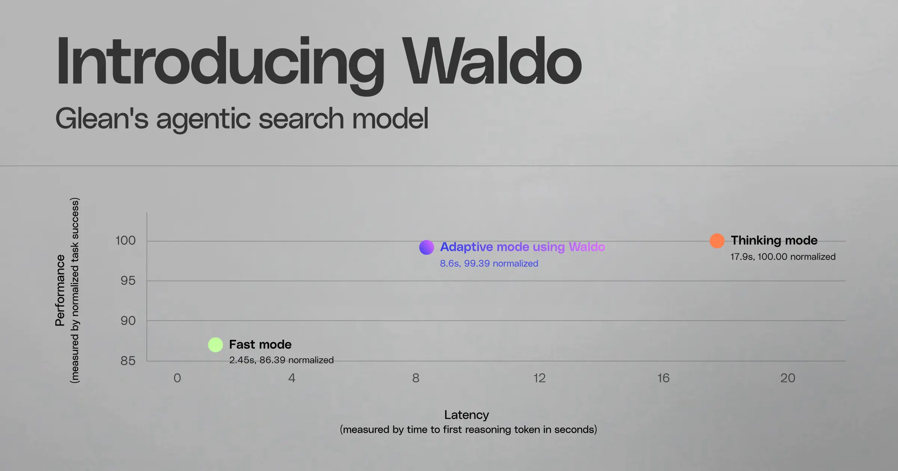
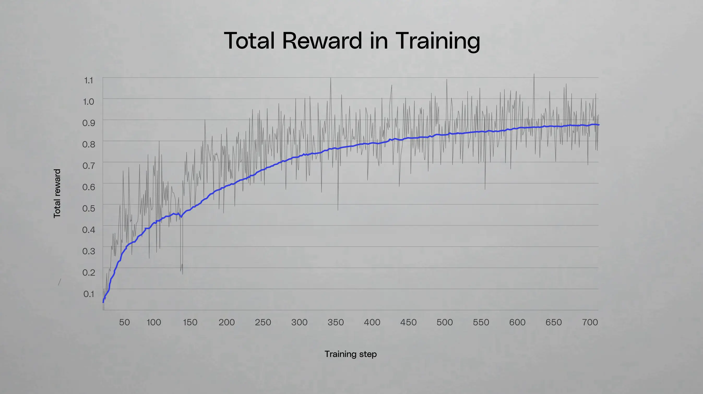
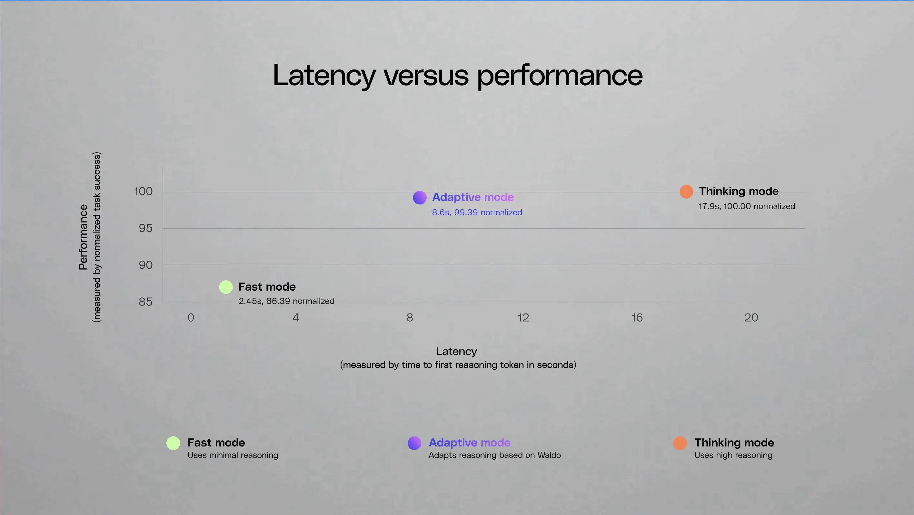

## Key Takeaways / 核心洞察

> 阅读笔记（凡哥）：以下 3 点为归档时补充的解读与引申，非原文内容；原文全文与逐段中英对照见下文。

### 1. Waldo runs before the frontier model / Waldo 在前沿模型之前运行

**原文明确写出**：`Waldo is a reinforcement-learned agentic search model that runs before a frontier model is invoked` —— 它是在前沿模型被调用之前运行的、经强化学习训练的智能体搜索模型，负责在固定工具集（Glean Search、员工搜索、网页搜索）上执行短工具计划；凑够证据或发现任务超出搜索能力时，不生成自然语言，直接把检索到的上下文交给前沿模型，且让前沿模型看到「同样的消息、同样的工具输出」，就像它自己完成了搜索。补充两个容易略过的细节：训练是**两阶段**（Phase 1 用 DPO 偏好对做监督预热，Phase 2 才用任务特定奖励信号做强化学习），不是纯 RL 一步到位；底模是 NVIDIA Nemotron 3 Nano（MoE，30B 总参数 / 3B 激活参数），用 Thinking Machine Labs 的 Tinker API 做 LoRA 微调，并刻意以 instruct 方式而非推理模式使用以压低延迟。训练数据只取工具使用轨迹（调用了哪些工具、顺序、是否成功），**不碰客户数据与文档内容**。

### 2. Initial step, not a sub-agent / 初始步骤而非子代理

**原文明确写出**：关键架构决策是把 Waldo 作为**初始步骤**运行，而不是让前沿模型把它当子代理调用。团队确实考虑过子代理方案，因为「编排故事更清晰」（orchestration story cleaner），但延迟太高：在子代理设计里，哪怕只是一次简单搜索，也要走**三次串行推理** —— 前沿模型决定调用 Waldo → Waldo 执行搜索 → 前沿模型生成回答。把 Waldo 放在最前面，最好情况下只需一次前沿模型调用，因为搜索工作已经完成。这是一次典型的「编排清晰度 vs 端到端延迟」取舍：为了省掉两次串行推理，宁可让编排逻辑不那么漂亮。

### 3. Latency & tokens: what it really is / 延迟与 token 收益，以及「锦上添花」的判断

**原文明确写出**：单次 LLM 调用维度，Waldo 比默认推理模型（GPT-5.4 medium）快 10 倍以上（平均 ≈250 ms 对比 ≈3 s）；集成进 harness 后，端到端延迟降低 ≈50%、token 减少 ≈25%，且质量无回退；约一半查询留在 fast path，用最少推理即可完成，不需要前沿模型的全部能力。此外 Waldo 前置还带出第二个收益 —— 自适应推理：用它的工具调用次数、返回文档数、输出是否稀疏，来判断该任务需要哪一档推理强度。

**事实校准**：文章页面日期是 **Apr 28, 2026**（Last updated 与 `og:publish_date` 一致），文末写的是 `Availability: Waldo will be deployed to customers soon.` —— 即发布当时还**未**向客户部署；「26 年 4 月才推出」应理解为「Waldo 模块 2026 年 4 月才发布」，不是 Glean 产品在 2026 年才推出。原文还有一句很关键：`None of that gets replaced by Waldo; it gets augmented by it.` —— 多年沉淀的企业语义搜索模型与 Enterprise Graph 一层不换，Waldo 只新增「搜索规划」这一层，检索质量仍来自既有基础设施。（笔记作者的推断，非原文结论：正因为它不替换底座、只优化高频且定义明确的搜索规划环节，把它看成成熟检索体系之上的**锦上添花 / 增量优化模块**是合理的；原文自己则把它定位为 `Glean’s first agentic search model`，并认为「小专用模型 + 前沿模型」会成为常态。由发布时间反推产品定位属于归纳，不是文档给出的因果。）

> 作者: Eddie Zhou（Engineering）、Kunal Patil（Software Engineer）、Abhilash Samantapudi（Product Manager）、Julie Mills（PMM） | 页面日期: Apr 28, 2026（Last updated） | 阅读时长: 6 分钟

> 原文链接: https://www.glean.com/blog/waldo-launch

Glean is used for tasks ranging from simple searches to deep work like data analysis, content creation, and taking action. Although we've historically used frontier models for search tasks, we’ve recently found that specialized models can do the job more efficiently. That's why we’re introducing Glean’s first agentic search model, nicknamed Waldo, which decides how to break down the question, which tools to use, what to read next, and when it has enough evidence to hand off to a frontier model for a high-quality answer.

Glean 被用于从简单搜索到数据分析、内容创作、执行动作等深度工作的各类任务。尽管我们过去一直用前沿模型承担搜索任务，但最近发现专用模型能把这件事做得更高效。因此我们推出 Glean 首个智能体搜索模型，昵称 Waldo：它决定如何拆解问题、用哪些工具、接下来读什么，以及什么时候证据已经足够、可以交给前沿模型生成高质量回答。

We believe the future of enterprise AI includes not just specialized tools, but specialized models designed for high-demand, well-defined jobs where latency and cost can be optimized. While frontier models can handle information retrieval on their own, doing so is often slower and more expensive than necessary. The better approach is a dedicated model, like Waldo, that works in concert with frontier models to deliver end-to-end agentic outcomes.

我们认为企业 AI 的未来不只有专用工具，还会有为「高频、定义明确、延迟与成本可优化」的工作而设计的专用模型。前沿模型当然能自己完成信息检索，但那样往往更慢、更贵，超出必要。更好的做法是像 Waldo 这样的专用模型与前沿模型协同，交付端到端的智能体结果。

Waldo doesn't just gather information. By running first and building up context before the frontier model ever sees the query, it becomes a natural input to a decision on the reasoning required for the job: does this query need a lightweight fast response, or should it be escalated to a higher reasoning level? The context from Waldo, including which tools were used, the number of searches, and semantic matching of the query against high-complexity and low-complexity tasks, helps determine the reasoning level required.

Waldo 不只是收集信息。因为它先运行、在前沿模型看到查询之前就把上下文搭建好，它自然成了「这个任务需要多少推理」这一判断的输入：这个查询需要轻量的快速回答，还是该升级到更高的推理档位？Waldo 带来的上下文 —— 用了哪些工具、搜索了多少次、查询与高复杂度／低复杂度任务的语义匹配 —— 帮助决定所需的推理档位。

On its own, Waldo is more than 10x faster than our default reasoning model (GPT-5.4 medium) on a per-LLM call basis, with average latency improvements of ≈250 ms versus ≈3s. Integrated into our harness, that translates into ≈50% lower latency and ≈25% fewer tokens with no quality regression. Built for enterprise search, Waldo uses [NVIDIA Nemotron 3 Nano](https://huggingface.co/nvidia/NVIDIA-Nemotron-3-Nano-30B-A3B-BF16) as its base model and is post-trained for search planning.

单看 Waldo 本身，在单次 LLM 调用维度上比我们的默认推理模型（GPT-5.4 medium）快 10 倍以上，平均延迟 ≈250 ms 对比 ≈3 s。集成进我们的 harness 后，转化为端到端延迟降低 ≈50%、token 减少 ≈25%，且质量没有回退。为企业搜索而建，Waldo 以 [NVIDIA Nemotron 3 Nano](https://huggingface.co/nvidia/NVIDIA-Nemotron-3-Nano-30B-A3B-BF16) 为底模，并针对搜索规划做后训练。

This post covers how we built Waldo, how we trained it, and the design decisions we made along the way.

本文讲述我们如何构建 Waldo、如何训练它，以及过程中做过的架构决策。

## Most enterprise work starts with search / 大多数企业工作都从搜索开始

When we analyzed query patterns in Glean, one thing stood out: regardless of how complex the end goal is, most tasks start with search. When a user needs information about a project, a customer, a process, or a decision, Glean searches internal documents, reads results, and synthesizes an answer. Sometimes this takes one search; often it takes several iterative loops of reading a result, refining the query, and searching again. Even tasks that eventually require document creation, workflow execution, or cross-system actions begin with this context-gathering phase.

分析 Glean 的查询模式时，有一点特别突出：无论最终目标多复杂，大多数任务都从搜索开始。用户想了解某个项目、客户、流程或决策时，Glean 会检索内部文档、阅读结果、综合成答案。有时一次搜索就够；更多时候要反复迭代 —— 读一条结果、改写查询、再搜一次。即便最终要创建文档、执行工作流或跨系统操作，任务也都是从「收集上下文」这一阶段起步。

Frontier models handle this well, but they're doing two very different jobs at once: *planning what to search for* and *reasoning about what they found to generate a response*. The first job is relatively mechanical: pattern matching over query intent, tool selection, and evidence sufficiency. The second job requires deep reasoning, long-context synthesis, and nuanced generation. Bundling both into a single expensive model means you're paying frontier-model prices for search planning, and you're adding latency on every turn of the loop.

前沿模型能把这件事做好，但它们同时在干两件性质完全不同的活：*规划该搜什么*，以及*基于搜到的内容进行推理并生成回答*。第一件相对机械：对查询意图做模式匹配、选工具、判断证据是否充分；第二件需要深度推理、长上下文综合和细腻的生成。把两者塞进同一个昂贵模型，等于用前沿模型的价格为搜索规划买单，并且在这个循环的每一轮都叠加延迟。

When you have a well-defined task that runs at high volume, what we found is that it's worth isolating it into a smaller, purpose-trained model rather than using a general-purpose reasoning model. The cost of the frontier model is better spent on synthesis and response generation.

我们的发现是：当一个任务定义明确、调用量又高时，把它隔离出来交给更小的专用训练模型，比继续用通用推理模型更划算。前沿模型的成本更应该花在综合与回答生成上。

## Waldo is an agentic search model / Waldo 是一个智能体搜索模型

Waldo is a reinforcement-learned agentic search model that runs *before* a frontier model is invoked. Its job is to execute short tool plans over a fixed toolset, including Glean Search, employee search, and web search, then hand off control to the frontier model with the retrieved context already in place.

Waldo 是一个经强化学习训练的智能体搜索模型，运行在*前沿模型被调用之前*。它的工作是在固定工具集（Glean Search、员工搜索、网页搜索）上执行短工具计划，然后在检索上下文已经就位的情况下，把控制权交给前沿模型。

Waldo searches until it has enough context or recognizes that the task needs capabilities beyond search (document creation, code execution, write tools). On completion, it doesn't generate natural language. It hands off control to the frontier model, which sees the conversation as if it had done the search work itself: same messages, same tool outputs.

Waldo 会一直搜索，直到上下文足够，或识别出任务需要搜索之外的能力（创建文档、执行代码、写工具）。完成时它不生成自然语言，而是把控制权交给前沿模型；前沿模型看到的对话就像它自己完成了搜索一样：同样的消息、同样的工具输出。

The key architectural decision was running Waldo as an initial step rather than having the frontier model invoke it as a sub-agent. We considered the sub-agent approach because it makes the orchestration story cleaner, but the latency was too great. In the sub-agent design, even a simple one-search query requires three serial inference steps: the frontier model decides to call Waldo, Waldo does the search, then the frontier model generates the response. Making Waldo the first model to be called can result in the best-case scenario of just one frontier model call, since Waldo has already done the work.

关键架构决策是：把 Waldo 作为初始步骤运行，而不是让前沿模型把它作为子代理调用。我们考虑过子代理方案，因为它能让编排逻辑更清晰，但延迟太高。在子代理设计中，即使是一次简单的单次搜索查询，也需要三个串行推理步骤：前沿模型决定调用 Waldo，Waldo 执行搜索，然后前沿模型生成响应。让 Waldo 成为第一个被调用的模型，最好情况下只需一次前沿模型调用，因为 Waldo 已经把活干完了。

## Training: DPO + reinforcement learning / 训练：DPO + 强化学习

Our training pipeline has two phases: supervised warmup followed by reinforcement learning with a task-specific reward signal. We used [Thinking Machine Labs’ Tinker API](https://github.com/thinking-machines-lab/tinker-cookbook) for LoRA-based fine-tuning which let us efficiently adapt the model without managing distributed training infrastructure.

我们的训练流水线分两个阶段：先做监督预热，再用任务特定的奖励信号做强化学习。我们用 [Thinking Machine Labs 的 Tinker API](https://github.com/thinking-machines-lab/tinker-cookbook) 做基于 LoRA 的微调，无需管理分布式训练基础设施就能高效适配模型。

Waldo is a search *planner*. It decides which queries to run and when to stop, but the actual retrieval quality comes from Glean's existing search infrastructure, the product of years of work building enterprise semantic search models that learn a company's language and an Enterprise Graph that understands relationships across people, content, and systems. None of that gets replaced by Waldo; it gets augmented by it. What Waldo needs to learn is coverage: how many searches to run, how to vary the queries, and when the retrieved evidence is sufficient.

Waldo 是搜索*规划器*。它决定跑哪些查询、什么时候停，但真正的检索质量来自 Glean 既有的搜索基础设施 —— 那是多年工作的产物：能学会一家公司语言的企业语义搜索模型，以及理解人员、内容、系统之间关系的 Enterprise Graph。这些都没有被 Waldo 替换，而是被它增强。Waldo 要学的是覆盖度：跑多少次搜索、如何变换查询、以及检索到的证据何时才算充分。

### Phase 1: Direct preference optimization (DPO) / 阶段一：直接偏好优化（DPO）

The first phase uses DPO to get the base model into the right behavioral space. DPO works by training on preference pairs: for each query, the model sees a "preferred" output and a "rejected" output, and learns to assign higher likelihood to the preferred one. Over many pairs, the model's behavior shifts toward the preferred distribution without needing an explicit reward function.

第一阶段用 DPO 把底模带进正确的行为空间。DPO 的训练方式是偏好对：对每个查询，模型同时看到「偏好」输出和「拒绝」输出，学习给偏好输出更高的概率。经过大量配对，模型行为会向偏好分布迁移，而无需显式奖励函数。

We construct these pairs from high-quality, anonymized production traces from Glean’s own deployment. Importantly, Waldo never trains on customer data or document content. The traces capture only tool-use patterns: which tools were called, in what order, and whether the plan succeeded. For the preferred side of each pair, when the production system uses core tools (search, document reader), we extract the tool plan. When the task doesn't require core tools, the preferred output is a pass-through or handoff signal. For the rejected side, we sample outputs from the base model and filter to cases that are non-trivially different from the production behavior.

这些偏好对来自 Glean 自家部署中高质量、匿名化的生产轨迹。重要的是，Waldo 从不在客户数据或文档内容上训练。轨迹只记录工具使用模式：调用了哪些工具、顺序如何、计划是否成功。构造偏好侧时，若生产系统用了核心工具（搜索、文档阅读器），就抽取它的工具计划；若任务不需要核心工具，偏好输出就是直通或交接信号。拒绝侧则从底模采样输出，并筛出与生产行为有实质差异的样本。

This is a model trained on *how to use tools*, not on enterprise data. Its purpose is conditioning: teaching the model the basic vocabulary of "when to search, when to stop, when to hand off."

这是一个训练在*如何使用工具*上、而非企业数据上的模型。它的作用是条件化：教会模型「何时搜索、何时停止、何时交接」这套基本词汇。

### Phase 2: Reinforcement learning / 阶段二：强化学习

This is the phase that enables Waldo to create *better* plans than the production system. We roll the model out against production queries and reward it based on outcomes.

这一阶段让 Waldo 能做出比生产系统*更好*的规划。我们让模型在真实生产查询上 rollout，并按结果给奖励。

For queries where search was needed, the reward has two components. First, a binary termination signal indicating whether Waldo determined that core tools were sufficient or not. Second, a recall/F1-based reward signal against the documents that the production system cited in the final response. After the full system produces a final response, we look at which documents it actually cited, and then work backward to ask: did Waldo's searches surface those documents? Recall measures whether Waldo found all the documents that ended up mattering. F1 then balances recall and precision, penalizing Waldo if it retrieves a lot of noise alongside the relevant documents.

对于需要搜索的查询，奖励有两部分。第一是二值的终止信号，表示 Waldo 是否判定核心工具已经够用。第二是基于 recall/F1 的奖励信号，对照生产系统在最终回答里实际引用的文档：等整个系统给出最终回答后，回看它引用了哪些文档，再倒推提问 —— Waldo 的搜索有没有把这些文档捞出来？Recall 衡量 Waldo 是否找齐了最终真正重要的文档；F1 再平衡召回与精确率，如果它在相关文档之外捞回大量噪声，就扣分。

What’s interesting is that if the production system took several iterative searches to find a document, Waldo can learn to find it in one. The reward signal doesn't care *how* Waldo got there; it cares whether the right evidence was retrieved.

有意思的是：如果生产系统要迭代搜索好几轮才找到某篇文档，Waldo 可以学会一次就找到。奖励信号不关心 Waldo *怎么*做到的，只关心是否检索到了正确的证据。

We train on production traces from Glean’s own deployment, and we’ve seen the model generalize well to external customer deployments. The base model is Nemotron 3 Nano (a mixture-of-experts architecture with 30B total parameters and 3B active parameters), chosen for its latency and cost profile. We deliberately chose to use Nemotron in an instruct-based fashion, rather than with reasoning, so we could push the boundaries on latency as our post-training environment allows us to achieve our quality goals without a reasoning model.

我们用 Glean 自家部署的生产轨迹训练，并观察到模型能很好地泛化到外部客户部署。底模是 Nemotron 3 Nano（混合专家架构，30B 总参数、3B 激活参数），选它是因为延迟与成本特性合适。我们刻意以 instruct 方式而非推理模式使用 Nemotron，以便把延迟压到极限 —— 后训练环境已经能在不用推理模型的情况下达成质量目标。

*Waldo’s reward curve improved quickly in the first 100 to 200 training steps, continued to rise through the middle of training, and then flattened toward the end, suggesting that additional training still helped but delivered smaller gains than earlier steps.*

Waldo 的奖励曲线在最初 100 到 200 个训练步内快速提升，训练中期继续上升，后期趋于平缓；这说明继续训练仍有收益，但增益小于早期阶段。

## From Waldo to adaptive reasoning / 从 Waldo 到自适应推理

Waldo solved the information-gathering problem, but it also uncovered a second opportunity: using the agentic search model's signals to dynamically determine how much reasoning a task requires.

Waldo 解决了信息收集问题，但也带出第二个机会：用智能体搜索模型自身的信号，动态判断一个任务需要多少推理。

Because Waldo runs first, its own execution becomes the basis for that decision. It knows how many tools it invoked, how many documents came back, and whether its outputs were empty or sparse. In other words, it knows how much it struggled. A query that triggered multiple tool calls but returned little relevant content is a strong signal that a lightweight model won't be enough. When Waldo determines the task needs tools beyond search to take action or execute code, that handoff signal becomes another routing input, one the model produces naturally as part of its workflow. By reading its own work and weighing it against the complexity of the original request, the agentic search model decides how much reasoning is needed.

因为 Waldo 先运行，它自己的执行过程就成了这个判断的依据：它知道自己调了多少次工具、返回了多少文档、输出是否为空或稀疏 —— 换句话说，它知道自己「吃力」到什么程度。一个触发多次工具调用却几乎没拿到相关内容的查询，是「轻量模型不够用」的强信号。当 Waldo 判定任务需要搜索之外的工具去执行动作或跑代码时，这个交接信号又成为一个路由输入，而且是模型在工作流里自然产生的。通过读取自己的执行结果、并与原始请求的复杂度权衡，智能体搜索模型决定所需的推理强度。

*The measure of the model looking at the latency by performance profile. Adaptive mode, using Waldo, was able to cut the latency in half while retaining similar performance, as measured by normalized task success.*

按性能档位衡量模型延迟。以归一化任务成功率衡量，使用 Waldo 的自适应模式能把延迟减半，同时保持相近的表现。

## Cost and latency savings from specialized models / 专用模型带来的成本与延迟收益

By combining Waldo with a frontier model, Glean was able to deliver ≈50% lower latency and ≈25% lower tokens while maintaining similar quality. We found that about half of all queries stay on a fast path with minimal reasoning, never need a frontier model's full capacity, and come without sacrificing answer quality.

把 Waldo 与前沿模型结合后，Glean 在质量基本不变的前提下，实现延迟降低 ≈50%、token 减少 ≈25%。我们发现约一半查询停留在最少推理的快路径上，从不需要前沿模型的全部能力，也不牺牲回答质量。

We think this pattern of small specialized models working in concert with frontier models will become increasingly common as agentic systems mature. Not every task in the pipeline needs frontier-level intelligence, and recognizing that is a meaningful step towards building systems that are both more capable and more efficient.

我们认为，随着智能体系统走向成熟，「小型专用模型与前沿模型协同」这种模式会越来越常见。流水线里并非每个任务都需要前沿级智能，认清这一点，是构建既更强又更高效系统的重要一步。

Availability: Waldo will be deployed to customers soon.

上线情况：Waldo 即将向客户部署。
