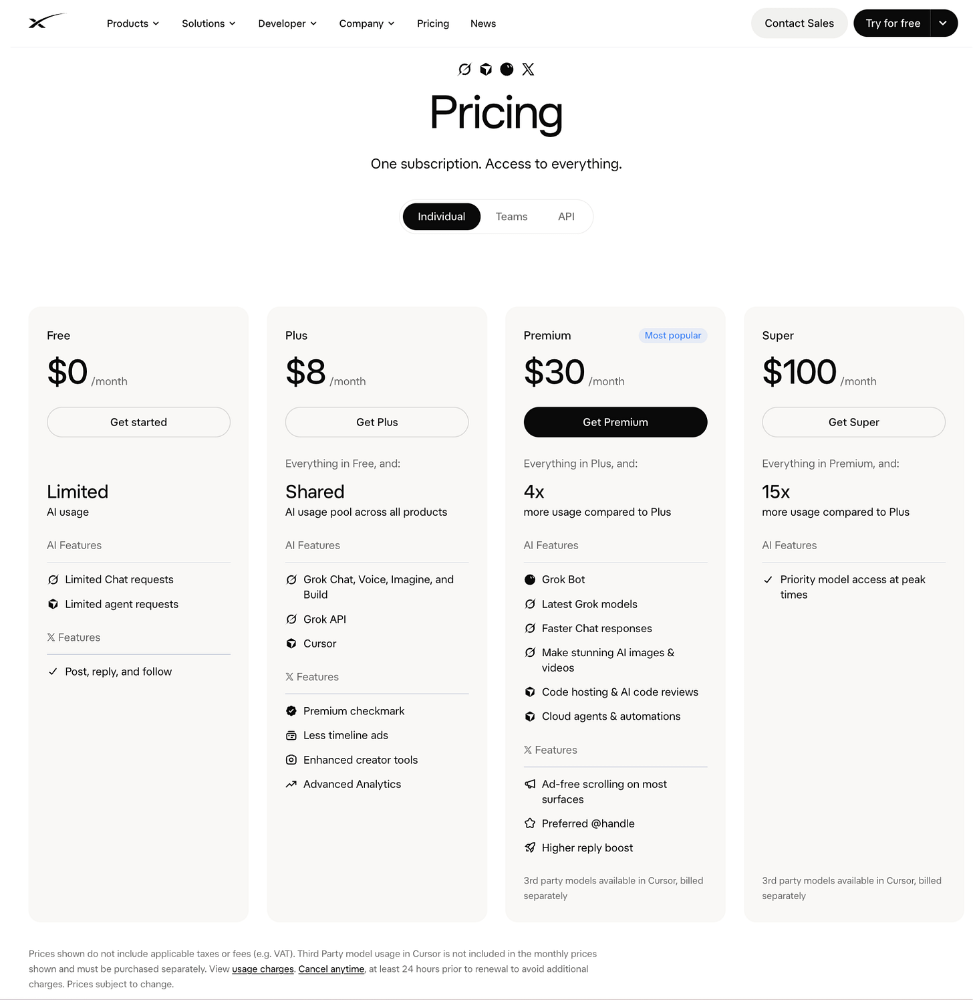
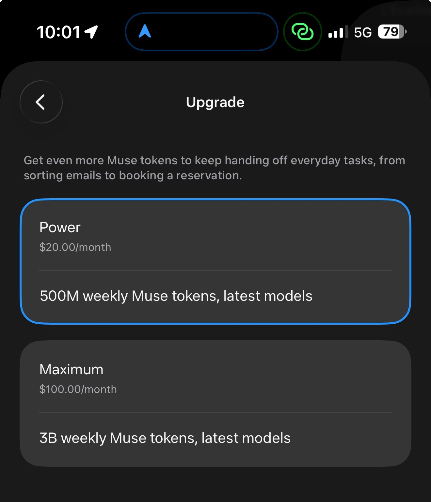
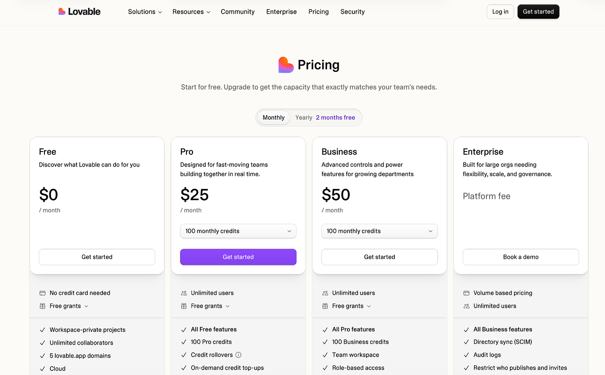
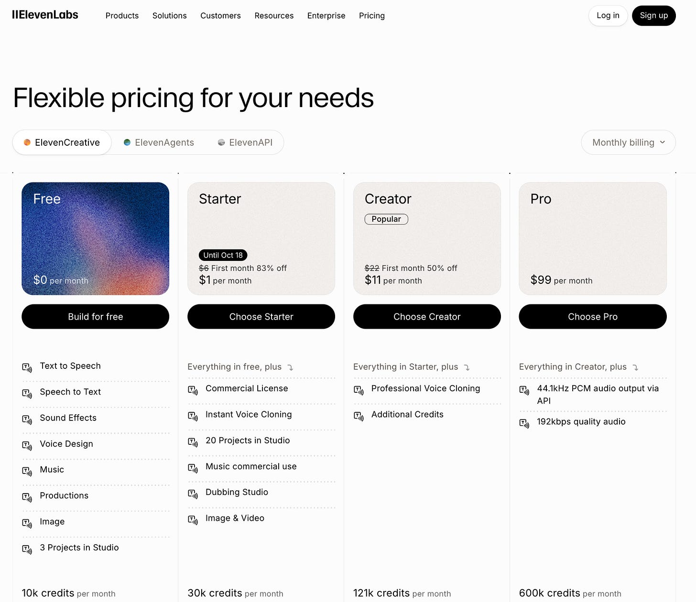
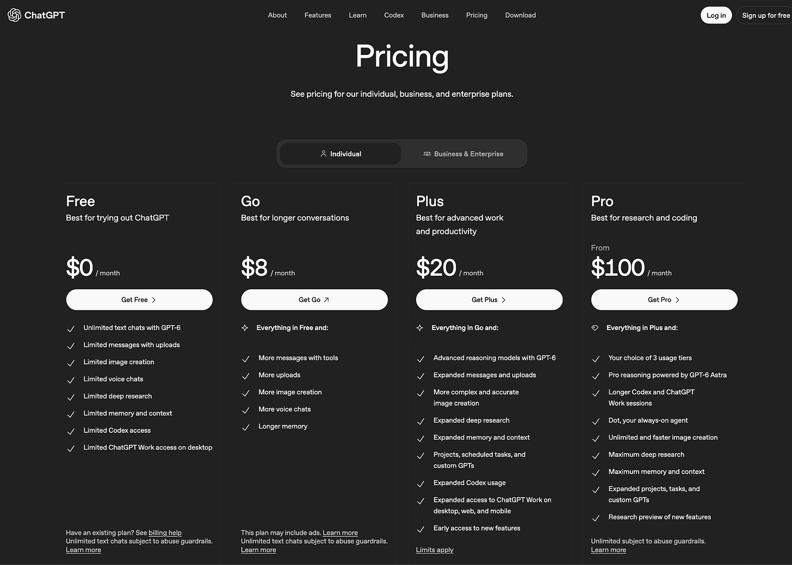
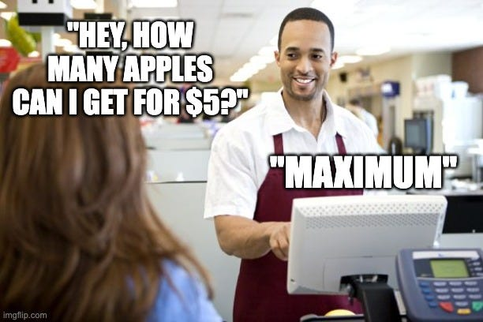
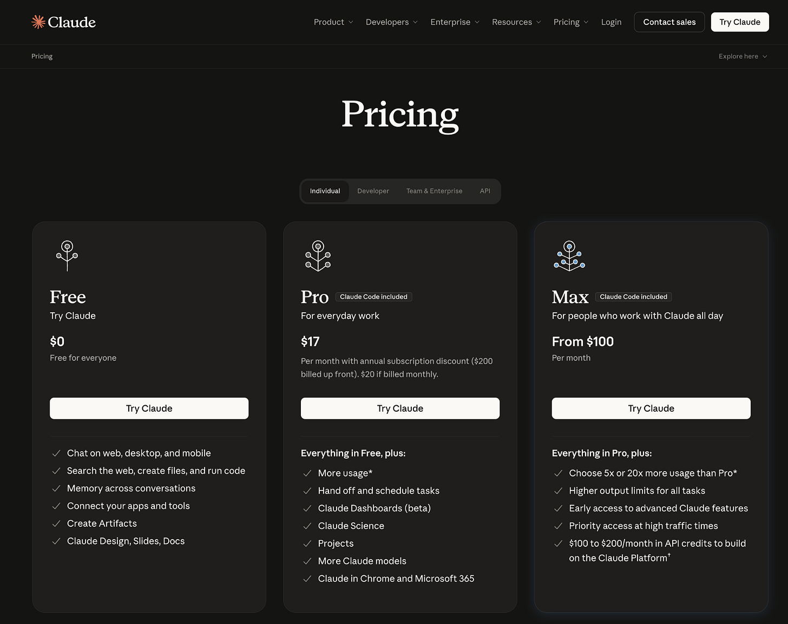

# What on earth is going on with AI pricing and packaging?

*AI companies have a pricing problem. And I work in AI…*

> 作者: Elena Verna | 日期: 2026-10-16T22:22:50+08:00

> 原文链接: https://www.elenaverna.com/p/what-on-earth-is-going-on-with-ai

---

I recently went down a rabbit hole looking at AI pricing pages, trying to answer what I thought was a pretty basic question: If I pay $20 a month for an AI product, what exactly am I getting? How much can I use it? And how do I know if I need the $20 plan, the $100 plan, or the “contact sales and surrender your firstborn” plan?

I’ve spent an embarrassing amount of my career obsessing over pricing and packaging and most importantly I work for an AI company, so I assumed I could figure this out. Turns out, I have vastly overestimated my qualifications.

Some companies promise 5x more usage without explaining 5x of WHAT. Others give you hundreds of millions of tokens, which sounds generous until you realize you have no idea what a token buys you. Some have decided that having a pricing page is optional.

Just imagine interviewing someone who tells you they’ll cost 500 million tokens a week, or that for twice the salary they’ll do “5x more work,” without telling you how much work they do today. Funny, right? In AI, we call that a pricing page.

And here’s the fascinating part: these companies are WILDLY successful. Millions of users, eye-watering valuations, explosive growth. Apparently, understanding what you’re paying for is no longer a prerequisite for buying software.

Before anyone accuses me of throwing stones from my very glass house, I lead growth at Lovable, and we have the same problem. We sell credits for a product that can build websites, apps, internal tools, presentations, and whatever else someone dreams up tomorrow. Good luck wrapping that into three subscription tiers.

But maybe we’re not all just terrible at pricing. AI products can do almost anything, and the cost of doing it can vary wildly. Unlike traditional SaaS, where we could reasonably charge for seats, storage, or transactions, we’re now trying to price work that neither the customer nor the company can reliably predict.

So far, the industry is getting away with it because the products are just that good and new and exciting. But will that last? Early adopters will tolerate mystery credits and surprise usage limits. The mass market? I’m less convinced.

Let’s examine a few:

---

*Thank you to my sponsors, who make this newsletter possible!*

**SurveyMonkey: All the insights. One platform. **Not just surveys. Market research, employee engagement, customer insights, brand tracking, NPS monitoring—everything connected on one platform**. Try SurveyMonkey for free today!!**

*(This is a full circle moment for me because I started my career at SurveyMonkey! Will always be rooting for them :))*

---

## GrokBot

One of the very hyped products out there right now, giving all kinds of people all kinds of agents. So, how do they do pricing?

This starts out pretty simple - 4 plans. Easy! But… what’s the actual amount of AI usage are you getting? Grok has somehow built an entire pricing strategy around multiplying a number they refuse to tell you.

Premium gets 4x more usage than Plus. Super gets 15x more. Except nowhere does it explain how much usage Plus actually includes. So we’re multiplying an unknown number by increasingly impressive numbers and calling it pricing.

## Muse

Muse is on fire right now and has a pretty amusing approach to pricing: just don’t have a pricing page in logged out state at all. I searched everywhere and the closest thing I found was a Facebook Answers post. Apparently, pricing is now a community-sourced mystery.

They do have pricing in-app: $20/month for 500 MILLION tokens per week.

Half a billion! Of something! I have no idea what that buys me, but I’m pretty sure I’m supposed to be impressed.

P.S. Extra credit for charging on monthly frequency, but giving tokens on the weekly basis.

## Lovable

I’m not sparing my own company either… we have this issue, too:

So, we give you credits… but what does that mean? $25/mo gives you 100 Pro credits, but no one knows what that means until you start building and see it for yourself. I’d love nothing more than to tie our pricing to outcomes, whether that’s hosting, a take rate on GMV (hi, Shopify!), or something else entirely. But ideally, we’d still be in business by the time you get there (and right now we wouldn’t).

## Instinct

So hot right now. This is their site.

Which brings us to the fact that if your AI product is awesome right now, you don’t need pricing figured out to get a ton of users. You don’t even need a proper marketing website. You can just launch, go viral, and worry about all those pesky things we used to consider prerequisites for running a legitimate company later. What a time to be alive. Anyway, moving on.

## 11Labs

Their pricing is similar to Lovable’s: credits! Except they give you WAY more of them. Because why give someone 100 imaginary dollars when you can give them 10,000? Welcome to arcade economics, where the money is made up and the numbers are designed to impress.

But wait.. there is more! a LOT more.

It is flexible alright. Human brain is not evolved enough to be able to comprehend this many plan options and decision making dimensions.

## ChatGPT

Now let’s talk about what the big boys and girls are up to:

Four plans for individuals. The Free plan’s feature list is basically just “Limited” copy-pasted all the way down. The first paid plan (‘Go’) offers a highly quantitative increase of ‘More’ across 4 of the elements.

The Plus and Pro plans pretty much just choose a different adjective and copy-paste down the line: Either taking your ‘Limited’ or ‘More’ access and then leveling it up to ‘Expanded’ or ‘Maximum.’

## Anthropic

Perhaps it’s more clear from their frenemies over at Anthropic?

At least the Free tier isn’t so blatantly framed as a second-class citizen. But… yeah, when I pay for Pro I get… ‘More usage’! More than… what? There’s that helpful little * there… that doesn’t actually connect to anything below. And Max is 5x or 20x more usage. That sure is a lot more than whatever it’s a lot more than!

## So what on earth do we do about this?

I think there are four things happening simultaneously, and they’re making an already complicated problem considerably worse.

### 1. We’ve invented arcade money for AI

Let’s start with something we’ve been doing in pricing for decades: making money feel less like money. There’s a concept in behavioral economics called mental accounting, which helps explain why people treat different forms of money differently. It’s why casinos have chips, arcades have tokens, and every other mobile game seems to have its own imaginary currency that somehow requires you to buy 1,200 gems to purchase something that costs 950.

AI companies have enthusiastically adopted this approach. Instead of dollars, we give people credits, tokens, compute units, and whatever other imaginary currency our pricing teams come up with. And yes, these currencies can make it harder to understand what you’re actually spending. When you’re using 12 credits instead of $3, you might be less inclined to think about the real cost.

But here’s where I have to defend the industry, including Lovable. Credits aren’t necessarily a sinister monetization scheme. They can solve a real problem. When your product has multiple AI models, tools, and actions that each have different underlying costs, a common currency makes it possible to package them into something resembling a subscription. Otherwise, we’d essentially be asking customers to manage a miniature AWS bill every time they wanted to accomplish something.

The problem isn’t necessarily that we invented these currencies. It’s that we’ve done a bad job explaining what they’re worth. If I give someone 100 Lovable credits, I should be able to help them understand roughly what they can accomplish with them. Otherwise, I’m not really selling them 100 units of value. I’m selling them 100 units of mystery. But this is incredibly hard when you have AI doing something custom for every customer!

### 2. We’ve confused bigger numbers with more value

Once you invent a currency, you can make the numbers as big as you want. Why give someone 100 credits when you could give them 10,000? Or 500 million tokens? Bigger numbers create an impression of generosity :)

And notice how much of AI pricing is framed around quantities rather than value. More tokens. More credits. Maximum messages. Extended access.

Nobody wakes up wanting 500 million tokens (sorry Muse). They wake up wanting to get something done. But we have no idea what our products can even do for our customers, since AI leaves it so open ended. So we are stuck once again.

### 3. We don’t know what unit we charge for anymore

This is where the problem gets genuinely interesting. Traditional SaaS had its own pricing problems, but at least we generally had some reasonably understandable ways to measure consumption. You could charge per seat, per transaction, per gigabyte of storage, or per API call. These weren’t perfect measures of customer value, but they were usually predictable enough that someone could estimate what they needed before buying.

AI has made that considerably more complicated. What exactly is the unit of consumption for an agent that can research your competitors, create a marketing campaign, build an application, or handle your customer support? Is it the number of messages you send? The number of tasks it completes? The time it spends working? The number of times it calls another tool? And more importantly, which of those measurements would actually make sense to the customer?

Some products have it easier. ElevenLabs can charge by minutes of generated audio or agent calls. Firecrawl can translate credits into pages scraped or searches performed. Those units aren’t perfect, but at least they’re connected to something a customer can imagine needing.

But the more general-purpose the product becomes, the harder this gets. An agent that can do almost anything doesn’t have one obvious unit of value. If we charge by the hour, customers might wonder why they’re paying more for a slow agent. If we charge by the task, how do we distinguish between answering an email and building an entire application? And if we charge for successful outcomes, who decides what success means?

The irony is that we’re building increasingly sophisticated AI systems capable of doing work we couldn’t have imagined automating a few years ago, and then asking customers to estimate how many tokens they’ll need to use them.

It’s like selling someone a car and asking them to estimate how many times the engine will fire… whut.

### 4. We don’t even know what it will cost us

And here’s the part that makes this genuinely difficult for AI companies. We aren’t just struggling to predict what customers will do with our products. We’re also struggling to predict what those actions will cost us.

In traditional SaaS, serving another customer wasn’t free, but the marginal cost was often relatively low and predictable. You could offer a subscription with generous usage allowances and have a pretty reasonable idea of the economics. AI changes that equation because every additional interaction can carry a meaningful inference cost, and different interactions can consume vastly different amounts of resources. (This goes away if LLMs become basically free… but we are not there yet).

This is especially challenging with agents, because they’re not just responding to a single request. They can plan, execute multiple steps, call tools, make mistakes, retry, and decide that the task requires a completely different approach. Two customers might ask for essentially the same outcome, but the underlying work (and cost) could be dramatically different.

(P.S. And then there’s also FRAUD. Bots, stolen accounts, and people abusing free tiers. In traditional SaaS, a fake signup mostly messed up your conversion metrics. In AI, it ruins your bottom line. So now we have to predict not just what customers will use, but how creatively people will try to bankrupt us. Fun times!)

This is why I think the answer isn’t as simple as “just charge for outcomes.” I love outcome-based pricing in theory. It aligns the company’s success with the customer’s success, which is what pricing should ideally do. But it’s considerably harder to implement when the same outcome can have wildly different delivery costs, when outcomes are difficult to define, or when the customer and the AI company disagree about whether the job was successfully completed.

## Sorry, customers. We’re working on it.

I don’t have a magical answer to AI pricing, which is somewhat disappointing given how many years I’ve spent thinking about monetization. But I do think this is going to become one of the most important problems AI companies need to solve as the technology moves beyond early adopters.

Right now, we’re surrounded by people who are willing to tolerate a ridiculous amount of complexity to use these products (Hi there, you AI pioneer! Yes, I’m talking to YOU). They’ll compare tokens, look up credit consumption, calculate model costs, and accept that their usage limits might change tomorrow. But those people aren’t the entire market. They’re the people who are enthusiastic enough about AI to put up with things most customers would find completely unacceptable.

If we want AI to reach a much broader audience, we can’t expect everyone to become an expert in inference economics just to figure out which subscription to buy. We have to make the cost of accomplishing something understandable, reasonably predictable, and within the customer’s control.

I think whoever figures this out first will have a massive competitive advantage. Not necessarily the company with the cheapest AI, the smartest model, or the most generous allocation of imaginary credits. But the company that can make AI pricing understandable, predictable, and aligned with customer value, without bankrupting itself in the process.

We’ve spent the last few years racing to make AI more powerful. The next big race might just be figuring out how to charge for it. And honestly, I’m not sure which is harder.

---

*Edited by Jonathan Yagel.*

---